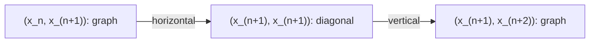
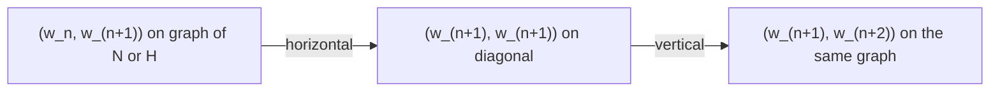

# Rudin exercises: statements and solutions

This article converts the exercise proofs in this repository from Lean into
mathematical prose. The source is Walter Rudin's *Principles of Mathematical
Analysis*, Third Edition. Statements below are summaries of the formal results,
not transcriptions of the book.

## Scope and reading guide

There is one entry for each of the **192 exercise files** currently present.
The [inventory](../../exercises.json) records **134 verified resolutions**:
128 proved as stated and six resolved by a counterexample and an explicit
correction. The remaining **58 entries** describe newer formalizations whose
inventory verification is pending. Some of those entries cover only part of
the source exercise; their limits are stated explicitly. This article does not
claim that all 287 exercises in the book are solved.

Each entry gives the mathematical statement, proof, Lean source, relevant
declarations, and inventory status. “Verified” refers to the repository's
recorded source review and proof checks, not to a new formal verification of
this prose. Short Lean declaration names refer to the namespaces in their
linked source files. “Pending verification” does not mean that an unproved source
claim has become a theorem. The Lean file fixes the exact formal scope.

Source corrections remain separate from the original claims. See the
[source record](source.md), [source issues](errata.md),
[clarification contracts](source-clarifications.md), and
[progress report](progress.md) for their context. This conversion does not
change the Lean files or their verification records.

The article uses standard mathematical notation:

- $\mathbb N$, $\mathbb Q$, $\mathbb R$, and $\mathbb C$ denote the natural,
  rational, real, and complex numbers. Sequence indices start where each
  formula specifies; Lean often shifts an index to start at zero.
- A convergent numerical series means convergence of its ordered partial sums.
  Absolute or unconditional convergence is stated when needed.
- Derivatives at a closed interval's endpoints are relative, one-sided
  derivatives where the statement permits them.
- Riemann–Stieltjes integrals keep the endpoint and jump conventions of the
  formal model. A measure integral is used only with the stated integrability
  hypotheses or comparison result.
- An almost-everywhere equality is not a pointwise equality.

## Contents

| Chapter | Article entries | Inventory-verified resolutions |
| --- | ---: | ---: |
| [1. The Real and Complex Number Systems](#chapter-01) | 20 | 20 |
| [2. Basic Topology](#chapter-02) | 30 | 30 |
| [3. Numerical Sequences and Series](#chapter-03) | 25 | 25 |
| [4. Continuity](#chapter-04) | 26 | 26 |
| [5. Differentiation](#chapter-05) | 29 | 29 |
| [6. The Riemann–Stieltjes Integral](#chapter-06) | 19 | 1 |
| [7. Sequences and Series of Functions](#chapter-07) | 26 | 0 |
| [8. Some Special Functions](#chapter-08) | 14 | 0 |
| [9. Functions of Several Variables](#chapter-09) | 1 | 1 |
| 10. Integration of Differential Forms | 0 | 0 |
| [11. The Lebesgue Theory](#chapter-11) | 2 | 2 |
| **Total** | **192** | **134** |

Chapter 8 contains Exercises 1–13 and 22; Chapter 9 contains Exercise 1;
Chapter 11 contains Exercises 1 and 18.
Other exercise numbers have no exercise proof file in this checkout.
Shared support lemmas and restricted prototypes are not additional solved
exercises. In particular, the Chapter 10 chain and integration support does
not establish complete Chapter 10 exercise solutions.

## Chapter 1 — The Real and Complex Number Systems

**Exercises:** [1](#r01e01) · [2](#r01e02) · [3](#r01e03) · [4](#r01e04) · [5](#r01e05) · [6](#r01e06) · [7](#r01e07) · [8](#r01e08) · [9](#r01e09) · [10](#r01e10) · [11](#r01e11) · [12](#r01e12) · [13](#r01e13) · [14](#r01e14) · [15](#r01e15) · [16](#r01e16) · [17](#r01e17) · [18](#r01e18) · [19](#r01e19) · [20](#r01e20)

### 1.1 — Rational operations preserve irrationality
**Lean source:** [Exercise01.lean](../../Math/Rudin/Chapter01/Exercise01.lean).
**Inventory status:** Verified as stated.

**Statement.** If $r\in\mathbb Q\setminus\{0\}$ and $x\in\mathbb R$ is irrational, both $r+x$ and $rx$ are irrational.

**Proof.** If $r+x$ were rational, subtracting $r$ would make $x$ rational. If $rx$ were rational, division by the nonzero rational $r$ would make $x$ rational. Both conclusions contradict the hypothesis.

**Lean declarations:** `exercise01`.

### 1.2 — No rational square root of twelve
**Lean source:** [Exercise02.lean](../../Math/Rudin/Chapter01/Exercise02.lean).
**Inventory status:** Verified as stated.

**Statement.** For every $q\in\mathbb Q$, $q^2\ne12$.

**Proof.** A natural number that is a rational square is an integer square. Indeed, if $q=a/b$ is in lowest terms with $b>0$, then $a^2=12b^2$ forces $b=1$, since $a^2$ and $b^2$ are relatively prime. But $3^2<12<4^2$, so $12$ is not an integer square. The Lean proof uses the standard rational-square criterion for natural numbers.

**Lean declarations:** `exercise02`.

### 1.3 — Multiplicative consequences of the field axioms
**Lean source:** [Exercise03.lean](../../Math/Rudin/Chapter01/Exercise03.lean).
**Inventory status:** Verified as stated.

**Statement.** In any field, let $x\ne0$.

1. If $xy=xz$, then $y=z$.
2. If $xy=x$, then $y=1$.
3. If $xy=1$, then $y=1/x$.
4. $1/(1/x)=x$.

**Proof.** Multiplication of $xy=xz$ by $x^{-1}$ gives $y=z$. Apply this cancellation first to $xy=x\cdot1$, and then to $xy=x(1/x)=1$, to obtain the second and third claims. Finally, $1/x\ne0$ and $(1/x)x=1$, so the third claim applied to $1/x$ gives $x=1/(1/x)$.

**Lean declarations:** `exercise03_a`, `exercise03_b`, `exercise03_c`, `exercise03_d`.

### 1.4 — Lower bounds precede upper bounds
**Lean source:** [Exercise04.lean](../../Math/Rudin/Chapter01/Exercise04.lean).
**Inventory status:** Verified as stated.

**Statement.** Let $E$ be a nonempty subset of a linearly ordered set. If $\alpha$ is a lower bound of $E$ and $\beta$ is an upper bound, then $\alpha\le\beta$.

**Proof.** Choose $x\in E$. The bound assumptions give $\alpha\le x\le\beta$, and transitivity gives the result.

**Lean declarations:** `exercise04`.

### 1.5 — Infimum by negation
**Lean source:** [Exercise05.lean](../../Math/Rudin/Chapter01/Exercise05.lean).
**Inventory status:** Verified as stated.

**Statement.** If $A\subseteq\mathbb R$ is nonempty and bounded below, then $-A=\{-a:a\in A\}$ is nonempty and bounded above, and

$$
\inf A=-\sup(-A).
$$

**Proof.** An element $a\in A$ gives $-a\in-A$. A lower bound $b$ of $A$ gives the upper bound $-b$ of $-A$. Write $s=\sup(-A)$. For each $a\in A$, $-a\le s$, hence $-s\le a$. Thus $-s$ is a lower bound of $A$. If $c$ is any lower bound, $-c$ bounds $-A$ above, so $s\le-c$ and $c\le-s$. Therefore $-s$ is the greatest lower bound.

**Lean declarations:** `exercise05`.

### 1.6 — Powers constructed from roots and suprema
**Lean source:** [Exercise06.lean](../../Math/Rudin/Chapter01/Exercise06.lean).
**Inventory status:** Verified as stated.

**Statement.** Fix $b>1$.

1. For $a>0$ and an integer $n>0$, there is a unique positive $u$ satisfying $u^n=a$. If integers $m,n,p,q$ satisfy $n,q>0$ and $m/n=p/q$, the positive $n$th root of $b^m$ equals the positive $q$th root of $b^p$. Thus these roots define $b^r$ unambiguously for $r\in\mathbb Q$, with every fraction representation giving the same value.
2. For $r,s\in\mathbb Q$, $b^{r+s}=b^rb^s$.
3. For real $x$, put

   $$
   B(x)=\{b^t:t\in\mathbb Q,\ t\le x\}.
   $$

   This set is nonempty and bounded above. For rational $r$, $b^r=\sup B(r)$. Consequently $b^x:=\sup B(x)$ extends the rational definition.
4. For real $x,y$, these supremum-defined powers satisfy $b^{x+y}=b^xb^y$.

**Proof.** To distinguish the construction from the library power function, write $P_b(x)$ for the standard real power. The standard laws for positive bases give

$$
P_a(1/n)>0,\qquad P_a(1/n)^n=a.
$$

If $u>0$ and $u^n=a$, raising both sides to the power $1/n$ gives $u=P_a(1/n)$. Thus the root selected by its defining equation exists, is unique, and equals this standard power. In particular, the positive $n$th root of $b^m$ is $P_b(m/n)$. Equal fractions therefore give equal roots, even when their numerators are negative. The standard addition law now gives the rational addition law.

Choose a rational $t<x$ to see that $B(x)$ is nonempty. Monotonicity gives $b^t=P_b(t)\le P_b(x)$ whenever $t\le x$, so $B(x)$ is bounded above. If $x=r$ is rational, $b^r$ belongs to $B(r)$ and bounds it above; it is therefore its maximum and supremum.

For arbitrary real $x$, let $S=\sup B(x)$. We already have $S\le P_b(x)$. If $z<P_b(x)$, continuity of $P_b$ gives a neighborhood of $x$ on which $P_b(t)>z$. Rational density supplies a rational $t<x$ in that neighborhood. Then $z<b^t\le S$. This proves $S=P_b(x)$. The standard addition law for $P_b$ now proves the addition law for the constructed real powers.

**Scope.** The roots and suprema are the actual definitions in the file. Their agreement with standard real powers is proved, not assumed as a definition. The condition in $B(x)$ is $t\le x$, including its endpoint.

**Lean declarations:** `exercise06_a`, `exercise06_root_exists`, `exercise06_root_spec`, `exercise06_rationalPower_fraction`, `exercise06_b`, `exercise06_c_supremum`, `exercise06_lowerPowers_nonempty`, `exercise06_lowerPowers_bddAbove`, `exercise06_realPower_eq_rpow`, `exercise06_c_real_power`, `exercise06_d`.

### 1.7 — A logarithm obtained from a supremum
**Lean source:** [Exercise07.lean](../../Math/Rudin/Chapter01/Exercise07.lean).
**Inventory status:** Verified as stated.

**Statement.** Fix $b>1$ and use the powers constructed in Exercise 1.6. For each $y>0$, there is exactly one real $x$ such that $b^x=y$. The construction has these seven steps:

1. $b^n-1\ge n(b-1)$ for each positive integer $n$; the formal result also includes $n=0$.
2. $b-1\ge n(b^{1/n}-1)$ for each positive integer $n$.
3. If $t>1$ and the positive integer $n$ satisfies $n>(b-1)/(t-1)$, then $b^{1/n}<t$.
4. If $b^w<y$, then $b^{w+1/n}<y$ for every sufficiently large positive integer $n$.
5. If $b^w>y$, then $b^{w-1/n}>y$ for every sufficiently large positive integer $n$.
6. $A=\{w\in\mathbb R:b^w<y\}$ is nonempty and bounded above, and $x=\sup A$ satisfies $b^x=y$.
7. Any two solutions coincide.

**Proof.** Bernoulli's inequality, applied to $b=1+(b-1)$, gives (1). Apply (1) with base $b^{1/n}>1$ and use $(b^{1/n})^n=b$ to get (2). Under the hypothesis of (3),

$$
n(b^{1/n}-1)\le b-1<n(t-1),
$$

which gives $b^{1/n}<t$.

For (4), set $t=y/b^w>1$. Choose an integer threshold $N\ge1$ larger than $(b-1)/(t-1)$. For every $n\ge N$, part (3) and the addition law give $b^{w+1/n}=b^wb^{1/n}<y$. For (5), use $t=b^w/y>1$ instead. Then $b^{1/n}<b^w/y$ and hence $b^{w-1/n}=b^w/b^{1/n}>y$ for all sufficiently large $n$.

The powers $b^n$ are unbounded, for example by (1). Choose $n$ with $b^n>1/y$; then $-n\in A$. Choose $m$ with $b^m>y$. Strict monotonicity of powers shows that every $w\in A$ satisfies $w<m$, so $A$ is bounded above.

Let $x=\sup A$. If $b^x<y$, part (4) gives $x+1/N\in A$ for some $N>0$, contrary to $x$ being an upper bound. If $b^x>y$, part (5) gives $b^{x-1/N}>y$. Every $w\in A$ then satisfies $w<x-1/N$, so $x-1/N$ is an upper bound smaller than $x$. Both alternatives are impossible, proving $b^x=y$. Finally, strict monotonicity makes $x\mapsto b^x$ injective, proving uniqueness.

**Lean declarations:** `exercise07_a`, `exercise07_b`, `exercise07_c`, `exercise07_d`, `exercise07_e`, `exercise07_A_nonempty`, `exercise07_A_bddAbove`, `exercise07_f`, `exercise07_g`, `exercise07`.

### 1.8 — The complex field cannot be ordered
**Lean source:** [Exercise08.lean](../../Math/Rudin/Chapter01/Exercise08.lean).
**Inventory status:** Verified as stated.

**Statement.** No linear order on $\mathbb C$ makes its usual field operations into an ordered field.

**Proof.** In an ordered field every square is nonnegative. Thus $i^2=-1$ would be nonnegative. But the ordered-field axioms give $0<1$, hence $-1<0$, a contradiction. This excludes every proposed linear order, not merely a particular one.

**Lean declarations:** `exercise08`.

### 1.9 — Lexicographic order lacks least upper bounds
**Lean source:** [Exercise09.lean](../../Math/Rudin/Chapter01/Exercise09.lean).
**Inventory status:** Verified as stated.

**Statement.** Define

$$
a+bi<c+di\quad\Longleftrightarrow\quad a<c\ \text{or}\ (a=c\ \text{and}\ b<d).
$$

This is a strict linear order on $\mathbb C$, but it does not have the least-upper-bound property. The imaginary axis $E=\{z:\operatorname{Re}z=0\}$ is a counterexample: its upper bounds are exactly the numbers with positive real part.

**Proof.** Irreflexivity follows from irreflexivity of the real order. For transitivity, if either comparison increases the real coordinate, the composite comparison does too; otherwise all three real coordinates agree and transitivity holds in the imaginary coordinates. Comparing real coordinates, and then imaginary coordinates when necessary, gives trichotomy.

If $\operatorname{Re}u>0$, every point of $E$ precedes $u$. Conversely, an upper bound $u$ must dominate $i(\operatorname{Im}u+1)$. Since its imaginary coordinate is too small for the equal-real-coordinate alternative, $\operatorname{Re}u>0$. The set $E$ contains $0$ and is bounded above by $1$. For any upper bound $u$, the number $u-i$ is a strictly smaller upper bound with the same positive real part. Thus no least upper bound exists.

**Lean declarations:** `exercise09_lt_iff`, `exercise09_linear_order`, `exercise09_upperBounds`, `exercise09_no_lub`.

### 1.10 — Explicit complex square roots
**Lean source:** [Exercise10.lean](../../Math/Rudin/Chapter01/Exercise10.lean).
**Inventory status:** Verified as stated.

**Statement.** For $w=u+iv\in\mathbb C$, set

$$
a=\sqrt{\frac{|w|+u}{2}},\qquad b=\sqrt{\frac{|w|-u}{2}},\qquad z=a+bi.
$$

Both coefficients are nonnegative. If $v\ge0$, then $z^2=w$; if $v\le0$, then $\overline z^{\,2}=w$. Let $\rho=z$ when $v\ge0$, and $\rho=\overline z$ otherwise. For $w\ne0$, the square roots are exactly the two distinct numbers $\rho$ and $-\rho$. For $w=0$, the unique square root is $0$.

**Proof.** Since $|u|\le|w|$, the radicands are nonnegative. Their squares give $a^2-b^2=u$. Also,

$$
(2ab)^2=4a^2b^2=|w|^2-u^2=v^2.
$$

Both $2ab$ and $|v|$ are nonnegative, so $2ab=|v|$. Therefore $z^2=u+i|v|$ and $\overline z^{\,2}=u-i|v|$, proving both sign-dependent formulas, including $v=0$.

For any $t$, the equation $t^2=w=\rho^2$ factors as $(t-\rho)(t+\rho)=0$. Thus $t=\rho$ or $t=-\rho$. If $w\ne0$, then $\rho\ne0$, so these roots are distinct. If $w=0$, the equation $t^2=0$ implies $t=0$.

**Lean declarations:** `exercise10_nonnegative_imaginary`, `exercise10_nonpositive_imaginary`, `exercise10_nonzero_roots`, `exercise10_zero_root`.

### 1.11 — Radius and unit factor
**Lean source:** [Exercise11.lean](../../Math/Rudin/Chapter01/Exercise11.lean).
**Inventory status:** Verified as stated.

**Statement.** Every $z\in\mathbb C$ has a representation $z=rw$ with $r\ge0$ and $|w|=1$. The radius is always uniquely determined as $r=|z|$. The unit factor is unique exactly when $z\ne0$. For $z=0$, all representations have $r=0$ and arbitrary $w$ of modulus one.

**Proof.** For $z\ne0$, take $r=|z|$ and $w=z/|z|$. Then $|w|=1$ and $rw=z$. For $z=0$, take $r=0,w=1$. In any admissible representation, $|z|=|r||w|=r$, which proves radius uniqueness. When $z\ne0$, division by this positive radius forces $w=z/|z|$. When $z=0$, the radius must vanish, and every unit $w$ works. In particular, the distinct choices $1$ and $-1$ show that the unit factor is not unique.

**Lean declarations:** `exercise11`, `exercise11_radius_uniqueness`, `exercise11_unit_uniqueness`, `exercise11_unit_unique_iff`, `exercise11_zero_choices`.

### 1.12 — The finite triangle inequality
**Lean source:** [Exercise12.lean](../../Math/Rudin/Chapter01/Exercise12.lean).
**Inventory status:** Verified as stated.

**Statement.** For complex numbers $z_1,\ldots,z_n$,

$$
\left|\sum_{j=1}^n z_j\right|\le\sum_{j=1}^n|z_j|.
$$

The formal result permits every $n\ge0$, including the empty sum.

**Proof.** The empty case is $0\le0$. If the result holds for $n$, the triangle inequality gives

$$
\left|\sum_{j=1}^{n+1}z_j\right|\le\left|\sum_{j=1}^nz_j\right|+|z_{n+1}|\le\sum_{j=1}^{n+1}|z_j|.
$$

Induction proves the claim.

**Lean declarations:** `exercise12`.

### 1.13 — The reverse triangle inequality
**Lean source:** [Exercise13.lean](../../Math/Rudin/Chapter01/Exercise13.lean).
**Inventory status:** Verified as stated.

**Statement.** For $x,y\in\mathbb C$,

$$
\bigl||x|-|y|\bigr|\le|x-y|.
$$

**Proof.** From $x=(x-y)+y$, the triangle inequality gives $|x|-|y|\le|x-y|$. Interchanging $x,y$ gives $|y|-|x|\le|y-x|=|x-y|$. Together these inequalities bound the absolute value of the difference.

**Lean declarations:** `exercise13`.

### 1.14 — A sum of squared moduli
**Lean source:** [Exercise14.lean](../../Math/Rudin/Chapter01/Exercise14.lean).
**Inventory status:** Verified as stated.

**Statement.** If $z\in\mathbb C$ and $|z|=1$, then $|1+z|^2+|1-z|^2=4$.

**Proof.** The parallelogram identity gives

$$
|1+z|^2+|1-z|^2=2|1|^2+2|z|^2=4.
$$

**Lean declarations:** `exercise14`.

### 1.15 — Equality in finite complex Schwarz inequality
**Lean source:** [Exercise15.lean](../../Math/Rudin/Chapter01/Exercise15.lean).
**Inventory status:** Verified as stated.

**Statement.** For $a,b\in\mathbb C^n$,

$$
\left|\sum_{j=1}^na_j\overline{b_j}\right|^2\le
\left(\sum_{j=1}^n|a_j|^2\right)\left(\sum_{j=1}^n|b_j|^2\right).
$$

Equality holds exactly when $a=0$, or $b=0$, or $b=ca$ for some nonzero $c\in\mathbb C$. Equivalently, equality holds if and only if $a=0$ or $b=ca$ for some scalar $c$. This includes $n=0$ and both zero-vector cases.

**Proof.** Give $\mathbb C^n$ its Euclidean norm and use the convention

$$
\langle b,a\rangle=\sum_j a_j\overline{b_j},\qquad \|a\|^2=\sum_j|a_j|^2.
$$

Cauchy–Schwarz gives $|\langle b,a\rangle|\le\|a\|\|b\|$; squaring gives the displayed inequality. The standard inner-product equality theorem states that equality holds precisely when $a=0$ or $b=ca$ for some scalar $c$. It applies also to the squared equality because both unsquared sides are nonnegative. If the scalar is zero, then $b=0$; otherwise it gives the stated nonzero-scalar branch. Conversely each of these three branches gives equality, by direct substitution or by the same equality theorem.

**Lean declarations:** `exercise15`, `exercise15_inner_sum`, `exercise15_norm_sq_sum`, `exercise15_schwarz`.

### 1.16 — Intersections of equal-radius spheres
**Lean source:** [Exercise16.lean](../../Math/Rudin/Chapter01/Exercise16.lean).
**Inventory status:** Verified as stated.

**Statement.** Let $x,y\in\mathbb R^k$ satisfy $d=\|x-y\|>0$, and let $r>0$. The number of points $z$ such that $\|z-x\|=\|z-y\|=r$ is:

| Dimension | $2r>d$ | $2r=d$ | $2r<d$ |
| --- | --- | --- | --- |
| $k\ge3$ | Infinitely many | One | None |
| $k=2$ | Two | One | None |
| $k=1$ | None | One | None |

More generally, for any dimension and $r\ge0$, with $m=(x+y)/2$,

$$
\|z-x\|=\|z-y\|=r
\quad\Longleftrightarrow\quad
\langle y-x,z-m\rangle=0,\qquad
\|z-m\|^2=r^2-\frac{\|y-x\|^2}{4}.
$$

If $s\ge0$ and $s^2=r^2-\|y-x\|^2/4$, the locus is exactly the image of the radius-$s$ sphere in $(\mathbb R(y-x))^\perp$ under $u\mapsto m+u$.

**Proof.** Write $u=z-m$ and $v=(y-x)/2$. Then $z-x=u+v$ and $z-y=u-v$, so expansion gives

$$
\|z-x\|^2=\|u\|^2+\frac{d^2}{4}+\langle y-x,u\rangle,
$$

$$
\|z-y\|^2=\|u\|^2+\frac{d^2}{4}-\langle y-x,u\rangle.
$$

Adding and subtracting proves the equivalence; the reverse implication uses nonnegativity to pass from squared norms to norms. It also proves the asserted sphere-image description.

If $2r<d$, the triangle inequality would give $d\le\|x-z\|+\|z-y\|=2r$, a contradiction. Under $r>0$, the squared radius $r^2-d^2/4$ is negative in this case, so it cannot be the square of a real norm. No square-root construction is valid for this branch. If $2r=d$, the squared radius is zero, forcing $z=m$, which does satisfy both equations.

Suppose $2r>d$. Since $x\ne y$, the perpendicular subspace has dimension $k-1$, and $s=\sqrt{r^2-d^2/4}>0$. For $k=1$, that subspace is $\{0\}$, so it has no vector of norm $s$. For $k=2$, it is a line; its radius-$s$ sphere consists of two opposite vectors. Translation preserves their distinctness. For $k\ge3$, its dimension is at least two. A positive-radius sphere in such a space is connected and contains two distinct opposite points; a connected finite subset of a metric space is a singleton, so this sphere is infinite. Its translation is injective and therefore has infinite image.

**Scope.** The bridge and tangency theorem also allow $r=0$ and coincident centers in every dimension. The no-intersection theorem needs only $2r<\|x-y\|$. The dimension-dependent counts above retain the source assumptions $d>0$ and $r>0$.

**Lean declarations:** `exercise16_a`, `exercise16_bridge`, `exercise16_sphere_image`, `exercise16_b`, `exercise16_c`, `exercise16_dimension_two`, `exercise16_dimension_one_cases`.

### 1.17 — The parallelogram identity and its geometry
**Lean source:** [Exercise17.lean](../../Math/Rudin/Chapter01/Exercise17.lean).
**Inventory status:** Verified as stated.

**Statement.** For $x,y\in\mathbb R^k$,

$$
\|x+y\|^2+\|x-y\|^2=2\|x\|^2+2\|y\|^2.
$$

If four vertices $a,b,c,d$ in order satisfy $a+c=b+d$, then

$$
\|a-c\|^2+\|b-d\|^2=
\|a-b\|^2+\|b-c\|^2+\|c-d\|^2+\|d-a\|^2.
$$

Thus the sum of the squared diagonal lengths equals the sum of the squared side lengths, including degenerate parallelograms.

**Proof.** Expand each squared norm using the inner product. The cross terms $2\langle x,y\rangle$ and $-2\langle x,y\rangle$ cancel. For the geometric version, set $x=b-a$ and $y=d-a$. The relation on vertices gives $c=a+x+y$. The diagonal vectors are $x+y$ and $x-y$, up to sign, and the side lengths are $\|x\|,\|y\|,\|x\|,\|y\|$. Substitution gives the formula without any nondegeneracy assumption.

**Lean declarations:** `exercise17`, `exercise17_geometry`.

### 1.18 — A nonzero orthogonal vector
**Lean source:** [Exercise18.lean](../../Math/Rudin/Chapter01/Exercise18.lean).
**Inventory status:** Verified as stated.

**Statement.** For $k\ge2$ and every $x\in\mathbb R^k$, there is a nonzero $y\in\mathbb R^k$ with $x\cdot y=0$. In dimension one, such a $y$ exists exactly when $x=0$.

**Proof.** If $x_1=x_2=0$, take $y=e_1$. Otherwise take

$$
y=x_1e_2-x_2e_1.
$$

At least one of its first two coordinates is nonzero, and $x\cdot y=-x_1x_2+x_2x_1=0$. In dimension one, orthogonality is $xy=0$. If $y\ne0$, this forces $x=0$. Conversely, $x=0$ is orthogonal to the nonzero vector $1$.

**Lean declarations:** `exercise18`, `exercise18_vector_spec`, `exercise18_dimension_one`.

### 1.19 — A distance locus and its zero-radius exception
**Lean source:** [Exercise19.lean](../../Math/Rudin/Chapter01/Exercise19.lean).
**Inventory status:** Verified refutation and correction.

**Statement.** The printed request asks, for arbitrary $a,b\in\mathbb R^k$, for a center $c$ and radius $r>0$ such that

$$
\|x-a\|=2\|x-b\|\quad\Longleftrightarrow\quad\|x-c\|=r
$$

for every $x$, with $3c=4b-a$ and $3r=2\|b-a\|$.

**Correction.** The unrestricted positive-radius claim is false when $a=b$. The valid construction in every dimension, including dimension zero, is

$$
c=\frac{4b-a}{3},\qquad r=\frac{2\|b-a\|}{3}\ge0.
$$

It gives the stated equivalence for every $x$. If $a\ne b$, then $r>0$. If $a=b$, the locus is exactly $\{a\}$, with $c=a,r=0$, and it cannot equal a positive-radius sphere about any center.

**Proof.** Expanding squared Euclidean norms gives

$$
\|x-a\|^2-4\|x-b\|^2=-3\bigl(\|x-c\|^2-r^2\bigr).
$$

Thus the two squared distance equations are equivalent. All distances and $r$ are nonnegative, so the unsquared equations are equivalent as well. When $a\ne b$, $\|b-a\|>0$, proving positivity.

When $a=b$, the equation $\|x-a\|=2\|x-a\|$ forces $x=a$. Suppose this singleton were a sphere with center $c$ and radius $r>0$. Since $a$ lies on it, its reflection $2c-a$ also lies on it, because $\|(2c-a)-c\|=\|a-c\|$. The singleton condition forces $2c-a=a$, hence $c=a$, which would give $r=0$, a contradiction. In particular, $a=b=0$ in $\mathbb R^1$ is an explicit counterexample to the original universal claim.

**Lean declarations:** `exercise19`, `exercise19_original_counterexample`, `exercise19_nondegenerate`, `exercise19_degenerate_no_positive_radius`, `exercise19_degenerate`.

### 1.20 — Dedekind cuts with greatest elements allowed
**Lean source:** [Exercise20.lean](../../Math/Rudin/Chapter01/Exercise20.lean).
**Inventory status:** Verified as stated.

**Statement.** Let a modified cut be a nonempty proper subset $A\subset\mathbb Q$ such that $p\in A$ and $q<p$ imply $q\in A$. Greatest elements are allowed. Order these cuts by strict inclusion, and define addition by the exact set of pairwise sums:

$$
A+B=\{r+s:r\in A,\ s\in B\}.
$$

These cuts are linearly ordered and have the least-upper-bound property. Addition satisfies A1–A4: closure, commutativity, associativity, and an additive identity. The identity is $Z=\{q\in\mathbb Q:q\le0\}$, which has greatest element $0$. A5 fails: the cut $N=\{q\in\mathbb Q:q<0\}$ has no additive inverse relative to $Z$.

**Proof.** First, if $r\in A$ and $s\notin A$, then $r<s$, since otherwise downward closure would imply $s\in A$. If $A\not\subseteq B$, choose $r\in A\setminus B$. Every $s\in B$ satisfies $s<r$, so $s\in A$. Hence $B\subseteq A$. Inclusion is reflexive, antisymmetric, and transitive; this comparability gives a linear order and trichotomy for strict inclusion.

Let $\mathcal A$ be a nonempty family of cuts bounded above by a cut $B$. Its union $U=\bigcup_{A\in\mathcal A}A$ is nonempty and downward closed. It is contained in $B$, so it is proper. Every member of $\mathcal A$ is contained in $U$, and every upper bound of the family contains $U$. Thus $U$ is its least upper bound, with membership exactly $q\in U$ if and only if $q\in A$ for some $A\in\mathcal A$.

For closure under addition, choose elements of $A$ and $B$ to obtain an element of $A+B$. Choose $r'\notin A$ and $s'\notin B$. Every sum $r+s\in A+B$ satisfies $r+s<r'+s'$, so $r'+s'\notin A+B$ and the sum is proper. If $q\le r+s$, then $q-s\le r$, so $q-s\in A$ and $q=(q-s)+s\in A+B$. Thus it is a modified cut; no extra closure points are added.

Commutativity follows from $r+s=s+r$. Associativity follows because both $(A+B)+C$ and $A+(B+C)$ consist exactly of the sums $r+s+t$ with $r\in A,s\in B,t\in C$. For the identity, $r\in A$ and $s\le0$ imply $r+s\in A$, while each $r\in A$ equals $r+0$. Hence $A+Z=A$, and commutativity gives $Z+A=A$.

Finally, suppose $N+B=Z$. Since $0\in Z$, there are $r<0$ and $s\in B$ with $r+s=0$. But $r/2<0$, so $r/2+s\in N+B$. This number equals $-r/2>0$, contradicting membership in $Z$. Thus $N$ has no inverse, and the universal inverse axiom fails.

**Lean declarations:** `exercise20_order`, `exercise20_cut_properties`, `exercise20_least_upper_bounds`, `exercise20_union_isLUB`, `exercise20_addition_closed`, `exercise20_mem_add`, `exercise20_addition_commutative`, `exercise20_addition_associative`, `exercise20_zero`, `exercise20_zero_has_greatest`, `exercise20_inverse_failure`, `exercise20_not_A5`.

## Chapter 2 — Basic Topology

**Exercises:** [1](#r02e01) · [2](#r02e02) · [3](#r02e03) · [4](#r02e04) · [5](#r02e05) · [6](#r02e06) · [7](#r02e07) · [8](#r02e08) · [9](#r02e09) · [10](#r02e10) · [11](#r02e11) · [12](#r02e12) · [13](#r02e13) · [14](#r02e14) · [15](#r02e15) · [16](#r02e16) · [17](#r02e17) · [18](#r02e18) · [19](#r02e19) · [20](#r02e20) · [21](#r02e21) · [22](#r02e22) · [23](#r02e23) · [24](#r02e24) · [25](#r02e25) · [26](#r02e26) · [27](#r02e27) · [28](#r02e28) · [29](#r02e29) · [30](#r02e30)

### 2.1 — The empty subset
**Lean source:** [Exercise01.lean](../../Math/Rudin/Chapter02/Exercise01.lean).
**Inventory status:** Verified as stated.

**Statement.** For every set $A$ in any ambient set, $\varnothing\subseteq A$.

**Proof.** The assertion requires that each member of $\varnothing$ belong to $A$. There is no member of $\varnothing$, so the implication holds.

**Lean declarations:** `exercise01`.

### 2.2 — Countably infinitely many algebraic numbers
**Lean source:** [Exercise02.lean](../../Math/Rudin/Chapter02/Exercise02.lean).
**Inventory status:** Verified as stated.

**Statement.** A complex number is algebraic if it is a root of a nonzero polynomial with integer coefficients. The set of algebraic complex numbers is countably infinite. In a displayed finite coefficient list, the coefficients must not all vanish; the coefficient at the last displayed index need not be nonzero.

**Proof.** Integer polynomials form an at most countable set: each is specified by a finite list of integers. Each nonzero polynomial has finitely many complex roots. Thus the algebraic numbers form a countable union of finite sets and are at most countable. For every $n\in\mathbb N$, the polynomial $X-n$ is nonzero and has root $n$. These roots are distinct, so the set is infinite.

**Lean declarations:** `exercise02`.

### 2.3 — A transcendental real number exists
**Lean source:** [Exercise03.lean](../../Math/Rudin/Chapter02/Exercise03.lean).
**Inventory status:** Verified as stated.

**Statement.** There exists $x\in\mathbb R$ such that $p(x)\ne0$ for every nonzero $p\in\mathbb Z[X]$.

**Proof.** There are at most countably many integer polynomials, and each nonzero polynomial has finitely many real roots. Their real roots therefore form an at most countable set. Since $\mathbb R$ is uncountable, some real number lies outside this set. It satisfies the required condition.

**Lean declarations:** `exercise03`.

### 2.4 — Irrational numbers are uncountable
**Lean source:** [Exercise04.lean](../../Math/Rudin/Chapter02/Exercise04.lean).
**Inventory status:** Verified as stated.

**Statement.** The set $\mathbb R\setminus\mathbb Q$ is uncountable.

**Proof.** The rational numbers are countable. If the irrational numbers were at most countable, their union with the rationals would make $\mathbb R$ at most countable. This contradicts the uncountability of $\mathbb R$.

**Lean declarations:** `exercise04`.

### 2.5 — Exactly three accumulation points
**Lean source:** [Exercise05.lean](../../Math/Rudin/Chapter02/Exercise05.lean).
**Inventory status:** Verified as stated.

**Statement.** The bounded set

$$
E=\{1/n:n\ge1\}\cup\{2+1/n:n\ge1\}\cup\{4+1/n:n\ge1\},
$$

where $n$ is an integer, has derived set $E'=\{0,2,4\}$, which has exactly three elements.

**Proof.** Each term lies in $[0,5]$, so $E$ is bounded. For each $a\in\{0,2,4\}$, the distinct points $a+1/n$ converge to $a$, making $a$ an accumulation point. No other point is an accumulation point of this sequence: a neighborhood separated from its limit meets only finitely many terms, and a smaller punctured neighborhood avoids those terms. The derived set of a finite union is the union of its derived sets. Indeed, a point outside all these derived sets has a punctured neighborhood avoiding each set, and the finite intersection of those neighborhoods avoids the union. Thus $E'=\{0,2,4\}$; these three real numbers are distinct.

**Lean declarations:** `exercise05`.

### 2.6 — Derived sets and closure
**Lean source:** [Exercise06.lean](../../Math/Rudin/Chapter02/Exercise06.lean).
**Inventory status:** Verified as stated.

**Statement.** For a subset $E$ of a metric space, its derived set $E'$ is closed, and

$$
\overline E=E\cup E',\qquad (\overline E)'=E'.
$$

However, $E$ and $E'$ need not have the same accumulation points.

**Proof.** If $x\notin E'$, choose $r>0$ such that $B(x,r)\cap E\subseteq\{x\}$. Every $y\in B(x,r)$ distinct from $x$ has a small ball contained in $B(x,r)$ and avoiding $x$, hence avoiding $E$. Neither such a $y$ nor $x$ belongs to $E'$. Thus the complement of $E'$ is open, and $E'$ is closed.

A point of $\overline E$ either belongs to $E$ or has another point of $E$ in each neighborhood. This proves $\overline E=E\cup E'$. Monotonicity gives $E'\subseteq(\overline E)'$. For the reverse inclusion, if $x\notin E'$, choose the ball above. Every other point of that ball has a neighborhood disjoint from $E$, so $B(x,r)\cap\overline E\subseteq\{x\}$. Hence $x\notin(\overline E)'$.

For a counterexample, take $E=\{1/n:n\ge1\}\subset\mathbb R$. Its only accumulation point is $0$, so $E'=\{0\}$. A finite set has no accumulation points, giving $(E')'=\varnothing\ne E'$.

**Lean declarations:** `exercise06_derived_closed`, `exercise06_closure_limit_points`, `exercise06_derived_limit_points`, `exercise06_counterexample`.

### 2.7 — Closure of finite and countable unions
**Lean source:** [Exercise07.lean](../../Math/Rudin/Chapter02/Exercise07.lean).
**Inventory status:** Verified as stated.

**Statement.** Let $A_i$ be subsets of a metric space. For every integer $n\ge0$,

$$
\overline{\bigcup_{i=1}^{n}A_i}=\bigcup_{i=1}^{n}\overline{A_i}.
$$

For the countable union,

$$
\bigcup_{i=1}^{\infty}\overline{A_i}\subseteq
\overline{\bigcup_{i=1}^{\infty}A_i},
$$

and strict containment can occur.

**Proof.** Each $A_i$ lies in the union, so monotonicity of closure gives the inclusion from the union of closures into the closure of the union. For a finite family, the union of the closures is closed and contains every $A_i$, so it also contains the closure of their union. When $n=0$, both sets are empty.

For strictness, put $A_i=\{1/i\}\subset\mathbb R$ for $i\ge1$. Each singleton is closed, so the union of their closures does not contain $0$. But $1/i\to0$, so $0$ belongs to the closure of their union.

**Lean declarations:** `exercise07a`, `exercise07b_inclusion`, `exercise07b_strict`.

### 2.8 — Accumulation points of open and closed plane sets
**Lean source:** [Exercise08.lean](../../Math/Rudin/Chapter02/Exercise08.lean).
**Inventory status:** Verified as stated.

**Statement.** Every member of an open subset of Euclidean $\mathbb R^2$ is an accumulation point of that set. This assertion is false for closed subsets.

**Proof.** If $x\in E$ and $E$ is open, some ball $B(x,r)$ lies in $E$. Every neighborhood of $x$ contains a point on a sufficiently short, nonzero line segment from $x$ inside that ball. Thus it contains a point of $E$ other than $x$. In contrast, $E=\{(0,0)\}$ is closed, contains the origin, and has no point different from the origin. The origin is not an accumulation point.

**Lean declarations:** `exercise08_open`, `exercise08_closed`.

### 2.9 — Interior and its limits
**Lean source:** [Exercise09.lean](../../Math/Rudin/Chapter02/Exercise09.lean).
**Inventory status:** Verified as stated.

**Statement.** Let $E$ be a subset of a metric space $X$, and write $E^\circ$ for its interior.

1. $E^\circ$ is open.
2. $E$ is open if and only if $E^\circ=E$.
3. If $G$ is open and $G\subseteq E$, then $G\subseteq E^\circ$.
4. $X\setminus E^\circ=\overline{X\setminus E}$.
5. $E^\circ$ need not equal $(\overline E)^\circ$.
6. $\overline E$ need not equal $\overline{E^\circ}$.

**Proof.** The interior is the union of all open subsets of $E$. Unions of open sets are open, proving the first assertion, and every open subset of $E$ lies in this union, proving the third. If $E$ is open, it is one of those subsets, so $E^\circ=E$. Conversely, equality with the open set $E^\circ$ makes $E$ open.

A point lies outside $E^\circ$ exactly when every neighborhood meets $X\setminus E$. This is the definition of membership in $\overline{X\setminus E}$ and proves the fourth assertion.

For the fifth, take $E=\mathbb R\setminus\{0\}$. It is open and dense, so $E^\circ=E$ whereas $(\overline E)^\circ=\mathbb R$. For the sixth, take $E=\{0\}\subset\mathbb R$. Its closure is itself, but its interior and the closure of its interior are empty.

**Lean declarations:** `exercise09a`, `exercise09b`, `exercise09c`, `exercise09d`, `exercise09e`, `exercise09f`.

### 2.10 — The zero-one metric
**Lean source:** [Exercise10.lean](../../Math/Rudin/Chapter02/Exercise10.lean).
**Inventory status:** Verified as stated.

**Statement.** On an infinite set $X$, define $d(x,y)=0$ if $x=y$, and $d(x,y)=1$ otherwise. This is a metric. Every subset is open and closed, and a subset is compact if and only if it is finite, including the empty set. The same conclusions hold without the assumption that $X$ is infinite.

**Proof.** Nonnegativity, symmetry, and $d(x,y)=0\iff x=y$ follow from the definition. If $x=z$, the triangle inequality is immediate. If $x\ne z$, at least one of $x\ne y$ and $y\ne z$ holds, so $1=d(x,z)\le d(x,y)+d(y,z)$.

Since $B(x,1/2)=\{x\}$, all singletons are open. Every set is a union of singletons and is therefore open; its complement is open as well, so it is closed. A finite set is compact by choosing one cover member for each point. For an infinite set, the cover by its open singletons has no finite subcover. The empty set has the empty finite subcover.

**Lean declarations:** `zeroOneDistance_metric_axioms`, `zeroOne_isOpen`, `zeroOne_isClosed`, `zeroOne_isCompact_iff`.

### 2.11 — Five proposed metrics on the real line
**Lean source:** [Exercise11.lean](../../Math/Rudin/Chapter02/Exercise11.lean).
**Inventory status:** Verified as stated.

**Statement.** For $x,y\in\mathbb R$, consider

$$
\begin{aligned}
d_1(x,y)&=(x-y)^2,&d_2(x,y)&=\sqrt{|x-y|},\\
d_3(x,y)&=|x^2-y^2|,&d_4(x,y)&=|x-2y|,\\
d_5(x,y)&=\frac{|x-y|}{1+|x-y|}.
\end{aligned}
$$

Exactly $d_2$ and $d_5$ are metrics.

**Proof.** For $d_1$, the triangle inequality fails because $d_1(0,2)=4>1+1=d_1(0,1)+d_1(1,2)$. For $d_3$, separation fails: $1\ne-1$ but $d_3(1,-1)=0$. For $d_4$, both the diagonal and symmetry axioms fail: $d_4(1,1)=1\ne0$, while $d_4(0,1)=2\ne1=d_4(1,0)$.

Both $d_2$ and $d_5$ are nonnegative, symmetric, and vanish exactly when $x=y$. To prove their triangle inequalities, put $a=|x-y|$, $b=|y-z|$, and $c=|x-z|$. Then $a,b,c\ge0$ and $c\le a+b$. Since

$$
(\sqrt a+\sqrt b)^2=a+b+2\sqrt{ab}\ge c,
$$

comparison of nonnegative square roots proves the inequality for $d_2$. For $d_5$, positive denominators give

$$
\frac{c}{1+c}\le\frac{a+b}{1+a+b}
=\frac a{1+a+b}+\frac b{1+a+b}
\le\frac a{1+a}+\frac b{1+b}.
$$

Thus both positive cases satisfy all metric axioms.

**Lean declarations:** `distanceOne_not_metric`, `distanceOne_triangle_failure`, `distanceTwo_metric`, `distanceThree_not_metric`, `distanceThree_separation_failure`, `distanceFour_not_metric`, `distanceFour_diagonal_failure`, `distanceFour_symmetry_failure`, `distanceFive_metric`, `exercise11`.

### 2.12 — Direct compactness of a sequence and its limit
**Lean source:** [Exercise12.lean](../../Math/Rudin/Chapter02/Exercise12.lean).
**Inventory status:** Verified as stated.

**Statement.** The set

$$
K=\{0\}\cup\{1/n:n\ge1\}\subset\mathbb R
$$

is compact. More explicitly, every indexed open cover of $K$ has a finite subcover, without using the Heine–Borel theorem.

**Proof.** Let $(U_i)_{i\in I}$ be an open cover. Choose $i_0$ with $0\in U_{i_0}$. Since $1/n\to0$, there is $N\ge1$ such that $1/n\in U_{i_0}$ whenever $n\ge N$. For each of the finitely many remaining terms, choose one cover member containing it. Those finitely many members together with $U_{i_0}$ cover $K$. This is the open-cover definition of compactness.

The same argument applies to a sequence together with its limit in any topological space. For this particular sequence, $K$ is countably infinite and $K'=\{0\}$: the reciprocals are distinct and positive, converge to $0$, and any point different from $0$ has a neighborhood meeting only finitely many of them. Adding the singleton $\{0\}$ creates no further accumulation point.

**Lean declarations:** `reciprocalSet_finite_subcover`, `exercise12`.

### 2.13 — A compact set with countably infinite derived set
**Lean source:** [Exercise13.lean](../../Math/Rudin/Chapter02/Exercise13.lean).
**Inventory status:** Verified as stated.

**Statement.** Let $A=\{0\}\cup\{1/n:n\ge1\}$ and

$$
K=A+A=\{a+b:a,b\in A\}.
$$

Then $K$ is compact and $K'=A$. In particular, its set of accumulation points is countably infinite, not merely at most countable.

**Proof.** By Exercise 2.12, $A$ is compact. The addition map is continuous on the compact product $A\times A$, so its image $K$ is compact. If $a\in A$, the points $a+1/n\in K$ differ from $a$ and converge to $a$. Thus $A\subseteq K'$.

Conversely, let $x\in K'$. Choose a sequence $u_j\in K\setminus\{x\}$ converging to $x$, and write $u_j=a_j+b_j$ with $a_j,b_j\in A$. Compactness of $A\times A$ gives a subsequence for which $(a_j,b_j)\to(a,b)\in A\times A$. Continuity and uniqueness of limits give $x=a+b$. Every nonzero point of $A$ is isolated in $A$. Thus if both $a$ and $b$ were nonzero, both summand sequences would eventually be constant, making $u_j=x$, a contradiction. One of $a,b$ is zero, so $x\in A$. This proves $K'=A$, and $A$ is countably infinite.

**Lean declarations:** `exercise13`.

### 2.14 — An open cover without a finite subcover
**Lean source:** [Exercise14.lean](../../Math/Rudin/Chapter02/Exercise14.lean).
**Inventory status:** Verified as stated.

**Statement.** The family $U_t=(t,\infty)$, indexed by all positive real numbers $t$, covers $(0,1)$, but no finite subfamily covers $(0,1)$.

**Proof.** Each $U_t$ is open. If $0<x<1$, then $t=x/2>0$ and $x\in U_t$, proving coverage. Given a nonempty finite set of positive indices, let $m$ be its minimum and take $x=\min(1,m)/2$. Then $0<x<1$ and $x<t$ for every selected index, so $x$ lies in none of the selected rays. The empty subfamily also fails to cover, for example because it misses $1/2$.

**Lean declarations:** `exercise14`.

### 2.15 — Closedness or boundedness alone is insufficient
**Lean source:** [Exercise15.lean](../../Math/Rudin/Chapter02/Exercise15.lean).
**Inventory status:** Verified as stated.

**Statement.** The compact-set finite-intersection theorem and its decreasing-sequence corollary both fail if compactness is replaced by closedness alone. They also both fail if it is replaced by boundedness alone.

**Proof.** For $n\ge0$, let $F_n=[n,\infty)\subset\mathbb R$. These sets are closed, nonempty, and decreasing. Every nonempty finite intersection equals the member with largest index and is therefore nonempty; the intersection of the empty family is $\mathbb R$. However, no real number is at least every natural number, so $\bigcap_{n\ge0}F_n=\varnothing$. This gives both closed-set counterexamples.

For the bounded-set counterexamples, let $B_n=(0,1/(n+1))$. These sets are bounded, nonempty, and decreasing. Their finite intersections are nonempty by the same largest-index argument, including the empty family as above. A member of their total intersection would be positive and less than $1/(n+1)$ for every $n$, which contradicts $1/(n+1)\to0$. Thus the total intersection is empty. These are separate replacements of compactness, not a counterexample under joint closedness and boundedness in $\mathbb R$.

**Lean declarations:** `closed_finite_intersection_counterexample`, `closed_nested_counterexample`, `bounded_finite_intersection_counterexample`, `bounded_nested_counterexample`.

### 2.16 — A clopen bounded noncompact subset of the rationals
**Lean source:** [Exercise16.lean](../../Math/Rudin/Chapter02/Exercise16.lean).
**Inventory status:** Verified as stated.

**Statement.** In $\mathbb Q$ with its usual metric, the set

$$
E=\{q\in\mathbb Q:2<q^2<3\}
$$

is closed and bounded but not compact. It is also open in $\mathbb Q$.

**Proof.** The map $q\mapsto q^2$ is continuous, so $E$ is the inverse image of $(2,3)$ and is open. Since $\sqrt2$ and $\sqrt3$ are irrational, no rational square equals $2$ or $3$. Thus $E$ is also the inverse image of the closed interval $[2,3]$ and is closed. Its members satisfy $|q|<2$, proving boundedness.

Suppose $E$ were compact. It is nonempty because $3/2\in E$. The continuous real-valued function $q\mapsto q^2$ would attain a minimum at some $q\in E$. But $\sqrt2<|q|$, so density of the rationals gives $r\in\mathbb Q$ with $\sqrt2<r<|q|$. Consequently $2<r^2<q^2<3$, so $r\in E$ has a smaller square, a contradiction. All topological claims here are relative to $\mathbb Q$.

**Lean declarations:** `rationalSquareBand_isClosed`, `rationalSquareBand_isBounded`, `rationalSquareBand_not_isCompact`, `rationalSquareBand_isOpen`, `exercise16`.

### 2.17 — Decimal expansions using only 4 and 7
**Lean source:** [Exercise17.lean](../../Math/Rudin/Chapter02/Exercise17.lean).
**Inventory status:** Verified as stated.

**Statement.** Let

$$
E=\left\{\sum_{n=0}^{\infty}\frac{d_n}{10^{n+1}}:d_n\in\{4,7\}\right\}\subseteq[0,1].
$$

Then $E$ is uncountable, is not dense in $[0,1]$, is compact, and is perfect: it is closed and every member is an accumulation point. Each permitted expansion is unique even among expansions using all ten decimal digits.

**Proof.** Encode digits by binary sequences, with $0$ selecting $4$ and $1$ selecting $7$. This defines a continuous map $f:\{0,1\}^{\mathbb N}\to\mathbb R$: agreement through the first $N$ digits bounds the remaining difference by a geometric tail tending to zero. Its image is exactly $E$. The binary sequence space is compact, so $E$ is compact and therefore closed.

To check uniqueness, every tail consisting of digits $4$ and $7$ has decimal value strictly between $0$ and $1$. If such an expansion and any other decimal expansion first differed at position $n$, cancellation of the common prefix and multiplication by $10^{n+1}$ would give

$$
d_n+u=e_n+v,\qquad 0<u<1,\quad 0\le v\le1.
$$

If $d_n>e_n$, the left side exceeds $e_n+1$; if $d_n<e_n$, it is less than $e_n$. Both contradict the equality. Thus no position differs. In particular, $f$ is injective, and terminating-versus-repeating-nine ambiguity cannot affect $E$.

Binary sequence space is uncountable by Cantor's diagonal argument: from a purported enumeration $a^{(n)}$, the sequence whose $n$th bit is the opposite of $a^{(n)}_n$ is omitted. Injectivity of $f$ makes $E$ uncountable. For any permitted digit sequence, change just its $n$th digit. The resulting values differ from the original value and converge to it as $n\to\infty$. Thus there are no isolated points. Finally, the first digit gives $x\ge4/10$ for all $x\in E$. Since $E$ is closed, $0\notin\overline E$, although $0\in[0,1]$. Equivalently, the relatively open neighborhood $[0,4/10)$ is disjoint from $E$, so density also fails in the subspace topology of $[0,1]$.

**Lean declarations:** `decimal47Set_not_countable`, `decimal47Set_not_dense`, `decimal47Set_not_dense_subspace`, `decimal47Set_isCompact`, `decimal47Set_perfect`, `decimal47Set_isClosed`, `decimal47Set_no_isolated`.

### 2.18 — A perfect set containing only irrational numbers
**Lean source:** [Exercise18.lean](../../Math/Rudin/Chapter02/Exercise18.lean).
**Inventory status:** Verified as stated.

**Statement.** There exists a nonempty compact perfect set $P\subset\mathbb R$ with $P\cap\mathbb Q=\varnothing$. In particular, a nonempty closed set with no isolated points can contain no rational number.

**Proof.** The source uses standard Polish-space results. First, $\mathbb R\setminus\mathbb Q$ is uncountable, because otherwise its union with the countable set $\mathbb Q$ would make $\mathbb R$ countable. Since $\mathbb Q$ is Borel, the Polish topology refinement theorem supplies a finer Polish topology on $\mathbb R$ in which its complement is closed. The perfect-set theorem for uncountable closed subsets of Polish spaces then gives a continuous injection

$$
f:\{0,1\}^{\mathbb N}\longrightarrow\mathbb R\setminus\mathbb Q
$$

for that finer topology. The identity map from the finer topology to the usual topology is continuous, so $f$ is also continuous as an ordinary real-valued map.

Set $P=f(\{0,1\}^{\mathbb N})$. Its domain is nonempty and compact, so $P$ is nonempty and compact in the usual real topology, hence closed. To show that $f(a)$ is not isolated, flip only the $n$th bit of $a$. These distinct sequences converge to $a$ in the product topology; continuity gives convergence of their images to $f(a)$, and injectivity makes all those images different from $f(a)$. Thus $P$ is perfect. Its construction places every member outside $\mathbb Q$. The finer topology is only a proof tool; every stated property of $P$ uses the usual topology.

**Lean declarations:** `exists_nonempty_perfect_irrational_set`.

### 2.19 — Separation and uncountability of connected spaces
**Lean source:** [Exercise19.lean](../../Math/Rudin/Chapter02/Exercise19.lean).
**Inventory status:** Verified as stated.

**Statement.** Subsets $A,B$ of a metric space are *separated* when

$$
\overline A\cap B=\varnothing,\qquad A\cap\overline B=\varnothing.
$$

This does not require disjoint closures or positive distance.

1. Disjoint closed sets are separated.
2. Disjoint open sets are separated.
3. For $p\in X$ and $\delta>0$, the sets $\{q:d(p,q)<\delta\}$ and $\{q:d(p,q)>\delta\}$ are separated. The Lean result holds for every real $\delta$.
4. A connected metric space with two distinct points is uncountable.

**Proof.** For closed sets, replace each closure by the set itself. If $A$ and $B$ are disjoint and open, a point of $B$ has the neighborhood $B$ disjoint from $A$, so it cannot belong to $\overline A$; the other condition follows symmetrically. The two sets in the third assertion are disjoint and open by continuity of $q\mapsto d(p,q)$, so the second assertion applies for every $\delta$.

For the fourth, let $a\ne b$. The continuous image of $X$ under $x\mapsto d(a,x)$ is connected and contains both $0$ and $d(a,b)>0$. A connected subset of the real line contains the interval between any two of its points, so the image contains $[0,d(a,b)]$. That nondegenerate interval is uncountable. If $X$ were at most countable, its image would be at most countable, a contradiction.

**Lean declarations:** `exercise19_a`, `exercise19_b`, `exercise19_c`, `exercise19_d`.

### 2.20 — Connected closure and disconnected interior
**Lean source:** [Exercise20.lean](../../Math/Rudin/Chapter02/Exercise20.lean).
**Inventory status:** Verified as stated.

**Statement.** The closure of a connected set is connected. This holds in every topological space, with the empty set allowed as connected in Rudin's convention. The interior of a connected set need not be connected, even in $\mathbb R^2$.

**Proof.** A dense connected subset of a space forces that space to be connected: any separation of the space into two nonempty relatively open sets meets the dense subset on both sides and would separate it. Apply this observation to $E\subseteq\overline E$. The empty case has empty closure.

For the interior, take

$$
S=\{(x,y)\in\mathbb R^2:x\ne0\}\cup\{(0,0)\}.
$$

For every $p\in S$, the segment from the origin to $p$ lies in $S$: a positive multiple of a point with nonzero first coordinate still has nonzero first coordinate, and the zero multiple is the origin. Hence $S$ is star-convex, thus path connected and connected. Its interior is exactly $\{(x,y):x\ne0\}$. That set is open, while the added origin is not interior because every ball about it contains a nonzero point on the vertical axis, outside $S$. The interior is the disjoint union of the two nonempty open half-planes $x<0$ and $x>0$, so it is disconnected.

**Lean declarations:** `exercise20_closure_connected`, `exercise20_interior_counterexample`.

### 2.21 — Separated sets and line segments
**Lean source:** [Exercise21.lean](../../Math/Rudin/Chapter02/Exercise21.lean).
**Inventory status:** Verified as stated.

**Statement.** Let $A,B\subseteq\mathbb R^k$ be separated, and define $p(t)=(1-t)a+tb$ for all real $t$.

1. For any $a,b\in\mathbb R^k$, the preimages $A_0=p^{-1}(A)$ and $B_0=p^{-1}(B)$ are separated subsets of $\mathbb R$.
2. If $a\in A$ and $b\in B$, some $t_0\in(0,1)$ satisfies $p(t_0)\notin A\cup B$.
3. Every convex subset of $\mathbb R^k$ is connected, including the empty set. The results allow $k=0$.

**Proof.** The map $p$ is continuous. For any set $D$, continuity gives $\overline{p^{-1}(D)}\subseteq p^{-1}(\overline D)$. Applying this to $A$ and $B$, the two separation conditions pull back to give the first assertion.

For the second, suppose the entire segment $C=p([0,1])$ lay in $A\cup B$. It is connected as the continuous image of $[0,1]$ and meets both $A$ and $B$. The sets $C\cap A$ and $C\cap B$ are disjoint and nonempty. They are relatively closed in $C$: for example, $C\cap\overline A=C\cap A$, since no point of $B$ lies in $\overline A$. They therefore separate $C$, a contradiction. Some segment point is outside $A\cup B$, and it cannot be either endpoint, so its parameter lies strictly between $0$ and $1$.

If a convex set had a separation into two nonempty parts, choose one point in each. Convexity puts the whole segment between them in the set, contrary to the second assertion. Hence it is connected; the empty case has no such separation.

**Lean declarations:** `exercise21_a`, `exercise21_b`, `exercise21_c`.

### 2.22 — Rational coordinates give separability
**Lean source:** [Exercise22.lean](../../Math/Rudin/Chapter02/Exercise22.lean).
**Inventory status:** Verified as stated.

**Statement.** Euclidean $\mathbb R^k$ has the at most countable dense subset $\mathbb Q^k$. This proves separability for positive integers $k$ and also for $k=0$.

**Proof.** A finite product of countable sets is countable, so the rational-coordinate points are at most countable. For $k>0$, given $x\in\mathbb R^k$ and $\varepsilon>0$, choose rational $q_i$ with $|q_i-x_i|<\varepsilon/\sqrt{k}$ for each coordinate. Then

$$
\|q-x\|_2^2=\sum_{i=1}^{k}|q_i-x_i|^2<\varepsilon^2,
$$

so every ball meets $\mathbb Q^k$. Equivalently, this is density of the finite product of the dense rational subsets, under the usual product–Euclidean homeomorphism used in Lean. For $k=0$, the Euclidean space and its rational-coordinate subset each consist of the single empty tuple.

**Lean declarations:** `exercise22_countable`, `exercise22_dense`, `exercise22`.

### 2.23 — A countable base from a dense set
**Lean source:** [Exercise23.lean](../../Math/Rudin/Chapter02/Exercise23.lean).
**Inventory status:** Verified as stated.

**Statement.** If a metric space $X$ has an at most countable dense subset $D$, then it has an at most countable family $\mathcal B$ of open sets such that, for every open $G$ and $x\in G$, some $V\in\mathcal B$ satisfies $x\in V\subseteq G$. Finite and empty spaces are included.

**Proof.** This is the standard theorem that a separable metric space is second countable, used in Lean. Explicitly, take all balls $B(d,r)$ with $d\in D$ and positive rational $r$. They form an at most countable family of open sets. Given $x\in G$, choose $\varepsilon>0$ with $B(x,\varepsilon)\subseteq G$. Density gives $d\in D$ with $d(x,d)<\varepsilon/3$. Choose a rational radius with

$$
d(x,d)<r<\varepsilon-d(x,d).
$$

Then $x\in B(d,r)$, and the triangle inequality gives $B(d,r)\subseteq B(x,\varepsilon)\subseteq G$. If $X$ is empty, the empty family satisfies the condition vacuously.

**Lean declarations:** `exercise23`.

### 2.24 — Accumulation points imply separability
**Lean source:** [Exercise24.lean](../../Math/Rudin/Chapter02/Exercise24.lean).
**Inventory status:** Verified as stated.

**Statement.** Suppose that every infinite subset $E$ of a metric space $X$ has an accumulation point in $X$. Then $X$ has an at most countable dense subset. No infinitude or nonemptiness assumption on $X$ is needed.

**Proof.** The source first proves a stronger intermediate result: $X$ is compact. It uses the standard characterization of countable compactness by accumulation points of infinite subsets, followed by the metric-space implications from countable compactness to sequential compactness and from sequential compactness to compactness. These theorems apply to the stated hypothesis without a nonemptiness assumption.

To see how compactness gives the conclusion, for each $n\ge1$ choose a finite subcover from the cover by balls of radius $1/n$, and let $D_n$ be their centers. The set $D=\bigcup_{n\ge1}D_n$ is at most countable. Given a nonempty ball $B(x,\varepsilon)$, choose $n$ with $1/n<\varepsilon$. Some selected center lies within $1/n$ of $x$, hence in that ball. Thus $D$ is dense. In the empty space, all the finite center sets can be empty. The Lean proof uses these compactness equivalences rather than the exercise's suggested separated-point construction.

**Lean declarations:** `compact_of_infinite_accumulation`, `exercise24`.

### 2.25 — Compact metric spaces are separable and second countable
**Lean source:** [Exercise25.lean](../../Math/Rudin/Chapter02/Exercise25.lean).
**Inventory status:** Verified as stated.

**Statement.** Every compact metric space $X$ has an at most countable dense subset and an at most countable base of open sets. The base refines every open neighborhood: if $x\in G$ and $G$ is open, some base member $V$ satisfies $x\in V\subseteq G$.

**Proof.** For each positive integer $n$, compactness selects finitely many radius-$1/n$ balls covering $X$. The union of their centers over all $n$ is at most countable and dense: for any $x$ and any $\varepsilon>0$, a selected center is within $1/n<\varepsilon$ of $x$ for sufficiently large $n$. Apply Exercise 2.23 to this dense subset to obtain the base and its refinement property. For the empty space, both the dense set and the base may be empty; finite spaces are also included.

**Lean declarations:** `exercise25_base`, `exercise25_separable`.

### 2.26 — Accumulation points imply the finite-subcover property
**Lean source:** [Exercise26.lean](../../Math/Rudin/Chapter02/Exercise26.lean).
**Inventory status:** Verified as stated.

**Statement.** Let $X$ be a metric space in which every infinite subset has an accumulation point in $X$. For any index set $I$ and any open cover $(U_i)_{i\in I}$ of $X$, there is a finite $J\subseteq I$ with $X\subseteq\bigcup_{i\in J}U_i$.

**Proof.** As established in Exercise 2.24, the accumulation-point hypothesis implies countable compactness, hence sequential compactness and compactness in a metric space. Apply the defining finite-subcover property of compactness to the given indexed cover. The cover need not be countable. If $X=\varnothing$, choose $J=\varnothing$. Thus the assertion also includes empty and finite spaces.

**Lean declarations:** `exercise26`.

### 2.27 — Condensation points and the countable remainder
**Lean source:** [Exercise27.lean](../../Math/Rudin/Chapter02/Exercise27.lean).
**Inventory status:** Verified as stated.

**Statement.** For an uncountable set $E\subseteq\mathbb R^k$, define

$$
P=\{x:\text{every open neighborhood }U\text{ of }x\text{ meets }E\text{ uncountably}\}.
$$

Then $P$ is perfect and $E\setminus P$ is at most countable. A condensation point is not required to belong to $E$. The Lean results establish closedness and absence of isolated points for this $P$, and countability of the remainder, for every subset of any second-countable topological space, without assuming $E$ uncountable.

**Proof.** If $x\notin P$, some open neighborhood $U$ has $U\cap E$ at most countable. The same $U$ shows that every point of $U$ lies outside $P$. Thus $P$ is closed.

Choose a countable base $\mathcal B$. Each $x\in E\setminus P$ belongs to a base member $V$ contained in an open neighborhood whose intersection with $E$ is at most countable. Consequently

$$
E\setminus P\subseteq
\bigcup_{\substack{V\in\mathcal B\\V\cap E\text{ at most countable}}}(V\cap E).
$$

This is a countable union of at most countable sets, so the remainder is at most countable.

If $x\in P$ were isolated in $P$, an open neighborhood $U$ of $x$ would satisfy $U\cap P\subseteq\{x\}$. It would follow that $U\cap E\subseteq(E\setminus P)\cup\{x\}$ is at most countable, contrary to the definition of $P$. Thus $P$ is perfect. For the source's uncountable $E$, the countability of $E\setminus P$ also forces $P$ to be nonempty.

**Lean declarations:** `exercise27_perfect`, `exercise27_countable`.

### 2.28 — Perfect-set decomposition and isolated points
**Lean source:** [Exercise28.lean](../../Math/Rudin/Chapter02/Exercise28.lean).
**Inventory status:** Verified as stated.

**Statement.** Every closed subset $F$ of a separable metric space can be written

$$
F=P\cup C,
$$

where $P$ is perfect, possibly empty, and $C$ is at most countable. Every countably infinite closed subset of Euclidean $\mathbb R^k$ has an isolated point. More strongly, every nonempty at most countable closed subset of $\mathbb R^k$ has an isolated point. These Euclidean assertions allow $k=0$.

**Scope and countability convention.** Rudin uses “countable” to mean countably infinite in the source corollary. This already excludes the empty set, so the corollary is verified as stated, not refuted. If “countable” is instead translated as at most countable, nonemptiness must be stated. The empty set is closed and at most countable but has no isolated point because it has no member. This is a translation check, not a source erratum. The isolated-point corollary is not asserted for arbitrary separable metric spaces; for example, $\mathbb Q$ is closed in itself, countable, and has no isolated points.

**Proof.** A separable metric space is second countable. The Cantor–Bendixson decomposition theorem used in Lean gives the stated union. It can also be obtained from the condensation-point argument of Exercise 2.27: let $P$ be the condensation points of $F$. They form a perfect set and $F\setminus P$ is at most countable. Since $F$ is closed, every condensation point belongs to $F$; a point outside $F$ has the open neighborhood $X\setminus F$ meeting $F$ in no points. Thus $C=F\setminus P$ gives $F=P\cup C$. For $F=\varnothing$, take both parts empty.

Now let $F\subseteq\mathbb R^k$ be closed, nonempty, and at most countable. If no member were isolated, $F$ would be a nonempty perfect set. The perfect-set theorem in complete metric spaces supplies an injection of binary sequence space into $F$. Binary sequence space is uncountable by the diagonal argument, contradicting countability of $F$. Hence an isolated point exists. A countably infinite $F$ is nonempty, so the source corollary follows. The empty-set check follows directly from the impossibility of choosing $x\in\varnothing$.

**Lean declarations:** `exercise28_decomposition`, `exercise28_source`, `exercise28_empty`, `exercise28_nonempty`.

### 2.29 — Disjoint open intervals, including unbounded components
**Lean source:** [Exercise29.lean](../../Math/Rudin/Chapter02/Exercise29.lean).
**Inventory status:** Verified refutation and correction.

**Statement.** Every open set $U\subseteq\mathbb R$ is the union of an at most countable family of pairwise disjoint nonempty open interval components. Each component has one of the forms

$$
(a,b)\quad(a<b),\qquad(a,\infty),\qquad(-\infty,b),\qquad\mathbb R,
$$

with finite real $a,b$ where applicable. The empty open set has the empty family. Each ray and the whole line has just itself as its component.

**Correction.** The source says “segments.” Definition 2.17 displays two finite real endpoints; under that bounded-only reading, the assertion is false. Later usage on book page 278 explicitly permits unbounded segments. The verified decomposition uses that extended open-interval convention. It does not silently replace finite endpoints by infinite endpoints. Separately, the Lean file proves that the connected open set $\mathbb R$ cannot be a pairwise disjoint union of bounded open segments, even without a countability restriction and even if empty segments are allowed.

**Proof.** For each $x\in U$, take its connected component $C_x$ within $U$, and retain distinct components only. Each component is nonempty and connected. It is open: every point $y$ in it has a small open interval contained in $U$; this interval is connected and meets the component, so maximality places the interval in the same component. Distinct components are disjoint, and every point of $U$ lies in its own component. Thus they cover $U$.

A connected subset of $\mathbb R$ contains every point between any two of its points. Hence each open nonempty component is an interval. If it is bounded on both sides, its infimum and supremum give $(a,b)$; if bounded on just one side, it is the corresponding open ray; if unbounded on both sides, it is $\mathbb R$. Endpoints cannot be included because the component is open. Each component contains a rational number. Choosing one rational in each gives an injection into $\mathbb Q$, because distinct components are disjoint. The family is therefore at most countable. If $U$ is empty there is no component to choose; if $U$ is a nonempty connected interval, ray, or the whole line, its only component is $U$.

For the bounded-only obstruction, suppose a pairwise disjoint family of bounded open segments covered $\mathbb R$. Choose a member $I$ containing $0$. The complement of $I$ is the union of all the other members, hence is open. Thus $I$ is a nonempty clopen subset of connected $\mathbb R$, so $I=\mathbb R$. But a bounded open segment omits its finite left endpoint and cannot be the whole line. This contradiction proves the refutation.

**Lean declarations:** `exercise29_source_segments`, `exercise29_bounded_segment_obstruction`, `exercise29_open_interval_decomposition`, `exercise29_components_empty`, `exercise29_components_Ioi`, `exercise29_components_Iio`, `exercise29_components_univ`.

### 2.30 — Euclidean Baire theorem by nested compact balls
**Lean source:** [Exercise30.lean](../../Math/Rudin/Chapter02/Exercise30.lean).
**Inventory status:** Verified as stated.

**Statement.** In $\mathbb R^k$:

1. If $\mathbb R^k=\bigcup_{n\ge1}F_n$ and every $F_n$ is closed, some $F_n$ has nonempty interior.
2. If every $G_n$ is open and dense, then $\bigcap_{n\ge1}G_n$ is nonempty.
3. The same intersection is dense.

The Lean statements allow every nonnegative integer $k$, including $k=0$. Their zero-based indices denote the source's positive indices.

**Proof.** Let $U$ be any nonempty open subset of $\mathbb R^k$. Choose a closed ball $K_0=\overline B(c_0,r_0)\subseteq U$ with $r_0>0$. Given $K_{n-1}=\overline B(c_{n-1},r_{n-1})$, density and openness of $G_n$ make

$$
B(c_{n-1},r_{n-1})\cap G_n
$$

nonempty and open. Choose a positive-radius closed ball $K_n$ inside this intersection. Thus each $K_n$ is nonempty and closed, $K_n\subseteq K_{n-1}$, and $K_n\subseteq G_n$.

Euclidean closed balls are compact. The nested compact-set theorem gives a point $x\in\bigcap_{n\ge0}K_n$. Then $x\in U$ and $x\in G_n$ for every $n\ge1$. Since every nonempty open $U$ meets $\bigcap_{n\ge1}G_n$, the intersection is dense. Taking $U=\mathbb R^k$, which contains the zero vector even when $k=0$, proves nonemptiness. No shrinking-radius assumption is needed: compactness of the first ball and nesting suffice.

Finally, if every closed $F_n$ in the cover had empty interior, each complement $G_n=\mathbb R^k\setminus F_n$ would be open and dense. The preceding construction would give a point in all these complements, outside the supposed cover. Therefore some $F_n$ has nonempty interior. This is the requested nested-set argument, not an invocation of Baire's theorem as a black box.

**Lean declarations:** `exercise30_closed_cover`, `exercise30_open_intersection_nonempty`, `exercise30_open_intersection_dense`.

## Chapter 3 — Numerical Sequences and Series

**Exercises:** [1](#r03e01) · [2](#r03e02) · [3](#r03e03) · [4](#r03e04) · [5](#r03e05) · [6](#r03e06) · [7](#r03e07) · [8](#r03e08) · [9](#r03e09) · [10](#r03e10) · [11](#r03e11) · [12](#r03e12) · [13](#r03e13) · [14](#r03e14) · [15](#r03e15) · [16](#r03e16) · [17](#r03e17) · [18](#r03e18) · [19](#r03e19) · [20](#r03e20) · [21](#r03e21) · [22](#r03e22) · [23](#r03e23) · [24](#r03e24) · [25](#r03e25)

### 3.1 — Limits of absolute values
**Lean source:** [Exercise01.lean](../../Math/Rudin/Chapter03/Exercise01.lean).
**Inventory status:** Verified as stated.

**Statement.** If a real or complex sequence $s_n$ tends to $s$, then $|s_n|\to|s|$. The converse is false. More generally, convergence in a seminormed additive group implies convergence of the norms.

**Proof.** The reverse triangle inequality gives

$$
\bigl|\|s_n\|-\|s\|\bigr|\leq\|s_n-s\|\longrightarrow0.
$$

For the converse, take $s_n=(-1)^n$. Its absolute values are all $1$, but its even and odd subsequences have the distinct limits $1$ and $-1$. Thus it has no limit.

**Lean declarations:** `exercise01_absolute_values`, `exercise01_converse`.

### 3.2 — A square-root difference
**Lean source:** [Exercise02.lean](../../Math/Rudin/Chapter03/Exercise02.lean).
**Inventory status:** Verified as stated.

**Statement.** As positive integers $n$ tend to infinity,

$$
\sqrt{n^2+n}-n\longrightarrow\frac12.
$$

**Proof.** For $x>0$, rationalization gives

$$
\sqrt{x^2+x}-x=\frac{x}{\sqrt{x^2+x}+x}
=\frac1{\sqrt{1+1/x}+1}.
$$

With $x=n$, the denominator tends to $2$, which is nonzero. The quotient therefore tends to $1/2$. The value at index zero does not affect this limit.

**Lean declarations:** `exercise02_limit`.

### 3.3 — Convergence of nested radicals
**Lean source:** [Exercise03.lean](../../Math/Rudin/Chapter03/Exercise03.lean).
**Inventory status:** Verified as stated.

**Statement.** Define $s_1=\sqrt2$ and

$$
s_{n+1}=\sqrt{2+\sqrt{s_n}}\qquad(n\geq1).
$$

Then $0\leq s_n<2$ for every $n$, and $(s_n)$ converges.

**Proof.** The initial bound holds because $0\leq\sqrt2<2$. If $0\leq s_n<2$, then $\sqrt{s_n}<2$, so $0\leq s_{n+1}<\sqrt4=2$. This proves the bound by induction. Also $s_2\geq s_1$, and the update $t\mapsto\sqrt{2+\sqrt t}$ is increasing for $t\geq0$. Induction therefore gives $s_{n+1}\geq s_n$ for all $n$. A bounded increasing real sequence converges.

**Scope.** The inner square root is part of the source recurrence; the update is not $\sqrt{2+s_n}$. Lean uses index zero for $s_1$.

**Lean declarations:** `exercise03_convergence`, `exercise03_strict_bound`.

### 3.4 — Upper and lower limits of a parity recurrence
**Lean source:** [Exercise04.lean](../../Math/Rudin/Chapter03/Exercise04.lean).
**Inventory status:** Verified as stated.

**Statement.** Let $s_1=0$ and, for $m\geq1$, let

$$
s_{2m}=\frac{s_{2m-1}}2,\qquad s_{2m+1}=\frac12+s_{2m}.
$$

Then $\limsup s_n=1$ and $\liminf s_n=1/2$.

**Proof.** Induction using the two recurrence rules gives, for $m\geq0$,

$$
s_{2m+1}=1-2^{-m},\qquad s_{2m+2}=\frac{1-2^{-m}}2.
$$

Consequently the odd terms tend to $1$ and the even terms tend to $1/2$. Every term is between $0$ and $1$. Moreover, both parity formulas are eventually at least $1/2-\varepsilon$, for each $\varepsilon>0$. Thus the upper limit is at most $1$ and the lower limit is at least $1/2$. The two subsequence limits give the reverse inequalities.

**Lean declarations:** `exercise04_limsup`, `exercise04_liminf`.

### 3.5 — Upper limit of a sum
**Lean source:** [Exercise05.lean](../../Math/Rudin/Chapter03/Exercise05.lean).
**Inventory status:** Verified as stated.

**Statement.** For real sequences $(a_n)$ and $(b_n)$, put $A=\limsup a_n$ and $B=\limsup b_n$ in the extended real line. If neither $(A,B)=(-\infty,+\infty)$ nor $(A,B)=(+\infty,-\infty)$, then

$$
\limsup(a_n+b_n)\leq A+B.
$$

**Proof.** If $A,B$ are finite, then eventually $a_n\leq A+\varepsilon$ and $b_n\leq B+\varepsilon$. Hence the upper limit of the sum is at most $A+B+2\varepsilon$; let $\varepsilon\downarrow0$. If an upper limit is $+\infty$, the exclusions make the right side $+\infty$, so the inequality is automatic. The remaining infinite case has one upper limit $-\infty$ and the other finite or $-\infty$. The latter sequence is eventually bounded above by a fixed real number, while the former is eventually below any chosen real number. Their sum tends to $-\infty$. This is the extended-real upper-limit inequality used in Lean.

**Lean declarations:** `exercise05_limsup_sum`.

### 3.6 — Four series and the complex parameter domain
**Lean source:** [Exercise06.lean](../../Math/Rudin/Chapter03/Exercise06.lean).
**Inventory status:** Verified as stated.

**Statement.** All series below start at $n=1$.

1. $\sum(\sqrt{n+1}-\sqrt n)$ diverges to $+\infty$.
2. $\sum(\sqrt{n+1}-\sqrt n)/n$ converges absolutely.
3. $\sum(n^{1/n}-1)^n$ converges absolutely.
4. For $z\in\mathbb C$, $\sum1/(1+z^n)$ is defined precisely when $z^n\ne-1$ for every positive integer $n$. The excluded parameters are exactly roots of unity of even order. On the defined domain, the series converges if and only if $|z|>1$, and in that case it converges absolutely. It diverges for defined parameters with $|z|\leq1$.

**Proof.** In (1), the first $N$ terms sum to $\sqrt{N+1}-1$, which tends to $+\infty$.

For (2), rationalization gives

$$
0\leq\frac{\sqrt{n+1}-\sqrt n}{n}
=\frac1{n(\sqrt{n+1}+\sqrt n)}\leq\frac1{n^{3/2}}.
$$

The comparison series converges.

For (3), the standard limit $n^{1/n}\to1$ implies that eventually $|n^{1/n}-1|\leq1/2$. Hence the absolute value of the $n$th term is at most $2^{-n}$.

For (4), a denominator vanishes exactly when $z^n=-1$. Such a parameter satisfies $z^{2n}=1$ and $z^n\ne1$. Conversely, these two conditions imply $(z^n-1)(z^n+1)=0$ and therefore $z^n=-1$. Equivalently, its order as a root of unity is even: an even order gives $-1$ at its half-period, while an odd order cannot admit a power equal to $-1$.

If $|z|>1$, no power can equal $-1$, since $|z^n|>1$. Eventually $|z|^n\geq2$, and

$$
|1+z^n|\geq |z|^n-1\geq\tfrac12|z|^n,
\qquad \left|\frac1{1+z^n}\right|\leq2|z|^{-n}.
$$

Geometric comparison proves absolute convergence. If $|z|<1$, the terms tend to $1$, not zero. If $|z|=1$ and the denominators are nonzero, then $|1+z^n|\leq2$, so every term has modulus at least $1/2$. In both cases ordinary convergence fails by the term test. In fact, the same lower bound applies to all defined parameters with $|z|\leq1$.

**Scope.** A parameter with a zero denominator makes the source expression undefined; it is not classified as a divergent series. No value is assigned to division by zero.

**Lean declarations:** `exercise06_a`, `exercise06_b`, `exercise06_c`, `exercise06_d_defined_parameters`, `exercise06_d_undefined_even`, `exercise06_d_convergence`, `exercise06_d_absolute`.

### 3.7 — A weighted square-root series
**Lean source:** [Exercise07.lean](../../Math/Rudin/Chapter03/Exercise07.lean).
**Inventory status:** Verified as stated.

**Statement.** If $a_n\geq0$ for $n\geq1$ and $\sum a_n$ converges, then $\sum\sqrt{a_n}/n$ converges.

**Proof.** The inequality $(\sqrt{a_n}-1/n)^2\geq0$ gives

$$
0\leq\frac{\sqrt{a_n}}n\leq\frac12\left(a_n+\frac1{n^2}\right).
$$

The right-hand series converges. Comparison proves convergence of the nonnegative series in the statement. The hypothesis requires only convergence of the ordinary partial sums; nonnegativity justifies the summability comparison.

**Lean declarations:** `exercise07_weighted_roots`.

### 3.8 — A bounded monotone multiplier
**Lean source:** [Exercise08.lean](../../Math/Rudin/Chapter03/Exercise08.lean).
**Inventory status:** Verified as stated.

**Statement.** Suppose $\sum a_n$ is a convergent complex series and $(b_n)$ is a bounded real sequence that is either nondecreasing or nonincreasing. Then $\sum a_nb_n$ converges. Absolute convergence of $\sum a_n$ is not required.

**Proof.** Bounded monotonicity gives a finite limit $b_n\to\ell$. The partial sums of $\sum a_n$ are bounded. The sequence $c_n=b_n-\ell$ is monotone and tends to zero. Dirichlet's test, obtained by summation by parts, gives convergence of $\sum c_na_n$; if $c_n$ is nondecreasing, apply the usual decreasing version to $-c_n$. Finally,

$$
\sum_{n<N}a_nb_n=\sum_{n<N}c_na_n+\ell\sum_{n<N}a_n,
$$

and both terms on the right converge. This is Abel's convergence test for ordinary, possibly conditional, series.

**Lean declarations:** `exercise08_monotone_multiplier`.

### 3.9 — Four radii of convergence
**Lean source:** [Exercise09.lean](../../Math/Rudin/Chapter03/Exercise09.lean).
**Inventory status:** Verified as stated.

**Statement.** The complex power series

$$
\sum_{n\geq0}n^3z^n,\qquad
\sum_{n\geq0}\frac{2^n}{n!}z^n,\qquad
\sum_{n\geq1}\frac{2^n}{n^2}z^n,\qquad
\sum_{n\geq0}\frac{n^3}{3^n}z^n
$$

have radii of convergence $1$, $+\infty$, $1/2$, and $3$, respectively.

**Proof.** The ratios of consecutive nonzero coefficients tend, respectively, to

$$
\left(\frac{n+1}{n}\right)^3\to1,\qquad
\frac2{n+1}\to0,\qquad
2\left(\frac n{n+1}\right)^2\to2,\qquad
\frac13\left(\frac{n+1}{n}\right)^3\to\frac13.
$$

The coefficient ratio theorem gives the reciprocal of each positive limit as the radius, and infinite radius when the limit is zero. Finite initial coefficients do not affect the radius; the third series is extended by a zero constant coefficient in Lean. No boundary convergence classification is needed for these radius claims.

**Lean declarations:** `exercise09_a`, `exercise09_b`, `exercise09_c`, `exercise09_d`.

### 3.10 — Integer coefficients restrict the radius
**Lean source:** [Exercise10.lean](../../Math/Rudin/Chapter03/Exercise10.lean).
**Inventory status:** Verified as stated.

**Statement.** If a complex power series $\sum a_nz^n$ has integer coefficients and infinitely many nonzero coefficients, its radius of convergence $R$ satisfies $R\leq1$.

**Proof.** If $R>1$, the series converges absolutely at $z=1$. In particular, $|a_n|\to0$. Eventually $|a_n|<1$, but an integer of absolute value less than $1$ is zero. This would leave only finitely many nonzero coefficients, a contradiction.

**Lean declarations:** `exercise10_integer_radius`.

### 3.11 — Transformations of a positive divergent series
**Lean source:** [Exercise11.lean](../../Math/Rudin/Chapter03/Exercise11.lean).
**Inventory status:** Verified as stated.

**Statement.** Let $a_n>0$ for $n\geq1$, suppose $\sum a_n$ diverges, and put $s_n=\sum_{j=1}^n a_j$, with $s_0=0$.

1. $\sum a_n/(1+a_n)$ diverges.
2. For positive integers $N,k$,

   $$
   \sum_{j=1}^k\frac{a_{N+j}}{s_{N+j}}\geq1-\frac{s_N}{s_{N+k}}.
   $$

   Consequently $\sum a_n/s_n$ diverges.
3. For $n\geq2$,

   $$
   \frac{a_n}{s_n^2}\leq\frac1{s_{n-1}}-\frac1{s_n}.
   $$

   The series $\sum_{n\geq1}a_n/s_n^2$ converges.
4. The assumptions do not decide convergence of $\sum a_n/(1+na_n)$: both convergence and divergence occur. In contrast, $\sum a_n/(1+n^2a_n)$ always converges.

**Proof.** For (1), suppose the transformed series converges. Its terms tend to zero, so eventually $a_n/(1+a_n)\leq1/2$, which implies $a_n\leq1$. On this tail,

$$
a_n\leq2\frac{a_n}{1+a_n}.
$$

Comparison would make $\sum a_n$ converge, a contradiction.

For (2), $s_{N+j}\leq s_{N+k}$, and therefore

$$
\sum_{j=1}^k\frac{a_{N+j}}{s_{N+j}}
\geq\frac{s_{N+k}-s_N}{s_{N+k}}.
$$

Since the original terms are positive and their sum diverges, $s_n\to+\infty$. For each fixed $N$, the right side tends to $1$ as $k\to\infty$. Thus tails of the transformed series cannot be arbitrarily small, contrary to the Cauchy criterion for convergence.

For (3), all denominators below are positive when $n\geq2$, and

$$
\frac1{s_{n-1}}-\frac1{s_n}
=\frac{a_n}{s_{n-1}s_n}\geq\frac{a_n}{s_n^2}.
$$

The comparison telescopes. Its partial sums from $2$ to $N$ are at most $1/s_1$. Adding the finite first term $a_1/s_1^2=1/a_1$ proves convergence. This part in fact requires only positivity, not divergence of the original series.

For the divergent example in (4), take $a_n=1$. The original series diverges and the linear transform is $\sum1/(n+1)$, which also diverges. For a convergent example, take

$$
a_n=\frac1{(n+1)^2}+\mathbf1_{\{2^j:j\geq0\}}(n).
$$

These terms are strictly positive and are at least $1$ at every power of two, so their series diverges. Away from powers of two, the linear transform is at most $(n+1)^{-2}$; at $n=2^j$ it is at most $1/n=2^{-j}$. Both comparison sums converge. Finally, for every positive sequence,

$$
0<\frac{a_n}{1+n^2a_n}\leq\frac1{n^2},
$$

which proves the quadratic-denominator assertion without a divergence hypothesis.

**Scope.** The reciprocal inequality in (3) is not asserted at $n=1$, where $s_0=0$.

**Lean declarations:** `exercise11_a`, `exercise11_b_inequality`, `exercise11_b_divergence`, `exercise11_c_inequality`, `exercise11_c_convergence`, `exercise11_d_linear_classification`, `exercise11_d_linear_convergent_example`, `exercise11_d_linear_divergent_example`, `exercise11_d_quadratic`.

### 3.12 — Transformations using positive tails
**Lean source:** [Exercise12.lean](../../Math/Rudin/Chapter03/Exercise12.lean).
**Inventory status:** Verified as stated.

**Statement.** Let $a_n>0$ for $n\geq1$, suppose $\sum a_n$ converges, and set $r_n=\sum_{j=n}^{\infty}a_j$.

1. For positive integers $m<n$,

   $$
   \sum_{j=m}^n\frac{a_j}{r_j}>1-\frac{r_n}{r_m}.
   $$

   The series $\sum a_n/r_n$ diverges.
2. For every $n\geq1$,

   $$
   \frac{a_n}{\sqrt{r_n}}<2(\sqrt{r_n}-\sqrt{r_{n+1}}).
   $$

   The series $\sum a_n/\sqrt{r_n}$ converges.

**Proof.** The tails satisfy $r_n>r_{n+1}>0$, $r_n-r_{n+1}=a_n$, and $r_n\to0$. For (1), use $r_j\leq r_m$ when $j\geq m$:

$$
\sum_{j=m}^n\frac{a_j}{r_j}
\geq\frac{r_m-r_{n+1}}{r_m}
>\frac{r_m-r_n}{r_m}.
$$

For each fixed $m$, the last expression tends to $1$ as $n\to\infty$. A convergent transformed series would therefore have every infinite tail at least $1$, whereas its tails must tend to zero. This contradiction proves divergence.

For (2), put $x=\sqrt{r_n}$ and $y=\sqrt{r_{n+1}}$. Then $0<y<x$ and

$$
\frac{a_n}{\sqrt{r_n}}=\frac{x^2-y^2}{x}
=(x-y)\left(1+\frac yx\right)<2(x-y).
$$

Summing this bound telescopes and bounds all partial sums by $2\sqrt{r_1}$. Since the terms are positive, the series converges.

**Lean declarations:** `exercise12_a_inequality`, `exercise12_a_divergence`, `exercise12_b_inequality`, `exercise12_b_convergence`.

### 3.13 — Absolute convergence of a Cauchy product
**Lean source:** [Exercise13.lean](../../Math/Rudin/Chapter03/Exercise13.lean).
**Inventory status:** Verified as stated.

**Statement.** Let $\sum_{n\geq0}a_n$ and $\sum_{n\geq0}b_n$ be absolutely convergent complex series. Their Cauchy product, with coefficients

$$
c_n=\sum_{k=0}^n a_kb_{n-k},
$$

is absolutely convergent.

**Proof.** Write $A=\sum|a_n|$ and $B=\sum|b_n|$. The triangle inequality and nonnegativity give, for each $N$,

$$
\sum_{n=0}^N|c_n|
\leq\sum_{\substack{k,j\geq0\\k+j\leq N}}|a_k||b_j|
\leq AB.
$$

Thus the increasing partial sums of $\sum|c_n|$ are bounded and converge. This is the standard absolute Cauchy-product theorem used in Lean. Both hypotheses refer to ordered partial sums of absolute values, not to an assumed unconditional interpretation of a conditionally convergent series.

**Lean declarations:** `exercise13_absolute_cauchy_product`.

### 3.14 — Arithmetic means and Tauberian converses
**Lean source:** [Exercise14.lean](../../Math/Rudin/Chapter03/Exercise14.lean).
**Inventory status:** Verified refutation and correction.

**Statement.** For a complex sequence $(s_n)_{n\geq0}$ define

$$
\sigma_n=\frac1{n+1}\sum_{k=0}^n s_k,\qquad a_n=s_n-s_{n-1}\quad(n\geq1).
$$

1. If $s_n\to s$, then $\sigma_n\to s$.
2. The converse fails: a nonconvergent sequence can have $\sigma_n\to0$.
3. This can occur even with every $s_n$ a positive real number and $\limsup s_n=+\infty$.
4. For $n\geq1$,

   $$
   s_n-\sigma_n=\frac1{n+1}\sum_{k=1}^n k a_k.
   $$

   If $na_n\to0$ and $\sigma_n\to\sigma$, then $s_n\to\sigma$.
5. The same conclusion holds under the weaker hypothesis that there is a finite real $M$ with $|ka_k|\leq M$ for every $k\geq1$. For $0\leq m<n$ the prescribed identity is

   $$
   s_n-\sigma_n=\frac{m+1}{n-m}(\sigma_n-\sigma_m)
      +\frac1{n-m}\sum_{i=m+1}^n(s_n-s_i).
   $$

   For $m<i\leq n$, the bounds used in the proof are

   $$
   |s_n-s_i|\leq\frac{(n-i)M}{i+1}\leq\frac{(n-m-1)M}{m+2}.
   $$

   With the floor choice specified below, the corrected final bound is $|s_n-s_i|\leq M\varepsilon$. It is strict if $M>0$.

**Correction.** The source prints $|s_n-s_i|<M\varepsilon$ while allowing $M=0$. The zero sequence satisfies all bound and mean-convergence assumptions with $M=0$, but the strict bound would be $0<0$. This refutes only that intermediate strict estimate. The non-strict correction proves the unchanged final converse without strengthening its hypotheses.

**Proof.** For (1), fix $\varepsilon>0$ and choose $K$ such that $|s_k-s|<\varepsilon$ for $k\geq K$. For $n\geq K$,

$$
|\sigma_n-s|\leq\frac1{n+1}\sum_{k<K}|s_k-s|+\varepsilon.
$$

The finite first sum divided by $n+1$ tends to zero, proving the arithmetic-mean theorem.

For (2) and (3), use the construction proved in the source file. Put

$$
F(n)=\lfloor n^{1/4}\rfloor^2,\qquad
s_n=F(n)-F(n-1)+\frac1{n+1},
$$

where $F(-1)$ is interpreted as $F(0)=0$ for the term at $n=0$. The function $F$ is nondecreasing, so $s_n>0$. At $n=(k+1)^4$, the jump in $F$ is $2k+1$, so $s_{(k+1)^4}\geq2k+1$ and $\limsup s_n=+\infty$. On the other hand, telescoping yields

$$
\sigma_n=\frac{F(n)}{n+1}+\frac1{n+1}\sum_{k=0}^n\frac1{k+1}.
$$

The first term tends to zero since $F(n)\leq\sqrt n$. The second tends to zero by (1), applied to $1/(k+1)$. This positive real sequence, also regarded as complex, proves both assertions and cannot have a finite limit.

For (4), expand and telescope the weighted differences:

$$
\sum_{k=1}^n k(s_k-s_{k-1})=(n+1)s_n-\sum_{k=0}^n s_k.
$$

This is the claimed identity. When $ka_k\to0$, its arithmetic means tend to zero by (1), and hence $s_n-\sigma_n\to0$.

For (5), subtract the two identities defining $(n+1)\sigma_n$ and $(m+1)\sigma_m$, and expand the sum of $s_n-s_i$. Rearrangement gives the stated block identity. The bound on $|ka_k|$ implies $M\geq0$. Since

$$
s_n-s_i=\sum_{k=i+1}^n a_k,\qquad |a_k|\leq\frac Mk\leq\frac M{i+1},
$$

the first estimate follows by the triangle inequality. The second follows from $i\geq m+1$, which bounds the numerator above by $(n-m-1)M$ and the denominator below by $m+2$.

Fix $\varepsilon>0$. For $n\geq\varepsilon$, choose

$$
m=\left\lfloor\frac{n-\varepsilon}{1+\varepsilon}\right\rfloor.
$$

The floor inequalities give

$$
0\leq m<n,\qquad
m\leq\frac{n-\varepsilon}{1+\varepsilon}<m+1,\qquad
\frac{m+1}{n-m}\leq\frac1\varepsilon,\qquad
\frac{n-m-1}{m+2}<\varepsilon.
$$

Indeed, the lower floor bound gives $\varepsilon(m+1)\leq n-m$, and the upper bound gives $n-m-1<\varepsilon(m+2)$. Thus $|s_n-s_i|\leq M\varepsilon$ for $m<i\leq n$, with strict inequality when $M>0$. For $M=0$, the zero-sequence obstruction applies at every $n\geq1$ with $\varepsilon=1$ and this same floor index; in particular $i=n$ is permitted.

Taking norms in the block identity and using its $n-m$ summands gives

$$
|s_n-\sigma|\leq\frac1\varepsilon|\sigma_n-\sigma_m|
+M\varepsilon+|\sigma_n-\sigma|.
$$

For fixed $\varepsilon$, this choice of $m$ tends to infinity with $n$. If $\sigma_n\to\sigma$, the right side tends to $M\varepsilon$. Therefore, in the extended real sense,

$$
\limsup_{n\to\infty}|s_n-\sigma|\leq M\varepsilon
$$

for every $\varepsilon>0$. Letting $\varepsilon\downarrow0$ and using nonnegativity proves $s_n\to\sigma$, including the case $M=0$.

**Lean declarations:** `exercise14_a`, `exercise14_b`, `exercise14_c`, `exercise14_d_identity`, `exercise14_d_convergence`, `exercise14_e_identity`, `exercise14_e_estimate`, `exercise14_e_index_choice`, `exercise14_e_index_estimate`, `exercise14_e_limsup`, `exercise14_e_convergence`, `exercise14_e_zero_bound_obstruction`, `exercise14_e_index_estimate_strict`.

### 3.15 — Series in Euclidean space
**Lean source:** [Exercise15.lean](../../Math/Rudin/Chapter03/Exercise15.lean).
**Inventory status:** Verified as stated.

**Statement.** Fix a positive integer $k$ and use the Euclidean norm on $\mathbb R^k$. Series convergence means convergence of the ordered partial sums $S_N=\sum_{n=0}^{N-1}a_n$. The following extensions of the scalar series theorems hold.

1. **Cauchy criterion (3.22).** The series converges if and only if for every $\varepsilon>0$ there is $N$ such that

   $$
   \left\|\sum_{j=n}^m a_j\right\|\leq\varepsilon\qquad(m\geq n\geq N).
   $$

2. **Term test (3.23).** Convergence implies $a_n\to0$.
3. **Comparison (3.25(a)).** If a real series $\sum c_n$ converges and $\|a_n\|\leq c_n$ eventually, then $\sum a_n$ converges.
4. **Root test (3.33).** Put $L=\limsup_{n\to\infty}\|a_n\|^{1/n}$, using $n\geq1$ and extended nonnegative values. If $L<1$, the series converges; if $L>1$, it diverges. The case $L=1$ does not decide convergence.
5. **Ratio test (3.34).** Assume $a_n\ne0$ eventually, so the norm ratios are defined on a tail. If $\limsup\|a_{n+1}\|/\|a_n\|<1$, the series converges. If these ratios are at least $1$ eventually, it diverges.
6. **Dirichlet test (3.42).** If $(S_N)$ is bounded and the real sequence $b_n$ is nonincreasing with limit zero, then $\sum b_na_n$ converges.
7. **Absolute convergence (3.45).** If $\sum\|a_n\|$ converges, then $\sum a_n$ converges.
8. **Linearity (3.47).** If $\sum a_n=A$ and $\sum b_n=B$, then $\sum(a_n+b_n)=A+B$. For each fixed real $c$, $\sum ca_n=cA$.
9. **Rearrangements (3.55).** Every rearrangement by a permutation of the natural numbers of an absolutely convergent vector series converges to the original sum.

**Proof.** For (1), an inclusive tail is $S_{m+1}-S_n$. Thus convergence implies the displayed condition. Conversely, apply the condition with tolerance $\varepsilon/2$ to see that the partial sums form a Cauchy sequence. Completeness of $\mathbb R^k$ gives a limit. For (2), $a_n=S_{n+1}-S_n\to0$.

For (3), discard the finite initial segment on which the comparison need not hold. On the remaining tail $c_n\geq0$, and

$$
\left\|\sum_{j=n}^m a_j\right\|\leq\sum_{j=n}^m\|a_j\|\leq\sum_{j=n}^m c_j.
$$

The scalar Cauchy criterion and (1) give convergence. Taking $c_n=\|a_n\|$ also proves (7).

For (4), if $L<1$, choose $q$ with $L<q<1$. Eventually $\|a_n\|^{1/n}\leq q$, so $\|a_n\|\leq q^n$ and geometric comparison applies. If a series converges, then eventually $\|a_n\|<1$, so its upper root limit is at most $1$. This proves divergence when $L>1$, including $L=+\infty$. For the boundary case choose a unit vector $v$: the series with $a_0=0$ and $a_n=n^{-2}v$ for $n\geq1$ converges, while the constant terms $b_n=v$ give a divergent series. Both upper root limits equal $1$, since $n^{-2/n}\to1$.

For (5), choose a number $q<1$ above the upper ratio limit. The eventual estimate $\|a_{n+1}\|\leq q\|a_n\|$ gives a geometric bound by induction. In the divergence case, the norms on a sufficiently late tail are nondecreasing and bounded below by a positive initial norm. They cannot tend to zero.

For (6), write $a_n=S_{n+1}-S_n$ and use summation by parts. If $\|S_j\|\leq M$, then for $m\geq n$,

$$
\sum_{j=n}^m b_ja_j
=b_mS_{m+1}-b_nS_n+\sum_{j=n+1}^m(b_{j-1}-b_j)S_j.
$$

Since a nonincreasing sequence tending to zero is nonnegative, the norm of this tail is at most $2Mb_n$, which tends to zero. The Cauchy criterion applies.

For (8), finite sums distribute over addition and scalar multiplication; continuity of these operations gives the asserted limits. For (9), choose a finite initial set outside which the sum of norms is small. Every sufficiently long rearranged partial sum contains that set, and its difference from the full sum is bounded by the remaining sum of norms. Thus its limit is unchanged.

**Scope.** No absolute-convergence assumption is added to the Cauchy criterion, term test, Dirichlet test, or linearity statements. Ratios are ratios of norms, not vector quotients, and zero denominators are excluded eventually. The file also handles $k=0$: every term is the zero vector, every series converges, and the upper root limit is $0$. The root-test boundary examples require $k>0$.

**Lean declarations:** `exercise15_cauchy_criterion`, `exercise15_terms_tend_zero`, `exercise15_comparison`, `exercise15_root_convergence`, `exercise15_root_divergence`, `exercise15_root_boundary`, `exercise15_dimension_zero`, `exercise15_ratio_convergence`, `exercise15_ratio_divergence`, `exercise15_dirichlet`, `exercise15_absolute_implies_convergent`, `exercise15_addition`, `exercise15_scalar_multiplication`, `exercise15_rearrangements`.

### 3.16 — Newton iteration for a square root
**Lean source:** [Exercise16.lean](../../Math/Rudin/Chapter03/Exercise16.lean).
**Inventory status:** Verified as stated.

**Statement.** Let $\alpha>0$, let $x_1>\sqrt\alpha$, and define

$$
x_{n+1}=\frac12\left(x_n+\frac\alpha{x_n}\right).
$$

Then $x_n>\sqrt\alpha$ for all $n$, the sequence is strictly decreasing, and $x_n\to\sqrt\alpha$. For $\varepsilon_n=x_n-\sqrt\alpha$ and $\beta=2\sqrt\alpha$,

$$
\varepsilon_{n+1}=\frac{\varepsilon_n^2}{2x_n}
<\frac{\varepsilon_n^2}{\beta},\qquad
\varepsilon_{n+1}<\beta\left(\frac{\varepsilon_1}{\beta}\right)^{2^n}\quad(n\geq1).
$$

When $\alpha=3$ and $x_1=2$,

$$
\frac{\varepsilon_1}{\beta}<\frac1{10},\qquad
\varepsilon_5<4\cdot10^{-16},\qquad
\varepsilon_6<4\cdot10^{-32}.
$$

**Proof.** Put $r=\sqrt\alpha>0$. For $x>r$, direct algebra gives

$$
\frac{x+\alpha/x}{2}-r=\frac{(x-r)^2}{2x}>0.
$$

Also $\alpha/x<x$, so the update is strictly less than $x$. Induction proves positivity of all denominators, the strict lower bound, and strict decrease. Thus $x_n\to L\geq r>0$. Passing to the limit in the recurrence gives $L=(L+\alpha/L)/2$, hence $L^2=\alpha$ and $L=r$.

The displayed algebra is the exact error identity. Since $x_n>r$ and $\varepsilon_n>0$, replacing $2x_n$ by $\beta$ makes the quotient strictly larger. Dividing by $\beta$ gives $\varepsilon_{n+1}/\beta<(\varepsilon_n/\beta)^2$; induction gives the iterated error estimate. No assumption that $\varepsilon_1/\beta<1$ is needed for that inequality or for convergence already proved.

For the numerical case, $\sqrt3>5/3$ implies

$$
\frac{2-\sqrt3}{2\sqrt3}<\frac1{10},
$$

and $2\sqrt3<4$. Apply the general estimate with $n=4$ and $n=5$ to obtain the fifth- and sixth-term bounds.

**Lean declarations:** `exercise16_monotone`, `exercise16_limit`, `exercise16_error_step`, `exercise16_error_bound`, `exercise16_initial_bound`, `exercise16_fifth_bound`, `exercise16_sixth_bound`.

### 3.17 — Alternating square-root iteration and its rate
**Lean source:** [Exercise17.lean](../../Math/Rudin/Chapter03/Exercise17.lean).
**Inventory status:** Verified as stated.

**Statement.** Suppose $\alpha>1$ and $x_1>\sqrt\alpha$. Define

$$
x_{n+1}=\frac{\alpha+x_n}{1+x_n}
=x_n+\frac{\alpha-x_n^2}{1+x_n}.
$$

Then

$$
x_1>x_3>x_5>\cdots>\sqrt\alpha,\qquad
x_2<x_4<x_6<\cdots<\sqrt\alpha,
$$

and the full sequence tends to $\sqrt\alpha$. Writing $r=\sqrt\alpha$, its successive-error ratios satisfy

$$
\frac{x_{n+1}-r}{x_n-r}\longrightarrow\frac{1-r}{1+r},\qquad
\frac{|x_{n+1}-r|}{|x_n-r|}\longrightarrow\frac{r-1}{r+1}\in(0,1).
$$

Thus convergence is linear. For the Newton sequence $(y_n)$ of Exercise 3.16, under its hypotheses $\alpha>0$ and $y_1>r$,

$$
\frac{y_{n+1}-r}{y_n-r}\to0,\qquad
\frac{y_{n+1}-r}{(y_n-r)^2}\to\frac1{2r},
$$

so that method has quadratic convergence.

**Proof.** All iterates are positive. With $f(y)=(\alpha+y)/(1+y)$,

$$
f(y)-r=\frac{(1-r)(y-r)}{1+y}.
$$

Since $r>1$, each step changes the sign of the nonzero error. Moreover,

$$
f(f(y))-y=\frac{2(\alpha-y^2)}{\alpha+1+2y}.
$$

The denominator is positive. This difference is negative above $r$ and positive below $r$, proving the strict odd and even monotonicity.

For convergence, define $t_n=(x_n-r)/(x_n+r)$. Algebra gives

$$
t_n=\left(\frac{1-r}{1+r}\right)^{n-1}\frac{x_1-r}{x_1+r}.
$$

The multiplier has absolute value less than $1$, so $t_n\to0$. Since $x_n=r(1+t_n)/(1-t_n)$, it follows that $x_n\to r$. Dividing the error identity by $x_n-r\ne0$ gives the signed ratio $(1-r)/(1+x_n)$ and therefore its stated limit; taking absolute values gives the positive rate.

For Newton's method, the exact error identity from Exercise 3.16 gives the two ratios

$$
\frac{y_n-r}{2y_n},\qquad\frac1{2y_n}.
$$

Because $y_n\to r>0$, their limits are $0$ and $1/(2r)$, respectively.

**Lean declarations:** `exercise17_odd_decreasing`, `exercise17_even_increasing`, `exercise17_limit`, `exercise17_rate`, `exercise17_absolute_rate`, `exercise17_newton_comparison`, `exercise17_newton_quadratic_rate`.

### 3.18 — Newton iteration for positive integer roots
**Lean source:** [Exercise18.lean](../../Math/Rudin/Chapter03/Exercise18.lean).
**Inventory status:** Verified as stated.

**Statement.** Retain $\alpha>0$ and $x_1>\sqrt\alpha$ from Exercise 3.16. For a positive integer $p$, replace its update by

$$
x_{n+1}=N(x_n),\qquad
N(x)=\frac{p-1}{p}x+\frac\alpha p x^{1-p}
=\frac{(p-1)x+\alpha/x^{p-1}}p.
$$

Every iterate is positive, and all powers and denominators in this real formula are defined.

1. If $p=1$, then $x_n=\alpha$ for every $n\geq2$; the limit is reached after one update.
2. If $p\geq2$, let $r=\alpha^{1/p}$ be the unique positive root of $r^p=\alpha$. Then $x_n\to r$, with three cases:
   - If $x_1<r$, the first step increases past $r$: $x_1<r<x_2$. From $x_2$ onward the sequence is strictly decreasing and stays above $r$.
   - If $x_1=r$, every term equals $r$.
   - If $x_1>r$, the entire sequence is strictly decreasing and stays above $r$.

**Proof.** The inherited initial bound implies $x_1>0$. For $p\geq1$ and $x>0$, the numerator of $N(x)$ is positive: $(p-1)x\geq0$ and $\alpha/x^{p-1}>0$. Thus positivity follows by induction, $p\ne0$, and $x_n^{p-1}\ne0$. On this domain the integer power $x^{1-p}$ is exactly the reciprocal of $x^{p-1}$. For $p=1$, the formula reduces to $N(x)=\alpha$.

Now suppose $p\geq2$. The positive real power $r=\alpha^{1/p}$ has $r^p=\alpha$, and strict monotonicity of $t\mapsto t^p$ on positive reals gives uniqueness. Direct algebra yields

$$
N(x)-x=\frac{r^p-x^p}{p x^{p-1}}.
$$

Also $N(r)=r$. For $x>0$ with $x\ne r$, the strict Bernoulli inequality applied to $r/x>0$ gives

$$
\left(\frac rx\right)^p>1+p\left(\frac rx-1\right),
$$

so

$$
N(x)-r=\frac xp\left[\left(\frac rx\right)^p-1-p\left(\frac rx-1\right)\right]>0.
$$

Thus every non-root positive start maps strictly above $r$. The difference formula then proves all the stated directions of motion and the constant case.

For $x\geq r$, one has $r^p/x^{p-1}\leq r$, and hence

$$
0\leq N(x)-r\leq\frac{p-1}{p}(x-r).
$$

The factor lies in $[0,1)$. Iteration bounds the errors by a geometric sequence and proves convergence for a start above $r$. A start below $r$ is covered after its first step. This bound proves convergence but does not assert an exact asymptotic order.

**Scope.** The starting hypothesis is not silently replaced by $x_1>\alpha^{1/p}$. The classification is proved for every positive start and then specialized to the inherited bound. That bound really allows the below-root case: for $\alpha=1/64$, $p=3$, and $x_1=3/16$,

$$
\sqrt\alpha=\frac18<\frac3{16}<\frac14=r<x_2.
$$

The formula concerns the positive real branch only; $p=0$, nonpositive starts, and other real or complex roots are outside the stated domain.

**Lean declarations:** `exercise18_well_defined`, `exercise18_source_update`, `exercise18_unit_exponent`, `exercise18_unit_limit`, `exercise18_higher_exponents`, `exercise18_below_example`.

### 3.19 — Ternary series and the Cantor set
**Lean source:** [Exercise19.lean](../../Math/Rudin/Chapter03/Exercise19.lean).
**Inventory status:** Verified as stated.

**Statement.** The middle-thirds Cantor set is exactly

$$
\left\{\sum_{n=1}^{\infty}\frac{\alpha_n}{3^n}:\alpha_n\in\{0,2\}\text{ for every }n\right\}.
$$

Every displayed series converges, and every Cantor-set point, including endpoints, has such a representation.

**Proof.** The terms are nonnegative and at most $2/3^n$, so geometric comparison proves convergence. For a prescribed sequence of digits let $t_m=\sum_{n=1}^m\alpha_n/3^n$. The remaining tail lies in $[0,3^{-m}]$. The interval $[t_m,t_m+3^{-m}]$ is one of the closed intervals retained at stage $m$ of the middle-thirds construction: a digit $0$ chooses the left third, and a digit $2$ chooses the right third. The series sum therefore lies in every stage and hence in the Cantor set.

Conversely, if $x$ belongs to the Cantor set, at each stage choose the retained third containing $x$, consistently inside the preceding chosen interval. These choices give digits $\alpha_n\in\{0,2\}$ and intervals $[t_m,t_m+3^{-m}]$ containing $x$. Thus $|x-t_m|\leq3^{-m}\to0$, proving the representation. Closed intervals retain their endpoints, so this argument includes $0$, $1$, and all deleted-interval endpoints. It does not require a unique unrestricted ternary expansion; for example $1/3=\sum_{n=2}^{\infty}2/3^n$. Lean uses the standard ternary characterization of the literal middle-thirds construction.

**Lean declarations:** `exercise19_digits_in_cantor`, `exercise19_cantor_has_digits`, `exercise19_image`.

### 3.20 — A convergent subsequence of a Cauchy sequence
**Lean source:** [Exercise20.lean](../../Math/Rudin/Chapter03/Exercise20.lean).
**Inventory status:** Verified as stated.

**Statement.** In any metric space $X$, let $(p_n)$ be Cauchy and let $\varphi:\mathbb N\to\mathbb N$ be strictly increasing. If $p_{\varphi(j)}\to p\in X$, then $p_n\to p$. Completeness of $X$ is not assumed.

**Proof.** Given $\varepsilon>0$, choose $N$ such that $d(p_n,p_m)<\varepsilon/2$ for $m,n\geq N$. Since $\varphi(j)\to\infty$, choose $j$ with $\varphi(j)\geq N$ and $d(p_{\varphi(j)},p)<\varepsilon/2$. Then for every $n\geq N$,

$$
d(p_n,p)\leq d(p_n,p_{\varphi(j)})+d(p_{\varphi(j)},p)<\varepsilon.
$$

**Lean declarations:** `exercise20_full_convergence`.

### 3.21 — Nested sets with vanishing diameter
**Lean source:** [Exercise21.lean](../../Math/Rudin/Chapter03/Exercise21.lean).
**Inventory status:** Verified as stated.

**Statement.** Let $X$ be a complete metric space, and let $E_n$ be nonempty closed bounded subsets with $E_{n+1}\subseteq E_n$ and $\operatorname{diam}(E_n)\to0$. Then $\bigcap_nE_n$ consists of exactly one point. Uniqueness alone requires only boundedness of each $E_n$ and vanishing diameter, not completeness, closedness, nonemptiness, or nesting.

**Proof.** Choose $x_n\in E_n$. If $m,n\geq N$, nesting puts both points in $E_N$, so

$$
d(x_m,x_n)\leq\operatorname{diam}(E_N).
$$

Thus $(x_n)$ is Cauchy and has a limit $x\in X$. For each fixed $N$, its tail lies in the closed set $E_N$, so $x\in E_N$. This proves nonemptiness of the intersection. If $x,y$ both lie in every $E_n$, boundedness gives $d(x,y)\leq\operatorname{diam}(E_n)$ for all $n$. Passing to the limit gives $d(x,y)=0$, so $x=y$. The last argument establishes the stated weaker hypotheses for uniqueness.

**Lean declarations:** `exercise21_intersection_exists`, `exercise21_intersection_unique`, `exercise21_singleton`.

### 3.22 — Baire's theorem
**Lean source:** [Exercise22.lean](../../Math/Rudin/Chapter03/Exercise22.lean).
**Inventory status:** Verified as stated.

**Statement.** If $X$ is a nonempty complete metric space and each $G_n$ is open and dense in $X$, then $\bigcap_nG_n$ is nonempty and dense. Density itself holds without the nonempty-space assumption.

**Proof.** This is Baire's theorem for complete metric spaces, as used in Lean. To see the nested-set argument, start with any nonempty open set $U$. Density and openness allow a nonempty closed ball $B_1$ of positive radius inside $U\cap G_1$. Inductively choose a nonempty closed ball $B_{n+1}$ inside the open ball with the same center and radius as $B_n$, intersected with $G_{n+1}$, and give it radius at most $2^{-(n+1)}$. This is possible because that intersection is nonempty and open. Choose the first radius at most $1/2$ as well. The balls are nested, closed, bounded, and have diameters tending to zero. Exercise 3.21 supplies a common point. It belongs to $U$ and every $G_n$. Thus every nonempty open set meets the intersection, proving density. If $X$ is nonempty, take $U=X$ to obtain nonemptiness. If $X$ is empty, density is vacuous but nonemptiness is not asserted.

**Lean declarations:** `exercise22_baire_nonempty`, `exercise22_baire_dense`.

### 3.23 — Limits of distances between Cauchy sequences
**Lean source:** [Exercise23.lean](../../Math/Rudin/Chapter03/Exercise23.lean).
**Inventory status:** Verified as stated.

**Statement.** If $(p_n)$ and $(q_n)$ are Cauchy sequences in any metric space $X$, then $d(p_n,q_n)$ has a finite real limit. The space $X$ need not be complete.

**Proof.** Two applications of the triangle inequality give

$$
|d(p_n,q_n)-d(p_m,q_m)|\leq d(p_n,p_m)+d(q_n,q_m).
$$

Both terms on the right are uniformly small for sufficiently large $m,n$. Thus the real distance sequence is Cauchy, and completeness of $\mathbb R$ gives a finite limit. The Lean proof expresses the same fact through uniform continuity of the distance function.

**Lean declarations:** `exercise23_distance_limit`.

### 3.24 — Completion by classes of Cauchy sequences
**Lean source:** [Exercise24.lean](../../Math/Rudin/Chapter03/Exercise24.lean).
**Inventory status:** Verified as stated.

**Statement.** Let $X$ be any metric space, with no nonemptiness assumption. On its Cauchy sequences define

$$
(p_n)\sim(q_n)\quad\Longleftrightarrow\quad d(p_n,q_n)\to0.
$$

1. This is an equivalence relation.
2. On the quotient $X^*$, the formula

   $$
   \Delta([(p_n)],[(q_n)])=\lim_{n\to\infty}d(p_n,q_n)
   $$

   is well defined and is a metric.
3. The metric space $X^*$ is complete.
4. The map $\varphi:X\to X^*$ sending $p$ to the class of the constant sequence $p,p,\ldots$ is an isometric embedding:

   $$
   \Delta(\varphi(p),\varphi(q))=d(p,q).
   $$

5. Its image is dense in $X^*$. If $X$ is complete, $\varphi$ is surjective, so $\varphi(X)=X^*$.

**Proof.** Reflexivity and symmetry in (1) follow from the corresponding metric axioms. If $p\sim q$ and $q\sim r$, then

$$
0\leq d(p_n,r_n)\leq d(p_n,q_n)+d(q_n,r_n)\to0,
$$

which proves transitivity.

By Exercise 3.23, the real limit defining $\Delta$ exists for every pair of Cauchy sequences. If $p\sim p'$ and $q\sim q'$, then

$$
|d(p_n,q_n)-d(p'_n,q'_n)|\leq d(p_n,p'_n)+d(q_n,q'_n)\to0.
$$

Thus the limit is independent of both representatives. Nonnegativity, symmetry, and the triangle inequality pass to limits. Self-distance is zero, and $\Delta(P,Q)=0$ holds exactly when their representatives are equivalent, that is, exactly when $P=Q$. This proves every metric axiom in (2).

For (3), the Lean construction identifies this actual sequence quotient with the standard complete metric completion $\widehat X$; it does not replace the quotient definition. Let $\iota:X\to\widehat X$ be the standard dense isometric embedding. Every Cauchy sequence $(p_n)$ has a limit $\widehat p$ after applying $\iota$. Continuity of distance gives

$$
\lim_n d(p_n,q_n)=d(\widehat p,\widehat q).
$$

Consequently two sequences are equivalent exactly when these limits in $\widehat X$ agree. The map $[(p_n)]\mapsto\widehat p$ is therefore well defined and injective, and it preserves the metric already specified by $\Delta$. It is surjective: density of $\iota(X)$ gives, for each $z\in\widehat X$, a sequence $\iota(p_n)\to z$. The sequence $(p_n)$ is Cauchy because $\iota$ preserves distances, and its class maps to $z$. Hence the quotient is isometric to the complete space $\widehat X$ and is complete. These are the standard completion and sequential-closure results used by the Lean proof.

For (4), the distance between two constant sequences is constantly $d(p,q)$. Taking its limit proves the identity and hence injectivity.

For (5), if $P=[(p_n)]$, then $\varphi(p_n)\to P$. Indeed, given $\varepsilon>0$, Cauchyness gives $N$ such that $d(p_n,p_m)<\varepsilon/2$ for $m,n\geq N$. For fixed $n\geq N$, taking $m\to\infty$ yields $\Delta(\varphi(p_n),P)\leq\varepsilon/2<\varepsilon$. Thus every class lies in the closure of the image. If $X$ is complete, a representative $(p_n)$ converges to some $p\in X$, so it is equivalent to the constant sequence at $p$. Every class is then $\varphi(p)$.

**Scope.** If $X$ is empty, there are no sequences $\mathbb N\to X$, so $X^*$ is empty. It is still a complete metric space, the embedding has dense image, and the asserted surjectivity is valid. No arbitrary point of $X$ is assumed in the construction.

**Lean declarations:** `exercise24_a`, `sequence_distance_limit`, `exercise24_b_well_defined`, `dist_eq_delta`, `distance_limit`, `exercise24_b_metric`, `exercise24_c`, `exercise24_d_embedding`, `exercise24_d`, `embed_injective`, `exercise24_e_density`, `exercise24_e_surjective`, `exercise24_e_range`.

### 3.25 — The completion of the rational numbers
**Lean source:** [Exercise25.lean](../../Math/Rudin/Chapter03/Exercise25.lean).
**Inventory status:** Verified as stated.

**Statement.** For the rational metric $d(p,q)=|p-q|$, the sequence-quotient completion $\mathbb Q^*$ from Exercise 3.24 is isometric to $\mathbb R$. There is an isometric bijection $T:\mathbb Q^*\to\mathbb R$ such that

$$
T(\varphi(q))=q\quad(q\in\mathbb Q),\qquad
\Delta(P,Q)=|T(P)-T(Q)|.
$$

For every rational Cauchy sequence $(q_n)$, its ordinary real limit is $T([(q_n)])$. The domain is complete and the image of the original rationals is dense in $\mathbb R$.

**Proof.** The usual inclusion $\mathbb Q\hookrightarrow\mathbb R$ preserves the stated distance. Every rational Cauchy sequence therefore has a real limit. Define $T([(q_n)])=\lim_n q_n$. Equivalent representatives have the same limit, and continuity of absolute value gives

$$
\Delta([(p_n)],[(q_n)])=\lim_n|p_n-q_n|
=|T([(p_n)])-T([(q_n)])|.
$$

Thus $T$ is an isometry and is injective. A constant rational sequence has its rational value as real limit, proving compatibility with $\varphi$ and the representative-limit assertion.

By Exercise 3.24 the domain is complete. The image of a complete space under an isometry into a metric space is closed. Here the image contains every rational number, and the rationals are dense in $\mathbb R$, so that closed image is all of $\mathbb R$. Hence $T$ is surjective and gives the required isometric identification. Its values on $\varphi(\mathbb Q)$ are precisely the ordinary rational points, whose density proves the last claim.

**Lean declarations:** `exercise25_identification`, `exercise25_distance`, `exercise25_representative_limit`, `exercise25_rational_completion_embed`, `exercise25_completeness_density`.

## Chapter 4 — Continuity

**Exercises:** [1](#r04e01) · [2](#r04e02) · [3](#r04e03) · [4](#r04e04) · [5](#r04e05) · [6](#r04e06) · [7](#r04e07) · [8](#r04e08) · [9](#r04e09) · [10](#r04e10) · [11](#r04e11) · [12](#r04e12) · [13](#r04e13) · [14](#r04e14) · [15](#r04e15) · [16](#r04e16) · [17](#r04e17) · [18](#r04e18) · [19](#r04e19) · [20](#r04e20) · [21](#r04e21) · [22](#r04e22) · [23](#r04e23) · [24](#r04e24) · [25](#r04e25) · [26](#r04e26)

### 4.1 — Symmetric differences do not imply continuity
**Lean source:** [Exercise01.lean](../../Math/Rudin/Chapter04/Exercise01.lean).
**Inventory status:** Verified as stated.

**Statement.** The condition

$$
\lim_{h\to0}\bigl(f(x+h)-f(x-h)\bigr)=0\qquad(x\in\mathbb R)
$$

does not imply that $f:\mathbb R\to\mathbb R$ is continuous.

**Proof.** Set $f(0)=1$ and $f(x)=0$ for $x\ne0$. At $x=0$, the symmetric difference is zero for every $h$. At $x\ne0$, it is zero whenever $|h|<|x|$, since neither $x+h$ nor $x-h$ is zero. Thus even the unpunctured limit holds at every $x$. Nevertheless, $f(h)=0$ for every nonzero $h$, whereas $f(0)=1$, so $f$ is not continuous at zero.

**Lean declarations:** `exercise01_symmetric_difference_converse`.

### 4.2 — Images of closures
**Lean source:** [Exercise02.lean](../../Math/Rudin/Chapter04/Exercise02.lean).
**Inventory status:** Verified as stated.

**Statement.** If $f:X\to Y$ is continuous between metric spaces and $E\subseteq X$, then

$$
f(\overline E)\subseteq\overline{f(E)}.
$$

The inclusion can be strict.

**Proof.** The closed set $f^{-1}(\overline{f(E)})$ contains $E$, so it contains $\overline E$. This proves the inclusion. For strictness, take $X=Y=\mathbb R$, $E=\mathbb R$, and $f(x)=e^x$. Then $f(\overline E)=(0,\infty)$, while $\overline{f(E)}=[0,\infty)$.

**Lean declarations:** `exercise02_closure_image_inclusion`, `exercise02_strict_inclusion`.

### 4.3 — Closed zero sets
**Lean source:** [Exercise03.lean](../../Math/Rudin/Chapter04/Exercise03.lean).
**Inventory status:** Verified as stated.

**Statement.** For a continuous real function $f$ on a metric space $X$, the set $\{p\in X:f(p)=0\}$ is closed.

**Proof.** The singleton $\{0\}$ is closed in $\mathbb R$, and the stated set is its inverse image under the continuous map $f$.

**Lean declarations:** `exercise03_zero_set_closed`.

### 4.4 — Continuous maps on dense sets
**Lean source:** [Exercise04.lean](../../Math/Rudin/Chapter04/Exercise04.lean).
**Inventory status:** Verified as stated.

**Statement.** Let $f,g:X\to Y$ be continuous maps between metric spaces, and let $E$ be dense in $X$. Then $f(E)$ is dense in the subspace $f(X)$. If $f=g$ on $E$, then $f=g$ on $X$.

**Proof.** Since $\overline E=X$, Exercise 4.2 gives $f(X)\subseteq\overline{f(E)}$, where this closure is taken in $Y$. Intersecting with $f(X)$ proves density in the range, not necessarily in all of $Y$. The equalizer $\{x:f(x)=g(x)\}$ is closed, because the diagonal of the metric space $Y$ is closed. If it contains $E$, it contains $\overline E=X$.

**Lean declarations:** `exercise04_image_density`, `exercise04_dense_uniqueness`.

### 4.5 — Extension from a closed set
**Lean source:** [Exercise05.lean](../../Math/Rudin/Chapter04/Exercise05.lean).
**Inventory status:** Verified as stated.

**Statement.** If $E\subseteq\mathbb R$ is closed and $f:E\to\mathbb R$ is continuous, there is a continuous $g:\mathbb R\to\mathbb R$ with $g|_E=f$. The same conclusion holds for values in $\mathbb R^k$, including $k=0$. Closedness of $E$ cannot be omitted.

**Scope.** The Lean results also allow any metric space $X$ in place of the ambient real line. They use the Tietze extension theorem rather than the suggested piecewise-affine construction. Empty closed domains are included.

**Proof.** A metric space is normal. The real-valued Tietze extension theorem therefore extends every continuous $f:E\to\mathbb R$ from a closed subset to the whole space, with no boundedness assumption on $f$. For $E=\varnothing$, one may simply take $g=0$. For an $\mathbb R^k$-valued function, extend each continuous coordinate by this theorem and assemble the extensions. Continuity of the coordinates gives continuity in the Euclidean topology. In dimension zero there is only one possible value.

For failure without closedness, take $E=(0,\infty)$ and $f(x)=1/x$. This is continuous on $E$, which is not closed because $0\in\overline E\setminus E$. If a continuous extension $g$ existed, the closed set $\{x:xg(x)=1\}$ would contain $(0,\infty)$ and hence zero. This would imply $0=1$.

**Lean declarations:** `exercise05_real_extension`, `exercise05_nonclosed_failure`, `exercise05_vector_extension`.

### 4.6 — Compact graphs and continuity
**Lean source:** [Exercise06.lean](../../Math/Rudin/Chapter04/Exercise06.lean).
**Inventory status:** Verified as stated.

**Statement.** Let $E$ be a compact metric space, $Y$ a metric space, and $f:E\to Y$ any map. Then $f$ is continuous if and only if its graph

$$
\Gamma_f=\{(x,f(x)):x\in E\}\subseteq E\times Y
$$

is compact. The empty domain is allowed. The implication from compact graph to continuity does not require a separate compactness assumption on $E$.

**Proof.** If $f$ is continuous, the map $x\mapsto(x,f(x))$ is continuous, so its image of the compact domain is compact. Conversely, suppose $\Gamma_f$ is compact. For every closed $F\subseteq Y$, the set $\Gamma_f\cap(E\times F)$ is compact. Its projection onto $E$ is exactly $f^{-1}(F)$, hence is compact and therefore closed in the metric space $E$. The closed-inverse-image criterion proves continuity.

**Lean declarations:** `exercise06_continuous_graph_compact`, `exercise06_compact_graph_continuous`, `exercise06_graph_equivalence`.

### 4.7 — Continuity on lines is insufficient
**Lean source:** [Exercise07.lean](../../Math/Rudin/Chapter04/Exercise07.lean).
**Inventory status:** Verified as stated.

**Statement.** Define $f(0,0)=g(0,0)=0$ and, away from the origin, set

$$
f(x,y)=\frac{xy^2}{x^2+y^4},\qquad g(x,y)=\frac{xy^2}{x^2+y^6}.
$$

Then $|f|\le\tfrac12$ on $\mathbb R^2$, but $f$ is not continuous at the origin. For every neighborhood $U$ of the origin and every real $M$, some $p\in U$ satisfies $|g(p)|>M$. Nevertheless, the restriction of each function to every affine straight line is continuous everywhere on that line.

**Proof.** The denominators are positive away from the origin. The inequality

$$
0\le(|x|-y^2)^2=x^2+y^4-2|x|y^2
$$

gives $|f(x,y)|\le\tfrac12$ there, and the same bound holds at zero. It also bounds the distance between any two values by $1$, so the range is bounded. Along $(x,y)=(t^2,t)$ with $t\ne0$, $f=\tfrac12$, which contradicts continuity at the origin. Along $(x,y)=(t^3,t)$, $g=1/(2t)$. Taking positive $t$ sufficiently small puts this point in any prescribed $U$ and makes $|g|$ larger than any prescribed $M$.

Both functions are continuous away from the origin by the quotient rule for continuous functions. For a line through the origin with direction $v=(a,b)$, if $a=0$ both restrictions are identically zero. If $a\ne0$, cancellation gives, including their assigned values at $t=0$,

$$
f(ta,tb)=\frac{ab^2t}{a^2+t^2b^4},\qquad
 g(ta,tb)=\frac{ab^2t}{a^2+t^4b^6}.
$$

Both expressions are continuous at zero. An affine line that reaches zero at parameter $c$ can be written there as $(t-c)v$, so this argument applies at that point as well. All its other points use ordinary continuity away from zero. For $v\ne0$, one nonzero coordinate recovers the parameter continuously by $t=(p_i-a_i)/v_i$; thus the result is also continuity in the line's subspace topology. The case $v=0$ is a singleton and is immediate.

**Lean declarations:** `exercise07_f_bounded`, `exercise07_f_range_bounded`, `exercise07_g_locally_unbounded`, `exercise07_f_discontinuous`, `exercise07_f_line_continuity`, `exercise07_f_line_restriction`, `exercise07_g_line_continuity`, `exercise07_g_line_restriction`.

### 4.8 — Uniform continuity on a bounded real domain
**Lean source:** [Exercise08.lean](../../Math/Rudin/Chapter04/Exercise08.lean).
**Inventory status:** Verified as stated.

**Statement.** If $E\subseteq\mathbb R$ is bounded and $f:E\to\mathbb R$ is uniformly continuous, then $f(E)$ is bounded. Equivalently, this holds for a real function uniformly continuous on $E$. It can fail when $E$ is unbounded.

**Proof.** A bounded subset of $\mathbb R$ is totally bounded: its closure is compact. Choose a uniform-continuity radius $\delta>0$ for output tolerance $1$. A finite collection of $\delta$-balls with centers in $E$ covers $E$, so the values of $f$ lie within distance $1$ of finitely many center values. This is a bounded set. If $E$ is empty, its image is empty and bounded. Without boundedness, use $E=\mathbb R$ and $f(x)=x$: the identity is uniformly continuous, but both domain and image are unbounded.

**Lean declarations:** `exercise08_bounded_image`, `exercise08_bounded_image_on`, `exercise08_unbounded_domain`.

### 4.9 — Uniform continuity through diameters
**Lean source:** [Exercise09.lean](../../Math/Rudin/Chapter04/Exercise09.lean).
**Inventory status:** Verified as stated.

**Statement.** For metric spaces $X,Y$ and a map $f:X\to Y$, uniform continuity is equivalent to the following condition: for every real $\varepsilon>0$ there is a real $\delta>0$ such that, for every subset $E\subseteq X$,

$$
\operatorname{diam}E<\delta\quad\Longrightarrow\quad
\operatorname{diam}f(E)<\varepsilon.
$$

**Diameter convention.** The source's earlier diameter definition covers nonempty sets only. To make the displayed all-subsets condition precise, use the extended nonnegative diameter

$$
\operatorname{diam}E=\sup\{d(x,y):x,y\in E\}\in[0,\infty],
$$

with $\operatorname{diam}\varnothing=0$ and diameter $\infty$ for unbounded sets. For every nonempty bounded $E$, this equals the ordinary real supremum in the source, embedded in $[0,\infty]$. This is a notation extension, not a refutation. In particular, an unbounded set is not assigned real diameter zero.

**Proof.** The supremum of the empty family in $[0,\infty]$ is zero. If the pairwise distances of a nonempty set had a finite upper bound, fixing one point would put the entire set in a bounded ball. Thus an unbounded set has infinite extended diameter. For a nonempty bounded set, its pairwise-distance set is nonempty, bounded above, and nonnegative. Its real least upper bound is therefore also its least upper bound in $[0,\infty]$, proving agreement with the source definition.

Suppose $f$ is uniformly continuous. Given $\varepsilon>0$, choose $\delta>0$ for output tolerance $\varepsilon/2$. If $\operatorname{diam}E<\delta$, every $x,y\in E$ has $d(x,y)<\delta$, so $d(f(x),f(y))<\varepsilon/2$. Taking the supremum gives

$$
\operatorname{diam}f(E)\le\varepsilon/2<\varepsilon.
$$

The smaller tolerance is necessary to retain a strict conclusion after taking a supremum. The empty set satisfies the conclusion automatically; unbounded sets cannot satisfy the finite input bound.

Conversely, apply the diameter condition to $E=\{x,y\}$. Its diameter is $d(x,y)$, including when $x=y$, and the image diameter is $d(f(x),f(y))$. The resulting estimate is precisely uniform continuity.

**Lean declarations:** `exercise09_uniform_to_diameter`, `exercise09_diameter_to_uniform`, `exercise09_diameter_empty`, `exercise09_diameter_unbounded`, `exercise09_diameter_agrees`.

### 4.10 — A sequential proof of uniform continuity
**Lean source:** [Exercise10.lean](../../Math/Rudin/Chapter04/Exercise10.lean).
**Inventory status:** Verified as stated.

**Statement.** If a map $f:X\to Y$ between metric spaces is not uniformly continuous, there are $\varepsilon>0$ and sequences $p_n,q_n\in X$ with

$$
d_X(p_n,q_n)\longrightarrow0,\qquad
 d_Y(f(p_n),f(q_n))>\varepsilon\quad\text{for every }n.
$$

Use these sequences to prove that a continuous map from a compact metric space is uniformly continuous.

**Proof.** Failure of uniform continuity gives $e>0$ such that for every $\delta>0$ some $p,q$ satisfy $d_X(p,q)<\delta$ and $d_Y(f(p),f(q))\ge e$. Choose these points for $\delta=1/(n+1)$ and set $\varepsilon=e/2$. This proves both required sequence estimates, including strict output separation.

Now suppose $X$ is compact and $f$ continuous. A subsequence $p_{n_j}$ converges to some $x\in X$. The triangle inequality and $d_X(p_{n_j},q_{n_j})\to0$ show that $q_{n_j}\to x$ too. Continuity gives $f(p_{n_j})\to f(x)$ and $f(q_{n_j})\to f(x)$, so their mutual distances tend to zero. This contradicts the fixed lower bound $\varepsilon$.

**Lean declarations:** `exercise10_nonuniform_sequences`, `exercise10_compact_uniform_continuity`.

### 4.11 — Cauchy images and extension by limits
**Lean source:** [Exercise11.lean](../../Math/Rudin/Chapter04/Exercise11.lean).
**Inventory status:** Verified as stated.

**Statement.** A uniformly continuous map $f:X\to Y$ between metric spaces sends Cauchy sequences to Cauchy sequences. Consequently, if $E$ is dense in a metric space $X$ and $f:E\to\mathbb R$ is uniformly continuous, then $f$ has a continuous extension to $X$.

**Scope.** The sequence construction in the file works for every complete metric target $Y$ and gives a uniformly continuous extension. No completeness of $X$ is required.

**Proof.** Given an output tolerance $\varepsilon>0$, uniform continuity supplies $\delta>0$. A Cauchy sequence has all sufficiently late pairs within $\delta$, so its image has all sufficiently late pairs within $\varepsilon$.

For each $x\in X$, choose $u_n\in E$ tending to $x$, using density. The sequence is Cauchy in $E$, so $f(u_n)$ is Cauchy and has a limit in the complete target. Define $g(x)$ to be this limit. If $v_n\in E$ also tends to $x$, then $d(u_n,v_n)\to0$; uniform continuity gives $d(f(u_n),f(v_n))\to0$. Hence the two limits agree, so $g$ is independent of the choices. At $x\in E$, comparison with the constant sequence $x$ proves $g(x)=f(x)$.

To prove uniform continuity, choose $\delta$ for the original map with tolerance $\varepsilon/2$. If $d(x,y)<\delta$, approximating sequences $u_n\to x$ and $v_n\to y$ eventually satisfy $d(u_n,v_n)<\delta$. Thus their image distances are eventually at most $\varepsilon/2$. Passing to limits gives $d(g(x),g(y))\le\varepsilon/2<\varepsilon$. In particular $g$ is continuous. If $X$ is empty, the unique map gives the extension; density permits no nonempty $X$ with $E$ empty.

**Lean declarations:** `exercise11_cauchy_images`, `exercise11_extension_via_sequences`, `exercise11_extension_uniformContinuous`.

### 4.12 — Composition of uniformly continuous maps
**Lean source:** [Exercise12.lean](../../Math/Rudin/Chapter04/Exercise12.lean).
**Inventory status:** Verified as stated.

**Statement.** If $X,Y,Z$ are metric spaces and $f:X\to Y$, $g:Y\to Z$ are uniformly continuous, then $g\circ f:X\to Z$ is uniformly continuous.

**Proof.** Given $\varepsilon>0$, choose $\eta>0$ such that $d_Y(u,v)<\eta$ implies $d_Z(g(u),g(v))<\varepsilon$. Then choose $\delta>0$ such that $d_X(x,y)<\delta$ implies $d_Y(f(x),f(y))<\eta$. Combining the implications proves the claim.

**Lean declarations:** `exercise12_composition`.

### 4.13 — Which targets admit dense-domain extensions?
**Lean source:** [Exercise13.lean](../../Math/Rudin/Chapter04/Exercise13.lean).
**Inventory status:** Verified as stated.

**Statement.** Let $E$ be dense in a metric space $X$ and let $f:E\to\mathbb R$ be uniformly continuous. There is a unique continuous extension $g:X\to\mathbb R$. The extension also exists when the target is $\mathbb R^k$, any compact metric space, or any complete metric space. It need not exist for an arbitrary metric target. For a complete target, the extension is uniformly continuous and is unique among continuous extensions. No nonemptiness assumption is needed, and $k=0$ is allowed.

**Proof.** For any complete metric target, the sequence construction of Exercise 4.11 supplies a uniformly continuous extension. The real line and every finite-dimensional Euclidean space are complete. A compact metric space is complete as well: a Cauchy sequence has a convergent subsequence by compactness, and the Cauchy property makes the entire sequence converge to the same limit. This answers all three target generalizations affirmatively.

For uniqueness, two continuous extensions agree on dense $E$, so Exercise 4.4 makes them equal on $X$. This uniqueness argument works for every metric target, whether complete or not.

For the negative answer, let $X=\mathbb R$, $E=\mathbb R\setminus\{0\}$, and take the same punctured line as target $Y$, with its usual subspace metric. The identity $f:E\to Y$ is uniformly continuous and $E$ is dense. The sequence $1/(n+1)$ is Cauchy but has no limit in $Y$, so $Y$ is not complete. If $g:\mathbb R\to Y$ were a continuous extension, composing it with the inclusion $Y\hookrightarrow\mathbb R$ would give a continuous real map equal to the identity on $E$. Density forces it to be the identity everywhere, requiring $g(0)=0\notin Y$.

**Lean declarations:** `exercise13_real_extension`, `exercise13_uniqueness`, `exercise13_euclidean_range`, `exercise13_compact_range`, `exercise13_complete_range`, `exercise13_arbitrary_range`.

### 4.14 — A fixed point in the unit interval
**Lean source:** [Exercise14.lean](../../Math/Rudin/Chapter04/Exercise14.lean).
**Inventory status:** Verified as stated.

**Statement.** Every continuous $f:[0,1]\to[0,1]$ has a fixed point, possibly an endpoint.

**Proof.** The continuous real function $F(x)=f(x)-x$ on $[0,1]$ satisfies $F(0)\ge0$ and $F(1)\le0$. If either value is zero, that endpoint is fixed. Otherwise, the intermediate value theorem gives $c\in(0,1)$ with $F(c)=0$, hence $f(c)=c$.

**Lean declarations:** `exercise14_fixed_point`.

### 4.15 — Continuous open real maps are monotone
**Lean source:** [Exercise15.lean](../../Math/Rudin/Chapter04/Exercise15.lean).
**Inventory status:** Verified as stated.

**Statement.** A map is open if it sends every open set to an open set. Every continuous open map $f:\mathbb R\to\mathbb R$ is nondecreasing or nonincreasing. Neither injectivity nor surjectivity is assumed.

**Proof.** An open real map has no local maximum: an open neighborhood on which $f\le f(x)$ would have an open image containing $f(x)$ but no larger values, which is impossible. The same argument excludes local minima.

If $a<b$ and $f(a)=f(b)$, continuity on $[a,b]$ gives a local extremum in $(a,b)$. Indeed, if $f$ is constant there every interior point is an extremum; otherwise an attained maximum above the endpoint value or an attained minimum below it is interior. This contradicts openness. Thus $f$ is injective. The standard monotonicity theorem for continuous injections on a real interval now gives that $f$ is strictly increasing or strictly decreasing, and therefore has the required weak monotonicity.

**Lean declarations:** `exercise15_open_continuous_monotone`.

### 4.16 — Integer and fractional parts
**Lean source:** [Exercise16.lean](../../Math/Rudin/Chapter04/Exercise16.lean).
**Inventory status:** Verified as stated.

**Statement.** Let $[x]=\lfloor x\rfloor$ be the integer satisfying $x-1<[x]\le x$, regarded as real-valued, and let $\{x\}=x-[x]$, so $0\le\{x\}<1$. Both functions are continuous exactly at the nonintegers. At every integer $n$,

$$
[n]=n,\quad\lim_{x\to n^-}[x]=n-1,\quad\lim_{x\to n^+}[x]=n,
$$

$$
\{n\}=0,\quad\lim_{x\to n^-}\{x\}=1,\quad\lim_{x\to n^+}\{x\}=0.
$$

Thus all their discontinuities are simple jumps, and both functions are right-continuous at each integer. At a noninteger, both one-sided limits equal the function's value.

**Proof.** On $(n,n+1)$, the integer part is constantly $n$ and the fractional part is $x-n$. This proves continuity and the one-sided limits at nonintegers. Immediately to the left of $n$, the integer part is $n-1$, while on $[n,n+1)$ it is $n$. Subtracting these values from $x$ gives the asserted limits for the fractional part. The unequal left and right limits exclude continuity at every integer; the right-hand formulas include the endpoint values and prove right-continuity. The inequality $[x]\le x$ is non-strict, including at integers.

**Lean declarations:** `exercise16_floor_discontinuities`, `exercise16_floor_integer`, `exercise16_noninteger_limits`, `exercise16_fractional_discontinuities`, `exercise16_frac_integer`.

### 4.17 — Countability of simple discontinuities
**Lean source:** [Exercise17.lean](../../Math/Rudin/Chapter04/Exercise17.lean).
**Inventory status:** Verified as stated.

**Statement.** For any real function on $(a,b)$, its simple discontinuities form an at most countable set. Here a simple discontinuity is an interior point at which both finite one-sided limits exist but the function is not continuous. This includes upward jumps, downward jumps, and removable discontinuities. No condition is imposed at $a$ or $b$.

**Proof.** At an upward jump $x$, write $L=f(x-)<f(x+)=R$. The source's rational-triple construction is as follows:

- **(a)** Choose $p\in\mathbb Q$ with $L<p<R$.
- **(b)** From the left limit, choose $q\in\mathbb Q$ with $a<q<x$ such that $f(t)<p$ whenever $q<t<x$.
- **(c)** From the right limit, choose $r\in\mathbb Q$ with $x<r<b$ such that $f(t)>p$ whenever $x<t<r$.

The same $p$ is used in all three steps. A triple $(p,q,r)$ can describe at most one point. If it described $x<y$, the midpoint $t=(x+y)/2$ would lie in both $(x,r)$ and $(q,y)$, forcing $f(t)>p$ and $f(t)<p$. Since $\mathbb Q^3$ is countable, upward jumps are at most countable. Apply the same result to $-f$ for downward jumps.

To treat removable discontinuities, first fix any set $S\subseteq\mathbb R$. Its points $x\in S$ for which some interval $(x,x+\eta_x)$ misses $S$ form a countable set. Choose a rational in each such interval. The intervals belonging to distinct such points are disjoint: if $x<y$ and $y\in S$, then $y\ge x+\eta_x$. Thus the chosen rationals distinguish the points.

If $f(x)$ is strictly below its finite right limit $R$, choose rational $p$ with $f(x)<p<R$. Then $x$ belongs to $S_p=\{t:f(t)<p\}$, but a right-hand interval at $x$ misses $S_p$. The preceding countability result and a countable union over $p$ show that these points are countable. Applying it to $-f$ treats $f(x)>R$. Hence all discrepancies between a value and a finite right limit are countable, including all removable discontinuities.

Finally, if the two finite one-sided limits are equal to each other and to $f(x)$, then $f$ is continuous at $x$. Every simple discontinuity therefore belongs to one of the three countable classes above. Since $x$ is interior to $(a,b)$, domain-relative one-sided limits agree with the usual local one-sided limits; the argument applies without any extension assumption outside the interval.

**Lean declarations:** `exercise17_a`, `exercise17_b`, `exercise17_c`, `exercise17_triple_uniqueness`, `exercise17_upward_jumps_countable`, `exercise17_other_simple_types`, `exercise17_simple_discontinuities_countable`, `exercise17_simple_discontinuities_within_countable`.

### 4.18 — Thomae's function
**Lean source:** [Exercise18.lean](../../Math/Rudin/Chapter04/Exercise18.lean).
**Inventory status:** Verified as stated.

**Statement.** Define $f(x)=0$ for irrational $x$, and

$$
f(m/n)=1/n
$$

when $m,n\in\mathbb Z$, $n>0$, and $m,n$ are relatively prime. In particular, $f(0)=1$, using the reduced denominator $1$. Then $f$ is continuous at every irrational point and has a simple removable discontinuity at every rational point. In fact, its deleted limit at every real point is zero.

**Proof.** In any bounded interval there are only finitely many reduced rationals with denominator at most a fixed integer $N$: both the denominator and, by boundedness, the numerator range over finite sets. Given $x\in\mathbb R$ and $\varepsilon>0$, choose $N$ with $1/(N+1)<\varepsilon$ and a bounded neighborhood of $x$. Exclude from a smaller neighborhood the finitely many rationals in this bounded interval with denominator at most $N$, except possibly $x$ itself. Every remaining $y\ne x$ is irrational, giving $f(y)=0$, or has reduced denominator at least $N+1$, giving $0<f(y)\le1/(N+1)<\varepsilon$. This proves the deleted limit is zero. At an irrational point it equals $f(x)$, proving continuity. At a rational point both one-sided limits are zero, but $f(x)>0$; this is a simple removable discontinuity, including at zero.

**Lean declarations:** `exercise18_irrational_continuity`, `exercise18_rational_simple_discontinuity`, `exercise18_deleted_limit`.

### 4.19 — Intermediate values and closed rational level sets
**Lean source:** [Exercise19.lean](../../Math/Rudin/Chapter04/Exercise19.lean).
**Inventory status:** Verified as stated.

**Statement.** Let $f:\mathbb R\to\mathbb R$ have the intermediate value property: whenever $f(a)<c<f(b)$, some point strictly between $a$ and $b$, in either order, has value $c$. Suppose $\{x:f(x)=r\}$ is closed for each rational $r$. Then $f$ is continuous.

**Proof.** Fix $x$ and a rational $r\ne f(x)$. The complement of the closed $r$-level set contains an open interval about $x$. On that interval, $f$ must stay on the same side of $r$ as $f(x)$: a point on the other side would, by the intermediate value property on the segment joining it to $x$, produce a point of the excluded level set.

Given $\varepsilon>0$, choose rationals

$$
f(x)-\varepsilon<r<f(x)<s<f(x)+\varepsilon.
$$

Apply the preceding argument to both levels and intersect the resulting neighborhoods. On this intersection $r<f(y)<s$, so $|f(y)-f(x)|<\varepsilon$. Thus $f$ is continuous at every $x$.

**Lean declarations:** `exercise19_closed_rational_fibers`.

### 4.20 — Distance to a nonempty set
**Lean source:** [Exercise20.lean](../../Math/Rudin/Chapter04/Exercise20.lean).
**Inventory status:** Verified as stated.

**Statement.** For a nonempty subset $E$ of a metric space $X$, define

$$
\rho_E(x)=\inf_{z\in E}d(x,z).
$$

Then **(a)** $\rho_E(x)=0$ if and only if $x\in\overline E$; and **(b)**

$$
|\rho_E(x)-\rho_E(y)|\le d(x,y)\qquad(x,y\in X).
$$

Consequently $\rho_E:X\to\mathbb R$ is uniformly continuous.

**Proof.** Nonemptiness and the lower bound zero make the infimum a finite nonnegative real number. It is zero exactly when, for every $\varepsilon>0$, some $z\in E$ has $d(x,z)<\varepsilon$. This is precisely the ball criterion for $x\in\overline E$, not necessarily for $x\in E$.

For every $z\in E$, the triangle inequality gives $d(x,z)\le d(x,y)+d(y,z)$. Taking infima gives $\rho_E(x)\le d(x,y)+\rho_E(y)$. Interchange $x,y$ to obtain the reverse difference bound, and combine them to obtain (b). Taking $\delta=\varepsilon$ proves uniform continuity. No assertion for an empty $E$ is needed or used.

**Lean declarations:** `exercise20_a`, `exercise20_b_lipschitz`, `exercise20_b_uniform_continuity`.

### 4.21 — Positive separation from a compact set
**Lean source:** [Exercise21.lean](../../Math/Rudin/Chapter04/Exercise21.lean).
**Inventory status:** Verified as stated.

**Statement.** If $K,F$ are disjoint subsets of a metric space, $K$ is compact, and $F$ is closed, there is $\delta>0$ such that

$$
d(p,q)>\delta\qquad(p\in K,\ q\in F).
$$

This includes empty sets. The result can fail for two disjoint closed noncompact sets.

**Proof.** If either set is empty, any positive $\delta$, for example $1$, works vacuously. Otherwise, the continuous function $\rho_F$ attains its minimum $m$ on $K$. At its minimizer $p_0$, closedness and disjointness give $p_0\notin\overline F=F$, hence $m>0$. For every $p\in K$, $q\in F$,

$$
d(p,q)\ge\rho_F(p)\ge m>m/2.
$$

Thus choose $\delta=m/2$, retaining the requested strict inequality.

For the counterexample, use $\mathbb R^2$ with its product maximum metric, and let

$$
A=\{(x,y):y=0\},\qquad B=\{(x,y):xy=1\}.
$$

They are closed as level sets of continuous functions and are disjoint. Both have unbounded first coordinate, so neither is compact. For any $\delta>0$, put $t=2/\delta$. The points $(t,0)\in A$ and $(t,t^{-1})\in B$ have distance $t^{-1}=\delta/2<\delta$. Hence no positive uniform lower bound exists. The same distances occur in the Euclidean metric.

**Lean declarations:** `exercise21_positive_separation`, `exercise21_closed_noncompact_failure`.

### 4.22 — Separating closed sets by a continuous function
**Lean source:** [Exercise22.lean](../../Math/Rudin/Chapter04/Exercise22.lean).
**Inventory status:** Verified as stated.

**Statement.** Let $A,B$ be disjoint nonempty closed subsets of a metric space $X$, and set

$$
f(p)=\frac{\rho_A(p)}{\rho_A(p)+\rho_B(p)}.
$$

The denominator is positive everywhere; $f$ is continuous, $0\le f\le1$, $f^{-1}(\{0\})=A$, and $f^{-1}(\{1\})=B$. Every closed subset of $X$ is the zero set of a continuous real function. Moreover,

$$
V=f^{-1}([0,1/2)),\qquad W=f^{-1}((1/2,1])
$$

are disjoint open sets containing $A$ and $B$, respectively. Thus any two disjoint closed subsets of $X$, including empty ones, have disjoint open neighborhoods.

**Proof.** Both distance functions are nonnegative and continuous by Exercise 4.20. Their sum could be zero only if both were zero, placing $p$ in $A\cap B$ by closedness. Hence the denominator is positive and the quotient is continuous. Its numerator lies between zero and its denominator, giving $0\le f\le1$. With a positive denominator, $f(p)=0$ is equivalent to $\rho_A(p)=0$, hence to $p\in A$; and $f(p)=1$ is equivalent to $\rho_B(p)=0$, hence to $p\in B$.

For a nonempty closed set $C$, use $h=\rho_C$ to represent it as a zero set. For $C=\varnothing$, use $h=1$; for $C=X$, the constant zero function also gives the result, including when $X$ is empty.

The half-open intervals displayed above are not open in $\mathbb R$. Instead use the established range bound to write $V=\{p:f(p)<1/2\}$ and $W=\{p:f(p)>1/2\}$. These are open by continuity. Their defining inequalities are incompatible, and the zero and one fibers give $A\subseteq V$ and $B\subseteq W$. Finally, if $A$ is empty, choose $V=\varnothing$, $W=X$; if $B$ is empty, choose $V=X$, $W=\varnothing$. These choices complete the separation claim for arbitrary disjoint closed sets.

**Lean declarations:** `exercise22_denominator_positive`, `exercise22_continuous`, `exercise22_range`, `exercise22_zero_fiber`, `exercise22_one_fiber`, `exercise22_all_closed_zero_sets`, `exercise22_open_neighborhoods`, `exercise22_disjoint_neighborhoods`, `exercise22_normality`.

### 4.23 — Continuity and slopes of convex functions
**Lean source:** [Exercise23.lean](../../Math/Rudin/Chapter04/Exercise23.lean).
**Inventory status:** Verified as stated.

**Statement.** Suppose $f:(a,b)\to\mathbb R$ is convex in the source sense:

$$
f(\lambda x+(1-\lambda)y)\le\lambda f(x)+(1-\lambda)f(y)
\quad(x,y\in(a,b),\ 0<\lambda<1).
$$

Then $f$ is continuous on $(a,b)$. If $f$ is convex on an interval $S$, $h$ is convex and nondecreasing on an interval $T$, and $f(S)\subseteq T$, then $h\circ f$ is convex on $S$. In particular, $e^f$ is convex. For $a<s<t<u<b$,

$$
\frac{f(t)-f(s)}{t-s}\le\frac{f(u)-f(s)}{u-s}
\le\frac{f(u)-f(t)}{u-t}.
$$

**Proof.** The endpoint weights $0,1$ give equality, so the strict-weight definition also gives the usual closed-weight definition. Express

$$
t=\frac{u-t}{u-s}s+\frac{t-s}{u-s}u.
$$

Convexity gives $(u-s)f(t)\le(u-t)f(s)+(t-s)f(u)$. Rearranging this inequality and dividing by the positive factors gives each displayed slope inequality.

Fix $x\in(a,b)$ and choose $r<x<s$ inside the interval. The slope inequalities imply, for $r<y<s$ and $y\ne x$,

$$
\frac{f(x)-f(r)}{x-r}\le\frac{f(y)-f(x)}{y-x}
\le\frac{f(s)-f(x)}{s-x}.
$$

For $y<x$, the middle quotient is the same secant slope with endpoints $y,x$; the same inequalities apply. The absolute value of this quotient is bounded by the maximum of the absolute values of the two fixed outer slopes. Thus $|f(y)-f(x)|\le M|y-x|$ locally, proving continuity at $x$. No endpoint continuity is asserted.

For composition, put $z=\lambda x+(1-\lambda)y$. Both $f(z)$ and $\lambda f(x)+(1-\lambda)f(y)$ lie in $T$. First apply monotonicity of $h$ to the convexity inequality for $f$, and then apply convexity of $h$:

$$
h(f(z))\le h(\lambda f(x)+(1-\lambda)f(y))
\le\lambda h(f(x))+(1-\lambda)h(f(y)).
$$

The exponential is convex and increasing on all of $\mathbb R$, so it is an allowed outer function. The file also allows arbitrary convex sets $S,T\subseteq\mathbb R$, including degenerate or empty intervals.

**Lean declarations:** `exercise23_convex_continuity`, `exercise23_increasing_convex_composition`, `exercise23_exp_convex`, `exercise23_first_slope_inequality`, `exercise23_second_slope_inequality`.

### 4.24 — Continuous midpoint-convex functions are convex
**Lean source:** [Exercise24.lean](../../Math/Rudin/Chapter04/Exercise24.lean).
**Inventory status:** Verified as stated.

**Statement.** Let $f:(a,b)\to\mathbb R$ be continuous and suppose

$$
f((x+y)/2)\le\frac{f(x)+f(y)}2\qquad(x,y\in(a,b)).
$$

Then $f$ is convex: for every $x,y\in(a,b)$ and $0\le\lambda\le1$,

$$
f(\lambda x+(1-\lambda)y)\le\lambda f(x)+(1-\lambda)f(y).
$$

This includes the source's strictly interior weights and requires no continuity at $a$ or $b$.

**Proof.** First let $g$ be continuous and midpoint-convex on $[0,1]$ with $g(0)=g(1)=0$. It attains a maximum $M=g(c)$. If $c\le1/2$, then

$$
M=g((0+2c)/2)\le\frac{g(0)+g(2c)}2\le M/2.
$$

If $c\ge1/2$, apply midpoint convexity to $2c-1$ and $1$ to obtain the same inequality. Thus $M\le0$, so $g\le0$ throughout $[0,1]$.

For fixed $x,y\in(a,b)$, apply this result to

$$
g(t)=f(tx+(1-t)y)-tf(x)-(1-t)f(y).
$$

The whole segment lies inside $(a,b)$, so $g$ is continuous on $[0,1]$. The affine maps in this formula preserve midpoints; the hypothesis on $f$ therefore makes $g$ midpoint-convex. Its endpoint values are zero. Hence $g(\lambda)\le0$, which is the required convexity inequality, including $\lambda=0,1$ and $x=y$.

**Lean declarations:** `exercise24_midpoint_to_convex`, `exercise24_source`.

### 4.25 — Sums of closed sets
**Lean source:** [Exercise25.lean](../../Math/Rudin/Chapter04/Exercise25.lean).
**Inventory status:** Verified as stated.

**Statement.** For subsets of $\mathbb R^k$, let $A+B=\{x+y:x\in A,\ y\in B\}$. **(a)** If $K$ is compact and $C$ is closed, then $K+C$ is closed, including empty summands and $k=0$. **(b)** For an irrational real $\alpha$, the sets

$$
C_1=\mathbb Z,\qquad C_2=\{n\alpha:n\in\mathbb Z\}
$$

are closed, but $C_1+C_2$ is countably infinite, dense in $\mathbb R$, and not closed. Countable infinitude of this sum holds for every real $\alpha$.

**Proof.** For (a), suppose $z_n=k_n+c_n\in K+C$ converges to $z$. Compactness supplies a subsequence $k_{n_j}\to k\in K$. Then $c_{n_j}=z_{n_j}-k_{n_j}\to z-k$, and closedness gives $z-k\in C$. Therefore $z\in K+C$. The sequential closedness criterion applies in Euclidean space. If either summand is empty, the sum is empty and closed; dimension zero causes no change to the argument.

For (b), $\mathbb Z$ is closed in $\mathbb R$, since every noninteger has an open interval around it containing no integer. Irrationality implies $\alpha\ne0$, so multiplication by $\alpha$ is a homeomorphism and sends $\mathbb Z$ to the closed set $C_2$. The sum is the image of the countable set $\mathbb Z^2$ under $(m,n)\mapsto m+n\alpha$; it contains $\mathbb Z$ and hence is infinite, for any $\alpha$.

To see density for irrational $\alpha$, the pigeonhole principle applied to the fractional parts of $0,\alpha,\ldots,N\alpha$ gives distinct indices whose fractional parts differ by less than $1/N$. Their difference is a nonzero element of $\mathbb Z+\alpha\mathbb Z$; it cannot be zero because $\alpha$ is irrational. Taking its absolute value gives a positive element $\eta<1/N$ of this additive subgroup. Integer multiples of $\eta$ approximate any real number with error less than $\eta$. Since $N$ can be arbitrarily large, the subgroup is dense. This is the standard irrational-generator density result used in the Lean proof. If the sum were also closed, density would make it all of $\mathbb R$, contradicting its countability and the uncountability of $\mathbb R$.

**Lean declarations:** `exercise25_a`, `exercise25_b_first_closed`, `exercise25_b_second_closed`, `exercise25_b_countable_sum`, `exercise25_b_dense_sum`, `exercise25_b_nonclosed_sum`.

### 4.26 — Recovering continuity through an injective map
**Lean source:** [Exercise26.lean](../../Math/Rudin/Chapter04/Exercise26.lean).
**Inventory status:** Verified as stated.

**Statement.** Let $X,Y,Z$ be metric spaces with $Y$ compact, let $f:X\to Y$ be arbitrary, and let $g:Y\to Z$ be continuous and injective. Put $h=g\circ f$. If $h$ is uniformly continuous, then $f$ is uniformly continuous; if $h$ is continuous, then $f$ is continuous. Compactness of $Y$ is necessary, even when $X$ and $Z$ are compact. The file also proves the forward implications: uniformly continuous $f$ gives uniformly continuous $h$ under compactness of $Y$, and continuous $f$ gives continuous $h$ without compactness or injectivity assumptions on $g$.

**Proof.** A continuous injection from a compact space to a metric space is a homeomorphism onto its image: it maps closed sets, which are compact, to compact and therefore closed sets. Thus the inverse $g^{-1}:g(Y)\to Y$ is continuous. The image $g(Y)$ is compact, so this inverse is uniformly continuous by the compact-domain uniform-continuity theorem. Regard $h$ as a map into the subspace $g(Y)$; its continuity or uniform continuity is unchanged. The identity $f=g^{-1}\circ h$ and composition give the two asserted implications. For the forward directions, use continuity of compositions; in the uniform case $g$ itself is uniformly continuous because $Y$ is compact.

For both failures without compactness, take $X=Z=[0,1]$ with the usual metric and let $Y$ be the same underlying set with the discrete zero-one metric. Let $f:X\to Y$ and $g:Y\to Z$ both be the identity on points. The space $Y$ is infinite and discrete, hence not compact: its cover by singleton open sets has no finite subcover. Every map from a discrete space is continuous, so $g$ is continuous and injective. The composite $h$ is the usual identity on $[0,1]$, hence uniformly continuous and continuous. But $f$ cannot be continuous, since its image of compact $X$ would be all of the noncompact space $Y$. It is consequently not uniformly continuous either. Both outer spaces remain compact, as required.

**Lean declarations:** `exercise26_uniform_continuity`, `exercise26_continuity`, `exercise26_noncompact_uniform_failure`, `exercise26_noncompact_continuity_failure`, `exercise26_uniform_continuity_forward`, `exercise26_continuity_forward`.

## Chapter 5 — Differentiation

**Exercises:** [1](#r05e01) · [2](#r05e02) · [3](#r05e03) · [4](#r05e04) · [5](#r05e05) · [6](#r05e06) · [7](#r05e07) · [8](#r05e08) · [9](#r05e09) · [10](#r05e10) · [11](#r05e11) · [12](#r05e12) · [13](#r05e13) · [14](#r05e14) · [15](#r05e15) · [16](#r05e16) · [17](#r05e17) · [18](#r05e18) · [19](#r05e19) · [20](#r05e20) · [21](#r05e21) · [22](#r05e22) · [23](#r05e23) · [24](#r05e24) · [25](#r05e25) · [26](#r05e26) · [27](#r05e27) · [28](#r05e28) · [29](#r05e29)

On a closed interval, derivatives in this chapter are derivatives within that interval. Thus endpoint derivatives are one-sided. Higher derivatives mean a sequence of genuine derivatives, not assigned values at points where differentiation fails.

### 5.1 — A quadratic difference bound forces constancy
**Lean source:** [Exercise01.lean](../../Math/Rudin/Chapter05/Exercise01.lean).
**Inventory status:** Verified as stated.
**Statement.** Suppose $f:\mathbb R\to\mathbb R$ satisfies $|f(x)-f(y)|\le (x-y)^2$ for all real $x,y$. Then $f$ is constant.

**Proof.** For $y\ne x$,

$$
\left|\frac{f(y)-f(x)}{y-x}\right|\le |y-x|\longrightarrow0.
$$

Hence $f'(x)=0$ at every real $x$. The mean value theorem on the interval between any two points gives equal function values.

**Lean declarations:** `exercise01_constant`.

### 5.2 — An increasing function and its inverse derivative
**Lean source:** [Exercise02.lean](../../Math/Rudin/Chapter05/Exercise02.lean).
**Inventory status:** Verified as stated.
**Statement.** Let $f$ be real-valued and differentiable on $(a,b)$, with $f'(x)>0$ there. Then $f$ is strictly increasing. Its inverse $g:f((a,b))\to(a,b)$ satisfies $g(f(x))=x$ and $f(g(y))=y$. The image is open, $g$ is differentiable on it, and

$$
g'(f(x))=\frac1{f'(x)}\qquad(a<x<b).
$$

No continuity of $f'$ is assumed.

**Proof.** The mean value theorem gives $f(v)>f(u)$ when $a<u<v<b$, so the inverse is well-defined. For each $x\in(a,b)$ choose $a<l<x<r<b$. Continuity and strict increase give $f((l,r))=(f(l),f(r))$, an open neighborhood of $f(x)$ inside the image. This also proves inverse continuity: points close enough to $f(x)$ have inverse values between any prescribed nearby $l$ and $r$. Put $y=f(t)$. As $y\to f(x)$, inverse continuity gives $t\to x$, and

$$
\frac{g(y)-g(f(x))}{y-f(x)}
=\left(\frac{f(t)-f(x)}{t-x}\right)^{-1}
\longrightarrow\frac1{f'(x)}.
$$

The denominator limit is positive. Any extension of $g$ outside the image has the same local derivative at these image points. If $(a,b)$ is empty, the interval assertions are vacuous.

**Lean declarations:** `exercise02_strict_increase`, `exercise02_inverse_identities`, `exercise02_inverse_hasDerivAt`, `exercise02_inverse_derivative`.

### 5.3 — Sharp parameters for an injective perturbation
**Lean source:** [Exercise03.lean](../../Math/Rudin/Chapter05/Exercise03.lean).
**Inventory status:** Verified as stated.
**Statement.** Let $g:\mathbb R\to\mathbb R$ be differentiable and satisfy $|g'(x)|\le M$ everywhere. For every $\varepsilon>0$ with $\varepsilon M<1$, the function $x\mapsto x+\varepsilon g(x)$ is strictly increasing and hence injective. If $M=0$, every positive $\varepsilon$ works. If $M>0$, the range is $0<\varepsilon<1/M$, and this is sharp as a guarantee based only on $M$.

**Proof.** The hypothesis forces $M\ge0$, and

$$
1+\varepsilon g'(x)\ge1-\varepsilon M>0.
$$

The mean value theorem proves strict increase. The choice $\varepsilon=1/(M+1)$ always lies in the stated range. Conversely, if $\varepsilon>0$ and $\varepsilon M\ge1$, take $g(x)=-x/\varepsilon$. Then $|g'|=1/\varepsilon\le M$, but $x+\varepsilon g(x)=0$ for every $x$. This includes the excluded endpoint $\varepsilon=1/M$.

**Lean declarations:** `exercise03_admissible_zero`, `exercise03_admissible_pos`, `exercise03_admissible_nonempty`, `exercise03_sharp`, `exercise03_injectivity`.

### 5.4 — A polynomial root from a coefficient identity
**Lean source:** [Exercise04.lean](../../Math/Rudin/Chapter05/Exercise04.lean).
**Inventory status:** Verified as stated.
**Statement.** If $n\ge0$ is an integer and real $C_0,\ldots,C_n$ satisfy $\sum_{k=0}^n C_k/(k+1)=0$, then $\sum_{k=0}^n C_kx^k=0$ for some $0<x<1$.

**Proof.** Set $P(t)=\sum_{k=0}^n C_kt^{k+1}/(k+1)$. Then $P(0)=P(1)=0$ and $P'(t)=\sum_{k=0}^n C_kt^k$. Rolle's theorem gives the required interior root. This proof includes $n=0$ and the zero polynomial; no nonzero-coefficient assumption is needed.

**Lean declarations:** `exercise04_interior_root`.

### 5.5 — Vanishing derivatives give vanishing unit increments
**Lean source:** [Exercise05.lean](../../Math/Rudin/Chapter05/Exercise05.lean).
**Inventory status:** Verified as stated.
**Statement.** If $f:(0,\infty)\to\mathbb R$ is differentiable and $f'(x)\to0$ as $x\to\infty$, then $f(x+1)-f(x)\to0$.

**Proof.** For every $x>0$, the mean value theorem gives $c_x\in(x,x+1)$ with $f(x+1)-f(x)=f'(c_x)$. Given $\varepsilon>0$, choose $R$ so that $|f'(t)|<\varepsilon$ for $t\ge R$. For $x\ge\max(R,1)$, $c_x>R$, so the increment has absolute value less than $\varepsilon$. No limit of $f$ itself is required.

**Lean declarations:** `exercise05_increment_limit`.

### 5.6 — Monotonicity of slopes from the origin
**Lean source:** [Exercise06.lean](../../Math/Rudin/Chapter05/Exercise06.lean).
**Inventory status:** Verified as stated.
**Statement.** Suppose $f$ is continuous on $[0,\infty)$, differentiable on $(0,\infty)$, $f(0)=0$, and $f'$ is nondecreasing on $(0,\infty)$. Then $f(x)/x$ is nondecreasing for $x>0$.

**Proof.** The derivative criterion for convexity, with continuity at the endpoint, makes $f$ convex on $[0,\infty)$. For $0<x\le y$, write $x=(1-x/y)0+(x/y)y$. Convexity gives $f(x)\le(x/y)f(y)$, because $f(0)=0$. Division by $x>0$ proves the claim. No derivative at zero is assumed. The four source labels describe hypotheses, not four separate conclusions.

**Lean declarations:** `exercise06_quotient_monotonicity`.

### 5.7 — Quotients at a common simple zero
**Lean source:** [Exercise07.lean](../../Math/Rudin/Chapter05/Exercise07.lean).
**Inventory status:** Verified as stated.
**Statement.** Let $f,g$ be real- or complex-valued functions of a real variable, differentiable at $x$. Suppose $f(x)=g(x)=0$, $f'(x)=A$, and $g'(x)=B\ne0$. Then $g(t)\ne0$ in a sufficiently small punctured neighborhood of $x$, and

$$
\lim_{t\to x}\frac{f(t)}{g(t)}=\frac AB.
$$

For complex values, derivatives are with respect to the real parameter.

**Proof.** The slopes $f(t)/(t-x)$ and $g(t)/(t-x)$ tend to $A$ and $B$. Since $B\ne0$, the second slope, and therefore $g(t)$, is eventually nonzero for $t\ne x$. Their quotient tends to $A/B$ and equals $f(t)/g(t)$. This argument uses only field operations and limits, so it applies to both $\mathbb R$ and $\mathbb C$.

**Lean declarations:** `exercise07_real_quotient_limit`, `exercise07_complex_quotient_limit`.

### 5.8 — Uniform differentiability on a closed interval
**Lean source:** [Exercise08.lean](../../Math/Rudin/Chapter05/Exercise08.lean).
**Inventory status:** Verified as stated.
**Statement.** Suppose $f:[a,b]\to\mathbb R$ has a derivative $d(x)$ within $[a,b]$ at every point, and $d$ is continuous on $[a,b]$. For every $\varepsilon>0$ there is $\delta>0$ such that

$$
\left|\frac{f(t)-f(x)}{t-x}-d(x)\right|<\varepsilon
$$

whenever $x,t\in[a,b]$ and $0<|t-x|<\delta$. The same result holds for $f:[a,b]\to\mathbb R^k$, with scalar division of vectors and Euclidean norm. In fact, the proof works in any real normed space. Endpoint derivatives are one-sided.

**Proof.** Compactness makes $d$ uniformly continuous. Choose $\delta$ so that $\|d(y)-d(x)\|<\varepsilon/2$ whenever both points lie in the interval and $|y-x|<\delta$. Fix admissible $x,t$ and put $H(y)=f(y)-y\,d(x)$. On the segment from $x$ to $t$, $H'(y)=d(y)-d(x)$ has norm at most $\varepsilon/2$. The norm form of the mean value inequality gives

$$
\|f(t)-f(x)-(t-x)d(x)\|\le(\varepsilon/2)|t-x|.
$$

Divide by $|t-x|>0$. The estimate is uniform in both points and does not require a vector mean value equality. Empty or singleton intervals have no admissible pair of distinct points.

**Lean declarations:** `exercise08_uniform_differentiability`, `exercise08_vector_version`.

### 5.9 — Filling a missing derivative at zero
**Lean source:** [Exercise09.lean](../../Math/Rudin/Chapter05/Exercise09.lean).
**Inventory status:** Verified as stated.
**Statement.** If $f:\mathbb R\to\mathbb R$ is continuous, differentiable at every nonzero point, and $f'(x)\to3$ as $x\to0$, then $f'(0)$ exists and equals $3$.

**Proof.** For $h\ne0$, apply the mean value theorem on the interval with endpoints $0,h$. There is $c_h$ strictly between them such that $(f(h)-f(0))/h=f'(c_h)$. Since $0<|c_h|<|h|$, the right and left difference quotients both tend to $3$. Equivalently, the one-sided derivative-limit theorem supplies derivatives $3$ on both half-lines, which combine into the ordinary derivative at zero.

**Lean declarations:** `exercise09_derivative_at_zero`.

### 5.10 — Complex quotients at a one-sided endpoint
**Lean source:** [Exercise10.lean](../../Math/Rudin/Chapter05/Exercise10.lean).
**Inventory status:** Verified as stated.
**Statement.** Let $f,g:(0,1)\to\mathbb C$ be differentiable with respect to the real variable. Suppose, as $x\to0^+$,

$$
f(x),g(x)\to0,\qquad f'(x)\to A,\qquad g'(x)\to B\ne0.
$$

Then $g$ is nonzero for all sufficiently small positive $x$, and $f(x)/g(x)\to A/B$. The separate finite derivative limits distinguish this assertion from Example 5.18.

**Proof.** Extend each function by value zero at zero. The endpoint derivative-limit theorem for normed-space-valued functions gives right derivatives $A$ and $B$. Hence $f(x)/x\to A$ and $g(x)/x\to B$. The second expression is eventually nonzero, so quotient convergence gives the result.

For the comparison, the denominator in Example 5.18 is

$$
G(x)=x+x^2e^{i/x^2},\qquad G'(x)=1+(2x-2i/x)e^{i/x^2}\quad(x\ne0).
$$

For $x>0$, the reverse triangle inequality and $|e^{i/x^2}|=1$ give

$$
|G'(x)|\ge\frac2x-2x-1\longrightarrow\infty.
$$

Thus $G'$ has no finite right-hand limit. Convergence of a quotient of derivatives alone, as in that example, is not the separate derivative-limit hypothesis used here.

**Lean declarations:** `exercise10_endpoint_quotient`, `exercise10_comparison`.

### 5.11 — Symmetric second differences and a failed converse
**Lean source:** [Exercise11.lean](../../Math/Rudin/Chapter05/Exercise11.lean).
**Inventory status:** Verified as stated.
**Statement.** Suppose $f$ has a first derivative throughout a neighborhood of $x$, and $f''(x)=D$ exists. Then

$$
\lim_{h\to0}\frac{f(x+h)+f(x-h)-2f(x)}{h^2}=D.
$$

A finite symmetric-difference limit does not imply existence of $f''(x)$, even when $f$ is differentiable everywhere.

**Proof.** Put $d=f'$. Differentiability of $d$ at $x$ gives

$$
\frac{d(x+h)-d(x-h)}{2h}\longrightarrow D.
$$

The numerator of the claimed quotient tends to zero by continuity of $f$ at $x$, and its derivative with respect to $h$ is $d(x+h)-d(x-h)$. The denominator tends to zero and has nonzero derivative $2h$ off zero. The real two-sided form of l'Hôpital's rule therefore gives the limit $D$.

For the converse take $f(t)=t|t|$ and $x=0$. Direct differentiation, including the difference quotient at zero, gives $f'(t)=2|t|$. This is not differentiable at zero, since its left and right derivatives are $-2$ and $2$. But $f$ is odd, so $f(h)+f(-h)-2f(0)=0$ for every $h$; the symmetric quotient has limit zero.

**Lean declarations:** `exercise11_second_difference`, `exercise11_converse_counterexample`.

### 5.12 — Two derivatives of the absolute-value cube
**Lean source:** [Exercise12.lean](../../Math/Rudin/Chapter05/Exercise12.lean).
**Inventory status:** Verified as stated.
**Statement.** For $f(x)=|x|^3$ on $\mathbb R$,

$$
f'(x)=3|x|x,\qquad f''(x)=6|x|
$$

at every real $x$, but $f'''(0)$ does not exist.

**Proof.** On each open half-line, differentiate $x^3$ or $-x^3$. At zero, $|h|^3/h\to0$, which gives the stated first derivative. The difference quotient of $3|x|x$ at zero is $3|h|\to0$, so the second derivative also exists there and has value zero. Finally, the difference quotient of $6|x|$ at zero is $6$ for positive increments and $-6$ for negative increments. Thus the third derivative fails at zero.

**Lean declarations:** `exercise12_first_derivative`, `exercise12_second_derivative`, `exercise12_third_derivative_failure`.

### 5.13 — Sharp regularity thresholds for a corrected oscillatory function
**Lean source:** [Exercise13.lean](../../Math/Rudin/Chapter05/Exercise13.lean).
**Inventory status:** Verified refutation and correction.
**Statement.** Let $a\in\mathbb R$ and $c>0$. For the explicitly corrected function

$$
F(0)=0,\qquad F(x)=|x|^a\sin(|x|^{-c})\quad(0<|x|\le1),
$$

the seven sharp conclusions are:

1. **(a)** $F$ is continuous on $[-1,1]$ if and only if $a>0$.
2. **(b)** $F'(0)$ exists if and only if $a>1$; then $F'(0)=0$.
3. **(c)** $F'$ exists everywhere on $[-1,1]$ and is bounded if and only if $a\ge1+c$.
4. **(d)** $F'$ exists everywhere and is continuous if and only if $a>1+c$.
5. **(e)** $F''(0)$ exists, with a genuine first derivative near zero, if and only if $a>2+c$; then $F''(0)=0$. Requiring the first derivative on the entire interval is equivalent here.
6. **(f)** Both derivatives exist everywhere and $F''$ is bounded if and only if $a\ge2+2c$.
7. **(g)** Both derivatives exist everywhere and $F''$ is continuous if and only if $a>2+2c$.

All interval derivatives include one-sided derivatives at $-1$ and $1$. At $a=1+c$, the first derivative is bounded but not continuous. At $a=2+2c$, the second derivative is bounded but not continuous.

**Correction.** The printed prefactor is $x^a$, not $|x|^a$. For arbitrary real $a$, it is not a real-valued expression at negative $x$: $a=1/2$, $x=-1$ would require a real $y$ with $y^2=-1$, impossible because $y^2\ge0$. The seven results above concern a selected absolute-power correction, not a proof of the printed formula or an OCR repair.

**Proof.** Away from zero the corrected function is smooth. For $t>0$, define

$$
\begin{aligned}
Q(t)&=a t^{a-1}\sin(t^{-c})-c t^{a-c-1}\cos(t^{-c}),\\
R(t)&=a(a-1)t^{a-2}\sin(t^{-c})
-c(2a-c-1)t^{a-c-2}\cos(t^{-c})
-c^2t^{a-2c-2}\sin(t^{-c}).
\end{aligned}
$$

The product and chain rules give, for $x\ne0$,

$$
F'(x)=\operatorname{sgn}(x)Q(|x|),\qquad F''(x)=R(|x|).
$$

These formulas apply on both half-lines and give the required endpoint derivatives. Whenever the derivatives exist at zero, extend these displayed functions by value zero there.

For the sufficient conditions, use $|\sin|,|\cos|\le1$. First,

$$
|F(x)|\le |x|^a,\qquad |F(x)/x|\le |x|^{a-1}.
$$

These bounds prove (a) for $a>0$ and (b) for $a>1$. The first-derivative bound is

$$
|F'(x)|\le |a||x|^{a-1}+c|x|^{a-c-1}.
$$

Nonnegative exponents give boundedness on $0<|x|\le1$; strictly positive exponents give convergence to zero. Since $c>0$, this proves the sufficient conditions in (c) and (d), including derivative existence at zero. Similarly,

$$
|F'(x)/x|\le |a||x|^{a-2}+c|x|^{a-c-2},
$$

which gives $F''(0)=0$ when $a>2+c$. Finally, bounding the three terms of $R$ gives boundedness when $a\ge2+2c$ and convergence to zero when $a>2+2c$. These thresholds also ensure that the lower derivatives exist.

For necessity, use the positive sequences

$$
t_n(b)=(b+2\pi(n+1))^{-1/c}\longrightarrow0,
$$

where $b=0,\pi,\pi/2$. They eventually lie in $(0,1]$ and satisfy $\sin(t_n(b)^{-c})=\sin b$ and $\cos(t_n(b)^{-c})=\cos b$.

At $b=\pi/2$, $F(t_n)=t_n^a$. Continuity at zero therefore forces $a>0$. Since $F$ is even, any derivative at zero must be zero. The same samples give $F(t_n)/t_n=t_n^{a-1}$, forcing $a>1$.

At $b=0$, $Q(t_n)=-c\,t_n^{a-c-1}$. Boundedness of the first derivative forces $a-c-1\ge0$; continuity at its zero value forces $a-c-1>0$. For the second derivative at zero, the first derivative is necessarily the displayed function wherever it exists. Its difference quotients on phases $b=0$ and $b=\pi$ are respectively

$$
-c\,t_n(0)^{a-c-2},\qquad c\,t_n(\pi)^{a-c-2}.
$$

A negative exponent is unbounded. At exponent zero the two limits are $-c$ and $c$, which differ. Thus a second derivative requires $a>2+c$. Off-zero smoothness shows that a local first derivative near zero can be extended to the whole interval, so the local and interval formulations agree.

For $R$, the sine-one samples give

$$
R(t_n(\pi/2))=t_n(\pi/2)^{a-2c-2}
\bigl(a(a-1)t_n(\pi/2)^{2c}-c^2\bigr).
$$

The factor in parentheses tends to $-c^2\ne0$. Boundedness forces the exponent to be nonnegative; convergence to $F''(0)=0$ forces it to be positive. This proves (f) and (g). The same samples show discontinuity at each equality threshold, while the preceding bounds prove boundedness there.

**Lean declarations:** `exercise13_a`, `exercise13_b`, `exercise13_c`, `exercise13_first_equality`, `exercise13_d`, `exercise13_e`, `exercise13_e_local`, `exercise13_e_local_iff_interval`, `exercise13_f`, `exercise13_second_equality`, `exercise13_g`, `exercise13_domain_obstruction`.

### 5.14 — Derivative criteria for convexity
**Lean source:** [Exercise14.lean](../../Math/Rudin/Chapter05/Exercise14.lean).
**Inventory status:** Verified as stated.
**Statement.** For a real function differentiable on $(a,b)$, convexity is equivalent to $f'$ being nondecreasing there. If $f'$ is also differentiable throughout $(a,b)$, convexity is equivalent to $f''(x)\ge0$ for every $x\in(a,b)$. No continuity of $f'$ or $f''$ is added.

**Proof.** For a differentiable convex function, the secant-slope inequalities give

$$
f'(x)\le\frac{f(y)-f(x)}{y-x}\le f'(y)\qquad(x<y).
$$

Thus $f'$ is nondecreasing. Conversely, the mean value theorem and monotonicity of $f'$ order the slopes on successive subintervals; those slope inequalities are the convexity inequality. This is the standard derivative criterion for convexity used in the source. Applying the derivative test for monotonicity to $f'$ gives the second assertion: a differentiable nondecreasing function has nonnegative derivative, and a nonnegative derivative implies nondecrease by the mean value theorem. Empty intervals cause no exception.

**Lean declarations:** `exercise14_first_derivative_criterion`, `exercise14_second_derivative_criterion`.

### 5.15 — A sharp bound for the first derivative
**Lean source:** [Exercise15.lean](../../Math/Rudin/Chapter05/Exercise15.lean).
**Inventory status:** Verified as stated.
**Statement.** Let $f$ have two genuine derivatives on $(a,\infty)$. If $M_0,M_2$ are finite bounds for $|f|,|f''|$, then $|f'|$ has a finite supremum $M_1$ and

$$
M_1^2\le4M_0M_2.
$$

In particular this holds when the three $M_j$ are finite least upper bounds of $|f^{(j)}|$. Either $M_0=0$ or $M_2=0$ forces $f'=0$. The constant $4$ is sharp. All these assertions also hold in Euclidean norm for vector-valued functions, and indeed in any real normed space.

**Scope.** The numerical assertion uses finite real bounds or finite real suprema. It does not assign extended-real values to products involving infinite suprema. Continuity of the second derivative is not required.

**Proof.** The norm Taylor inequality of Exercise 5.20 on $[x,x+2h]$, for $h>0$, yields

$$
\|f(x+2h)-f(x)-2hf'(x)\|\le2h^2M_2.
$$

The triangle inequality therefore gives

$$
2h\|f'(x)\|\le2M_0+2h^2M_2.
$$

Write $u=\|f'(x)\|$. If $M_2>0$ and $u>0$, substitute $h=u/(2M_2)$ to obtain $u^2\le4M_0M_2$. The case $u=0$ is immediate. If $M_2=0$ and $u>0$, choosing $h>(M_0/u)$ contradicts the displayed inequality. Thus the pointwise bound holds in every case. It bounds $\|f'\|$ by $\sqrt{4M_0M_2}$, proves existence of its finite supremum, and passes to that supremum. It also handles either zero bound.

For sharpness on $(-1,\infty)$, take

$$
f(x)=\begin{cases}2x^2-1,&-1<x<0,\\(x^2-1)/(x^2+1),&x\ge0.\end{cases}
$$

Its derivatives are

$$
f'(x)=\begin{cases}4x,&x<0,\\4x/(x^2+1)^2,&x\ge0,\end{cases}\qquad
f''(x)=\begin{cases}4,&x<0,\\4(1-3x^2)/(x^2+1)^3,&x\ge0.\end{cases}
$$

The two pieces of $f$ agree at zero with value $-1$; their first derivatives agree with value $0$, and their second derivatives agree with value $4$. The one-sided derivatives therefore combine to give both genuine derivatives at the join.

On $(-1,0)$ the bounds $|f|\le1$, $|f'|\le4$, and $|f''|\le4$ follow directly. For $x\ge0$, $|x^2-1|\le x^2+1$, $x\le(1+x^2)^2$, and $|1-3x^2|\le(1+x^2)^3$ give the same bounds. Here the middle inequality follows from $1+x^2-x>0$, and the last follows by expanding both inequalities with $u=x^2\ge0$. The value at zero gives $M_0=1$ and $M_2=4$; as $x\to-1^+$, $|f'(x)|\to4$, so $M_1=4$. Consequently $M_1^2=16=4M_0M_2$.

**Lean declarations:** `exercise15_derivative_bound`, `exercise15_finite_supremum`, `exercise15_zero_bound`, `exercise15_example_regular`, `exercise15_example_function_supremum`, `exercise15_example_derivative_supremum`, `exercise15_example_second_derivative_supremum`, `exercise15_example_sharpness`, `exercise15_vector_version`.

### 5.16 — A bounded second derivative controls the limiting first derivative
**Lean source:** [Exercise16.lean](../../Math/Rudin/Chapter05/Exercise16.lean).
**Inventory status:** Verified as stated.
**Statement.** Suppose $f$ has two derivatives on $(0,\infty)$, $f''$ is bounded there, and $f(x)\to0$ as $x\to\infty$. Then $f'(x)\to0$. The source proves this in any real normed space, in particular for real functions.

**Proof.** Choose $B\ge0$ with $\|f''(t)\|\le B$. Given $\varepsilon>0$, put $\eta=\varepsilon^2/(8(B+1))$. On a sufficiently late half-line, $\|f(t)\|\le\eta$. Apply the pointwise bound of Exercise 5.15 on that half-line:

$$
\|f'(x)\|^2\le4\eta B<\varepsilon^2.
$$

Thus $\|f'(x)\|<\varepsilon$ for all sufficiently large $x$. This proof also covers $B=0$ and assumes no continuity of $f''$.

**Lean declarations:** `exercise16_derivative_limit`.

### 5.17 — A sharp third-derivative bound
**Lean source:** [Exercise17.lean](../../Math/Rudin/Chapter05/Exercise17.lean).
**Inventory status:** Verified as stated.
**Statement.** Let $f$ have three derivatives within $[-1,1]$, with

$$
f(-1)=f(0)=f'(0)=0,\qquad f(1)=1.
$$

There is $x\in(-1,1)$ with $f'''(x)\ge3$. In fact, the source proves $f'''(x)=3$ at some such point. The bound is sharp.

**Proof.** Let $p(t)=(t^3+t^2)/2$ and $g=f-p$. Then $g(-1)=g(0)=g(1)=g'(0)=0$. Rolle's theorem produces zeros of $g'$ at $u\in(-1,0)$ and $v\in(0,1)$. Applying it to $g'$ on $[u,0]$ and $[0,v]$ gives zeros of $g''$ at $s<0<t$. Applying it to $g''$ on $[s,t]$ gives $g'''(x)=0$ somewhere inside. Since $p'''=3$, this means $f'''(x)=3$. The polynomial $p$ itself satisfies all four data and has third derivative identically $3$, so no larger universal lower bound is possible. Endpoint derivatives used here are only within the interval.

**Lean declarations:** `exercise17_third_derivative_lower_bound`, `exercise17_third_derivative_eq`, `exercise17_sharpness`.

### 5.18 — An exact Taylor identity from a quotient
**Lean source:** [Exercise18.lean](../../Math/Rudin/Chapter05/Exercise18.lean).
**Inventory status:** Verified as stated.
**Statement.** Let $n\ge1$ be an integer. Suppose $f$ has genuine derivatives through order $n-1$ on $[a,b]$, with one-sided derivatives at endpoints. For distinct $\alpha,\beta\in[a,b]$, define

$$
P(t)=\sum_{k=0}^{n-1}\frac{f^{(k)}(\alpha)}{k!}(t-\alpha)^k,
\qquad Q(t)=\frac{f(t)-f(\beta)}{t-\beta}\quad(t\ne\beta).
$$

Then $Q$ has derivatives through order $n-1$ on $[a,b]\setminus\{\beta\}$, and

$$
f(\beta)=P(\beta)+\frac{Q^{(n-1)}(\alpha)}{(n-1)!}(\beta-\alpha)^n.
$$

**Proof.** The quotient rule first constructs $Q'$ wherever $t\ne\beta$. Repeated differentiation of $(t-\beta)Q(t)=f(t)-f(\beta)$ gives, for $1\le k\le n-1$,

$$
f^{(k)}(t)=(t-\beta)Q^{(k)}(t)+kQ^{(k-1)}(t).
$$

Equivalently, $Q^{(k)}=(f^{(k)}-kQ^{(k-1)})/(t-\beta)$; induction with the quotient rule proves these are genuine derivatives, including within derivatives at retained endpoints. Substituting $t=\alpha$ into these identities and successively eliminating $Q(\alpha),\ldots,Q^{(n-2)}(\alpha)$ gives the displayed formula. More explicitly, the identity for order $m+1$ follows from that for order $m$ by this recurrence and $(m+1)!= (m+1)m!$. At $n=1$ there is no derivative hypothesis: the formula is simply $f(\beta)=f(\alpha)+Q(\alpha)(\beta-\alpha)$.

**Lean declarations:** `exercise18_quotient_taylor_identity`.

### 5.19 — Secants whose endpoints approach zero
**Lean source:** [Exercise19.lean](../../Math/Rudin/Chapter05/Exercise19.lean).
**Inventory status:** Verified as stated.
**Statement.** Let $f:(-1,1)\to\mathbb R$ have derivative $L=f'(0)$. Suppose $-1<\alpha_n<\beta_n<1$ and both sequences tend to zero. Set

$$
D_n=\frac{f(\beta_n)-f(\alpha_n)}{\beta_n-\alpha_n}.
$$

Then $D_n\to L$ under each of these sufficient conditions:

1. **(a)** $\alpha_n<0<\beta_n$ for all $n$.
2. **(b)** $0<\alpha_n<\beta_n$ and $\beta_n/(\beta_n-\alpha_n)$ is bounded.
3. **(c)** $f$ is differentiable throughout $(-1,1)$ and $f'$ is continuous there. Continuity of $f'$ at zero alone also suffices.

Without these additional conditions, there is an everywhere differentiable example for which $D_n$ has a finite limit different from $f'(0)$.

**Proof.** For $t\ne0$, put $r(t)=(f(t)-f(0))/t-L$, so $r(t)\to0$. When the endpoints are nonzero,

$$
D_n-L=\frac{\beta_n}{\beta_n-\alpha_n}r(\beta_n)
-\frac{\alpha_n}{\beta_n-\alpha_n}r(\alpha_n).
$$

In (a), the first coefficient lies between zero and one, and the absolute value of the second does too. In (b), the first coefficient is bounded by assumption, and the second equals the first minus one. Thus both terms tend to zero in each case. In (c), the mean value theorem gives $D_n=f'(c_n)$ with $\alpha_n<c_n<\beta_n$. Hence $c_n\to0$, and continuity of $f'$ at zero finishes the proof.

For the counterexample take $f(0)=0$ and $f(x)=x^2\sin(1/x)$ for $x\ne0$. The bound $|f(x)/x|\le|x|$ gives $f'(0)=0$, and the function is differentiable away from zero. Set

$$
p_n=2\pi(n+1),\qquad \alpha_n=\frac1{p_n+\pi/2},\qquad \beta_n=\frac1{p_n}.
$$

These satisfy $0<\alpha_n<\beta_n<1$ and tend to zero. Since $f(\beta_n)=0$ and $f(\alpha_n)=\alpha_n^2$,

$$
D_n=-\frac{1-(\pi/2)\alpha_n}{\pi/2}\longrightarrow-\frac2\pi\ne0.
$$

The derivative cannot be continuous at zero, since (c) would then force the same secants to tend to zero.

**Lean declarations:** `exercise19_a`, `exercise19_b`, `exercise19_c`, `exercise19_different_limit`.

### 5.20 — Taylor's inequality for vector-valued functions
**Lean source:** [Exercise20.lean](../../Math/Rudin/Chapter05/Exercise20.lean).
**Inventory status:** Verified as stated.
**Statement.** Let $E$ be a real normed space, $n\ge0$ an integer, and $I$ the closed interval with endpoints $a,b$ in either order. Suppose functions $F_0,\ldots,F_n:I\to E$ satisfy $F_k'=F_{k+1}$ within $I$ for $k<n$, and $\|F_n(t)\|\le M$ on $I$. Then

$$
\left\|F_0(b)-\sum_{k=0}^{n-1}\frac{(b-a)^k}{k!}F_k(a)\right\|
\le\frac{M|b-a|^n}{n!}.
$$

This includes Euclidean vector-valued functions, both directions, one-sided endpoint derivatives, and $n=0$ with an empty sum. The highest derivative need not be continuous.

**Proof.** First work on $[0,1]$ and prove the corresponding bound at every $t$ by induction on $n$. For $n=0$ it is the given bound. For the induction step, subtract the Taylor polynomial of order $n$ and call the remainder $R$. Its derivative is the order-$n$ remainder for the derivative sequence $F_1,F_2,\ldots$. The induction hypothesis gives

$$
\|R'(t)\|\le M t^n/n!.
$$

Also $R(0)=0$. The norm derivative comparison theorem, applied against the scalar function $B(t)=Mt^{n+1}/(n+1)!$, whose derivative is the right-hand bound, gives $\|R(t)\|\le B(t)$. This theorem is the norm mean value inequality with a differentiable scalar majorant, so it needs no continuity of $F_{n+1}$.

For general endpoints put $d=b-a$ and $G_k(t)=d^kF_k(a+td)$ on $[0,1]$. The chain rule gives $G_k'=G_{k+1}$, and $\|G_n\|\le|d|^nM$. The unit-interval result at $t=1$ is exactly the displayed estimate. This change of variables also works for $d<0$ and $d=0$; at $n=0$ the convention is $|d|^0=1$.

**Lean declarations:** `exercise20_vector_taylor_bound`.

### 5.21 — Closed sets as smooth zero sets
**Lean source:** [Exercise21.lean](../../Math/Rudin/Chapter05/Exercise21.lean).
**Inventory status:** Verified as stated.
**Statement.** Every closed set $E\subset\mathbb R$ is exactly the zero set of a smooth real function on $\mathbb R$. Thus it is the zero set of a differentiable function and, for every positive integer $n$, of an $n$-times-differentiable function. The construction includes $E=\varnothing$ and $E=\mathbb R$.

**Proof.** Apply the smooth separation theorem for disjoint closed sets, obtained by partitions of unity, to $E$ and the empty set. The theorem supplies a smooth function $f$ with $f(x)=0$ exactly when $x\in E$ (and the second prescribed level set empty). This is the library theorem used in the source. Smoothness implies that every iterated derivative exists and is differentiable; retaining only the first $n$ derivative steps gives the finite-order assertion, and retaining the first gives the differentiable assertion. For the boundary cases one can also take $f=1/2$ when $E=\varnothing$ and $f=0$ when $E=\mathbb R$. The finite-order result in the file permits $n=0$ as well, with no derivative steps required.

**Lean declarations:** `exercise21_differentiable_zero_set`, `exercise21_finite_order_zero_set`, `exercise21_smooth_zero_set`.

### 5.22 — Fixed points, contractions, and iteration paths
**Lean source:** [Exercise22.lean](../../Math/Rudin/Chapter05/Exercise22.lean).
**Inventory status:** Verified as stated.
**Statement.** The following assertions concern real functions on $\mathbb R$.

1. **(a)** If $f$ is differentiable and $f'(t)\ne1$ everywhere, it has at most one fixed point.
2. **(b)** The function $f(t)=t+1/(1+e^t)$ has no fixed point, although $0<f'(t)<1$ everywhere.
3. **(c)** If $f$ is differentiable and $|f'(t)|\le A<1$ everywhere, it has exactly one fixed point $z$. For every starting value $x_1$, the iteration $x_{n+1}=f(x_n)$ converges to $z$.
4. **(d)** The graph/diagonal iteration path has successive vertices $(x_n,x_{n+1})$, $(x_{n+1},x_{n+1})$, $(x_{n+1},x_{n+2})$.

**Proof.** If two distinct fixed points existed in (a), the mean value theorem between them would give $f'(c)=1$, a contradiction. In (b), the displacement $1/(1+e^t)$ is strictly positive, so there is no fixed point. Differentiation gives

$$
f'(t)=1-\frac{e^t}{(1+e^t)^2}.
$$

For $u=e^t>0$, $0<u/(1+u)^2<1$, proving the derivative inequalities.

In (c), the derivative bound forces $A\ge0$, and the mean value theorem gives $|f(x)-f(y)|\le A|x-y|$. The contraction mapping theorem on the complete space $\mathbb R$ supplies a unique fixed point and convergence of every orbit to it. Unlike (b), this uses one uniform constant strictly below one; $A=0$ is included.

For (d), $x_{n+1}=f(x_n)$ puts the first vertex on the graph. Holding its second coordinate fixed gives the horizontal segment to the diagonal; holding the new first coordinate fixed gives the vertical segment back to the graph:

The horizontal segment consists exactly of points $(s,x_{n+1})$ with $s$ between $x_n$ and $x_{n+1}$. The vertical segment consists exactly of $(x_{n+1},s)$ with $s$ between $x_{n+1}$ and $x_{n+2}$. These descriptions include degenerate segments at fixed points.

**Lean declarations:** `exercise22_a`, `exercise22_b_no_fixed_point`, `exercise22_b_hasDerivAt`, `exercise22_b_derivative`, `exercise22_c_existence`, `exercise22_c_iteration`, `exercise22_d_segments`, `exercise22_d_vertices`.

### 5.23 — Complete iteration regions for a cubic map
**Lean source:** [Exercise23.lean](../../Math/Rudin/Chapter05/Exercise23.lean).
**Inventory status:** Verified as stated.
**Statement.** For $f(x)=(x^3+1)/3$, there are exactly three fixed points,

$$
\alpha\in(-2,-1),\qquad\beta\in(0,1),\qquad\gamma\in(1,2).
$$

For $x_{n+1}=f(x_n)$ the exact limit regions are

$$
\begin{aligned}
x_n\to-\infty&\quad\Longleftrightarrow\quad x_1<\alpha,\\
x_n\to\beta&\quad\Longleftrightarrow\quad\alpha<x_1<\gamma,\\
x_n\to+\infty&\quad\Longleftrightarrow\quad\gamma<x_1.
\end{aligned}
$$

Starting at any fixed point gives a constant sequence.

**Proof.** The polynomial $p(x)=x^3-3x+1$ has opposite signs at the endpoints of each of $[-2,-1]$, $[0,1]$, and $[1,2]$. The intermediate value theorem gives three roots in the stated open intervals. Since these are distinct, the monic cubic factors as

$$
f(x)-x=\frac{(x-\alpha)(x-\beta)(x-\gamma)}3,
$$

so there are no other fixed points. The map $f$ is strictly increasing. The factorization shows $f(x)<x$ below $\alpha$, $f(x)>x$ between $\alpha$ and $\beta$, $f(x)<x$ between $\beta$ and $\gamma$, and $f(x)>x$ above $\gamma$.

A start below $\alpha$ therefore gives a decreasing orbit. If bounded below, it would converge to a finite limit $l\le x_1<\alpha$; continuity would make $l$ a fixed point, impossible. Hence it tends to $-\infty$. The argument above $\gamma$ is the increasing counterpart. Between $\alpha$ and $\beta$, monotonicity of $f$ keeps the orbit below $\beta$, while the sign rule makes it increase. Its limit is a fixed point in $[x_1,\beta]$, necessarily $\beta$. Between $\beta$ and $\gamma$, it decreases to $\beta$ by the same argument. A start at $\beta$ is constant. Finally, monotonicity preserves the bounds by $\alpha$ and $\gamma$ for starts outside the middle region; these bounds exclude the other limits and prove all three converses. Starts at $\alpha$ and $\gamma$ remain at those values.

**Lean declarations:** `exercise23_roots_exist`, `exercise23_fixed_points`, `exercise23_classification`, `exercise23_a`, `exercise23_exact_regions`, `exercise23_b`, `exercise23_c`.

### 5.24 — Quadratic and linear square-root iterations
**Lean source:** [Exercise24.lean](../../Math/Rudin/Chapter05/Exercise24.lean).
**Inventory status:** Verified as stated.
**Statement.** Let $\alpha>0$, $\alpha\ne1$, and $r=\sqrt\alpha$. On the positive half-line consider

$$
N(x)=\frac{x+\alpha/x}{2},\qquad H(x)=\frac{\alpha+x}{1+x}.
$$

Both maps have the unique positive fixed point $r$, and both iterations converge to $r$ from every positive start. A start at $r$ is constant. For any other positive start, the Newton iteration $u_{n+1}=N(u_n)$ has rates

$$
\frac{u_{n+1}-r}{(u_n-r)^2}\to\frac1{2r},\qquad
\frac{u_{n+1}-r}{u_n-r}\to0.
$$

The other iteration $v_{n+1}=H(v_n)$ has signed linear rate

$$
\frac{v_{n+1}-r}{v_n-r}\to q=\frac{1-r}{1+r},\qquad
\frac{|v_{n+1}-r|}{|v_n-r|}\to|q|,\qquad0<|q|<1.
$$

For $\alpha>1$ this second iteration alternates about $r$; for $0<\alpha<1$ it approaches $r$ monotonically from the starting side. These rates explain the different speeds in Chapter 3, Exercises 16 and 17.

**Proof.** All denominators are positive on the stated domain, and both maps preserve positivity. Each fixed-point equation reduces to $x^2=\alpha$, so its unique positive solution is $r$. Differentiation gives

$$
N'(x)=\frac{1-\alpha/x^2}{2},\qquad H'(x)=\frac{1-\alpha}{(1+x)^2},\qquad N'(r)=0,\quad H'(r)=q.
$$

More precisely, direct algebra gives

$$
N(x)-r=\frac{(x-r)^2}{2x},\qquad
H(x)-r=\frac{(1-r)(x-r)}{1+x}.
$$

For a nonfixed Newton start, the first iterate is strictly above $r$. Above $r$, $r<N(x)<x$, so the subsequent orbit decreases to a limit at least $r$. Continuity and the unique positive fixed point identify the limit as $r$. The exact error identity shows that the orbit never reaches $r$, and division by its nonzero errors gives the two stated rates.

For the other map, define $z_n=(v_n-r)/(v_n+r)$. Its exact recurrence is $z_{n+1}=qz_n$, hence

$$
z_n=q^{n-1}\frac{v_1-r}{v_1+r}.
$$

Since $r>0$, $|q|<1$, so $z_n\to0$ and $v_n=r(1+z_n)/(1-z_n)\to r$. Since $\alpha\ne1$, $q\ne0$; a nonfixed orbit never reaches $r$. Divide the second error identity by $v_n-r$ and take limits to obtain the signed rate, then take absolute values.

The complete graph/diagonal paths use the horizontal and vertical segments of Exercise 5.22 for either orbit. For Newton, a start above $r$ decreases strictly and stays above it. A start below $r$ moves above $r$ in one step, then decreases strictly. For $\alpha>1$, $-1<q<0$, so the $H$-orbit changes side at every step. Its terms on the upper side decrease strictly and those on the lower side increase strictly. Indeed,

$$
H(H(y))-y=\frac{2(\alpha-y^2)}{\alpha+1+2y},
$$

which has the required sign on each side. If the start is above $r$, the odd-numbered terms are above and decrease, while the even-numbered terms are below and increase; for a start below $r$ the roles reverse. For $0<\alpha<1$, $0<q<1$ and the error identity preserves sides. Also $H(y)-y=(\alpha-y^2)/(1+y)$, so each step moves strictly toward $r$ without crossing it. A root start gives degenerate segments.

Here the horizontal coordinate ranges between $w_n,w_{n+1}$ on the first segment, and the vertical coordinate ranges between $w_{n+1},w_{n+2}$ on the second. Alternation describes scalar iterates on opposite sides of $r$, not a claim that a planar segment passes through $(r,r)$.

**Lean declarations:** `exercise24_fixed_points`, `exercise24_constant`, `exercise24_derivatives_at_root`, `exercise24_newton_convergence`, `exercise24_newton_rates`, `exercise24_mobius_convergence`, `exercise24_mobius_rates`, `exercise24_rate_signs`, `exercise24_newton_diagrams`, `exercise24_greater_than_one_diagrams`, `exercise24_diagram_segments`, `exercise24_less_than_one_diagrams`.

### 5.25 — Newton iteration with termination and zero-curvature corrections
**Lean source:** [Exercise25.lean](../../Math/Rudin/Chapter05/Exercise25.lean).
**Inventory status:** Verified refutation and correction.
**Statement.** Let $a<b$ and let $f$ have genuine first and second derivatives $p=f'$ and $q=f''$ within $[a,b]$. Suppose

$$
f(a)<0<f(b),\qquad p(x)\ge\delta>0,\qquad0\le q(x)\le M\quad(x\in[a,b]).
$$

There is a unique zero $\xi\in(a,b)$. Start with $\xi<x_1\le b$ and define the infinite Newton sequence

$$
x_{n+1}=g(x_n),\qquad g(x)=x-\frac{f(x)}{p(x)}.
$$

The results, with the corrected termination convention, are:

1. **(a)** Every iterate lies in $[\xi,b]$ and has positive derivative denominator. The next term is the unique horizontal-axis intercept of the tangent at $(x_n,f(x_n))$. Once the root is reached, all later terms equal it.
2. **(b)** $\xi\le x_{n+1}\le x_n$, with $x_{n+1}<x_n$ if and only if $x_n>\xi$, and $x_n\to\xi$.
3. **(c)** If $x_n>\xi$, there is $t_n\in(\xi,x_n)$ such that

   $$
   x_{n+1}-\xi=\frac{q(t_n)}{2p(x_n)}(x_n-\xi)^2.
   $$

   If $x_n=\xi$, the next error is zero and no point of $(\xi,x_n)$ exists.
4. **(d)** Put $A=M/(2\delta)\ge0$ and $e_n=x_n-\xi$. Then

   $$
   0\le e_{n+1}\le Ae_n^2,\qquad
      0\le e_{n+1}\le A^{2^n-1}e_1^{2^n}\quad(n\ge0).
   $$

   The second formula at $n=0$ is $e_1\le e_1$, using the usual zeroth-power convention. If $A>0$, it also reads $e_{n+1}\le(Ae_1)^{2^n}/A$. If $A=0$, equivalently $M=0$, then $x_n=\xi$ for all $n\ge2$.
5. **(e)** Fixed points of $g$ on $[a,b]$ are exactly zeros of $f$. Within this interval,

   $$
   g'(x)=\frac{f(x)q(x)}{p(x)^2}.
   $$

   At the interior root $g'(\xi)=0$, and the actual derivative satisfies $g'(x)\to0$ as $x\to\xi$, without continuity of $q$.
6. **(f)** For the signed real cube-root function $h(x)=\sqrt[3]{x}$, Newton iteration from a nonzero start is $x_n=(-2)^{n-1}x_1$. Every step is defined, signs alternate, and $|x_n|\to\infty$. The function $h$ is not differentiable at zero.

**Correction.** The source requires $x_1<b$; the verified proof also permits $x_1=b$ using one-sided endpoint derivatives. The printed all-step strict descent and interior Taylor-point claims are false after finite termination. On $[-1,1]$, take $f(x)=x$, $\delta=1$, $M=1$, and $x_1=1/2$. Then $\xi=0$ and $x_2=x_3=\cdots=0$. Thus later steps are not strict and the Taylor interval is empty. This termination defect does not require a zero upper bound: the counterexample above uses $M=1$. The same affine function also permits $M=0$, when $A=0$ and the printed $1/A$ is undefined. There is no real number $r$ with $0r=1$. The denominator-free bound above is the correction; strict convexity is not added.

**Proof.** Continuity and the endpoint signs give a zero by the intermediate value theorem. Since $p\ge\delta>0$, the mean value theorem makes $f$ strictly increasing, so the zero is unique and interior. Existence of the second derivative makes $p$ continuous on $[a,b]$; $q\ge0$ also makes $p$ nondecreasing.

For $\xi<x\le b$, Taylor's theorem at $x$, evaluated at $\xi$, gives

$$
0=f(\xi)=f(x)+p(x)(\xi-x)+\tfrac12q(t)(\xi-x)^2
\quad\text{for some }t\in(\xi,x).
$$

This form needs no continuity of $q$. To obtain it by Rolle's theorem, subtract from $f(y)$ its tangent at $x$ and a quadratic $C(y-x)^2$ chosen to make the remainder vanish at $\xi$. It also vanishes at $x$. Rolle first gives a zero of its first derivative between them; that derivative already vanishes at $x$. A second application of Rolle gives $q(t)=2C$. Rearranging yields (c).

The nonnegative Taylor error implies $g(x)\ge\xi$, while $f(x)>0$ and $p(x)>0$ imply $g(x)<x$ off the root. At the root $g(\xi)=\xi$. Induction proves invariance, positive denominators, weak descent, strictness exactly off the root, and absorption after termination. Solving

$$
f(x)+p(x)(y-x)=0
$$

for $y$ gives the unique intercept $y=g(x)$, proving the tangent assertion.

Monotone boundedness gives $x_n\to l\in[\xi,b]$. Since $f,p$ are continuous and $p(l)>0$, passing to the limit in the recurrence gives $l=g(l)$, hence $f(l)=0$ and $l=\xi$.

Use $q(t)\le M$ and $p(x)\ge\delta$ in (c) to obtain $0\le e_{n+1}\le Ae_n^2$; the same inequality holds at a terminated step. Induction gives the denominator-free bound: squaring the bound at exponent $2^n$ and multiplying by $A$ changes the power of $A$ from $2(2^n-1)+1$ to $2^{n+1}-1$. This calculation involves no division by $A$. If $A>0$, algebra gives the printed reciprocal form. If $M=0$, the one-step inequality forces zero error immediately. Positivity of $2\delta$ proves $A=0$ if and only if $M=0$.

The quotient rule gives $g'=fq/p^2$, including within derivatives at endpoints; $g(x)=x$ is equivalent to $f(x)=0$ because $p(x)>0$. Near the root,

$$
|g'(x)|\le |f(x)|\frac{M}{\delta^2}\longrightarrow0.
$$

At $\xi$ the formula gives derivative zero. Since $\xi$ is interior, these are ordinary local derivatives and their ordinary limit.

Finally let $r=h(x)$, so $r^3=x$ for every real $x$. Off zero, inverse differentiation gives $h'(x)=1/(3r^2)\ne0$. Therefore

$$
x-\frac{h(x)}{h'(x)}=x-3r^3=-2x.
$$

Induction yields the stated iterates, none zero, and $|x_n|=2^{n-1}|x_1|\to\infty$. If $h$ were differentiable at zero, differentiation of $h(x)^3=x$ there would give $0=1$. Thus the derivative obstruction is genuine, not an assigned derivative value.

**Lean declarations:** `exercise25_root`, `exercise25_iteration`, `exercise25_iteration_absorbing`, `exercise25_tangent`, `exercise25_strict_step`, `exercise25_termination_counterexample`, `exercise25_convergence`, `exercise25_taylor`, `exercise25_taylor_terminated`, `exercise25_quadratic`, `exercise25_denominator_free`, `exercise25_printed_bound`, `exercise25_fixed_point`, `exercise25_g_derivative`, `exercise25_g_derivative_root`, `exercise25_deriv_limit`, `exercise25_cube_root_derivative`, `exercise25_cube_root_iterates`, `exercise25_cube_root_well_defined`, `exercise25_cube_root_divergence`, `exercise25_cube_root_not_differentiable`, `exercise25_zero_curvature`, `exercise25_A_zero_iff`, `exercise25_zero_A_termination`, `exercise25_zero_bound_domain_obstruction`.

### 5.26 — A differential inequality with zero initial value
**Lean source:** [Exercise26.lean](../../Math/Rudin/Chapter05/Exercise26.lean).
**Inventory status:** Verified as stated.
**Statement.** Let $f$ have derivative $v$ within $[a,b]$, suppose $f(a)=0$, and assume

$$
|v(x)|\le A|f(x)|\qquad(x\in[a,b])
$$

for a real constant $A$ of any sign. Then $f=0$ throughout $[a,b]$. The source also proves the normed-space version $\|v(x)\|\le A\|f(x)\|$.

**Proof.** Apply the differential form of Grönwall's zero-initial-value theorem: a continuous normed-space-valued function whose right derivative satisfies $\|f'_+(x)\|\le A\|f(x)\|$ and whose initial value is zero vanishes to the right. Within differentiability supplies continuity on $[a,b]$ and the needed right derivative at every $x<b$, so this standard theorem applies directly. This is the library result used in the source; it permits every real $A$. In particular, for $A<0$, the original inequality already forces $f(x)=0$ at each point, and for $A=0$ the derivative vanishes. If $a=b$, the conclusion is just the initial value; if $a>b$, the interval is empty. No ambient endpoint derivatives are needed.

**Lean declarations:** `exercise26_zero_solution`.

### 5.27 — Scalar differential-equation uniqueness and waiting-time solutions
**Lean source:** [Exercise27.lean](../../Math/Rudin/Chapter05/Exercise27.lean).
**Inventory status:** Verified as stated.
**Statement.** Suppose $\phi$ is real-valued on $[a,b]\times[\alpha,\beta]$ and, for a fixed real $A$,

$$
|\phi(x,u)-\phi(x,v)|\le A|u-v|
$$

for all points of that rectangle with the same $x$. Then two differentiable solutions taking values in $[\alpha,\beta]$ of $y'=\phi(x,y)$ with the same initial value $y(a)=c\in[\alpha,\beta]$ agree on $[a,b]$. The equation and derivatives include the one-sided endpoints.

For $b\ge0$, all real solutions on the forward interval $[0,b]$ of

$$
y'=\sqrt y,\qquad y(0)=0,\qquad y\ge0
$$

are the waiting-time functions

$$
y(x)=\begin{cases}0,&x\le t,\\(x-t)^2/4,&x>t,\end{cases}
\qquad t\in[0,b].
$$

Here $t=b$ represents the zero solution on the whole interval. If $b>0$, $y=0$ and $y=x^2/4$ are distinct solutions.

**Scope.** The square-root domain condition $y\ge0$ is explicit. The parabola $x^2/4$ is asserted as a solution on a forward interval only, not on negative $x$. No existence theorem for general $\phi$ is claimed.

**Proof.** For two solutions put $w=y-z$. Then $w(a)=0$ and

$$
|w'(x)|=|\phi(x,y(x))-\phi(x,z(x))|\le A|w(x)|.
$$

Exercise 5.26 gives $w=0$. Only values in the specified rectangle are used; no continuity assumption on $\phi$ is needed for this uniqueness implication.

For a waiting-time function, the derivative is zero before $t$ and $(x-t)/2$ after $t$. The difference quotient at $t$ tends to zero from both sides. Since the square root of $(x-t)^2/4$ is $(x-t)/2$ for $x>t$, the equation holds at every point, including the join. The function is nonnegative and has initial value zero. At $b>0$, the zero function and the immediate-start parabola differ at $b$.

Conversely, a solution has nonnegative derivative, so it is nondecreasing. Its zero set in $[0,b]$ is nonempty and compact, by continuity, and has a greatest point $t$. Monotonicity and nonnegativity imply $y=0$ on $[0,t]$, while maximality gives $y>0$ on $(t,b]$. There the chain rule gives

$$
(\sqrt{y})'=\frac{y'}{2\sqrt y}=\frac12.
$$

For any $x>t$, continuity of $\sqrt y$ on $[t,x]$ and the mean value theorem give $\sqrt{y(x)}=(x-t)/2$. Squaring yields the stated branch. This proves both directions of the classification, including $b=0$ and the zero solution.

**Lean declarations:** `exercise27_lipschitz_uniqueness`, `exercise27_nonunique_examples`, `exercise27_sqrt_classification`, `exercise27_all_nonunique_solutions`, `exercise27_wait_solution`.

### 5.28 — Uniqueness for systems in a cell
**Lean source:** [Exercise28.lean](../../Math/Rudin/Chapter05/Exercise28.lean).
**Inventory status:** Verified as stated.
**Statement.** In $\mathbb R^k$ with Euclidean norm, a function $y$ differentiable within $[a,b]$ with $y(a)=0$ and $\|y'(x)\|\le A\|y(x)\|$ is identically zero, for any real $A$.

Let $C=\prod_{j=1}^k[\alpha_j,\beta_j]$ and let $\Phi:[a,b]\times C\to\mathbb R^k$ satisfy

$$
\|\Phi(x,u)-\Phi(x,v)\|\le A\|u-v\|\qquad(x\in[a,b],\ u,v\in C).
$$

There is at most one differentiable solution with values in $C$ of $y'=\Phi(x,y)$ having a specified initial value $y(a)=c\in C$. Derivatives and the equation hold within the closed interval, including endpoints.

**Proof.** The first assertion is the normed-space differential inequality from Exercise 5.26, specialized to Euclidean space. For two solutions $y,z$ with the same initial value, $w=y-z$ has initial value zero and

$$
\|w'(x)\|=\|\Phi(x,y(x))-\Phi(x,z(x))\|\le A\|w(x)\|.
$$

The first assertion gives $w=0$. The Lipschitz condition is needed only on the specified cell. There is no continuity assumption on the derivative or ambient endpoint derivative assumption. The proof also permits $k=0$, where the vector space has only one element, and degenerate or empty time intervals.

**Lean declarations:** `exercise28_vector_zero_estimate`, `exercise28_system_uniqueness`.

### 5.29 — Uniqueness for a linear equation of arbitrary positive order
**Lean source:** [Exercise29.lean](../../Math/Rudin/Chapter05/Exercise29.lean).
**Inventory status:** Verified as stated.
**Statement.** Let $k\ge1$, $a\le b$, and let $f,g_1,\ldots,g_k$ be continuous real functions on $[a,b]$. There is at most one real solution with genuine derivatives through order $k$ within $[a,b]$ of

$$
y^{(k)}+g_k y^{(k-1)}+\cdots+g_2y'+g_1y=f,
$$

with initial data $y^{(j-1)}(a)=c_j$ for $1\le j\le k$. The scalar equation and these data are equivalent to the companion system

$$
Y_j'=Y_{j+1}\ (j<k),\qquad
Y_k'=f-\sum_{j=1}^k g_jY_j,\qquad Y_j(a)=c_j,
$$

where $Y_j=y^{(j-1)}$. For $k=1$ this is simply $Y_1'=f-g_1Y_1$.

**Scope.** Derivative data mean functions $D_0,\ldots,D_k$ on the interval with $D_0=y$ and $D_j'=D_{j+1}$ within the interval for every $j<k$, together with the equation and initial data. No continuity of the highest derivative is imposed. For $a<b$, these data agree with the actual iterated within derivatives. The scalar/system equivalence and uniqueness also hold for $a=b$ using the supplied derivative data. Only uniqueness, not existence, is asserted.

**Proof.** Given the scalar derivative data, form the vector $Y=(D_0,\ldots,D_{k-1})$. Coordinatewise differentiation gives the first $k-1$ equations, and the scalar equation gives the last. Conversely, from a system solution take $D_j=Y_{j+1}$ for $0\le j<k$ and $D_k=f-\sum g_jY_j$. The system gives every derivative relation and all initial data. On a nondegenerate interval, uniqueness of within derivatives identifies this supplied sequence inductively with the iterated within derivatives of $y$; this does not infer derivative existence from assigned values.

By compactness and continuity there is a finite $G\ge0$ with $|g_j(x)|\le G$ for every $j,x$. Let $\Phi$ be the companion vector field. The forcing term cancels in $\Phi(x,u)-\Phi(x,v)$. Each of its first $k-1$ coordinates has absolute value at most $\|u-v\|$, and its last has absolute value at most $kG\|u-v\|$. Since the Euclidean norm is at most the sum of the coordinate absolute values, the source's convenient bound is

$$
\|\Phi(x,u)-\Phi(x,v)\|\le k(1+kG)\|u-v\|.
$$

This estimate holds for all vectors. Two proposed system solutions are continuous on the compact interval, so their coordinates lie in a common bounded closed cell. Exercise 5.28 applies on that cell and makes the two vectors equal. Their first coordinates are the scalar solutions, proving uniqueness. The argument includes $k=1$; when $a=b$, equality follows already from the first initial datum. Continuity of $f$ is retained from the statement, although the uniqueness estimate itself only uses the coefficient bounds.

**Lean declarations:** `exercise29_system_reduction`, `exercise29_scalar_iff_iterated`, `exercise29_derivative_tower`, `exercise29_field_order_one`, `exercise29_linear_ode_uniqueness`.

## Chapter 6 — The Riemann-Stieltjes Integral

**Exercises:** [1](#r06e01) · [2](#r06e02) · [3](#r06e03) · [4](#r06e04) · [5](#r06e05) · [6](#r06e06) · [7](#r06e07) · [8](#r06e08) · [9](#r06e09) · [10](#r06e10) · [11](#r06e11) · [12](#r06e12) · [13](#r06e13) · [14](#r06e14) · [15](#r06e15) · [16](#r06e16) · [17](#r06e17) · [18](#r06e18) · [19](#r06e19)

Throughout this chapter, $\alpha$ is real-valued. The notation $f\in\mathcal R(\alpha)$ refers to the literal Riemann–Stieltjes integral on the stated compact interval, not to a measure integral obtained by changing $\alpha$. A partition has nodes $a=x_0\le\cdots\le x_n=b$, with $n\ge1$. Its lower and upper sums use the infimum and supremum of $f$ on each **closed** cell, multiplied by $\alpha(x_{i+1})-\alpha(x_i)$. The integrator is nondecreasing on $[a,b]$, the integrand is bounded there, and integrability means that the supremum of lower sums equals the infimum of upper sums. Repeated nodes contribute zero. Thus all integrals over singleton intervals are zero.

The support results prove equivalence with convergence of every tagged refinement of a suitable partition; tags may be cell endpoints. For complex functions, the definition uses norm convergence of the complex tagged sums with these same real increments. This is equivalent to integrability of both real components. No right-continuous normalization of a raw integrator is made. Ordinary Riemann integration means $\alpha(x)=x$.

The support bridges used below have specific scopes. Continuous functions have literal integrals for every interval-nondecreasing $\alpha$, by uniform continuity and small Darboux gaps. Identification with a Stieltjes measure integral requires an already right-continuous Stieltjes function. For the identity integrator, every literal proper Riemann integral equals the Lebesgue interval integral, without extra continuity or measurability assumptions. A bounded function continuous almost everywhere is literally Riemann integrable: closed-cell step envelopes have gaps tending to zero almost everywhere, and dominated convergence makes their integral gaps tend to zero. These bridges justify the measure-theoretic steps below; they do not redefine the source integrals.

Only Exercise 6.1 is inventory-verified. The other entries describe the current proofs but retain their pending inventory status.

### 6.1 — A function supported at one point
**Lean source:** [Exercise01.lean](../../Math/Rudin/Chapter06/Exercise01.lean).
**Inventory status:** Verified as stated.

**Statement.** Let $a\le b$, $x_0\in[a,b]$, and let $\alpha$ be nondecreasing on $[a,b]$ and continuous at $x_0$ relative to that interval. Define $f(x_0)=1$ and $f(x)=0$ for $x\ne x_0$. Then $f\in\mathcal R(\alpha)$ and

$$
\int_a^b f\,d\alpha=0.
$$

The hypotheses include either endpoint and impose no conditions outside $[a,b]$.

**Proof.** Every positive-length cell contains a point other than $x_0$, so its lower contribution is zero. A zero-length cell also contributes zero. Thus every lower sum is zero, and all upper sums are nonnegative.

If $a<b$, relative continuity gives $u\le x_0\le v$ in $[a,b]$, with $u<v$ and $\alpha(v)-\alpha(u)<\varepsilon$. Choose $u<x_0$ unless $u=a=x_0$, and $x_0<v$ unless $v=b=x_0$. A partition containing $u,v$ isolates the support in $[u,v]$; omit any empty outer interval. Its upper sum is at most $\alpha(v)-\alpha(u)<\varepsilon$. Hence the upper integral is zero as well. If $a=b$, every increment is zero, which proves the same conclusion.

**Lean declarations:** `exercise01`, `exercise01_of_lt`, `pointSpike_lowerSum`, `pointSpike_upperSum_nonneg`, `pointSpike_small_upperSum`.

### 6.2 — Zero integral and the role of continuity
**Lean source:** [Exercise02.lean](../../Math/Rudin/Chapter06/Exercise02.lean).
**Inventory status:** Pending verification.

**Statement.** Suppose $a<b$, $f:[a,b]\to\mathbb R$ is continuous and nonnegative, and its ordinary Riemann integral is zero. Then $f(x)=0$ for every $x\in[a,b]$, including the endpoints.

For comparison with Exercise 6.1, the function $h=\mathbf1_{\{1/2\}}$ on $[0,1]$ is nonnegative, has ordinary integral zero, and satisfies $h(1/2)=1$, but is not continuous. Also, the vanishing assertion fails on a singleton interval even for the continuous constant function $1$.

**Proof.** The continuous identity-integrator bridge identifies the given integral with the ordinary interval integral. If $f(x_0)>0$ anywhere in $[a,b]$, continuity gives a relative neighborhood on which $f$ has a positive lower bound. Since $a<b$, that neighborhood contains an interval of positive length, also when $x_0$ is an endpoint. Nonnegativity elsewhere then makes the integral strictly positive, a contradiction.

Exercise 6.1 with $\alpha(x)=x$ proves the zero integral of $h$. Its value at $1/2$ is $1$. If it were continuous on $[0,1]$, the preceding result would force that value to be zero. Finally, $\int_a^a1\,dx=0$, although $1\ne0$ at $a$.

**Scope.** The comparison removes continuity of the **integrand**, not continuity of the integrator in Exercise 6.1. It does not refute the continuous theorem.

**Lean declarations:** `exercise02`, `exercise02_comparison`, `exercise02_singleton_obstruction`.

### 6.3 — Three values at a jump
**Lean source:** [Exercise03.lean](../../Math/Rudin/Chapter06/Exercise03.lean).
**Inventory status:** Pending verification.

**Statement.** Let $f:[-1,1]\to\mathbb R$ be bounded. Each $\beta_j$ is zero for $x<0$ and one for $x>0$, while

$$
\beta_1(0)=0,\qquad\beta_2(0)=1,\qquad\beta_3(0)=\tfrac12.
$$

1. $f\in\mathcal R(\beta_1)$ if and only if $\lim_{x\downarrow0}f(x)=f(0)$.
2. $f\in\mathcal R(\beta_2)$ if and only if $\lim_{x\uparrow0}f(x)=f(0)$.
3. $f\in\mathcal R(\beta_3)$ if and only if $f$ is continuous at zero.
4. Every integral that exists in these cases equals $f(0)$. In particular, continuity at zero gives all three integrals and the same value. No continuity away from zero is required.

**Proof.** More generally, put $\beta(0)=c$ with $0\le c\le1$. A cell with nonzero increment must contain zero. Tag every such cell at zero. The sum is then exactly $f(0)$, because all increments telescope to $1$. Consequently any integral value must be $f(0)$.

Suppose the tagged sums converge. In a partition controlling their error, change one tag in a cell containing zero from $0$ to $y$. The resulting error is

$$
|f(y)-f(0)|\,|\beta(x_{i+1})-\beta(x_i)|.
$$

The cell where the partition first crosses into $(0,1]$ has increment at least $1-c$. If $c<1$, control of this error forces right continuity at zero. The cell where it first reaches $[0,1]$ from the left has increment at least $c$; if $c>0$, the same argument forces left continuity.

Conversely, assume continuity on each side whose coefficient is nonzero. Insert $-d,0,d$ into a partition, with $0<d\le1$ sufficiently small. In every refinement, cells with nonzero increments lie on the required side within distance $d$ of zero. Their tag values differ from $f(0)$ by less than $\varepsilon$. The absolute error is at most $\varepsilon$ times the total increment, which is $1$. A side with coefficient zero contributes nothing and needs no continuity. Apply this with $c=0,1,1/2$ and use the proved Darboux–tagged equivalence.

**Scope.** The actual values $\beta_j(0)$ are essential. Replacing them by right limits would change the problem.

**Lean declarations:** `exercise03_a_integrability`, `exercise03_a_integral`, `exercise03_a_value`, `exercise03_b_integrability`, `exercise03_b_integral`, `exercise03_b_value`, `exercise03_c_integrability`, `exercise03_c_integral`, `exercise03_c_value`, `exercise03_d`, `exercise03_beta_negative`, `exercise03_beta_positive`.

### 6.4 — The rational indicator is not Riemann integrable
**Lean source:** [Exercise04.lean](../../Math/Rudin/Chapter06/Exercise04.lean).
**Inventory status:** Pending verification.

**Statement.** Let $D(x)=1$ on rational points and $D(x)=0$ on irrational points. For $a\le b$, its lower Darboux integral is $0$ and its upper Darboux integral is $b-a$. Thus it is not Riemann integrable when $a<b$, either in the Darboux or equivalent tagged sense. The same holds for any function with these values on $[a,b]$, regardless of its values outside that interval.

**Proof.** Both rational and irrational points occur in every positive-length cell. Its infimum is therefore $0$ and its supremum is $1$. Repeated-node cells have zero weight. Every lower sum is $0$, while every upper sum is

$$
\sum_i(x_{i+1}-x_i)=b-a.
$$

Taking the two extrema gives the stated values. They differ precisely when $a<b$. On a singleton they both vanish. Equality of functions on the interval preserves all these sums, which gives the final formulation.

**Lean declarations:** `exercise04`, `exercise04_source`, `exercise04_darboux_extrema`, `exercise04_tagged`, `rationalIndicator_lowerSum`, `rationalIndicator_upperSum`.

### 6.5 — Integrable squares and cubes
**Lean source:** [Exercise05.lean](../../Math/Rudin/Chapter06/Exercise05.lean).
**Inventory status:** Pending verification.

**Statement.** For bounded real functions, integrability of $f^2$ does not imply integrability of $f$ on a nondegenerate interval. In contrast, if $a\le b$ and $f^3\in\mathcal R(\alpha)$, then $f\in\mathcal R(\alpha)$. This includes ordinary Riemann integrals and the equivalent tagged formulation.

**Proof.** Let $f=2D-1$, with $D$ from Exercise 6.4. Then $f$ is $1$ on rational points and $-1$ on irrational points; hence $|f|=1$, $f^2=1$, and $\int_a^bf^2\,dx=b-a$, including $a=b$. If $f$ were integrable for $a<b$, linearity would make $D=(f+1)/2$ integrable, contrary to Exercise 6.4.

For the cube, use the continuous signed cube root

$$
r(y)=(\max(y,0))^{1/3}-(\max(-y,0))^{1/3}.
$$

Both power bases are nonnegative. Splitting into $y\ge0$ and $y\le0$ proves continuity at all points, $r(x^3)=x$, and $r(y)^3=y$, including negative inputs and zero. The bounded range of the integrable function $f^3$ lies in a compact interval. The continuous-composition theorem for literal Riemann–Stieltjes integrals therefore makes $r\circ f^3=f$ integrable.

**Scope.** The cube theorem needs no separate bound on $f$: boundedness of $f^3$, already included in its integrability, suffices. The assertion is for real functions, not arbitrary complex cube roots.

**Lean declarations:** `exercise05_square`, `exercise05_square_integral`, `exercise05_sign_nonintegrable`, `exercise05_cube`, `exercise05_cube_stieltjes`, `exercise05_cube_tagged`, `continuous_signedCubeRoot`, `signedCubeRoot_cube`, `cube_signedCubeRoot`.

### 6.6 — Discontinuities confined to the Cantor set
**Lean source:** [Exercise06.lean](../../Math/Rudin/Chapter06/Exercise06.lean).
**Inventory status:** Pending verification.

**Statement.** Let $P$ be the middle-thirds Cantor set. Suppose $f:[0,1]\to\mathbb R$ satisfies $|f(x)|\le M$ and is continuous relative to $[0,1]$ at every point outside $P$. Then $f$ is ordinarily Riemann integrable, and its literal integral equals its Lebesgue interval integral. No continuity is required at points of $P$, including $0$ and $1$.

**Proof.** The compact set $P$ has finite Lebesgue measure $m$. Its self-similarity is

$$
P=\tfrac13P\ \cup\ \tfrac13(2+P).
$$

Translation invariance and scaling of Lebesgue measure give $m\le m/3+m/3$. Finiteness and nonnegativity imply $m=0$. Thus the given bounded function is relatively continuous almost everywhere. The support criterion described above supplies arbitrarily small literal Darboux gaps and the asserted integral, not merely an almost-everywhere replacement of $f$.

**Lean declarations:** `exercise06`, `exercise06_cantor_null`.

### 6.7 — Proper and conditionally convergent improper integrals
**Lean source:** [Exercise07.lean](../../Math/Rudin/Chapter06/Exercise07.lean).
**Inventory status:** Pending verification.

**Statement.** An improper integral at a finite left endpoint $a<b$ means a finite limit

$$
\lim_{c\downarrow a}\int_c^b f(x)\,dx,
$$

with an actual proper Riemann integral on every $[c,b]$, $a<c\le b$. At infinity it means a finite limit of $\int_a^B f$ as $B\to\infty$, with actual proper integrals for every $B\ge a$. These definitions include the singleton truncations and assign no value to divergence.

1. If $f$ is properly Riemann integrable on $[a,b]$, $a<b$, with integral $v$, its improper integral at $a$ exists and equals $v$. In particular this applies to $[0,1]$.
2. On $(0,1]$, the explicit function

   $$
   f(x)=\frac{\cos(1/x-1)}x
   $$

   has a finite improper integral, but $|f|$ does not. Both have proper integrals on every $[c,1]$, $0<c\le1$.

**Proof.** For the first assertion, restriction preserves proper integrability. The ordinary bridge gives an integrable function on the compact interval with the same value $v$. Continuity of its integral with respect to the lower endpoint then gives the required limit. Neither continuity nor prior measurability of $f$ is assumed.

For the construction, define, for $k\ne0$ and $t\ge0$,

$$
K_k(t)=\frac{\cos(kt)}{1+t},\qquad H_k(t)=\frac{\sin(kt)}{(1+t)^2}.
$$

These functions are continuous on each truncation. Integration by parts gives

$$
\int_0^B K_k(t)\,dt
=\frac{\sin(kB)}{k(1+B)}+\frac1k\int_0^B H_k(t)\,dt.
$$

The boundary term tends to zero, and $|H_k(t)|\le(1+t)^{-2}$ proves absolute convergence of the second integral. Thus every $K_k$ has a finite improper integral.

The integral of $|K_1|$ cannot converge finitely. Otherwise the nonnegative-improper-integral bridge would give absolute integrability of $K_1$. Since $\cos^2t\le|\cos t|$, the integral of $\cos^2t/(1+t)$ would also converge. But $2\cos^2t-\cos(2t)=1$ implies

$$
2\int_0^B\frac{\cos^2t}{1+t}\,dt-\int_0^BK_2(t)\,dt=\log(1+B),
$$

contradicting the finite limits on the left.

Finally, the proper substitution $t=1/x-1$ gives

$$
\int_c^1f(x)\,dx=\int_0^{1/c-1}K_1(t)\,dt,\qquad
\int_c^1|f(x)|\,dx=\int_0^{1/c-1}|K_1(t)|\,dt.
$$

It follows that the first limit exists, with value $\int_0^\infty H_1(t)\,dt$. A finite limit for the second would, on setting $c=(1+B)^{-1}$, contradict the preceding nonconvergence. Continuity away from zero supplies all proper witnesses.

**Lean declarations:** `exercise07_a`, `exercise07_b`, `properRiemann_of_continuousOn`, `properRiemann_restrict_right`, `improperRiemannTop_of_integrableOn`, `integrableOn_of_improperRiemannTop_nonneg`, `oscillatoryKernel_proper_identity`, `oscillatoryKernel_improper`, `oscillatoryKernel_one_not_absolute`, `inverse_substitution`, `conditionalEndpointExample_proper`.

### 6.8 — The integral test
**Lean source:** [Exercise08.lean](../../Math/Rudin/Chapter06/Exercise08.lean).
**Inventory status:** Pending verification.

**Statement.** Let $f:[1,\infty)\to\mathbb R$ be nonnegative and nonincreasing. Then

$$
\int_1^\infty f(x)\,dx\text{ converges finitely}
\quad\Longleftrightarrow\quad
\sum_{n=1}^\infty f(n)\text{ converges}.
$$

Series convergence means convergence of the ordered partial sums. Monotonicity alone supplies the proper Riemann integrals on every $[1,B]$, including $B=1$.

**Proof.** On $[n,n+1]$, monotonicity gives

$$
f(n+1)\le\int_n^{n+1}f(x)\,dx\le f(n).
$$

Consequently, for $N\ge1$,

$$
\sum_{n=2}^{N+1}f(n)\le\int_1^{N+1}f(x)\,dx\le\sum_{n=1}^Nf(n).
$$

All these partial sums and integral truncations are nondecreasing. A finite improper limit bounds the left sums, which therefore converge. Conversely, bounded partial sums bound the integral at integer endpoints; monotonicity bounds every real truncation by a larger integer truncation. Thus the truncations have a finite limit. The Lean proof uses the corresponding standard sum–integral comparison theorems through the ordinary bridge. It proves the equivalence between ordered convergence and summability for these nonnegative terms; unconditional summability is not an extra assumption.

**Lean declarations:** `exercise08_integral_test`, `exercise08_proper`, `ordinarySeriesConverges_iff_summable_of_nonneg`.

### 6.9 — Integration by parts at improper endpoints
**Lean source:** [Exercise09.lean](../../Math/Rudin/Chapter06/Exercise09.lean).
**Inventory status:** Pending verification.

**Statement.** The following sufficient rules use real functions and explicit local $C^1$ data.
1. Let $a<b$. Suppose $u,v$ have derivatives $u',v'$ relative to $(a,b]$ at every point there, and $u',v'$ are continuous on $(a,b]$. If $u(x)v(x)\to L$ as $x\downarrow a$ and $\int_a^b u'v=I$ exists improperly, then

   $$
   \int_a^b uv'=u(b)v(b)-L-I.
   $$

2. Suppose instead that these derivative and continuity conditions hold on $[a,\infty)$. If $u(x)v(x)\to L$ at infinity and $\int_a^\infty u'v=I$ exists improperly, then

   $$
   \int_a^\infty uv'=L-u(a)v(a)-I.
   $$

3. Both improper integrals below converge and are equal:

   $$
   \int_0^\infty\frac{\cos x}{1+x}\,dx
      =\int_0^\infty\frac{\sin x}{(1+x)^2}\,dx.
   $$

   The right integral converges absolutely; the left does not.

**Proof.** Relative derivatives permit the appropriate one-sided derivatives at included endpoints. They also give continuity of $u,v$. On every closed truncation the products are continuous, so both proper integrals exist. Proper integration by parts gives

$$
\int_c^Buv'=u(B)v(B)-u(c)v(c)-\int_c^Bu'v.
$$

Taking the indicated limit proves each rule and constructs the other improper integral. No derivative is assumed at the omitted endpoint.

For the example take $u(x)=(1+x)^{-1}$ and $v(x)=\sin x$. Then $u'v=-\sin x/(1+x)^2$, the boundary product is zero at $0$ and tends to zero at infinity. The bound $|\sin x|/(1+x)^2\le(1+x)^{-2}$ gives absolute convergence of the right integral. The second rule gives the equality. The double-angle/logarithm argument in Exercise 6.7 proves failure of absolute convergence on the left. All four integrands, including the two absolute values, are continuous on each $[0,B]$, so their proper integral witnesses exist even at $B=0$.

**Lean declarations:** `exercise09_finite_endpoint_rule`, `exercise09_infinite_endpoint_rule`, `exercise09_example_equality`, `exercise09_sine_absolute`, `exercise09_cosine_not_absolute`, `properRiemann_integration_by_parts`, `exercise09_proper`.

### 6.10 — Young and Hölder inequalities
**Lean source:** [Exercise10.lean](../../Math/Rudin/Chapter06/Exercise10.lean).
**Inventory status:** Pending verification.

**Statement.** Let $p,q>0$ satisfy $1/p+1/q=1$; these conditions imply $p,q>1$.
1. For $u,v\ge0$,

   $$
   uv\le\frac{u^p}{p}+\frac{v^q}{q},
   $$

   with equality exactly when $u^p=v^q$, including $u=v=0$.
2. On $a\le b$, let $\alpha$ be nondecreasing and let real nonnegative $f,g\in\mathcal R(\alpha)$ satisfy $\int f^p\,d\alpha=\int g^q\,d\alpha=1$. Then $fg$ is integrable and $\int fg\,d\alpha\le1$.
3. For complex $f,g\in\mathcal R(\alpha)$ on $a\le b$, the product and both norm powers are integrable, and

   $$
   \left|\int_a^b fg\,d\alpha\right|
      \le\left(\int_a^b|f|^p\,d\alpha\right)^{1/p}
          \left(\int_a^b|g|^q\,d\alpha\right)^{1/q}.
   $$

   Zero power integrals, zero total increment, jumps, and singleton intervals are included.
4. The same Hölder bound holds for ordinary improper integrals on $[a,\infty)$ and on $(a,b]$, $a<b$. Here $f,g$ are complex-valued and properly Riemann integrable on **every** closed truncation, including singleton cuts. Assume the improper integrals of $|f|^p$ and $|g|^q$ have finite values $A,B$. Then the product has proper integrals on every truncation and a finite improper value $z$, with $|z|\le A^{1/p}B^{1/q}$. Product convergence is a conclusion, not a hypothesis.

**Proof.** Young's inequality and its exact equality condition are the standard nonnegative form of Young's theorem. Continuous composition gives the required powers; the product closure law constructs the product integral. Integrating Young's inequality proves the normalized assertion.

To include zero norms without division, apply finite Hölder directly to the actual nonnegative weights $w_i=\alpha(x_{i+1})-\alpha(x_i)$:

$$
\sum_i F_iG_iw_i\le
\left(\sum_iF_i^pw_i\right)^{1/p}
\left(\sum_iG_i^qw_i\right)^{1/q}.
$$

This follows by applying unweighted finite Hölder to $F_iw_i^{1/p}$ and $G_iw_i^{1/q}$. Choose common refinements whose tagged sums approximate the three integrals with errors tending to zero. Continuity of the positive powers, also at zero, gives the real integral inequality. For complex functions the norm of the integral is at most the integral of the norm, and $|fg|=|f||g|$; apply the real inequality to these two norms. Component and composition results supply all integral-existence statements.

For the improper cases, on each truncation Young gives

$$
\int|fg|\le\frac1p\int|f|^p+\frac1q\int|g|^q.
$$

The assumed finite power limits bound these nonnegative truncations. The ordinary real and componentwise complex bridges, followed by the bounded-truncation criterion, prove absolute integrability of the product on the ray or the finite half-open interval. Thus its proper integrals have a finite limit. Passing to the limit in the proper Hölder inequality gives the required bound, again without dividing by $A$ or $B$.

**Scope.** The improper assertions use the identity integrator. They do not assert an improper theorem for an arbitrary raw Stieltjes integrator.

**Lean declarations:** `young`, `young_eq_iff`, `holder_normalized`, `holder_complex`, `holder_improper_left_complex`, `holder_improper_top_complex`, `weighted_holder`, `holder_real_values`, `holder_complex_values`, `exists_rs_rpow`, `exists_complex_norm_rpow`, `complex_ordinary_integral`, `proper_complex_product`, `proper_product_norm_young`.

### 6.11 — The weighted quadratic seminorm
**Lean source:** [Exercise11.lean](../../Math/Rudin/Chapter06/Exercise11.lean).
**Inventory status:** Pending verification.

**Statement.** For $a\le b$, nondecreasing $\alpha$, and complex $u\in\mathcal R(\alpha)$, define

$$
\|u\|_2=\left(\int_a^b|u|^2\,d\alpha\right)^{1/2}.
$$

The integral exists and this quantity is nonnegative. For $f,g,h\in\mathcal R(\alpha)$,

$$
\|f-h\|_2\le\|f-g\|_2+\|g-h\|_2.
$$

The same assertion holds for real functions under their canonical complex embedding. This is a seminorm on actual functions; no separation assertion is made.

**Proof.** Composition gives each squared-norm integral. Put $A=\int|u|^2$, $B=\int|v|^2$, and $C=\int|u||v|$, all with respect to $\alpha$. Schwarz, the $p=q=2$ case of Exercise 6.10, gives $C\le\sqrt A\sqrt B$. The pointwise triangle inequality yields

$$
\int|u+v|^2\le A+2C+B\le(\sqrt A+\sqrt B)^2.
$$

All quantities are nonnegative, so taking square roots proves $\|u+v\|_2\le\|u\|_2+\|v\|_2$. Apply it to $u=f-g$ and $v=g-h$. Real embedding preserves the actual integral and the absolute value, giving the real case. For the zero integrator every increment vanishes, so even the constant function $1$ has seminorm zero.

**Scope.** The implementation selects the unique raw integral value when it exists, with a default value outside that domain. Every use in these inequalities proves existence first; the default is not an integrability claim.

**Lean declarations:** `rsL2Norm_difference_triangle`, `rsL2Norm_real_difference_triangle`, `exists_l2_integral`, `rsL2Norm_eq`, `rsL2Norm_nonneg`, `schwarz_norm_values`, `rsL2Norm_add_le`, `hasComplexRSIntegral_real`, `rsL2Norm_constant_one_zero_integrator`.

### 6.12 — Continuous approximation in the quadratic seminorm
**Lean source:** [Exercise12.lean](../../Math/Rudin/Chapter06/Exercise12.lean).
**Inventory status:** Pending verification.

**Statement.** Let $a\le b$, let $\alpha$ be nondecreasing on $[a,b]$, let $f\in\mathcal R(\alpha)$ be complex-valued, and let $\varepsilon>0$. There is a continuous function $g:\mathbb R\to\mathbb C$, itself integrable against $\alpha$, such that its actual squared-error integral $E$ satisfies

$$
0\le E=\int_a^b|f-g|^2\,d\alpha<\varepsilon^2,
\qquad\|f-g\|_2<\varepsilon.
$$

When $f$ is real, $g$ can be real. No continuity of $\alpha$ or positive total increment is assumed.

**Proof.** First suppose $f$ is real and $|f|\le M$ on the interval, with $M\ge0$. Choose a partition $P$ with

$$
U(P,f,\alpha)-L(P,f,\alpha)<\frac{\delta}{2M+1}.
$$

Interpolate the values $f(x_i)$ linearly on each positive-length cell, and extend constantly outside $[a,b]$. One global formula is

$$
g(t)=f(a)+\sum_i r_i(t)\bigl(f(x_{i+1})-f(x_i)\bigr),\qquad
r_i(t)=\min\!\left(1,\max\!\left(0,\frac{t-x_i}{x_{i+1}-x_i}\right)\right).
$$

For repeated nodes the coefficient difference is zero; omit that term, so no division by zero is needed in this mathematical formula. On a genuine cell, $g$ is the convex combination of its two endpoint values. Hence both $f(t)$ and $g(t)$ lie between the closed-cell extrema $m_i,M_i$. Thus

$$
|f(t)-g(t)|^2\le2M(M_i-m_i).
$$

The continuous-integrand existence theorem and algebraic closure show that $g$ and $(f-g)^2$ have actual raw integrals. Their upper-sum bound gives

$$
0\le E\le U(P,(f-g)^2,\alpha)
\le2M\bigl(U(P,f,\alpha)-L(P,f,\alpha)\bigr)<\delta.
$$

Choose $\delta=\varepsilon^2$ for the real assertion.

For complex $f$, apply this construction separately to its real and imaginary parts with $\delta=\varepsilon^2/2$. Combine the two real polygons into $g$. The identity $|f-g|^2=(\Re(f-g))^2+(\Im(f-g))^2$ gives $E<\varepsilon^2$. Taking the nonnegative square root proves the seminorm estimate. The argument uses the actual closed-cell gaps and therefore also covers jumps of $\alpha$, zero mass, and $a=b$.

**Lean declarations:** `continuous_approximation_complex`, `continuous_approximation_real`, `exists_continuous_real_sq_error`, `exists_continuous_complex_rs`, `partitionPolygon_cell_affine`, `partitionPolygon_error_bound`, `partitionPolygon_upper_error_le`.

### 6.13 — A quadratic oscillatory phase
**Lean source:** [Exercise13.lean](../../Math/Rudin/Chapter06/Exercise13.lean).
**Inventory status:** Pending verification.

**Statement.** Define, for real $x$,

$$
F(x)=\int_x^{x+1}\sin(t^2)\,dt.
$$

Every such integral, and every finite truncation of $\sin(t^2)$, is a proper Riemann integral.
1. For $x>0$, $|F(x)|<1/x$.
2. For $x>0$,

   $$
   2xF(x)=\cos(x^2)-\cos((x+1)^2)+r(x),\qquad |r(x)|<2/x.
   $$

3. $\limsup_{x\to\infty}xF(x)=1$ and $\liminf_{x\to\infty}xF(x)=-1$; actual sequences tending to infinity approach both values.
4. $\int_0^\infty\sin(t^2)\,dt$ converges as a finite limit of proper Riemann integrals.

**Proof.** Continuity gives every proper integral. Integration by parts on $0<a\le b$ gives

$$
\int_a^b\sin(t^2)\,dt
=\frac{\cos(a^2)}{2a}-\frac{\cos(b^2)}{2b}
-\int_a^b\frac{\cos(t^2)}{2t^2}\,dt.
$$

The last integral has absolute value at most $1/(2a)-1/(2b)$. For $a<b$ the inequality is strict: $|\cos(t^2)|$ cannot be identically $1$ on a nondegenerate positive interval. Otherwise $\sin(t^2)$ would vanish there, while its derivative $2t\cos(t^2)$ would not. Continuity makes the strict pointwise inequality strict after integration. Combining the three bounds gives $|F(x)|<1/x$ and the uniform tail bound

$$
\left|\int_a^b\sin(t^2)\,dt\right|\le1/a.
$$

The latter is the Cauchy criterion at infinity, proving part 4 with all proper witnesses.

Multiplying the integration-by-parts formula by $2x$ gives part 2 with

$$
r(x)=\frac{\cos((x+1)^2)}{x+1}
-2x\int_x^{x+1}\frac{\cos(t^2)}{2t^2}\,dt.
$$

Its absolute value is at most $2/(x+1)<2/x$, hence tends to zero.

To attain both limiting bounds, set

$$
y_n=\pi(n+1)+\frac{\pi-1}{2},\quad
m_n(\delta)=\left\lfloor\frac{y_n^2-\delta}{2\pi}\right\rfloor,\quad
x_n(\delta)=\sqrt{2\pi m_n(\delta)+\delta},
$$

for $\delta=0$ or $\pi$. The floor arguments are nonnegative. The floor inequalities give $x_n\le y_n$ and $|x_n-y_n|\le2\pi/y_n\to0$, so $x_n\to\infty$. Moreover,

$$
\cos(x_n^2)=\cos\delta,\qquad
\cos((x_n+1)^2)=\cos\bigl(\delta+\pi+2(x_n-y_n)\bigr).
$$

The asymptotic formula therefore gives $x_nF(x_n)\to1$ for $\delta=0$ and $\to-1$ for $\delta=\pi$. Part 1 bounds all sufficiently large scaled values between $-1$ and $1$, which proves the limsup and liminf assertions.

**Lean declarations:** `quadraticWindow_hasDarboux`, `quadratic_hasDarboux`, `exercise13_a`, `exercise13_b`, `exercise13_c`, `exercise13_c_sequences`, `exercise13_d`, `quadratic_tail_bound`, `quadratic_integration_by_parts`, `quadraticRemainder_tendsto`.

### 6.14 — An exponential oscillatory phase
**Lean source:** [Exercise14.lean](../../Math/Rudin/Chapter06/Exercise14.lean).
**Inventory status:** Pending verification.

**Statement.** For real $x$, let

$$
F(x)=\int_x^{x+1}\sin(e^t)\,dt.
$$

All finite truncations are proper Riemann integrals. For **every real** $x$,

$$
e^x|F(x)|<2,
$$

$$
e^xF(x)=\cos(e^x)-e^{-1}\cos(e^{x+1})+r(x),\qquad |r(x)|<3e^{-x}.
$$

Furthermore,

$$
\limsup_{x\to\infty}e^xF(x)=1+e^{-1},\qquad
\liminf_{x\to\infty}e^xF(x)=-(1+e^{-1}),
$$

with sequences attaining both limits, and $\int_0^\infty\sin(e^t)\,dt$ converges improperly.

**Proof.** Continuity supplies all proper integrals. Integration by parts gives

$$
\int_a^b\sin(e^t)\,dt
=e^{-a}\cos(e^a)-e^{-b}\cos(e^b)
-\int_a^be^{-t}\cos(e^t)\,dt.
$$

For $a\le b$, the correction has absolute value at most $e^{-a}-e^{-b}$, and the bound is strict when $a<b$. Indeed, $|\cos(e^t)|$ cannot be constantly $1$ on an interval, since the phase derivative $e^t$ never vanishes. Thus $|F(x)|<2e^{-x}$ for all real $x$. The non-strict estimate on arbitrary tails is

$$
\left|\int_a^b\sin(e^t)\,dt\right|\le2e^{-a},
$$

which proves improper convergence by the Cauchy criterion.

For the sharper remainder, a second integration by parts gives

$$
\int_a^be^{-t}\cos(e^t)\,dt
=e^{-2b}\sin(e^b)-e^{-2a}\sin(e^a)
+2\int_a^be^{-2t}\sin(e^t)\,dt.
$$

Its absolute value is at most $2e^{-2a}$. Taking

$$
r(x)=-e^x\int_x^{x+1}e^{-t}\cos(e^t)\,dt
$$

proves the displayed identity and $|r(x)|\le2e^{-x}<3e^{-x}$.

The identity bounds all limiting values by $\pm(1+e^{-1})$. To attain the bounds, use irrationality of $e$ and density of irrational rotations modulo $2\pi$. For any $\delta\ge0$ and target $\beta$, choose increasing integers $n_j$ such that

$$
e\bigl(\delta+2\pi(n_j+1)\bigr)\pmod{2\pi}\longrightarrow\beta\pmod{2\pi}.
$$

With $x_j=\log(\delta+2\pi(n_j+1))$, one has $x_j\to\infty$, $\cos(e^{x_j})=\cos\delta$, and $\cos(e^{x_j+1})\to\cos\beta$. The remainder tends to zero. The choices $(\delta,\beta)=(0,\pi)$ and $(\pi,0)$ yield the two claimed extremal limits.

**Scope.** Repeating Exercise 6.13 includes the limit and convergence questions. The sharp scaled limits here are $\pm(1+e^{-1})$, not $\pm2$; the strict bound $2$ alone does not determine them.

**Lean declarations:** `exponentialWindow_hasDarboux`, `exponential_hasDarboux`, `exercise14_decay_bound`, `exercise14_asymptotic`, `exercise14_limits`, `exercise14_limit_sequences`, `exercise14_improper_convergence`, `exponential_tail_bound`, `exponential_second_integration_by_parts`, `exponentialRemainder_tendsto`, `exponential_phase_irrational`, `exponential_phase_sequence`.

### 6.15 — A strict Schwarz-type bound
**Lean source:** [Exercise15.lean](../../Math/Rudin/Chapter06/Exercise15.lean).
**Inventory status:** Pending verification.

**Statement.** Let $a\le b$ and let real $f$ have derivative $f'$ relative to $[a,b]$ at every point, including one-sided endpoint derivatives. Assume $f'$ is continuous on $[a,b]$, $f(a)=f(b)=0$, and the actual Riemann integral satisfies $\int_a^bf^2\,dx=1$. Then all the following integrals exist properly, and

$$
\int_a^bxf(x)f'(x)\,dx=-\tfrac12,
$$

$$
\left(\int_a^b(f')^2\,dx\right)
\left(\int_a^bx^2f^2\,dx\right)>\tfrac14.
$$

The normalization rules out $a=b$.

**Proof.** The derivative hypotheses give continuity of $f$, and all displayed integrands are continuous. Integrate

$$
(xf^2)'=f^2+2xff'.
$$

The endpoint terms vanish and $\int f^2=1$, proving the first identity.

For each real $c$, the integral $\int_a^b(f'+cxf)^2\,dx$ is strictly positive. If the continuous nonnegative integrand had zero integral, it would vanish everywhere, so $f'=-cxf$. On this compact interval,

$$
|f'|\le |c|(|a|+|b|)|f|.
$$

The zero-solution theorem for this differential inequality, with $f(a)=0$, forces $f=0$, contradicting the normalization.

Put $A=\int_a^b(f')^2\,dx\ge0$ and $B=\int_a^bx^2f^2\,dx$. Apply the strict positivity just proved with $c=2A$. Expanding the square and using the first identity gives

$$
0<A+4A(-\tfrac12)+4A^2B=A(4AB-1).
$$

Since $A\ge0$, this forces $AB>1/4$. This explicitly excludes equality rather than assuming a strict version of Schwarz.

**Lean declarations:** `exercise15_integration_identity`, `exercise15_strict_product_bound`, `exercise15`.

### 6.16 — Floor-function integral formulas for zeta
**Lean source:** [Exercise16.lean](../../Math/Rudin/Chapter06/Exercise16.lean).
**Inventory status:** Pending verification.

**Statement.** For $s>1$, the ordered series $\zeta(s)=\sum_{n=1}^\infty n^{-s}$ converges, and

$$
\zeta(s)=s\int_1^\infty\frac{\lfloor x\rfloor}{x^{s+1}}\,dx,
$$

$$
\zeta(s)=\frac{s}{s-1}-s\int_1^\infty\frac{x-\lfloor x\rfloor}{x^{s+1}}\,dx.
$$

Both formulas use actual improper Riemann integrals. The remainder integral converges for every real $s>0$. For every real $s$ and every $B\ge1$, both integrands have proper Riemann integrals on $[1,B]$. The exact finite identity, valid for every real $s$ and integer $N\ge1$, is

$$
\sum_{n=1}^N n^{-s}=N^{1-s}+s\int_1^N\frac{\lfloor x\rfloor}{x^{s+1}}\,dx.
$$

**Proof.** On each compact interval starting at $1$, the floor function is monotone and hence properly Riemann integrable. The factor $x^{-s-1}$ is continuous there. Product and subtraction laws give proper integrability of both displayed integrands for all real $s$, also at $B=1$.

Abel summation applied to $x^{-s}$, whose derivative is $-sx^{-s-1}$ for $x>0$, gives the finite identity. For $s>1$, the $p$-series theorem gives ordered convergence, while

$$
0\le\frac{\lfloor x\rfloor}{x^{s+1}}\le x^{-s}\qquad(x\ge1)
$$

proves convergence of the floor integral over all real cutoffs. Letting $N\to\infty$ in the finite identity, with $N^{1-s}\to0$, proves the first formula.

For $s>0$,

$$
0\le\frac{x-\lfloor x\rfloor}{x^{s+1}}\le x^{-s-1},
$$

and the comparison integral is finite. Together with the proper witnesses this proves convergence of the remainder. If $s>1$, the two integrands add to $x^{-s}$, whose integral from $1$ to infinity is $1/(s-1)$. Adding their truncations and taking limits gives the second formula.

**Scope.** Only the remainder convergence is extended to $0<s\le1$. No convergence of the defining zeta series, or zeta formula on that range, is asserted.

**Lean declarations:** `exercise16_a`, `exercise16_ordered_series`, `exercise16_proper_integrals`, `exercise16_finite_identity`, `exercise16_b`, `exercise16_remainder_convergence`.

### 6.17 — Integration by parts with a discontinuous monotone factor
**Lean source:** [Exercise17.lean](../../Math/Rudin/Chapter06/Exercise17.lean).
**Inventory status:** Pending verification.

**Statement.** Let $a\le b$, let real $\alpha$ be nondecreasing on $[a,b]$, let $g$ be continuous there, and suppose $G'=g$ relative to $[a,b]$ at every point, with one-sided endpoint derivatives. Then both literal integrals exist and

$$
\int_a^b\alpha(x)g(x)\,dx
=\alpha(b)G(b)-\alpha(a)G(a)-\int_a^bG\,d\alpha.
$$

The assertion holds for real $g,G$ and also for complex $g,G$ with a real parameter derivative. In the complex case multiplication by $\alpha$ is real scalar multiplication. No continuity of $\alpha$ is assumed, even at endpoints.

**Proof.** Monotonicity makes $\alpha$ ordinarily Riemann integrable, and continuity makes $g$ so; their product is integrable. The derivative condition makes $G$ continuous, hence $G\in\mathcal R(\alpha)$. This constructs both integrals before proving their relation.

For a partition, finite summation by parts gives the exact identity

$$
\sum_iG(x_{i+1})\bigl(\alpha(x_{i+1})-\alpha(x_i)\bigr)
+\sum_i\alpha(x_i)\bigl(G(x_{i+1})-G(x_i)\bigr)
=\alpha(b)G(b)-\alpha(a)G(a).
$$

Uniform differentiability, which follows from the continuous derivative on the compact interval, gives

$$
|G(y)-G(x)-g(x)(y-x)|\le\eta|y-x|
$$

for sufficiently close points of $[a,b]$. If $|\alpha|\le C$, replacing the second sum by its left-tag ordinary sum changes it by at most $C\eta(b-a)$. Zero-length cells give zero error. Take a common refinement that both controls the two integrals and has sufficiently short cells. The first sum tends to $\int G\,d\alpha$, the replaced sum tends to $\int\alpha g\,dx$, and the error tends to zero. The displayed formula follows with the original endpoint values of $\alpha$. Apply this real proof to real and imaginary components for the complex assertion. At $a=b$ all terms cancel directly.

**Lean declarations:** `exercise17_stieltjes_parts`, `exercise17_stieltjes_parts_complex`.

### 6.18 — The same circle with different lengths
**Lean source:** [Exercise18.lean](../../Math/Rudin/Chapter06/Exercise18.lean).
**Inventory status:** Pending verification.

**Statement.** On $[0,2\pi]$, define complex curves

$$
\gamma_1(t)=e^{it},\qquad\gamma_2(t)=e^{2it},\qquad
\gamma_3(t)=\begin{cases}1,&t=0,\\
\exp\bigl(2\pi i\,t\sin(1/t)\bigr),&t>0.
\end{cases}
$$

All three are continuous and have the unit circle as their range. The first two are rectifiable, with lengths $2\pi$ and $4\pi$. The third has infinite length and infinite variation, and is not rectifiable. Length is the supremum of ordered partition chord sums in the usual complex norm, as in Exercise 6.19.

**Correction.** The printed third formula contains $1/t$ but its interval includes zero. There is no real reciprocal of zero: no real $u$ satisfies $0u=1$. The value $\gamma_3(0)=1$ is an explicit endpoint repair and is the **unique** continuous extension of the printed positive-parameter formula. The phase remains $t\sin(1/t)$, not $\sin(1/t)$ alone. The correction and all obligations still have pending inventory status.

**Proof.** The bound $|t\sin(1/t)|\le|t|$ makes the phase tend to zero as $t\to0$. Thus the positive-parameter formula tends to $1$, proving continuity of the repair and uniqueness of its endpoint value. Away from zero continuity follows by composition. The first two curves are continuous directly.

Every value has modulus one. The first curve covers the circle over a full angular period; the second covers it as well by taking half of each first-curve parameter. For the third curve put $h(t)=t\sin(1/t)$ and $l=2/(3\pi)$. Then $h(l)=-2/(3\pi)$, while the inequality $\sin u\ge u-u^3/6$ gives

$$
h(2\pi)\ge1-\frac1{24\pi^2}.
$$

Since $1/(24\pi^2)\le2/(3\pi)$, the phase values differ by at least $1$. Continuity and the intermediate value theorem show that $2\pi h([l,2\pi])$ contains an angular interval of width $2\pi$. Such an interval covers the whole unit circle under $\theta\mapsto e^{i\theta}$.

For angular points,

$$
|e^{is}-e^{it}|=2\left|\sin\frac{s-t}{2}\right|\le|s-t|.
$$

Thus the length of $t\mapsto e^{i\omega t}$ on $[0,L]$, for $\omega,L\ge0$, is at most $\omega L$. A uniform partition with $N$ cells has chord sum

$$
2N\left|\sin\frac{\omega L}{2N}\right|\longrightarrow\omega L.
$$

This gives the reverse inequality, also when $\omega L=0$. Taking $(\omega,L)=(1,2\pi)$ and $(2,2\pi)$ proves the two finite lengths.

For the third curve choose decreasing times

$$
\tau_n=\frac1{\pi/2+(n+2)\pi},\qquad
\theta_n=2\pi\tau_n=\frac2{n+5/2}.
$$

They lie in $[0,2\pi]$, and

$$
\Im\gamma_3(\tau_n)=(-1)^n\sin\theta_n,\qquad0\le\theta_n\le\pi/2.
$$

Successive imaginary parts have opposite signs. The chord between them is at least $\sin\theta_n$. Using $\sin\theta\ge2\theta/\pi$ on $[0,\pi/2]$ gives the sufficient bound

$$
\frac1{n+3}\le\pi\,|\gamma_3(\tau_{n+1})-\gamma_3(\tau_n)|.
$$

For each finite list, reverse the decreasing times and insert the two interval endpoints. Its chord sum is bounded by the source length. If that length were finite, all partial sums of these nonnegative chords would be bounded, and the displayed bound would make a shifted harmonic series converge. This is impossible. Hence the length is infinite. The proved equality between source length and variation gives infinite variation as well.

**Lean declarations:** `exercise18_common_range`, `exercise18_gamma1_continuous`, `exercise18_first_length`, `exercise18_gamma2_continuous`, `exercise18_second_length`, `exercise18_endpoint_extension`, `exercise18_endpoint_unique`, `exercise18_printed_endpoint_obstruction`, `exercise18_third_nonrectifiable`, `exercise18_third_infinite_variation`, `exercise18_gamma3_positive`, `exercise18_phase_width`, `linearCircle_length`, `exercise18_sample_im`, `exercise18_harmonic_chord`.

### 6.19 — Invariance under continuous reparameterization
**Lean source:** [Exercise19.lean](../../Math/Rudin/Chapter06/Exercise19.lean).
**Inventory status:** Pending verification.

**Statement.** Let $c\le d$, let $\gamma:[a,b]\to\mathbb R^k$ be continuous, and let $\varphi:[c,d]\to[a,b]$ be a continuous bijection with $\varphi(c)=a$. Put $\widetilde\gamma=\gamma\circ\varphi$. Then $\widetilde\gamma$ is continuous, and
1. $\widetilde\gamma$ is an arc if and only if $\gamma$ is an arc, where an arc is a continuous injective map of the parameter interval.
2. $\widetilde\gamma$ is a closed curve if and only if $\gamma$ is a closed curve, where closed means equality of the endpoint values.
3. The curves have equal lengths in $[0,\infty]$, so one is rectifiable if and only if the other is.

The Euclidean norm is the usual $\ell^2$ norm. The file also proves these assertions for a pseudometric target; the length and rectifiability assertions do not require continuity of $\gamma$. Under the full hypotheses, singleton intervals are included. Separately, the length convention gives zero for empty or singleton intervals.

**Proof.** Define the source length by

$$
L(\gamma;[a,b])=\sup_{a=x_0\le\cdots\le x_n=b}
\sum_{i=0}^{n-1}d\bigl(\gamma(x_{i+1}),\gamma(x_i)\bigr),
$$

with the supremum in the extended nonnegative reals. Every partition list is admissible in the definition of variation, so source length is at most variation. Conversely, add $a,b$ to any finite ordered list in $[a,b]$. The extra chords are nonnegative, so its sum is at most a full partition sum. Thus the two suprema agree. Removing repeated nodes does not change a sum, so strictly increasing finite lists give the same supremum. Empty intervals have no partitions and hence supremum zero; singleton chords are all zero. In a normed space the distance is exactly the norm of the chord difference.

A continuous injective real function on an interval is strictly monotone. The condition $\varphi(c)=a$ and the fact that its range is $[a,b]$ force increasing orientation; the singleton case is immediate. Surjectivity and monotonicity then give $\varphi(d)=b$. Mapping an ordered partition through $\varphi$ preserves its order and its chord sum. Conversely, each ordered partition of $[a,b]$ has ordered preimages by bijectivity and increasing order. Therefore the two length suprema are equal, without assuming finiteness. This also proves the equivalence of rectifiability.

Composition gives continuity of $\widetilde\gamma$. Injectivity is preserved in one direction by composition of injections; in the other, lift two parameters of $\gamma$ through the surjection $\varphi$ and use injectivity of the composite. Finally, $\widetilde\gamma(c)=\gamma(a)$ and $\widetilde\gamma(d)=\gamma(b)$ give the closed-curve equivalence.

**Lean declarations:** `exercise19_arc`, `exercise19_closed_curve`, `exercise19_rectifiability`, `exercise19_length`, `exercise19_euclidean`, `curveLength_eq_eVariationOn`, `curveLength_eq_zero_of_ge`, `curveLength_eq_strictLists`, `curveChordSum_eq_norm`, `reparam_strictMono`, `reparam_last`, `reparam_continuous`.

## Chapter 7 — Sequences and Series of Functions

**Exercises:** [1](#r07e01) · [2](#r07e02) · [3](#r07e03) · [4](#r07e04) · [5](#r07e05) · [6](#r07e06) · [7](#r07e07) · [8](#r07e08) · [9](#r07e09) · [10](#r07e10) · [11](#r07e11) · [12](#r07e12) · [13](#r07e13) · [14](#r07e14) · [15](#r07e15) · [16](#r07e16) · [17](#r07e17) · [18](#r07e18) · [19](#r07e19) · [20](#r07e20) · [21](#r07e21) · [22](#r07e22) · [23](#r07e23) · [24](#r07e24) · [25](#r07e25) · [26](#r07e26)

These entries describe the results currently proved in the Lean files. Their inventory status remains pending. Positive series indices below correspond to Lean indices shifted by one where indicated in the source.

### 7.1 — A common bound for a uniformly convergent sequence
**Lean source:** [Exercise01.lean](../../Math/Rudin/Chapter07/Exercise01.lean).
**Inventory status:** Pending verification.

**Statement.** Let $E$ be any subset of a set $X$, and let $f_n:X\to V$, where $V$ is a normed additive commutative group. Suppose $f_n\to f$ uniformly on $E$ and, for each $n$, there is a real number $M_n$ such that $\|f_n(x)\|\le M_n$ for every $x\in E$. Then there is one real number $M$ such that $\|f_n(x)\|\le M$ for all $n$ and $x\in E$. This includes real and complex functions and the empty domain.

**Proof.** Choose $N$ such that $\|f_n(x)-f(x)\|<1$ whenever $n\ge N$ and $x\in E$. Taking $n=N$ gives $\|f(x)\|\le M_N+1$, hence $\|f_n(x)\|\le M_N+2$ for $n\ge N$. For the finitely many earlier indices, use their individual bounds. With indices starting at zero, the single choice

$$
M=2+|M_N|+\sum_{i<N}|M_i|
$$

works in both cases. If $E$ is empty, all the required inequalities are vacuous.

**Lean declarations:** `exercise01_uniform_bound`.

### 7.2 — Uniform limits of sums and products
**Lean source:** [Exercise02.lean](../../Math/Rudin/Chapter07/Exercise02.lean).
**Inventory status:** Pending verification.

**Statement.** If $f_n\to f$ and $g_n\to g$ uniformly on an arbitrary set $E$, with values in a normed additive commutative group, then $f_n+g_n\to f+g$ uniformly on $E$. If the values lie in a normed ring and each $f_n$ and $g_n$ is bounded on $E$, then $f_ng_n\to fg$ uniformly there. The product result includes real and complex functions; the ring need not be commutative.

**Proof.** The sum estimate is

$$
\|(f+g)-(f_n+g_n)\|\le \|f-f_n\|+\|g-g_n\|.
$$

Make both terms less than $\varepsilon/2$, uniformly on $E$.

For products, Exercise 7.1 gives nonnegative common bounds $A$ and $B$ for $\|f_n\|$ and $\|g_n\|$. Pointwise passage to the limit gives $\|g\|\le B$. The identity

$$
fg-f_ng_n=(f-f_n)g+f_n(g-g_n)
$$

yields

$$
\|fg-f_ng_n\|\le B\|f-f_n\|+A\|g-g_n\|.
$$

Make both errors less than $\delta=\varepsilon/(A+B+1)$. The last expression is at most $(A+B)\delta<\varepsilon$. No initial common bound was assumed.

**Lean declarations:** `exercise02_sums`, `exercise02_products`.

### 7.3 — Products can fail to converge uniformly
**Lean source:** [Exercise03.lean](../../Math/Rudin/Chapter07/Exercise03.lean).
**Inventory status:** Pending verification.

**Statement.** On $\mathbb R$, set $f_n(x)=x$ and $g_n(x)=1/(n+1)$ for $n\ge0$. Both sequences converge uniformly, respectively to $x$ and $0$. Their product converges pointwise to zero but has no uniform limit on $\mathbb R$.

**Proof.** The first sequence is constant in $n$. The error for the second is $1/(n+1)$, independent of $x$, and tends to zero. At any fixed $x$, the product $x/(n+1)$ tends to zero. However, at $x=n+1$ the product equals $1$, so its error cannot eventually be less than $1/2$ everywhere. Any uniform limit would also be a pointwise limit and would therefore equal zero. Thus no alternative uniform limit exists.

**Lean declarations:** `exercise03_unbounded_product_example`, `exercise03_first_uniform`, `exercise03_second_uniform`, `exercise03_pointwise`, `exercise03_not_uniform`, `exercise03_no_uniform_limit`.

### 7.4 — A positive series near a singular parameter
**Lean source:** [Exercise04.lean](../../Math/Rudin/Chapter07/Exercise04.lean).
**Inventory status:** Pending verification.

**Statement.** For real $x$, consider

$$
S_N(x)=\sum_{n=1}^{N}\frac1{1+n^2x^2}.
$$

The series converges absolutely exactly when $x\ne0$; write its sum as $S(x)$ on that domain. Its partial sums have a uniform limit on a set $E\subseteq\mathbb R$ if and only if

$$
\text{there is }\delta>0\text{ such that }|x|\ge\delta\quad(x\in E).
$$

When this holds, the limit is $S$ on $E$. Consequently, this criterion classifies every interval: the empty interval is allowed, a singleton works exactly when its point is nonzero, and any interval containing or approaching zero fails. The sum is continuous throughout $\mathbb R\setminus\{0\}$ and is unbounded above on that domain.

**Proof.** For $|x|\ge\delta>0$,

$$
0\le\frac1{1+n^2x^2}\le\frac1{\delta^2n^2}.
$$

The convergent reciprocal-square series gives absolute convergence at every nonzero point and uniform convergence on every such $E$ by the Weierstrass test. At zero, $S_N(0)=N$, so there is no finite limit.

Conversely, suppose the partial sums converge uniformly on $E$. Their uniform Cauchy condition, with error $1/2$, gives an index $N$ for which

$$
|S_{N+1}(x)-S_N(x)|<\frac12\qquad(x\in E).
$$

If $(N+1)|x|\le1$, the left side is $1/(1+(N+1)^2x^2)\ge1/2$, a contradiction. Thus $E$ is bounded away from zero. In particular, failure is equivalent to the condition that, for every $\delta>0$, some $x\in E$ has $|x|<\delta$. This also handles empty sets and degenerate intervals without exceptions.

Each term is continuous because its denominator is positive. Near any nonzero $x_0$, restrict to the open neighborhood $|x|>|x_0|/2$; convergence there is uniform. The uniform-limit theorem gives continuity at $x_0$.

Finally, at $x=1/(N+1)$ each of the first $N$ terms is at least $1/2$. Hence

$$
S\left(\frac1{N+1}\right)\ge\frac N2.
$$

Choosing $N>2M$ gives a nonzero point with $S(x)>M$, for any prescribed real $M$.

**Scope.** The Lean expression for the infinite sum is defined at every real number, but it represents the series sum only at nonzero arguments. No value at zero is used to claim convergence or continuity there.

**Lean declarations:** `exercise04_absolute_domain`, `exercise04_pointwise`, `exercise04_zero_partialSum`, `exercise04_zero_diverges`, `exercise04_uniform_iff`, `exercise04_uniform_intervals`, `exercise04_no_uniform_limit_iff`, `exercise04_uniform_empty`, `exercise04_uniform_singleton_iff`, `exercise04_continuousAt`, `exercise04_continuity`, `exercise04_large_value`, `exercise04_unbounded`.

### 7.5 — Shrinking supports and failure of uniform convergence
**Lean source:** [Exercise05.lean](../../Math/Rudin/Chapter07/Exercise05.lean).
**Inventory status:** Pending verification.

**Statement.** For $n\ge1$, define on $\mathbb R$

$$
f_n(x)=
\begin{cases}
\sin^2(\pi/x),&1/(n+1)\le x\le1/n,\\
0,&\text{otherwise}.
\end{cases}
$$

Both support endpoints are included. Each $f_n$ is continuous, and $f_n(x)\to0$ at every real point. The limit is continuous, but the sequence has no uniform limit on $\mathbb R$. The series $\sum_{n\ge1}f_n(x)$ converges absolutely at every real $x$, while its ordered partial sums have no uniform limit on $\mathbb R$.

**Proof.** At each support endpoint, $\pi/x$ is an integer multiple of $\pi$, so the interior expression is zero. It therefore joins continuously to the zero function outside the support. In particular, $f_n(0)=0$.

If $x\le0$, every term vanishes. If $x>0$, then eventually $1/n<x$, so every sufficiently late term vanishes. Thus the sequence tends pointwise to the continuous zero function, and each numerical series has only finitely many nonzero terms. This proves absolute convergence as well as ordinary partial-sum convergence.

For every $n\ge1$, the point $x_n=1/(n+1/2)$ lies inside the support and satisfies

$$
f_n(x_n)=\sin^2\bigl((n+1/2)\pi\bigr)=1.
$$

Therefore $f_n$ does not tend uniformly to zero. Pointwise uniqueness excludes any other uniform limit. If the series partial sums were uniformly convergent, their consecutive differences $f_n$ would tend uniformly to zero by the uniform Cauchy condition. The same peak values contradict this, regardless of the proposed limit of the partial sums.

**Lean declarations:** `exercise05_endpoints`, `exercise05_term_continuous`, `exercise05_pointwise_limit`, `exercise05_limit_continuity`, `exercise05_sequence_not_uniform`, `exercise05_sequence_no_uniform_limit`, `exercise05_series_absolute`, `exercise05_series_pointwise`, `exercise05_series_no_uniform_limit`, `exercise05_series_not_uniform`.

### 7.6 — Locally uniform but nowhere absolute convergence
**Lean source:** [Exercise06.lean](../../Math/Rudin/Chapter07/Exercise06.lean).
**Inventory status:** Pending verification.

**Statement.** The real series

$$
\sum_{n=1}^{\infty}(-1)^n\frac{x^2+n}{n^2}
$$

converges in its displayed order at every $x\in\mathbb R$, uniformly on every bounded subset of $\mathbb R$. This includes all bounded intervals, empty or degenerate. It converges absolutely at no real point.

**Proof.** Split each term as

$$
(-1)^n\frac{x^2+n}{n^2}=x^2\frac{(-1)^n}{n^2}+\frac{(-1)^n}{n}.
$$

The first coefficient series is absolutely convergent; call its sum $A$. The second has an ordinary ordered limit $b$ by the alternating-series test. On $|x|\le R$, the first subseries has the summable uniform majorant $R^2/n^2$. The second is constant as a function of $x$, so its numerical convergence is uniform on any domain. Adding their partial sums proves uniform convergence to the same function $Ax^2+b$ on every bounded set. Singleton sets give pointwise convergence.

For every real $x$,

$$
\left|(-1)^n\frac{x^2+n}{n^2}\right|=\frac{x^2+n}{n^2}\ge\frac1n.
$$

The harmonic series diverges, so the nonnegative absolute partial sums have no finite limit.

**Scope.** Convergence of the alternating harmonic part means convergence in the natural order, not unconditional summability. The file does not assert uniform convergence on the whole real line.

**Lean declarations:** `exercise06_harmonic_converges`, `exercise06_uniform_on_bounded_sets`, `exercise06_local_uniform`, `exercise06_pointwise`, `exercise06_nowhere_absolute`.

### 7.7 — Uniform convergence does not preserve derivative limits
**Lean source:** [Exercise07.lean](../../Math/Rudin/Chapter07/Exercise07.lean).
**Inventory status:** Pending verification.

**Statement.** For $n\ge1$ and $x\in\mathbb R$, let

$$
f_n(x)=\frac{x}{1+nx^2}.
$$

Then $f_n\to f=0$ uniformly on all of $\mathbb R$. Every $f_n$ is differentiable, with

$$
f_n'(x)=\frac{1-nx^2}{(1+nx^2)^2}.
$$

For $x\ne0$, $f_n'(x)\to0=f'(x)$. At zero, every $f_n'(0)=1$, whereas $f'(0)=0$.

**Proof.** The quotient rule applies since $1+nx^2>0$. To bound the functions, use $(\sqrt n\,|x|-1)^2\ge0$, which implies $\sqrt n\,|x|\le1+nx^2$. Thus

$$
|f_n(x)|\le\frac1{\sqrt n}
$$

for all real $x$, proving global uniform convergence. Also $|1-nx^2|\le1+nx^2$, so

$$
|f_n'(x)|\le\frac1{1+nx^2}.
$$

For a fixed nonzero $x$ the right side tends to zero. At $x=0$, direct substitution gives $f_n'(0)=1$ for every $n$. The constant limit function has derivative zero everywhere, establishing both the agreement off zero and the failure at zero.

**Lean declarations:** `exercise07_hasDerivAt`, `exercise07_norm_bound`, `exercise07_uniform_limit`, `exercise07_derivative_nonzero`, `exercise07_derivative_zero`.

### 7.8 — An absolutely convergent series of step functions
**Lean source:** [Exercise08.lean](../../Math/Rudin/Chapter07/Exercise08.lean).
**Inventory status:** Pending verification.

**Statement.** Put $I(t)=0$ for $t\le0$ and $I(t)=1$ for $t>0$. Let $p_n$ be distinct points of $(a,b)$, and let $c_n$ be complex coefficients, or vectors in a complete real normed space, such that the ordinary partial sums of $\sum_n\|c_n\|$ have a finite limit. Then

$$
F(x)=\sum_n I(x-p_n)c_n
$$

is a uniformly convergent series on $[a,b]$, in fact on all of $\mathbb R$. It is continuous at every $x\in[a,b]$ unequal to all $p_n$, including endpoints and accumulation points of the jumps.

**Proof.** The $n$th term is $c_n$ when $p_n<x$ and zero otherwise, including when $x=p_n$. Its norm is at most $\|c_n\|$. The Weierstrass test in a complete normed space proves global uniform convergence. Nonnegativity of $\|c_n\|$ identifies its ordinary finite-sum convergence with the summability needed in that test.

Fix $x\ne p_n$ for every $n$. Each individual step function is constant on some neighborhood of $x$, hence continuous at $x$. Every finite partial sum is therefore continuous there. To prove continuity of $F$, approximate it uniformly within $\varepsilon/3$ by one such partial sum, then use continuity of that partial sum to control its change by $\varepsilon/3$. The triangle inequality controls the change in $F$ by $\varepsilon$. No common neighborhood for infinitely many terms is needed, so accumulation points cause no difficulty. This is continuity in the whole real line, not only relative continuity at the endpoints.

**Scope.** The global uniform-convergence theorem permits arbitrary jump points; distinctness and membership in $(a,b)$ are retained in the source-form statements. The piecewise formulation also works in any complete normed additive commutative group, without scalar multiplication.

**Lean declarations:** `exercise08_step_zero`, `exercise08_source_term`, `exercise08_uniform_global`, `exercise08_uniform_series`, `exercise08_continuity_off_jumps`.

### 7.9 — Limits along moving points and a false converse
**Lean source:** [Exercise09.lean](../../Math/Rudin/Chapter07/Exercise09.lean).
**Inventory status:** Pending verification.

**Statement.** Let $E$ be a subset of a metric space $X$, and let $f_n:X\to Y$ take values in a metric space $Y$. Suppose each $f_n$ is continuous on $E$ and $f_n\to f$ uniformly on $E$. If $x_n\in E$ and $x_n\to x\in E$, then $f_n(x_n)\to f(x)$. The converse fails even for continuous real functions on $\mathbb R$.

**Proof.** The uniform-limit theorem makes $f$ continuous on $E$, so $f(x_n)\to f(x)$. Moreover,

$$
d\bigl(f_n(x_n),f(x)\bigr)
\le d\bigl(f_n(x_n),f(x_n)\bigr)+d\bigl(f(x_n),f(x)\bigr).
$$

The first term tends to zero by uniform convergence and the second by relative continuity.

For the converse, take $f_n(t)=t/(n+1)$ on $\mathbb R$. Each is continuous. For any convergent real sequence $x_n\to x$, the sequence $x_n$ is bounded, so $x_n/(n+1)\to0$. Thus every required moving-point limit holds with $f=0$. But $f_n(n+1)=1$, which excludes uniform convergence to zero.

**Lean declarations:** `exercise09_moving_points`, `exercise09_counterexample_continuous`, `exercise09_counterexample_moving`, `exercise09_converse`.

### 7.10 — A series with exactly the rational discontinuities
**Lean source:** [Exercise10.lean](../../Math/Rudin/Chapter07/Exercise10.lean).
**Inventory status:** Pending verification.

**Statement.** Let $\{t\}=t-\lfloor t\rfloor$ and define the real function

$$
F(x)=\sum_{n=1}^{\infty}\frac{\{nx\}}{n^2}.
$$

The series converges uniformly on $\mathbb R$. Its discontinuities are exactly the rational numbers, including zero and negative rationals. They form a countable dense set. For every $a\le b$, $F$ has a Riemann integral on $[a,b]$, equal to its interval Lebesgue integral.

**Proof.** Since $0\le\{nx\}<1$, the summable majorant $1/n^2$ proves uniform convergence and the bound $|F(x)|\le\sum_{n\ge1}1/n^2$. If $x$ is irrational, $nx$ is not an integer for any positive integer $n$. Every summand is continuous at $x$, and uniform convergence gives continuity there.

For any real $x$, define

$$
L_n(x)=\begin{cases}
1/n^2,&nx\in\mathbb Z,\\
\{nx\}/n^2,&nx\notin\mathbb Z.
\end{cases}
$$

This is the left limit of the $n$th summand at $x$. The same majorant permits passage of the left limit through the sum, giving

$$
\lim_{y\uparrow x}F(y)=\sum_{n\ge1}L_n(x).
$$

For a rational $x=p/q$, with $q\ge1$, each $L_n(x)$ is at least the corresponding summand of $F(x)$, and the inequality is strict for $n=q$: the values are $1/q^2$ and $0$. Both series converge, so the left limit is strictly greater than $F(x)$. Thus $F$ is discontinuous at every rational point.

Countability and density now follow from those properties of $\mathbb Q$. On any closed bounded interval, $F$ is bounded and its discontinuity set has measure zero. The Lebesgue criterion for Riemann integrability gives an actual Darboux integral, and the Riemann–Lebesgue agreement theorem identifies its value with the interval integral. When $a=b$, that integral is zero.

**Lean declarations:** `fractionalSeries_uniform`, `fractionalSeries_continuousAt`, `fractionalSeries_leftLimit`, `fractionalSeries_not_continuousAt_rat`, `exercise10_discontinuities`, `exercise10_countability`, `exercise10_density`, `exercise10_riemann_integrability`.

### 7.11 — The uniform Dirichlet test
**Lean source:** [Exercise11.lean](../../Math/Rudin/Chapter07/Exercise11.lean).
**Inventory status:** Pending verification.

**Statement.** Let $E\subseteq X$, let $f_n:X\to V$ take values in a complete real normed space, and let $g_n:X\to\mathbb R$. Assume that there is a real bound $B$ such that

$$
\left\|\sum_{i=0}^{N-1}f_i(x)\right\|\le B
\quad\text{for every }N\text{ and }x\in E,
$$

that $g_n\to0$ uniformly on $E$, and that $g_n(x)$ is nonincreasing in $n$ at each $x\in E$. Then the ordered partial sums of $\sum_{n\ge0}g_n(x)f_n(x)$ converge uniformly on $E$. In particular, $V$ may be $\mathbb C$; the multipliers $g_n$ remain real.

**Proof.** Replace $B$ by $\max(B,0)$. Since each decreasing numerical sequence $g_n(x)$ has limit zero, all its terms are nonnegative. Write $A_N(x)=\sum_{i<N}f_i(x)$. For $m<n$, summation by parts gives

$$
\sum_{i=m}^{n-1}g_i f_i
=g_{n-1}A_n-g_mA_m
+\sum_{i=m}^{n-2}(g_i-g_{i+1})A_{i+1}.
$$

The triangle inequality, $\|A_j\|\le B$, and monotonicity give

$$
\left\|\sum_{i=m}^{n-1}g_i(x)f_i(x)\right\|
\le B\left(g_{n-1}(x)+g_m(x)+\sum_{i=m}^{n-2}(g_i(x)-g_{i+1}(x))\right)
=2B g_m(x).
$$

For a prescribed $\varepsilon>0$, uniform convergence of $g_m$ makes $g_m(x)<\varepsilon/[2(B+1)]$ for all sufficiently large $m$ and all $x\in E$. The tail estimate then gives the uniform Cauchy condition. Completeness yields the pointwise limits, and the uniform Cauchy condition makes convergence to them uniform. An empty $E$ imposes no condition on the chosen limit outside $E$.

**Scope.** The three source conditions are hypotheses. No convergence of $\sum f_n$ is assumed, and the conclusion concerns ordered convergence, not absolute or unconditional summability.

**Lean declarations:** `exercise11_tail_bound`, `exercise11_uniform_dirichlet_bound`, `exercise11_uniform_dirichlet`.

### 7.12 — Convergence of dominated improper Riemann integrals
**Lean source:** [Exercise12.lean](../../Math/Rudin/Chapter07/Exercise12.lean).
**Inventory status:** Pending verification.

**Statement.** Let $g:(0,\infty)\to\mathbb R$ and let $f_n:(0,\infty)\to\mathbb R$, or $f_n:(0,\infty)\to\mathbb C$. Suppose $g$ and every $f_n$ are Riemann integrable on each $[a,b]$ with $0<a<b$, that

$$
|f_n(x)|\le g(x)\qquad(n\ge0,\ x>0),
$$

and that $f_n\to f$ uniformly on every compact subset of $(0,\infty)$. In the complex case, $|\cdot|$ denotes the complex norm. Suppose also that the improper Riemann integral of $g$ is finite. Then $f$ is locally Riemann integrable, the improper integrals of every $f_n$ and of $f$ converge absolutely, and

$$
\lim_{n\to\infty}\int_0^\infty f_n(x)\,dx
=\int_0^\infty f(x)\,dx.
$$

Here an improper integral is the sum of two separate limits,

$$
\lim_{a\downarrow0}\int_a^1 h(x)\,dx
+\lim_{b\to\infty}\int_1^b h(x)\,dx,
$$

not a limit in which the two endpoints are coupled. Integrability on singleton intervals is automatic.

**Proof.** Uniform convergence on singleton compact sets gives pointwise convergence. The domination hypothesis implies $g\ge0$ and, on taking limits, $|f|\le g$.

First consider real functions. Local Riemann integrability implies measurability on the positive ray: use the countable cover $[1/(k+1),k+1]$. A nonnegative locally integrable function with finite improper endpoint limits is Lebesgue integrable on $(0,\infty)$. Indeed, its integrals on the increasing truncated intervals are bounded by the two endpoint limits; monotone convergence identifies their finite supremum with its integral on the whole ray. Thus $g$ is integrable. Measurability and domination give absolute Lebesgue integrability of each $f_n$ and of its pointwise limit $f$. The dominated convergence theorem gives convergence of their integrals.

It remains to retain the Riemann conclusions rather than merely Lebesgue conclusions. Fix $0<a\le b$. The approximating functions have proper Riemann integrals and converge uniformly on $[a,b]$. Their integral values converge to the integral of $f$, by dominated convergence on that interval. For any tagged partition, replacing $f$ by a uniformly close $f_n$ changes its tagged sum by at most

$$
(b-a)\sup_{[a,b]}|f-f_n|.
$$

Choose $n$ so that this error and the difference of integral values are each less than $\varepsilon/3$, and choose a partition controlling the tagged sums for $f_n$ within $\varepsilon/3$. The triangle inequality proves proper Riemann integrability of $f$. Absolute values of locally Riemann integrable real functions are again locally Riemann integrable. Absolute Lebesgue integrability, together with these proper Riemann witnesses, then gives both endpoint limits for $f_n$, $f$, $|f_n|$, and $|f|$. Their improper values equal their Lebesgue integrals, so the already proved integral limit is the required improper Riemann limit.

For complex functions, apply the real argument to the real and imaginary parts. Each is bounded in absolute value by $|f_n|\le g$, and each inherits compact uniform convergence. Combining their proper tagged integrals proves proper complex Riemann integrability of the limit. The norm of a locally complex Riemann integrable function is locally real Riemann integrable. Domination gives absolute integrability of the norms; the separate complex endpoint limits follow from integrability. Finally, dominated convergence for the complex integral proves the displayed limit.

**Scope.** Both the real and complex statements are present. Measurability, absolute integrability, and proper Riemann integrability of the limit are derived, not extra hypotheses.

**Lean declarations:** `exercise12_bridges`, `exercise12_improper_existence`, `exercise12_integral_limit`, `exercise12_complex`.

### 7.13 — Selection for bounded monotone functions
**Lean source:** [Exercise13.lean](../../Math/Rudin/Chapter07/Exercise13.lean).
**Inventory status:** Pending verification.

**Statement.** Let $f_n:\mathbb R\to\mathbb R$ be nondecreasing in the real argument, with $0\le f_n(x)\le1$ for every $n,x$. There are strictly increasing indices $k_n$ and a nondecreasing function $g:\mathbb R\to[0,1]$ such that $f_{k_n}(x)\to g(x)$ at every real point, including every discontinuity of $g$. If $g$ is continuous, this convergence is uniform on every compact subset of $\mathbb R$.

More generally, any pointwise-convergent sequence of nondecreasing real functions with continuous limit converges locally uniformly; the bound $[0,1]$ is not needed for this last assertion.

**Proof.** The product $[0,1]^{\mathbb R}$ is compact by Tychonoff's theorem, so the sequence has a cluster point $g$ in the pointwise topology. The set of nondecreasing functions is closed in that topology: each inequality $h(x)\le h(y)$ for $x\le y$ is a closed condition. Hence $g$ is nondecreasing and takes values in $[0,1]$.

A monotone real function has at most countably many discontinuities. Let $D$ be their union with $\mathbb Q$. Restriction to $D$ is continuous, and the countable product of real lines is metrizable. The restricted cluster point is therefore the limit of a subsequence with strictly increasing indices $k_n$. This subsequence converges to $g$ at every point of $D$, including all its discontinuities.

At any other point $x$, $g$ is continuous. Choose rationals $p<x<q$ sufficiently near $x$ that $g(p)$ and $g(q)$ are as close to $g(x)$ as needed. Monotonicity gives

$$
f_{k_n}(p)\le f_{k_n}(x)\le f_{k_n}(q).
$$

Convergence at the rational endpoints and continuity of $g$ squeeze the middle term to $g(x)$. This establishes convergence on the whole line, not just at continuity points.

Finally, assume $g$ is continuous and write $h_n=f_{k_n}$. Given $x$ and $\varepsilon>0$, choose $l<x<r$ so close to $x$ that $g(l)$, $g(r)$, and every $g(y)$ for $l<y<r$ differ from $g(x)$ by less than $\varepsilon/3$. Pointwise convergence at $l,r$ eventually gives

$$
g(l)-\varepsilon/3<h_n(l)\le h_n(y)\le h_n(r)<g(r)+\varepsilon/3.
$$

It follows that $|h_n(y)-g(y)|<\varepsilon$ throughout $(l,r)$ for all sufficiently large $n$. This proves local uniform convergence. A finite subcover of any compact set gives one index valid everywhere on that set. This last argument applies to any such pointwise-convergent sequence and uses no monotonicity in the sequence index.

**Lean declarations:** `exercise13_helly_selection`, `exercise13_locally_uniform`, `exercise13_uniform_on_compact`, `exercise13`.

### 7.14 — A continuous curve onto the square
**Lean source:** [Exercise14.lean](../../Math/Rudin/Chapter07/Exercise14.lean).
**Inventory status:** Pending verification.
**Statement.** Let $f:\mathbb R\to\mathbb R$ be continuous and $2$-periodic. Assume $0\le f\le1$ everywhere, $f=0$ on $[0,1/3]$, and $f=1$ on $[2/3,1]$. Define

$$
x(t)=\sum_{n=1}^{\infty}2^{-n}f(3^{2n-1}t),\qquad
y(t)=\sum_{n=1}^{\infty}2^{-n}f(3^{2n}t),\qquad \Phi(t)=(x(t),y(t)).
$$

Both series converge uniformly on $\mathbb R$, and $\Phi$ is continuous. If $C$ is the middle-thirds Cantor set, then

$$
\Phi(C)=\Phi([0,1])=[0,1]^2.
$$

**Proof.** Each summand is continuous and has absolute value at most $2^{-n}$. The Weierstrass majorant test gives uniform convergence and continuity. Nonnegativity and $\sum_{n\ge1}2^{-n}=1$ put both coordinates in $[0,1]$ for every real $t$.

Choose binary expansions

$$
u=\sum_{n\ge1}u_n2^{-n},\qquad v=\sum_{n\ge1}v_n2^{-n},\qquad u_n,v_n\in\{0,1\}.
$$

Interlace them by $a_{2n-1}=u_n$, $a_{2n}=v_n$, and set

$$
t=\sum_{j\ge1}\frac{2a_j}{3^{j+1}}.
$$

This ternary expansion has a leading zero and only zero-or-two digits, so $t\in C$. For every $j\ge1$, removing the first $j-1$ nonzero-position digits gives

$$
3^jt=2k+\sum_{r\ge0}\frac{2a_{j+r}}{3^{r+1}}\quad\text{for some integer }k\ge0.
$$

The tail belongs to $[0,1/3]$ if $a_j=0$, and to $[2/3,1]$ if $a_j=1$. Periodicity and the plateau conditions therefore give $f(3^jt)=a_j$. Substitution yields $x(t)=u$ and $y(t)=v$. Closed plateau intervals make this argument valid for endpoint values and either permitted binary expansion. Thus every point of the square has a preimage in $C\subset[0,1]$, proving both image equalities.

**Lean declarations:** `exercise14_continuity`, `exercise14_constructive_cantor`, `exercise14_cantor_surjection`, `exercise14_interval_surjection`.

### 7.15 — Equicontinuity of positive dilations
**Lean source:** [Exercise15.lean](../../Math/Rudin/Chapter07/Exercise15.lean).
**Inventory status:** Pending verification.
**Statement.** For any $f:\mathbb R\to\mathbb R$, the family $t\mapsto f(nt)$, $n\ge1$, on $[0,1]$ is equicontinuous if and only if

$$
f(x)=f(0)\qquad(x\ge0).
$$

In particular, under the source assumption that $f$ is continuous on $\mathbb R$, this is the exact restriction. Constancy on the negative half-line does not follow.
**Proof.** Fix $x\ge0$ and $\varepsilon>0$. Equicontinuity at $0$ supplies $\delta>0$ such that $|f(nt)-f(0)|<\varepsilon$ for every positive integer $n$ and every $t\in[0,1]$ with $t<\delta$. Choose $n>x$ and $n>x/\delta$. Then $t=x/n$ is admissible, so $|f(x)-f(0)|<\varepsilon$. Since $\varepsilon$ is arbitrary, $f(x)=f(0)$. Conversely, this identity makes every dilation constant on $[0,1]$, which gives equicontinuity. The continuous function $f(x)=\min(x,0)$ satisfies the restriction but has $f(-1)=-1\ne0=f(0)$. The general equivalence does not require continuity; the continuous classification retains the source hypothesis explicitly.

**Lean declarations:** `exercise15_classification`, `exercise15_continuous_classification`, `exercise15_nonconstant_example`.

### 7.16 — Pointwise convergence of an equicontinuous sequence
**Lean source:** [Exercise16.lean](../../Math/Rudin/Chapter07/Exercise16.lean).
**Inventory status:** Pending verification.
**Statement.** Let $K$ be compact and let $f_n:K\to Y$ be equicontinuous. If $f_n(x)\to g(x)$ at every $x\in K$, then $f_n\to g$ uniformly. The Lean result allows any compact topological domain and any uniform-space target, and also gives the restriction-to-a-compact-set formulation, including the empty set.
**Proof.** In a metric target, fix $\varepsilon>0$. Equicontinuity gives, for each $x\in K$, a neighborhood $U_x$ such that $d(f_n(y),f_n(x))<\varepsilon/4$ for all $n$ and $y\in U_x$. Taking pointwise limits gives $d(g(y),g(x))\le\varepsilon/4$. Choose finitely many of these neighborhoods covering $K$. Pointwise convergence at their centers supplies one $N$ such that the center errors are less than $\varepsilon/4$ for $n\ge N$. For $y$ in a chosen neighborhood, the triangle inequality now gives $d(f_n(y),g(y))<\varepsilon$. The uniform-space version is the standard compact-domain theorem that pointwise and uniform convergence agree on equicontinuous families; the same finite-cover proof uses entourages in place of metric balls. Apply it to the compact subspace for the set formulation. On an empty domain all convergence conditions are vacuous.

**Lean declarations:** `exercise16_uniform_convergence`, `exercise16_uniform_convergence_on`.

### 7.17 — Metric and vector versions of convergence theorems
**Lean source:** [Exercise17.lean](../../Math/Rudin/Chapter07/Exercise17.lean).
**Inventory status:** Pending verification.
**Statement.** For maps $F_n:X\to Y$ into a metric space, uniform convergence to $f$ means

$$
\forall\varepsilon>0\ \exists N\ \forall n\ge N\ \forall x\in X,\quad d(F_n(x),f(x))<\varepsilon.
$$

For a family $F_i:X\to Y$ between metric spaces, the source's equicontinuity condition is the uniform condition

$$
\forall\varepsilon>0\ \exists\delta>0\ \forall x,y\in X\ \forall i,\quad d(x,y)<\delta\ \Longrightarrow\ d(F_i(x),F_i(y))<\varepsilon.
$$

The file proves the following nine extensions.

1. **Supremum criterion (7.9).** Set $s_n=\sup_{x\in X}d(F_n(x),f(x))$ in $[0,\infty]$, with $\sup\varnothing=0$. Then uniform convergence is equivalent to $s_n\to0$. Infinite early errors are permitted; a separate pointwise-convergence assumption is unnecessary.
2. **Continuity (7.12).** A uniform limit of continuous maps into any metric space is continuous. The domain can be any topological space.
3. **Cauchy criterion (7.8).** If $Y$ is complete, a uniform limit exists exactly when, for every $\varepsilon>0$, some $N$ satisfies $d(F_m(x),F_n(x))<\varepsilon$ for all $m,n\ge N$ and all $x$.
4. **Interchange of limits (7.11).** Suppose $Y$ is complete, $F_n\to f$ uniformly on $S$, $x$ is an accumulation point of $S$, and $F_n(t)\to A_n$ as $t\to x$ through $S\setminus\{x\}$. Then $A_n\to L$ for some $L$, and $f(t)\to L$ through the same set. The file also allows any nontrivial approach filter eventually contained in $S$.
5. **Majorant test (7.10).** In a complete normed additive group, if $\|F_n(x)\|\le M_n$ everywhere and the ordered real partial sums of $\sum M_n$ converge to a finite limit, then $\sum F_n$ converges uniformly to its pointwise sum.
6. **Integration (7.16).** Let $a\le b$, let $\alpha$ be nondecreasing on $[a,b]$, and let $F_n:[a,b]\to\mathbb R^k$ be Riemann–Stieltjes integrable with values $v_n=\int_a^bF_n\,d\alpha$. If $F_n\to f$ uniformly, then $f$ is integrable and $v_n\to\int_a^bf\,d\alpha$. Vector integration is coordinatewise. The integrator need not be continuous.
7. **Differentiation (7.17).** In any real Banach space, suppose $x_0\in[a,b]$, every $F_n$ has a derivative $D_n(x)$ relative to $[a,b]$ at each point of that interval, $F_n(x_0)\to v$, and $D_n\to g$ uniformly. Then $F_n$ converges uniformly on $[a,b]$ to a function $f$ with relative derivative $g$ at every point. For $a<b$ this includes one-sided endpoint derivatives. No continuity of $D_n$ is assumed.
8. **Equicontinuity (7.24).** A uniformly convergent sequence of continuous maps from a compact metric space into any metric space satisfies the uniform equicontinuity condition above.
9. **Selection and boundedness (7.25).** An equicontinuous, pointwise bounded sequence on a compact metric domain, with values in a proper metric space, has a uniformly convergent subsequence with continuous limit. A proper metric space is one whose closed bounded sets are compact. If the target is also a normed additive group, there is one $M$ with $\|F_n(x)\|\le M$ for all $n,x$. These assertions include every Euclidean vector target.

**Proof.** For the supremum criterion, uniform error less than $\varepsilon/2$ bounds $s_n$ by $\varepsilon/2$, while $s_n<\varepsilon$ bounds every pointwise error. This also handles empty domains and infinite initial suprema. For continuity, choose a continuous approximant with uniform error less than $\varepsilon/3$ and use its continuity at the chosen point; the triangle inequality gives continuity of the limit.

For the complete-target Cauchy criterion, the uniform Cauchy condition makes each $F_n(x)$ a Cauchy sequence. Completeness supplies $f(x)$. Pass to the pointwise limit in a uniform $\varepsilon/2$ bound to obtain a uniform error at most $\varepsilon/2<\varepsilon$. Conversely, compare two late terms with their uniform limit. For interchange of limits, the same Cauchy bound passes to the approach limit and gives $d(A_m,A_n)\le\varepsilon/2$ for late $m,n$. Hence $A_n\to L$. Fix a late $n$ and bound

$$
d(f(t),L)\le d(f(t),F_n(t))+d(F_n(t),A_n)+d(A_n,L).
$$

The first and third terms are uniformly small and the middle term tends to zero. A nontrivial approach filter ensures that passing bounds to limits is valid; accumulation supplies precisely this condition in the punctured-neighborhood case.

For the majorant test, if $X$ is nonempty the norm bound forces $M_n\ge0$. Convergence of its ordered partial sums then gives summability. The norm of each vector tail is at most the corresponding scalar tail, so completeness and the uniform Cauchy criterion apply. If $X$ is empty the conclusion is immediate.

For integration, write $D=\alpha(b)-\alpha(a)\ge0$. Actual tagged sums use tags in closed partition cells and the increments $\alpha(x_{i+1})-\alpha(x_i)$, not modified endpoint values. A uniform scalar error $|u-w|\le\delta$ gives

$$
|S(u)-S(w)|\le\delta D,\qquad\left|\int u\,d\alpha-\int w\,d\alpha\right|\le\delta D.
$$

Consequently the integrals of a uniformly convergent scalar sequence are Cauchy. Let their limit be $L$. The limit function is bounded because one approximant is bounded. Choose an approximant uniformly close to it and with integral close to $L$, then a partition whose every tagged refinement approximates that approximant's integral. The triangle inequality for these three errors proves that the limit function has integral $L$. Using tolerances with denominator $D+1$ includes $D=0$ and $a=b$. Apply this scalar argument to each of the finitely many coordinates; coordinatewise convergence is Euclidean convergence.

For differentiation, the mean-value estimate on the convex interval gives

$$
\|(F_m-F_n)(y)-(F_m-F_n)(x)\|\le\sup_{t\in[a,b]}\|D_m(t)-D_n(t)\|\,|y-x|.
$$

Here one can use any common derivative-error bound instead of the displayed supremum. Taking $x=x_0$ proves uniform Cauchy convergence of $F_n$, hence a uniform limit $f$. For fixed $x$, divide the same estimate by $|y-x|$ for $y\ne x$. The difference quotients of $F_n$ are uniformly Cauchy on $[a,b]\setminus\{x\}$, and their pointwise limit is the difference quotient of $f$. Interchange their uniform limit with $y\to x$ to obtain derivative $g(x)$. The argument is relative to the closed interval, so includes its endpoints. When $a=b$, the asserted within-derivative condition is vacuous, not a claim of a uniquely determined ordinary derivative.

For equicontinuity, the sequence together with its uniform limit is compact in the uniform topology. The compact-family result of Exercise 7.19 gives equicontinuity, and compactness of the domain makes it uniform. Finally, the closure of an equicontinuous pointwise bounded family in a proper target is compact by Arzelà–Ascoli, as in Exercise 7.19. Sequential compactness selects strictly increasing indices. In a normed target the compact closure is norm bounded, and point evaluation cannot increase the supremum norm; this gives the common bound.

**Lean declarations:** `exercise17_uniform`, `exercise17_equicontinuous`, `exercise17_uniform_iff`, `exercise17_equicontinuous_iff`, `exercise17_metric_sup_criterion`, `exercise17_metric_continuity`, `exercise17_complete_cauchy`, `exercise17_complete_limit_interchange_filter`, `exercise17_complete_limit_interchange`, `exercise17_vector_majorant`, `exercise17_stieltjes_uniform_limit`, `exercise17_hasVectorRSIntegral`, `exercise17_vector_integration`, `exercise17_vector_differentiation`, `exercise17_vector_equicontinuity`, `exercise17_vector_selection_bound`, `exercise17_vector_selection_subsequence`.

### 7.18 — Compactness of bounded primitives
**Lean source:** [Exercise18.lean](../../Math/Rudin/Chapter07/Exercise18.lean).
**Inventory status:** Pending verification.
**Statement.** Let $a\le b$. Suppose $f_n$ are real- or complex-valued Riemann-integrable functions on $[a,b]$, and $|f_n(t)|\le M$ for all $n,t$, where $M\ge0$. Define

$$
F_n(x)=\int_a^x f_n(t)\,dt\qquad(a\le x\le b).
$$

There are strictly increasing indices $k_j$ and a continuous $G$ on $[a,b]$ such that $F_{k_j}\to G$ uniformly. The file constructs the primitive values from integrability on the full interval; it does not assume their existence separately in the final statement.
**Proof.** Splitting a Riemann integral shows existence of every primitive value and, for $x\le y$, gives $F_n(y)-F_n(x)=\int_x^y f_n$. The formal complex estimate bounds the real and imaginary integrals separately, giving the sufficient, though nonsharp, bound

$$
|F_n(y)-F_n(x)|\le2M|y-x|,\qquad |F_n(x)|\le2M(b-a).
$$

Thus the primitives are continuous, equicontinuous, and pointwise bounded on a compact interval. Arzelà–Ascoli gives compact closure in the uniform topology, and sequential compactness gives the required subsequence. Real Darboux-integrable inputs embed into the complex formulation by their zero imaginary component; taking real parts of the primitives and of the uniform limit returns the real result. All integrals here are genuine Riemann integrals. If $a=b$, every primitive is zero and the assertion still holds.

**Lean declarations:** `exercise18_complex_integral_bound`, `exercise18_primitive_lipschitz`, `exercise18_primitive_subsequence`, `exercise18_exists_primitive_subsequence`, `exercise18_real_primitive_subsequence`.

### 7.19 — Compact subsets of a continuous-function space
**Lean source:** [Exercise19.lean](../../Math/Rudin/Chapter07/Exercise19.lean).
**Inventory status:** Pending verification.
**Statement.** Let $K$ be a compact metric space. A subset $S\subset C(K)$ is compact in the supremum metric if and only if it is closed in that metric, pointwise bounded, and equicontinuous. Both real and complex functions are included. More generally, the equivalence holds in $C(K,Y)$ for any proper metric target $Y$. Empty domains and empty families are allowed.
**Proof.** A compact subset of a metric space is closed. For each $x\in K$, evaluation $f\mapsto f(x)$ is continuous, so its image of a compact $S$ is compact and therefore bounded. To obtain equicontinuity, cover compact $S$ by finitely many uniform balls of radius $\varepsilon/3$. At a fixed $x$, continuity of their finitely many centers gives one neighborhood on which each center varies by less than $\varepsilon/3$. Every member of $S$ is within $\varepsilon/3$ of a center at both points, so its variation is less than $\varepsilon$. This proves necessity.

Conversely, properness makes the closure of each bounded evaluation image compact. Arzelà–Ascoli then says that an equicontinuous family with these pointwise compact closures has compact closure in the uniform topology on compact $K$. If $S$ is closed, its closure is $S$, giving sufficiency. This argument also proves the compact-closure assertion without assuming $S$ closed. Neither direction needs $S$ or $K$ to be nonempty.

**Lean declarations:** `exercise19_necessity_closed`, `exercise19_necessity_bounded`, `exercise19_necessity_equicontinuous`, `exercise19_compact_closure`, `exercise19_sufficiency`, `exercise19_ascoli_iff`.

### 7.20 — A continuous function with zero moments
**Lean source:** [Exercise20.lean](../../Math/Rudin/Chapter07/Exercise20.lean).
**Inventory status:** Pending verification.
**Statement.** If $f$ is continuous on $[0,1]$ and

$$
\int_0^1 f(x)x^n\,dx=0\qquad(n=0,1,2,\ldots),
$$

then $f(x)=0$ for every $x\in[0,1]$. The statement holds for real and complex $f$, with the ordinary Riemann integral.
**Proof.** First take real $f$. Linearity gives $\int_0^1f(x)p(x)\,dx=0$ for every real polynomial $p$. Let $M\ge0$ bound $|f|$ on the interval. Given $\varepsilon>0$, Weierstrass approximation supplies $p$ with $|f-p|<\varepsilon/(M+1)$ everywhere. Hence

$$
\left|\int_0^1 f(x)^2\,dx\right|
=\left|\int_0^1 f(x)(f(x)-p(x))\,dx\right|
\le\frac{M\varepsilon}{M+1}\le\varepsilon.
$$

Thus $\int f^2=0$. A continuous nonnegative function on a nondegenerate compact interval with integral zero is identically zero: a positive value, even at an endpoint, would give a positive lower bound on a one-sided interval of positive length. Applying this to $f^2$ proves the conclusion at every point. The Lean argument identifies the continuous Riemann integrals with interval integrals before these estimates and returns to the Darboux formulation for the conclusion. For complex $f$, the moment conditions give zero moments for both $\operatorname{Re}f$ and $\operatorname{Im}f$. Applying the real result to each component gives $f=0$.

**Lean declarations:** `exercise20_polynomial_moments`, `exercise20_square_zero`, `exercise20_zero_moments`, `exercise20_zero_moments_complex`.

### 7.21 — Complex polynomials are not dense on the circle
**Lean source:** [Exercise21.lean](../../Math/Rudin/Chapter07/Exercise21.lean).
**Inventory status:** Pending verification.
**Statement.** On $K=\{z\in\mathbb C:|z|=1\}$, let $A$ be the algebra of restrictions of complex polynomials in $z$ alone. Then $A$ separates points and vanishes at no point, but is not uniformly dense in $C(K,\mathbb C)$. Specifically, the continuous function $h(z)=\overline z$ satisfies

$$
\|p-h\|_\infty\ge1
$$

for every polynomial $p$, and the same lower bound holds for every function in the uniform closure of $A$.
**Proof.** The polynomial $p(z)=z$ separates any two distinct points; the constant polynomial $1$ is nonzero at every point. For an arbitrary polynomial $p$, consider $q(z)=zp(z)-1$. It is holomorphic on a neighborhood of the closed unit disk and $|q(0)|=1$. On its boundary, $z\overline z=1$ and $|z|=1$, so

$$
|q(z)|=|z(p(z)-\overline z)|=|p(z)-\overline z|.
$$

The maximum modulus principle yields $1\le\|p-h\|_\infty$. Since the norm-distance function is continuous, the closed set $\{g:\|g-h\|_\infty\ge1\}$ contains the entire closure of $A$. It does not contain $h$, whose distance from itself is zero. Thus $h$ lies outside that closure. This proof uses the maximum modulus principle rather than the source's suggested integral argument.

**Lean declarations:** `exercise21_mem_iff`, `exercise21_point_separation`, `exercise21_nonvanishing`, `exercise21_uniform_separation`, `exercise21_closure_separation`, `exercise21_not_dense`.

### 7.22 — Polynomial approximation in Stieltjes mean square
**Lean source:** [Exercise22.lean](../../Math/Rudin/Chapter07/Exercise22.lean).
**Inventory status:** Pending verification.
**Statement.** Let $a\le b$, let $\alpha$ be nondecreasing on $[a,b]$, and let $f\in\mathcal R(\alpha)$ there. There are polynomials $p_n$, real for real $f$ and complex for complex $f$, such that the actual Riemann–Stieltjes integrals

$$
E_n=\int_a^b|f(x)-p_n(x)|^2\,d\alpha(x)
$$

exist, are nonnegative, and tend to zero. No continuity or right-continuity of $\alpha$, and no positive-mass condition, is imposed.
**Proof.** For real $f$ and $\varepsilon>0$, the continuous-approximation construction of Exercise 6.12 gives a continuous $g$ with

$$
A=\int_a^b(f-g)^2\,d\alpha<\varepsilon/4.
$$

That construction uses a partition with small Darboux gap and its continuous polygon interpolant, so it applies to the original Stieltjes increments even when $\alpha$ has jumps. Put $D=\alpha(b)-\alpha(a)\ge0$ and choose, by Weierstrass approximation, a real polynomial $p$ with

$$
\|g-p\|_\infty<\delta,\qquad \delta=\sqrt{\frac{\varepsilon}{4(D+1)}}.
$$

Continuous functions and polynomials are Stieltjes integrable. Closure of the integrable functions under subtraction and squaring gives all error integrals. Monotonicity of the integral gives

$$
B=\int_a^b(g-p)^2\,d\alpha\le\delta^2D\le\varepsilon/4.
$$

Since $(f-p)^2\le2(f-g)^2+2(g-p)^2$, the error $E$ for $p$ satisfies $0\le E\le2A+2B<\varepsilon$. Choose such a polynomial for $\varepsilon=1/(n+1)$; then $0\le E_n<1/(n+1)$ proves convergence. The denominator $D+1$ covers zero mass, including $a=b$.

For complex $f=u+iv$, apply the real construction to $u$ and $v$, producing real polynomials $p_n,q_n$. The complex polynomial $P_n=p_n+iq_n$ has

$$
|f-P_n|^2=(u-p_n)^2+(v-q_n)^2.
$$

Its error integral is the sum of the two nonnegative errors, hence tends to zero. The file states both tagged-refinement and Darboux versions of the real result; these use closed-cell tags and the unchanged endpoint values of $\alpha$.

**Lean declarations:** `exercise22_approximate_real`, `exercise22_polynomial_l2_real`, `exercise22_polynomial_l2_darboux`, `exercise22ComplexPolynomial_eval`, `exercise22_polynomial_l2_complex`.

### 7.23 — An explicit polynomial approximation to absolute value
**Lean source:** [Exercise23.lean](../../Math/Rudin/Chapter07/Exercise23.lean).
**Inventory status:** Pending verification.
**Statement.** Define polynomials by

$$
P_0(x)=0,\qquad P_{n+1}(x)=P_n(x)+\frac{x^2-P_n(x)^2}{2}.
$$

For every integer $n\ge0$ and $|x|\le1$,

$$
0\le P_n(x)\le P_{n+1}(x)\le|x|,
$$

and

$$
|x|-P_n(x)\le |x|\left(1-\frac{|x|}{2}\right)^n<\frac2{n+1}.
$$

Consequently $P_n\to|x|$ uniformly on $[-1,1]$.
**Proof.** Write $u=|x|$. The recurrence gives the exact error identity

$$
u-P_{n+1}=(u-P_n)\left(1-\frac{u+P_n}{2}\right).
$$

Starting at $P_0=0$, suppose $0\le P_n\le u\le1$. Then $x^2-P_n^2\ge0$, so $P_{n+1}\ge P_n\ge0$. Both factors in the error identity are nonnegative, so $P_{n+1}\le u$. This proves the monotone bounds by induction. The second factor is at most $1-u/2$, so a second induction gives $u-P_n\le u(1-u/2)^n$.

Set $r=1-u/2$, so $0<r\le1$. Since $r^j\ge r^n$ for $0\le j\le n$,

$$
(n+1)r^n(1-r)\le(1-r)\sum_{j=0}^n r^j=1-r^{n+1}<1.
$$

Using $u=2(1-r)$ gives the strict bound $ur^n<2/(n+1)$. This remains strict when $u=0$, and includes $n=0$. The nonnegative error is bounded independently of $x$ by $2/(n+1)\to0$, proving uniform convergence, including both interval endpoints.

**Lean declarations:** `exercise23_zero`, `exercise23_succ`, `exercise23Value_succ`, `exercise23_error_identity`, `exercise23_monotone_bounds`, `exercise23_geometric_error`, `exercise23_strict_error`, `exercise23_error_bound`, `exercise23_uniform_absolute_value`.

### 7.24 — Completion by distance-difference functions
**Lean source:** [Exercise24.lean](../../Math/Rudin/Chapter07/Exercise24.lean).
**Inventory status:** Pending verification.
**Statement.** Let $X$ be a metric space and fix $a\in X$. For $p\in X$, define the complex-valued function

$$
f_p(x)=d(x,p)-d(x,a).
$$

Then $f_p\in C_b(X,\mathbb C)$ and

$$
|f_p(x)|\le d(a,p),\qquad \|f_p-f_q\|_\infty=d(p,q).
$$

Let $Y$ be the closure of $\{f_p:p\in X\}$ in $C_b(X,\mathbb C)$. Then $Y$ is complete and $p\mapsto f_p$, with codomain restricted to $Y$, is an isometry with dense range. No separability assumption is needed.
**Proof.** The reverse triangle inequality gives $|d(x,p)-d(x,a)|\le d(a,p)$, and the distance functions are continuous. Thus $f_p$ is bounded and continuous. The same inequality gives

$$
|f_p(x)-f_q(x)|=|d(x,p)-d(x,q)|\le d(p,q).
$$

At $x=p$ equality holds. Hence the supremum norm of the difference is exactly $d(p,q)$, proving isometry and injectivity. The space of bounded continuous complex-valued functions is complete in the supremum norm. A closed subspace of a complete metric space is complete, so $Y$ is complete. Every $f_p$ belongs to $Y$, and its image is dense there by the definition of closure. Restricting the codomain leaves the metric equality unchanged. The chosen base point already entails that $X$ is nonempty.

**Lean declarations:** `exercise24_pointwise_bound`, `exercise24_continuous`, `exercise24Embedding_apply`, `exercise24_distance`, `exercise24_norm`, `exercise24_isometry`, `exercise24_completion_isometry`, `exercise24_dense_embedding`, `exercise24_completion`.

### 7.25 — Euler polygons and their residuals
**Lean source:** [Exercise25.lean](../../Math/Rudin/Chapter07/Exercise25.lean).
**Inventory status:** Pending verification.
**Statement.** Let $\phi:[0,1]\times\mathbb R\to\mathbb R$ be continuous and bounded, let $c\in\mathbb R$, and choose $M\ge0$ such that $|\phi(t,z)|\le M$ throughout the closed strip. The source asks for a solution of $y'=\phi(t,y)$, $y(0)=c$, by the following construction. For each positive integer $N$, put

$$
t_i=i/N,\qquad z_0=c,\qquad z_{i+1}=z_i+N^{-1}\phi(t_i,z_i).
$$

Let $f_N$ interpolate these nodes affinely on each $[t_i,t_{i+1}]$. Define $\Delta_N(t)=f_N'(t)-\phi(t,f_N(t))$ off the mesh and $\Delta_N(t_i)=0$ at every mesh point, including $0$ and $1$.

The current file contains the polygon construction, its cell derivative formula, the residual integral identity in both interval-integral and Riemann forms, the bounds and Riemann integrability in part (a), equicontinuity in part (b), and the uniform residual limit in part (e):

$$
|f_N'|\le M\ \text{where the derivative exists},\qquad
|\Delta_N|\le2M,\qquad |f_N|\le |c|+M=:M_1,
$$

$$
|f_N(t)-f_N(s)|\le M|t-s|,\qquad
f_N(x)=c+\int_0^x[\phi(t,f_N(t))+\Delta_N(t)]\,dt,
\qquad \Delta_N\longrightarrow0\ \text{uniformly on }[0,1].
$$

There are strictly increasing indices $\sigma:\mathbb N\to\mathbb N$ for which $f_{\sigma(n)+1}\to f$ uniformly on $[0,1]$. The limit satisfies $|f|\le M_1$, the composed fields converge uniformly, and

$$
f(x)=c+\int_0^x\phi(t,f(t))\,dt,\qquad f(0)=c,\qquad f'(x)=\phi(x,f(x)).
$$

The derivatives are relative to $[0,1]$, hence one-sided at its endpoints. The composition-limit result itself allows any index map $\sigma$, provided the stated uniform polygon limit exists.

**Scope.** The file includes the subsequence selection and the resulting existence theorem, not only a theorem conditional on a uniform polygon limit. Inventory verification remains pending. The shared construction permits values in a real normed vector space; the integral identity assumes completeness, and the compactness and uniform-limit arguments additionally assume a proper target. These assumptions hold for the real target of this exercise. No continuity or boundedness of the field outside the closed strip is required. No uniqueness of the differential-equation solution is asserted.

**Proof.** A formula for the polygon, extended constantly outside $[0,1]$, is

$$
f_N(t)=c+\sum_{i=0}^{N-1}\bigl(\min(t,t_{i+1})-\min(t,t_i)\bigr)\phi(t_i,z_i).
$$

The clipped affine factors are continuous, nonnegative, at most $1/N$, and sum to $t$ on $[0,1]$. At $t_i$, the preceding complete increments sum to $z_i-c$. Thus the formula gives $f_N(t_i)=z_i$ and, on the entire closed cell,

$$
f_N(t)=z_i+(t-t_i)\phi(t_i,z_i).
$$

In its open interior, $f_N'(t)=\phi(t_i,z_i)$. For $s\le t$, every clipped factor has a nonnegative increment, and their increments sum to $t-s$ on $[0,1]$. The triangle inequality therefore gives $|f_N(t)-f_N(s)|\le M(t-s)$. The same estimate holds on the whole real line for the constant extension because the sum of clipped increments is at most $t-s$. This proves equicontinuity and bounds every actual derivative, including a derivative at a mesh point if it exists. Comparing with $f_N(0)=c$ yields $|f_N(t)|\le|c|+Mt\le M_1$ on $[0,1]$.

Define a step velocity $v_N$ to equal $\phi(t_i,z_i)$ on $(t_i,t_{i+1}]$ and zero outside the union of these cells. Off the finite mesh, $\Delta_N=v_N-\phi(t,f_N(t))$, so $|\Delta_N|\le2M$; at the mesh it is zero. The composition $t\mapsto\phi(t,f_N(t))$ is continuous on the interval, and $v_N$ is locally constant off the mesh. Hence the bounded residual is continuous except possibly at finitely many points, and is Riemann integrable. The file explicitly identifies its Darboux integral with its interval integral. Integrating each step-velocity term gives its clipped affine factor, and therefore

$$
\int_0^x v_N(t)\,dt=f_N(x)-c.
$$

The functions $v_N$ and $\phi(t,f_N(t))+\Delta_N(t)$ differ only at finitely many mesh points. Their integrals are equal, proving the residual identity, including $x=0,1$.

For the residual-limit argument, all pairs $(t,f_N(t))$ belong to the compact rectangle $[0,1]\times[-M_1,M_1]$, on which $\phi$ is uniformly continuous. If $t\in(t_i,t_{i+1})$, then

$$
|t-t_i|\le N^{-1},\qquad |f_N(t)-f_N(t_i)|\le M/N.
$$

Thus the product-metric distance between $(t,f_N(t))$ and $(t_i,f_N(t_i))$ is at most $(1+M)/N$, independently of the cell and point. Uniform continuity makes the difference of the two field values tend uniformly to zero. This difference is $\Delta_N(t)$ off the mesh, while the mesh values are already zero. The full sequence, not merely a subsequence, therefore has the claimed uniform residual limit.

On the compact interval $[0,1]$, the common Lipschitz estimate gives equicontinuity and the bound $M_1$ gives pointwise boundedness. Arzelà–Ascoli supplies a subsequence with strictly increasing indices $\sigma(n)$ that converges uniformly to a function $f$. This is the required selection in part (c). Passing its bound to the pointwise limit gives $|f(t)|\le M_1$, and uniform convergence gives continuity of $f$. Both the polygons and their limit stay in the same compact rectangle. Uniform continuity of $\phi$ therefore changes the uniform estimate $|f_{\sigma(n)+1}(t)-f(t)|\to0$ into uniform convergence of $\phi(t,f_{\sigma(n)+1}(t))$ to $\phi(t,f(t))$. Strict increase implies $\sigma(n)\to\infty$, so the corresponding residual subsequence tends uniformly to zero. Their sums thus converge uniformly to the continuous function $g(t)=\phi(t,f(t))$.

Each such sum is integrable by the residual identity, and $g$ is integrable by continuity. A uniform integrand error at most $\delta$ bounds every primitive error on $[0,1]$ by $\delta$. Passing to the limit in the residual identities gives $f(x)=c+\int_0^x g(t)\,dt$ for every $x\in[0,1]$. At $x=0$ this gives $f(0)=c$. The fundamental theorem of calculus for continuous integrands gives derivative $g(x)$ in the interval interior and the corresponding one-sided derivatives at both endpoints. Together with the selected subsequence, these steps construct the required solution. The continuous scalar integrand also has an ordinary Riemann integral, equal to its interval integral. Thus its Riemann integral from $0$ to $x$ is $f(x)-c$, as required.

**Lean declarations:** `polygon_continuous`, `polygon_zero`, `polygon_cell`, `polygon_mesh`, `polygon_hasDerivAt`, `polygon_norm_sub_le`, `polygon_bound`, `residual_mesh`, `residual_eq_deriv_sub`, `residual_bound`, `residual_riemann_integrable`, `polygon_lipschitz`, `polygon_deriv_bound`, `polygon_equicontinuous`, `velocity_integral`, `residual_integral_identity`, `residual_riemann_identity`, `field_uniformContinuousOn`, `residual_uniform`, `limit_bound`, `composition_uniform`, `limit_integral_equation`, `limit_solution`, `polygon_subsequence`, `exists_solution`, `exercise25_solution`, `exercise25_riemann_solution`.

### 7.26 — Vector-valued solutions from Euler polygons
**Lean source:** [Exercise26.lean](../../Math/Rudin/Chapter07/Exercise26.lean).
**Inventory status:** Pending verification.

**Statement.** Let $k\ge0$ and let $\Phi:[0,1]\times\mathbb R^k\to\mathbb R^k$ be continuous and bounded in the Euclidean norm. For every $c\in\mathbb R^k$, the vector Euler polygons from [Exercise 7.25](#r07e25) have a uniformly convergent subsequence on $[0,1]$. Its continuous limit $f$ satisfies

$$
f(0)=c,\qquad f(x)=c+\int_0^x\Phi(t,f(t))\,dt,
\qquad f'(x)=\Phi(x,f(x)).
$$

The derivative is ordinary for $0<x<1$ and one-sided at both endpoints. The residuals of the full polygon sequence tend uniformly to zero. No Lipschitz condition on $\Phi$, and no uniqueness conclusion, is imposed.

**Proof.** Choose $M\ge0$ with $\|\Phi(t,z)\|\le M$ on the strip; any given bound is nonnegative because it bounds $\|\Phi(0,c)\|$. In the mesh construction $t_i=i/N$, define

$$
z_0=c,\qquad z_{i+1}=z_i+N^{-1}\Phi(t_i,z_i)
$$

and interpolate affinely. The same sum and triangle-inequality arguments as in Exercise 7.25 give

$$
\|f_N(t)\|\le\|c\|+M,
\qquad\|f_N(t)-f_N(s)\|\le M|t-s|.
$$

Finite-dimensional Euclidean space is complete, and its closed bounded sets are compact. The vector form of Arzelà–Ascoli therefore supplies strictly increasing indices and a uniform polygon limit $f$. Continuity of $\Phi$ is uniform on the compact set $[0,1]\times\overline B(0,\|c\|+M)$. The cell estimates $|t-t_i|\le1/N$ and $\|f_N(t)-z_i\|\le M/N$ make the residuals uniformly small. At mesh points their defined value is zero. The same uniform continuity gives convergence of $\Phi(t,f_N(t))$ along the selected subsequence to $\Phi(t,f(t))$, uniformly in $t$.

Pass to the limit in the polygon residual integral identity. The integral error is bounded by the interval length times the uniform integrand error, so the displayed integral equation follows. Its integrand is continuous. The fundamental theorem of calculus gives the equation for the derivative, including the two one-sided endpoint derivatives, and evaluation at zero gives $f(0)=c$. This uses the actual vector Euler construction, not a separate differential-equation existence theorem. If $k=0$, the target has one point and all these conclusions still hold.

**Lean declarations:** `exercise26_vector_existence`, `exercise26_vector_residual`.

## Chapter 8 — Some Special Functions

**Exercises:** [1](#r08e01) · [2](#r08e02) · [3](#r08e03) · [4](#r08e04) · [5](#r08e05) · [6](#r08e06) · [7](#r08e07) · [8](#r08e08) · [9](#r08e09) · [10](#r08e10) · [11](#r08e11) · [12](#r08e12) · [13](#r08e13) · [22](#r08e22)

These entries describe the present Lean files for this chapter. All retain pending inventory status; exercises without an exercise proof file are not represented here.

### 8.1 — A smooth function with all derivatives zero at the origin
**Lean source:** [Exercise01.lean](../../Math/Rudin/Chapter08/Exercise01.lean).
**Inventory status:** Pending verification.

**Statement.** Define the real function

$$
f(x)=\begin{cases}e^{-1/x^2},&x\ne0,\\0,&x=0.\end{cases}
$$

It is smooth on all of $\mathbb R$. Every successive derivative genuinely exists at every real point, and $f^{(n)}(0)=0$ for every integer $n\ge0$. In particular, the derivative of $f^{(n)}$ at zero exists and equals zero for every $n\ge0$.

**Proof.** Use the standard smooth function

$$
G(t)=\begin{cases}e^{-1/t},&t>0,\\0,&t\le0.\end{cases}
$$

The library's smooth-extension theorem gives smoothness of $G$ and the following derivative identity, including at zero: for a real polynomial $P$,

$$
\frac{d}{dt}\bigl(P(1/t)G(t)\bigr)
=Q(1/t)G(t),\qquad Q(u)=u^2\bigl(P(u)-P'(u)\bigr).
$$

At $t=0$, both products are understood as their zero extensions. Starting with $P=1$, repeated application of this identity shows that every derivative of $G$ has this form and vanishes at zero. The zero extensions are justified by the decay of $e^{-1/t}$ faster than every power of $1/t$ as $t\downarrow0$, as used in the smooth-extension theorem.

Now $f(x)=G(x^2)$, which gives exactly the stated piecewise formula and is smooth by composition. For each positive order, the higher chain rule (Faà di Bruno's formula) expresses its derivative at zero as a finite sum whose terms each contain a derivative of $G$ evaluated at $0$. Every such factor is zero. Order zero is $f(0)=G(0)=0$. Smoothness ensures existence of all successive derivatives, so the vanishing formulas do not rely on assigning default values to nonexistent derivatives.

**Lean declarations:** `exercise01_formula`, `exercise01_smooth`, `exercise01_flatness`, `exercise01_all_derivatives`, `exercise01_derivatives_at_zero`.

### 8.2 — Two different iterated sums
**Lean source:** [Exercise02.lean](../../Math/Rudin/Chapter08/Exercise02.lean).
**Inventory status:** Pending verification.

**Statement.** For positive integers $i,j$, define

$$
a_{ij}=\begin{cases}
0,&i<j,\\
-1,&i=j,\\
2^{j-i},&i>j.
\end{cases}
$$

Every row and every column has a convergent ordinary sum, but

$$
\sum_{i=1}^{\infty}\left(\sum_{j=1}^{\infty}a_{ij}\right)=-2,
\qquad
\sum_{j=1}^{\infty}\left(\sum_{i=1}^{\infty}a_{ij}\right)=0.
$$

The outer sums also converge in their natural order.

**Proof.** Row $i$ is zero after its diagonal term. Its finite sum is

$$
-1+\sum_{j=1}^{i-1}2^{j-i}
=-1+\sum_{k=1}^{i-1}2^{-k}
=-2^{1-i}.
$$

This includes $i=1$, where the finite sum before the diagonal is empty. Summing the row sums gives the geometric series $-\sum_{i\ge1}2^{1-i}=-2$.

Column $j$ starts with $j-1$ zeros, followed by $-1$ and the geometric tail $2^{-1},2^{-2},\ldots$. Its sum is $-1+\sum_{k\ge1}2^{-k}=0$. Consequently every outer partial sum of the column sums is zero. These calculations establish convergence of every inner sum and both outer sums, while their unequal values show that interchanging the two infinite sums is invalid for this signed array.

**Lean declarations:** `exercise02_formula`, `exercise02_source_formula`, `exercise02_rows`, `exercise02_columns`, `exercise02_row_then_outer`, `exercise02_column_then_outer`.

### 8.3 — Interchanging nonnegative double sums
**Lean source:** [Exercise03.lean](../../Math/Rudin/Chapter08/Exercise03.lean).
**Inventory status:** Pending verification.

**Statement.** For an array of nonnegative real numbers $a_{ij}$, indexed by $i,j\ge1$,

$$
\sum_{i=1}^{\infty}\left(\sum_{j=1}^{\infty}a_{ij}\right)
=\sum_{j=1}^{\infty}\left(\sum_{i=1}^{\infty}a_{ij}\right),
$$

where both sides take values in $[0,\infty]$. In particular, one side is infinite if and only if the other is infinite. The result also holds when individual entries themselves may be $+\infty$. The inner sums and the outer sums are limits of their natural ordered partial sums.

**Proof.** Tonelli's theorem for nonnegative series identifies either order of summation with the sum over all pairs $(i,j)$. Equivalently, both sides are the supremum of all finite subsums of the array: any finite set of pairs is contained in a finite rectangle, and nonnegativity makes these subsums increase when indices are added. Thus the two extended values agree without any finiteness assumption.

For each fixed row, the first $N$ terms increase to the supremum of its finite subsums, which is its extended sum. The same applies to the sequence of row sums and, after interchanging the indices, to columns and column sums. This proves the asserted ordered convergence even when the limit is infinite. For finite nonnegative real entries, their embedding into $[0,\infty]$ preserves their values, so the extended theorem applies directly. Equality immediately gives the equivalence of divergence to infinity in the two orders.

**Lean declarations:** `exercise03_nonnegative_interchange`, `exercise03_ordered_sums`, `exercise03_infinite_iff`, `exercise03_real_entries`.

### 8.4 — Four limits involving powers and logarithms
**Lean source:** [Exercise04.lean](../../Math/Rudin/Chapter08/Exercise04.lean).
**Inventory status:** Pending verification.

**Statement.** The following real limits hold:

1. For $b>0$,

   $$
   \lim_{x\to0}\frac{b^x-1}{x}=\log b.
   $$

2. On the natural domain $x>-1$,

   $$
   \lim_{x\to0}\frac{\log(1+x)}x=1.
   $$

3. For nonzero $x$ near zero, with $1+x>0$,

   $$
   \lim_{x\to0}(1+x)^{1/x}=e.
   $$

4. For each fixed real $x$,

   $$
   \lim_{n\to\infty}\left(1+\frac xn\right)^n=e^x.
   $$

   Here $n$ runs through positive integers, and the base is positive for all sufficiently large $n$.

The first three limits are punctured, two-sided limits at zero.

**Proof.** The derivative of $b^x$ at zero is $b^0\log b=\log b$, so its difference quotient proves the first limit. The derivative of $\log(1+x)$ at zero is $1$, giving the second. For all sufficiently small $|x|$, $1+x>0$, and hence

$$
(1+x)^{1/x}=\exp\left(\frac{\log(1+x)}x\right).
$$

The second limit and continuity of the exponential give the third.

The fourth assertion is the standard exponential limit for arbitrary fixed real $x$, used directly from the library. It can also be seen from the second limit: if $x\ne0$, put $t_n=x/n$. Then $t_n\to0$ through nonzero values and

$$
n\log(1+x/n)=x\,\frac{\log(1+t_n)}{t_n}\longrightarrow x.
$$

Exponentiation gives the result once $1+x/n>0$. This eventual positivity follows from $x/n\to0$. If $x=0$, every positive-index term is $1=e^0$. No value assigned at the initial index $n=0$ affects the limit.

**Lean declarations:** `exercise04_a`, `exercise04_b`, `exercise04_positive_base`, `exercise04_c`, `exercise04_d`, `exercise04_d_positive_base`.

### 8.5 — Four limits from exponential and trigonometric remainders
**Lean source:** [Exercise05.lean](../../Math/Rudin/Chapter08/Exercise05.lean).
**Inventory status:** Pending verification.

**Statement.** With the natural real domains of the expressions,

$$
\begin{aligned}
\text{(a)}\quad&\lim_{x\to0}\frac{e-(1+x)^{1/x}}x=\frac e2,\\
\text{(b)}\quad&\lim_{n\to\infty}\frac n{\log n}\bigl(n^{1/n}-1\bigr)=1\quad(n\in\mathbb N,\ n>1),\\
\text{(c)}\quad&\lim_{x\to0}\frac{\tan x-x}{x(1-\cos x)}=\frac23,\\
\text{(d)}\quad&\lim_{x\to0}\frac{x-\sin x}{\tan x-x}=\frac12.
\end{aligned}
$$

The real limits are two-sided, with zero deleted. The power in (a) has positive base near zero.

**Proof.** L'Hôpital's rule gives

$$
\frac{\log(1+x)-x}{x^2}\longrightarrow-\frac12,
$$

because the quotient of the derivatives is $-1/[2(1+x)]$ for sufficiently small nonzero $x$. Put $h(x)=\log(1+x)/x-1$. Then $h(x)\to0$ and $h(x)/x\to-1/2$. The exponential difference quotient $(e^u-1)/u$, continuously extended to value $1$ at zero, tends to $1$. Therefore

$$
\frac{e-(1+x)^{1/x}}x
=-e\,\frac{e^{h(x)}-1}{h(x)}\,\frac{h(x)}x
\longrightarrow\frac e2,
$$

where the continuous extension makes the identity valid also when $h(x)=0$. For (b), set $u_n=\log n/n$. Then $u_n\to0$ and $u_n>0$ for $n>1$. The expression is $(e^{u_n}-1)/u_n$, whose limit is $1$.

For the trigonometric limits, L'Hôpital's rule and $\sin x/x\to1$ give

$$
C(x)=\frac{1-\cos x}{x^2}\longrightarrow\frac12,
\qquad
S(x)=\frac{x-\sin x}{x^3}\longrightarrow\frac16.
$$

Since $\cos x\to1$,

$$
T(x)=\frac{\tan x-x}{x^3}
=\frac{C(x)-S(x)}{\cos x}\longrightarrow\frac13.
$$

The ratios in (c) and (d) are respectively $T(x)/C(x)$ and $S(x)/T(x)$, giving $2/3$ and $1/2$. These nonzero remainder limits also ensure that the original denominators are nonzero in a sufficiently small deleted neighborhood of zero. Thus no value assigned by totalized division at a singular point enters the argument.

**Lean declarations:** `exercise05_a`, `exercise05_b`, `exercise05_c`, `exercise05_d`.

### 8.6 — Continuous solutions of the exponential equation
**Lean source:** [Exercise06.lean](../../Math/Rudin/Chapter08/Exercise06.lean).
**Inventory status:** Pending verification.

**Statement.** Suppose $f:\mathbb R\to\mathbb R$ is not identically zero and satisfies

$$
f(x)f(y)=f(x+y)\qquad(x,y\in\mathbb R).
$$

If $f$ is differentiable, then $f(x)=e^{cx}$ for some real constant $c$. The same conclusion holds if only continuity is assumed. Conversely, every $f(x)=e^{cx}$ is differentiable, is not identically zero, and satisfies the equation. Even without a regularity assumption, the equation and the nonzero hypothesis imply $f(0)=1$ and $f(x)>0$ everywhere.

**Proof.** Choose $t$ with $f(t)\ne0$. The identity $f(t)f(0)=f(t)$ gives $f(0)=1$. Then $f(x)f(-x)=1$, so $f$ never vanishes. Since

$$
f(x)=f(x/2)^2,
$$

it is positive everywhere. Thus positivity is a conclusion, not an additional hypothesis.

For a continuous solution, define $h(x)=\log f(x)$. Positivity and continuity of $f$ make $h$ continuous, and the equation gives $h(x+y)=h(x)+h(y)$. The standard theorem on continuous additive real functions gives $h(x)=xh(1)$: additivity proves this first on rational arguments, and density of the rationals with continuity extends it to every real argument. With $c=h(1)$, exponentiation gives $f(x)=e^{cx}$. A differentiable solution is continuous, so the first part follows as well.

Conversely, $e^{cx}$ is differentiable and never zero, and $e^{cx}e^{cy}=e^{c(x+y)}$ by the exponential addition law.

**Scope.** “Not identically zero” means that $f(t)\ne0$ for at least one real $t$. The identically zero solution of the functional equation is excluded in both regularity cases.

**Lean declarations:** `exercise06_positive`, `exercise06_a`, `exercise06_b`, `exercise06_converse`.

### 8.7 — Strict bounds for the sine ratio
**Lean source:** [Exercise07.lean](../../Math/Rudin/Chapter08/Exercise07.lean).
**Inventory status:** Pending verification.

**Statement.** For every real $x$ with $0<x<\pi/2$,

$$
\frac2\pi<\frac{\sin x}{x}<1.
$$

**Proof.** The strict chord bound for sine on $(0,\pi/2)$ gives $(2/\pi)x<\sin x$. The standard strict inequality $\sin x<x$ holds for $x>0$. Divide both inequalities by the positive number $x$ to obtain the conclusion. The open interval is essential to the stated strict lower bound: at $x=\pi/2$ that bound becomes equality, while the displayed ratio is not defined at zero.

**Lean declarations:** `exercise07_sine_ratio`.

### 8.8 — A sine bound for integer multiples
**Lean source:** [Exercise08.lean](../../Math/Rudin/Chapter08/Exercise08.lean).
**Inventory status:** Pending verification.

**Statement.** For every integer $n\ge0$ and every real $x$,

$$
|\sin(nx)|\le n|\sin x|.
$$

The integer restriction cannot be dropped: the inequality fails for $n=1/2$ and $x=\pi$.

**Proof.** For $n=0$, both sides are zero. If the bound holds for $n$, the addition formula and $|\cos t|\le1$ give

$$
\begin{aligned}
|\sin((n+1)x)|
&\le |\sin(nx)|\,|\cos x|+|\cos(nx)|\,|\sin x|\\
&\le |\sin(nx)|+|\sin x|\\
&\le(n+1)|\sin x|.
\end{aligned}
$$

Induction proves the assertion for all nonnegative integers. For the stated noninteger example, $|\sin(\pi/2)|=1$, while $(1/2)|\sin\pi|=0$, so the proposed inequality is strictly reversed.

**Lean declarations:** `exercise08_integer_bound`, `exercise08_noninteger_failure`.

### 8.9 — Harmonic sums and the decimal scale for exceeding one hundred
**Lean source:** [Exercise09.lean](../../Math/Rudin/Chapter08/Exercise09.lean).
**Inventory status:** Pending verification.

**Statement.** For $N\ge1$, let $H_N=\sum_{j=1}^N1/j$. Then $H_N-\log N$ has a finite limit, the Euler–Mascheroni constant $\gamma$. For a nonnegative integer $m$, $H_{10^m}>100$ holds exactly when $m\ge44$. In particular, the requested decimal scale is located by

$$
H_{10^{43}}<100<H_{10^{44}}.
$$

**Proof.** The standard harmonic-sum theorem gives

$$
H_N-\log N\longrightarrow\gamma.
$$

For the numerical scale, use the library bounds

$$
2.3025850926<\log10<2.3025850934.
$$

The sequence $H_N-\log N$ is decreasing for positive $N$, and its value at $N=6$ is less than $2/3$. Consequently,

$$
H_{10^{43}}<43\log10+\frac23
<43(2.3025850934)+\frac23<100.
$$

In the other direction, the harmonic integral bound $\log(N+1)\le H_N$ and monotonicity of logarithm give

$$
H_{10^{44}}\ge\log(10^{44}+1)\ge44\log10
>44(2.3025850926)>100.
$$

Thus the two bounds are strict and use explicit certified logarithm estimates, rather than an unquantified asymptotic approximation. Since every harmonic summand is positive, $H_N$ increases with $N$. If $m\le43$, then $H_{10^m}\le H_{10^{43}}<100$; if $m\ge44$, then $H_{10^m}\ge H_{10^{44}}>100$. This proves the exact integer-exponent threshold.

**Lean declarations:** `exercise09_sum_eq_harmonic`, `exercise09_a`, `exercise09_b`, `exercise09_decimal_threshold`.

### 8.10 — Divergence of the prime reciprocal series
**Lean source:** [Exercise10.lean](../../Math/Rudin/Chapter08/Exercise10.lean).
**Inventory status:** Pending verification.

**Statement.** Define the ordered prime reciprocal partial sums by

$$
P_N=\sum_{\substack{p<N\\p\text{ prime}}}\frac1p.
$$

Then $P_N\to+\infty$. In particular, for every real $M$ there is an $N$ such that $P_N>M$.

**Proof.** Use the standard divergence theorem for prime reciprocals, supplied by the library: the nonnegative sequence

$$
a_n=\begin{cases}1/n,&n\text{ prime},\\0,&\text{otherwise}\end{cases}
$$

is not summable. The values at $0$ and $1$ are zero, so no reciprocal of zero is involved in the prime sum. Its ordinary partial sums equal $P_N$.

For a nonnegative sequence, these partial sums are nondecreasing. If they were bounded above, monotone convergence would give a finite limit and hence summability, contrary to the cited theorem. Therefore they are unbounded above. Monotonicity then gives divergence to $+\infty$: after a partial sum exceeds any fixed $M$, every later one also exceeds $M$.

**Scope.** The file uses the library's prime-reciprocal divergence theorem rather than proving the book's finite-product hint as a separate result. It explicitly converts that theorem into divergence of the ordered prime partial sums and their unboundedness.

**Lean declarations:** `exercise10_partial_eq`, `exercise10_prime_reciprocals`, `exercise10_unbounded`.

### 8.11 — An Abelian limit for a Laplace integral
**Lean source:** [Exercise11.lean](../../Math/Rudin/Chapter08/Exercise11.lean).
**Inventory status:** Pending verification.

**Statement.** Let $f:[0,\infty)\to\mathbb C$ be Riemann integrable on $[0,A]$ for every finite $A>0$, and suppose $f(x)\to1$ as $x\to\infty$. For every $t>0$, the improper integral

$$
L(t)=\lim_{A\to\infty}\int_0^A e^{-tx}f(x)\,dx
$$

exists and converges absolutely. Moreover,

$$
\lim_{t\downarrow0}tL(t)=1.
$$

Real functions are included by their embedding into $\mathbb C$.

**Proof.** Convergence to one bounds $|f(x)|$ by $2$ for all sufficiently large $x$. On the remaining compact interval, Riemann integrability supplies a finite bound. Thus there is one $M\ge0$ with $|f(x)|\le M$ for every $x\ge0$.

The finite Riemann integrals agree with their interval Lebesgue integrals: apply the real comparison theorem to the real and imaginary components. The countable cover $(0,\infty)=\bigcup_{n\ge0}(0,n+1]$ then supplies almost-everywhere strong measurability on the positive ray. For each $t>0$,

$$
|e^{-tx}f(x)|\le Me^{-tx},\qquad
\int_0^\infty Me^{-tx}\,dx=\frac Mt<\infty.
$$

Hence the Laplace integrand is absolutely integrable. It is also properly Riemann integrable on each finite interval, by multiplication with the continuous exponential. Its finite-interval integrals therefore tend to its integral over $(0,\infty)$, proving the asserted improper-integral interpretation rather than using a default value of a nonintegrable function.

For $t>0$, substitute $y=tx$ to obtain

$$
tL(t)=\int_0^\infty e^{-y}f(y/t)\,dy.
$$

For each fixed $y>0$, $y/t\to\infty$ as $t\downarrow0$, so the integrand tends to $e^{-y}$. Its norm is at most $Me^{-y}$, independently of $t$, and this majorant is integrable. The dominated convergence theorem gives

$$
\lim_{t\downarrow0}tL(t)=\int_0^\infty e^{-y}\,dy=1.
$$

The point $y=0$ has measure zero and requires no limit assumption on $f(0)$.

**Lean declarations:** `complex_riemann_bridge`, `exercise11_truncated_riemann`, `exercise11_measurable`, `exercise11_bounded`, `exercise11_laplace_integrable`, `exercise11_improper_integral`, `exercise11_change_variable`, `exercise11_abelian_limit`.

### 8.12 — Fourier normalization and Parseval for the indicator problem

**Lean source:** [Exercise12.lean](../../Math/Rudin/Chapter08/Exercise12.lean).

**Inventory status:** Pending verification.

**Statement.** The inventory asks about the $2\pi$-periodic extension of the indicator of $[-\delta,\delta]$ from $[-\pi,\pi]$, where $0<\delta<\pi$. Its five requested parts are: compute the complex Fourier coefficients, with separate cases $n=0$ and $n\ne0$; prove

$$
\sum_{n=1}^{\infty}\frac{\sin(n\delta)}{n}=\frac{\pi-\delta}{2};
$$

use Parseval to prove

$$
\sum_{n=1}^{\infty}\frac{\sin^2(n\delta)}{n^2\delta}=\frac{\pi-\delta}{2};
$$

pass to the limit $\delta\to0^+$ to prove

$$
\int_0^{\infty}\left(\frac{\sin x}{x}\right)^2\,dx=\frac{\pi}{2},
$$

with the integrand defined at zero by continuity; and evaluate the square-series identity at $\delta=\pi/2$, including the resulting sum over odd positive integers.

**Partial coverage.** None of these five parts is proved in this file. The file defines the nonperiodic indicator and proves the following normalization results and general Parseval identity. All five inventory obligations remain `todo`.

For every $n\in\mathbb Z$ and $x\in\mathbb R$, define the Fourier monomial $e_n(x)=\exp(inx)$. For every $a\in\mathbb R$ and function $f:\mathbb R\to\mathbb C$, define

$$
c_n(a,f)=\frac{1}{2\pi}\int_a^{a+2\pi}e^{-inx}f(x)\,dx.
$$

These definitions use the source period, negative sign in the coefficient, and normalized mass. The standard Fourier character on $\mathbb R/(2\pi\mathbb Z)$, evaluated at the class of $x$, equals $e_n(x)$. The library interval coefficient on $[a,a+2\pi]$ equals $c_n(a,f)$. Neither equality requires continuity, periodicity, or an integrability hypothesis on $f$; the coefficient equality is an equality of the defined integrals.

If $f$ belongs to $L^2$ for Lebesgue measure restricted to $(a,a+2\pi]$, then

$$
\sum_{n\in\mathbb Z}|c_n(a,f)|^2
=\frac{1}{2\pi}\int_a^{a+2\pi}|f(x)|^2\,dx.
$$

The assertion includes summability of this family indexed by $\mathbb Z$, not only equality of a formal series with an integral. The $L^2$ hypothesis is on the actual function, including the measurability requirement in `MemLp`, rather than on an unspecified equivalence class. No periodicity hypothesis is needed for this interval statement.

Finally, for every real $\delta$, the file defines

$$
g_\delta(x)=\begin{cases}1,&-\delta\le x\le\delta,\\0,&\text{otherwise},\end{cases}
\qquad x\in\mathbb R,
$$

with values in $\mathbb C$. This definition itself has no restriction $0<\delta<\pi$ and does not take a periodic extension.

**Proof.** For a circle of period $T$, the standard character at the class of $x$ is $\exp(2\pi i n x/T)$. Substitution of $T=2\pi$ gives $\exp(inx)$, since $\pi>0$. This proves the character bridge for every integer frequency, including zero and negative frequencies.

For the coefficient bridge, expand the library coefficient into its interval integral. The interval has length $(a+2\pi)-a=2\pi>0$, so its normalization is $1/(2\pi)$. Its integrand is the character of frequency $-n$ multiplied by $f(x)$. The character calculation gives $\exp(-inx)f(x)$ pointwise. Thus both the scalar normalization and the actual interval integrands agree with the definition of $c_n(a,f)$.

For Parseval, apply the library's interval Parseval theorem to the assumed $L^2$ function on $(a,a+2\pi]$. It gives a summable family of squared coefficient norms with sum equal to the squared-norm integral divided by the interval length. Replace every interval coefficient using the coefficient bridge, and replace the interval length by $2\pi$. Complex norms are absolute values, which gives the displayed identity. The indicator is only defined; this proof does not apply Parseval to it or evaluate any of its coefficients or series.

**Lean declarations:** Theorems: `Rudin.Chapter08.fourierMonomial_bridge`, `Rudin.Chapter08.fourierCoefficient_bridge`, `Rudin.Chapter08.source_parseval`. Definitions: `Rudin.Chapter08.fourierMonomial`, `Rudin.Chapter08.fourierCoefficient`, `Rudin.Chapter08.exercise12Indicator`.

### 8.13 — Fourier coefficients and Parseval for the sawtooth

**Lean source:** [Exercise13.lean](../../Math/Rudin/Chapter08/Exercise13.lean).

**Inventory status:** Pending verification.

**Statement.** The inventory asks to apply Parseval to the periodic extension of $f(x)=x$ on $[0,2\pi)$ and derive

$$
\sum_{n=1}^{\infty}\frac{1}{n^2}=\frac{\pi^2}{6}.
$$

**Partial coverage.** The file proves the Fourier data, the $L^2$ hypothesis, the energy integral, and Parseval's identity below. It does not state or prove the final reciprocal-square identity. The single inventory obligation remains `todo`.

The sawtooth is defined as a function $s:\mathbb R/(2\pi\mathbb Z)\to\mathbb C$ by choosing the representative $x\in[0,2\pi)$ and setting $s([x])=x$. The coefficient theorems are stated directly for the representative function $f:\mathbb R\to\mathbb C$, $f(x)=x$, integrated over $[0,2\pi]$. Using the coefficient convention from Exercise 8.12, put $c_n=c_n(0,f)$. Then

$$
c_0=\pi,\qquad c_n=\frac{i}{n}\quad(n\in\mathbb Z,\ n\ne0).
$$

The representative belongs to $L^2$ for Lebesgue measure restricted to $(0,2\pi]$, and its normalized energy is

$$
\frac{1}{2\pi}\int_0^{2\pi}|f(x)|^2\,dx=\frac{4\pi^2}{3}.
$$

Consequently the family of squared coefficient norms is summable over $\mathbb Z$, with

$$
\sum_{n\in\mathbb Z}|c_n|^2=\frac{4\pi^2}{3}.
$$

**Proof.** At frequency zero, the exponential in the coefficient integral is $1$. Integration of the real identity function, followed by its inclusion in $\mathbb C$, gives

$$
c_0=\frac{1}{2\pi}\int_0^{2\pi}x\,dx
=\frac{1}{2\pi}\left[\frac{x^2}{2}\right]_0^{2\pi}
=\pi.
$$

Let $n\in\mathbb Z\setminus\{0\}$. First, the constant function $1$ has coefficient zero at frequency $n$: it is the zeroth Fourier character, and distinct characters are orthogonal. The file uses this fact in the interval Fourier differentiation formula for $f(x)=x$, whose derivative is the integrable constant function $1$. In ordinary integration-by-parts notation, the same calculation is

$$
\int_0^{2\pi}x e^{-inx}\,dx
=\left[\frac{x e^{-inx}}{-in}\right]_0^{2\pi}
-\frac{1}{-in}\int_0^{2\pi}e^{-inx}\,dx.
$$

The last integral vanishes by the constant-function coefficient calculation. Since $n$ is an integer, $e^{-2\pi in}=1$, so the boundary term is $2\pi/(-in)=2\pi i/n$. Division by $2\pi$ gives $c_n=i/n$. The condition $n\ne0$ permits the divisions. This argument applies to both positive and negative integers.

To verify the $L^2$ hypothesis for this actual representative, observe that $x\mapsto(x:\mathbb C)$ is continuous and hence measurable. Almost every point for the restricted measure lies in $(0,2\pi]$. At each such point,

$$
|f(x)|=|x|=x\le2\pi.
$$

Thus the representative is essentially bounded on this interval. Its restricted Lebesgue measure is finite, so the $L^\infty$ bound implies membership in $L^2$. This proves the precise hypothesis needed by the interval Parseval theorem.

For the energy, $|(x:\mathbb C)|^2=|x|^2=x^2$ for every real $x$. Therefore

$$
\frac{1}{2\pi}\int_0^{2\pi}|f(x)|^2\,dx
=\frac{1}{2\pi}\left[\frac{x^3}{3}\right]_0^{2\pi}
=\frac{4\pi^2}{3}.
$$

Apply the general Parseval identity from Exercise 8.12 with $a=0$ and the verified $L^2$ hypothesis. Substitution of the energy value proves the asserted summability and sum. This is the last theorem in the file. The remaining step for the inventory target is to substitute the coefficient values, separate the zero frequency, pair positive and negative frequencies, and solve for the positive-integer reciprocal-square sum. That step is not formalized here.

**Lean declarations:** Theorems: `Rudin.Chapter08.exercise13_coefficient_zero`, `Rudin.Chapter08.exercise13_coefficient`, `Rudin.Chapter08.exercise13_memLp`, `Rudin.Chapter08.exercise13_energy`, `Rudin.Chapter08.exercise13_parseval`. Definition: `Rudin.Chapter08.exercise13Sawtooth`.

### 8.22 — The binomial series and its differential equation
**Lean source:** [Exercise22.lean](../../Math/Rudin/Chapter08/Exercise22.lean).
**Inventory status:** Pending verification.

**Statement.** For $\alpha\in\mathbb R$, define

$$
c_0=1,\qquad c_n=\frac{\alpha(\alpha-1)\cdots(\alpha-n+1)}{n!}\quad(n\ge1).
$$

For every $|x|<1$, the series $F(x)=\sum_{n\ge0}c_nx^n$ converges absolutely, and its ordered partial sums converge to $F(x)$. If $\alpha=m\in\mathbb N$, every coefficient with $n>m$ vanishes. The sum is differentiable on $(-1,1)$ and satisfies

$$
(1+x)F'(x)=\alpha F(x),\qquad F(0)=1.
$$

The unique differentiable solution of this equation with initial value one is $F(x)=(1+x)^\alpha$. Thus

$$
(1+x)^\alpha=1+\sum_{n\ge1}\frac{\alpha(\alpha-1)\cdots(\alpha-n+1)}{n!}x^n.
$$

For $\alpha>0$ and $-1<x<1$, the file also proves the absolutely convergent Gamma expansion

$$
(1-x)^{-\alpha}=\sum_{n\ge0}\frac{\Gamma(n+\alpha)}{n!\,\Gamma(\alpha)}x^n.
$$

Both identities include convergence of ordered partial sums. The endpoints $x=\pm1$ are not asserted. The bases $1+x$ and $1-x$ are positive throughout the stated interval.

**Proof.** The coefficient is the falling product divided by $n!$, with the empty product equal to one. If $\alpha=m\in\mathbb N$ and $n>m$, the factor with index $m$ is zero, so the series terminates. Otherwise its coefficients are nonzero and

$$
\frac{|c_{n+1}|}{|c_n|}=\frac{|\alpha-n|}{n+1}\longrightarrow1.
$$

For $0<|x|<1$, the ratio test gives absolute convergence; at $x=0$ only the constant term survives. Equivalently, the radius of convergence is at least one, which is the library result used in Lean. Absolute convergence supplies ordered convergence.

Inside that radius, the power-series differentiation theorem gives

$$
F'(x)=\sum_{n\ge0}(n+1)c_{n+1}x^n.
$$

The falling-product formula gives $(n+1)c_{n+1}=(\alpha-n)c_n$. Reindexing the absolutely convergent derivative series yields

$$
xF'(x)=\sum_{n\ge0}nc_nx^n.
$$

Add the two series term by term to obtain $(1+x)F'(x)=\alpha\sum_{n\ge0}c_nx^n=\alpha F(x)$. At zero the constant coefficient gives $F(0)=1$.

To solve the differential equation, let $f$ be any differentiable solution on $(-1,1)$ with $f(0)=1$. The product rule and the equation give

$$
\frac{d}{dx}\bigl(f(x)(1+x)^{-\alpha}\bigr)=0.
$$

The interval is connected, so this product is constant, and its value at zero is one. Since $(1+x)^\alpha>0$, this proves $f(x)=(1+x)^\alpha$. Apply this to the power-series sum to obtain the binomial identity.

Finally, for $\alpha>0$, positivity of $\Gamma(\alpha)$ and the recurrence $\Gamma(u+1)=u\Gamma(u)$ give

$$
(-1)^n\binom{-\alpha}{n}
=\frac{\alpha(\alpha+1)\cdots(\alpha+n-1)}{n!}
=\frac{\Gamma(n+\alpha)}{n!\,\Gamma(\alpha)}.
$$

For $n=0$ the empty product gives one. Substitute exponent $-\alpha$ and argument $-x$ into the binomial identity and use this coefficient formula. Its absolute convergence also gives the asserted ordered Gamma-series convergence.

**Lean declarations:** `exercise22_coefficient`, `exercise22_hasSum`, `exercise22_ordered_convergence`, `exercise22_terminates`, `exercise22_differentiable`, `exercise22_series_ode`, `exercise22_initial_value`, `exercise22_ode_unique`, `exercise22_binomial_identity`, `exercise22_newton`, `exercise22_gamma_hasSum`, `exercise22_gamma_series`.

## Chapter 9 — Functions of Several Variables

**Exercises:** [1](#r09e01)

### 9.1 — Finite linear combinations form a vector space
**Lean source:** [Exercise01.lean](../../Math/Rudin/Chapter09/Exercise01.lean).
**Inventory status:** Verified as stated.

**Statement.** Let $X$ be a real vector space and $S\subseteq X$ nonempty. The set of finite linear combinations of elements of $S$ is a vector subspace of $X$, with the inherited operations. The formal result applies more generally to a vector space over any field $K$.

**Proof.** Define

$$
V=\left\{\sum_{s\in T}c_s s:T\subseteq S\text{ finite},\ c_s\in K\right\}.
$$

Every element of $S$ belongs to $V$ as a one-term combination. The zero vector is the empty sum, or a one-term combination with coefficient zero, since $S$ is nonempty. If $x,y\in V$, choose finite sets supporting their combinations. Extend their coefficients by zero to the union of these sets. Adding the coefficients gives a finite combination representing $x+y$, so $x+y\in V$. For $\lambda\in K$, multiplying every coefficient in a representation of $x$ by $\lambda$ gives $\lambda x\in V$. In particular, $-x\in V$. The remaining vector-space identities are inherited from $X$.

The file also identifies this explicit set with the usual span: every finite combination lies in any subspace containing $S$, while the standard finite-combination description of the span gives the reverse inclusion. The submodule construction therefore has exactly $V$ as its carrier, not a larger set.

**Scope.** Empty sums are permitted. For the source's nonempty $S$, they add no new vector beyond its one-term combinations with coefficient zero.

**Lean declarations:** `exercise01`, `mem_finiteLinearCombinations_iff`.

## Chapter 11 — The Lebesgue Theory

**Exercises:** [1](#r11e01) · [18](#r11e18)

### 11.1 — Zero nonnegative integral implies zero almost everywhere
**Lean source:** [Exercise01.lean](../../Math/Rudin/Chapter11/Exercise01.lean).
**Inventory status:** Verified as stated.

**Statement.** Let $(X,\mu)$ be a measure space, $E\subseteq X$ measurable, and $f$ a real function that is measurable on $E$ and satisfies $f\ge0$ there. If its nonnegative Lebesgue integral satisfies

$$
\int_E f\,d\mu=0,
$$

then $f=0$ almost everywhere on $E$; equivalently, $\mu(\{x\in E:f(x)\ne0\})=0$. No assumption that $\mu(E)$ is finite is needed. The formal statements permit measurability almost everywhere for the restricted measure and also cover functions valued in $[0,\infty]$.

**Proof.** For each positive integer $n$, put

$$
E_n=\{x\in E:f(x)\ge1/n\}.
$$

Monotonicity of the nonnegative integral gives

$$
0=\int_E f\,d\mu\ge\frac1n\mu(E_n).
$$

Hence every $E_n$ has measure zero. Since $f\ge0$ on $E$, its nonzero set there is $\bigcup_{n\ge1}E_n$, which also has measure zero. This argument includes the value $+\infty$. For a function measurable only almost everywhere, take a measurable representative for the restricted measure; the null exceptional set does not change the conclusion. The Lean proof applies the standard zero-nonnegative-integral criterion directly.

**Scope.** For real-valued $f$, the file uses the nonnegative integral after embedding the nonnegative values into $[0,\infty]$. Nonnegativity on $E$ ensures that this loses no values. A separate Bochner-integral version assumes explicitly that $f$ is integrable on $E$. For a nonnegative integrable function this integral agrees with the nonnegative integral, so the same conclusion follows. The integrability assumption is necessary for that formulation because Lean assigns the Bochner integral the default value zero for nonintegrable functions; that default is not the source's zero-integral hypothesis.

**Lean declarations:** `exercise01`, `exercise01_ennreal`, `exercise01_integrable`.

### 11.18 — Schwarz equality and the missing zero case
**Lean source:** [Exercise18.lean](../../Math/Rudin/Chapter11/Exercise18.lean).
**Inventory status:** Verified refutation and correction.

**Statement.** For complex square-integrable functions $f,g$ on a measure space, the printed claim is

$$
\left|\int f\overline g\,d\mu\right|^2
=\left(\int|f|^2\,d\mu\right)\left(\int|g|^2\,d\mu\right)
\quad\Longleftrightarrow\quad
 g=cf\ \text{almost everywhere for some }c\in\mathbb C.
$$

The implication from proportionality to equality is valid, but the unrestricted reverse implication is false.

**Correction.** On an arbitrary measure space, the complete criterion is

$$
\left|\int f\overline g\,d\mu\right|^2
=\left(\int|f|^2\,d\mu\right)\left(\int|g|^2\,d\mu\right)
\quad\Longleftrightarrow\quad
 f=0\ \text{almost everywhere}\ \text{or}\ 
 g=cf\ \text{almost everywhere for some }c\in\mathbb C.
$$

Thus the printed equivalence holds if one adds the explicit assumption that $f$ is not zero almost everywhere. No finite-total-measure assumption is required. Square integrability in the file includes almost-everywhere strong measurability and finite $L^2$ seminorm.

**Proof.** First consider the one-point space $X=\{*\}$ with unit point mass, and take $f(*)=0$, $g(*)=1$. Both functions are square integrable: their squared-norm integrals are $0$ and $1$. The displayed equality is $0=0\cdot1$. But no scalar satisfies $1=c\cdot0$ at the point of full measure. This refutes the printed necessity even on a finite measure space.

For the correction, let $F,G$ denote the classes of $f,g$ in complex $L^2(\mu)$. Its inner product, with the convention that the first argument is conjugate-linear, gives

$$
\langle G,F\rangle=\int f\overline g\,d\mu,\qquad
\|F\|^2=\int|f|^2\,d\mu,\qquad
\|G\|^2=\int|g|^2\,d\mu.
$$

The products are integrable by the $L^2$ inner-product theorem. Equality in the squared formula is equivalent to $|\langle G,F\rangle|=\|F\|\|G\|$, because both sides are nonnegative. The standard equality criterion for Cauchy–Schwarz in an inner-product space states that this holds exactly when $F=0$ or $G=cF$ for some complex scalar. Equality of $L^2$ classes is precisely equality almost everywhere of representatives. This gives the corrected assertion and, when $f$ is not zero almost everywhere, the printed equivalence with that additional hypothesis.

For completeness, if $g=cf$ almost everywhere and $A=\int|f|^2\,d\mu$, then

$$
\int f\overline g\,d\mu=\overline c\,A,
\qquad \int|g|^2\,d\mu=|c|^2A.
$$

Both sides of Schwarz equality are therefore $|c|^2A^2$. If $f=0$ almost everywhere, both sides are zero for every $g\in L^2$. If $g=0$ almost everywhere, proportionality holds with $c=0$. These observations include the both-zero case and show why no zero-function case can be omitted.

**Lean declarations:** `exercise18_proportional_implies_equality`, `exercise18_original_counterexample`, `exercise18_of_not_ae_zero`, `exercise18`, `exercise18_L2`, `exercise18_inner_integral`, `exercise18_norm_sq_integral`.
