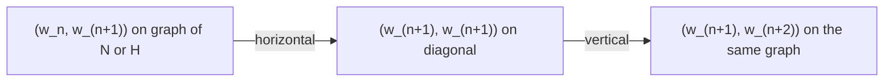

# Chapter 5 — Differentiation

[All chapters](../solutions.md) · [Previous chapter](chapter-04.md) · [Next chapter](chapter-06.md)

**Exercises:** [1](#r05e01) · [2](#r05e02) · [3](#r05e03) · [4](#r05e04) · [5](#r05e05) · [6](#r05e06) · [7](#r05e07) · [8](#r05e08) · [9](#r05e09) · [10](#r05e10) · [11](#r05e11) · [12](#r05e12) · [13](#r05e13) · [14](#r05e14) · [15](#r05e15) · [16](#r05e16) · [17](#r05e17) · [18](#r05e18) · [19](#r05e19) · [20](#r05e20) · [21](#r05e21) · [22](#r05e22) · [23](#r05e23) · [24](#r05e24) · [25](#r05e25) · [26](#r05e26) · [27](#r05e27) · [28](#r05e28) · [29](#r05e29)

### 5.1 — A quadratic difference bound forces constancy
**Lean source:** [Exercise01.lean](../../../Math/Rudin/Chapter05/Exercise01.lean).
**Inventory status:** Verified as stated.
**Statement.** Suppose $f:\mathbb R\to\mathbb R$ satisfies $|f(x)-f(y)|\le (x-y)^2$ for all real $x,y$. Then $f$ is constant.

**Proof.** For $y\ne x$,

$$
\left|\frac{f(y)-f(x)}{y-x}\right|\le |y-x|\longrightarrow0.
$$

Hence $f'(x)=0$ at every real $x$. The mean value theorem on the interval between any two points gives equal function values.

**Lean declarations:** `exercise01_constant`.

### 5.2 — An increasing function and its inverse derivative
**Lean source:** [Exercise02.lean](../../../Math/Rudin/Chapter05/Exercise02.lean).
**Inventory status:** Verified as stated.
**Statement.** Let $f$ be real-valued and differentiable on $(a,b)$, with $f'(x)>0$ there. Then $f$ is strictly increasing. Its inverse $g:f((a,b))\to(a,b)$ satisfies $g(f(x))=x$ and $f(g(y))=y$. The image is open, $g$ is differentiable on it, and

$$
g'(f(x))=\frac1{f'(x)}\qquad(a<x<b).
$$

No continuity of $f'$ is assumed.

**Proof.** The mean value theorem gives $f(v)>f(u)$ when $a<u<v<b$, so the inverse is well-defined. For each $x\in(a,b)$ choose $a<l<x<r<b$. Continuity and strict increase give $f((l,r))=(f(l),f(r))$, an open neighborhood of $f(x)$ inside the image. This also proves inverse continuity: points close enough to $f(x)$ have inverse values between any prescribed nearby $l$ and $r$. Put $y=f(t)$. As $y\to f(x)$, inverse continuity gives $t\to x$, and

$$
\frac{g(y)-g(f(x))}{y-f(x)}
=\left(\frac{f(t)-f(x)}{t-x}\right)^{-1}
\longrightarrow\frac1{f'(x)}.
$$

The denominator limit is positive. Any extension of $g$ outside the image has the same local derivative at these image points. If $(a,b)$ is empty, the interval assertions are vacuous.

**Lean declarations:** `exercise02_strict_increase`, `exercise02_inverse_identities`, `exercise02_inverse_hasDerivAt`, `exercise02_inverse_derivative`.

### 5.3 — Sharp parameters for an injective perturbation
**Lean source:** [Exercise03.lean](../../../Math/Rudin/Chapter05/Exercise03.lean).
**Inventory status:** Verified as stated.
**Statement.** Let $g:\mathbb R\to\mathbb R$ be differentiable and satisfy $|g'(x)|\le M$ everywhere. For every $\varepsilon>0$ with $\varepsilon M<1$, the function $x\mapsto x+\varepsilon g(x)$ is strictly increasing and hence injective. If $M=0$, every positive $\varepsilon$ works. If $M>0$, the range is $0<\varepsilon<1/M$, and this is sharp as a guarantee based only on $M$.

**Proof.** The hypothesis forces $M\ge0$, and

$$
1+\varepsilon g'(x)\ge1-\varepsilon M>0.
$$

The mean value theorem proves strict increase. The choice $\varepsilon=1/(M+1)$ always lies in the stated range. Conversely, if $\varepsilon>0$ and $\varepsilon M\ge1$, take $g(x)=-x/\varepsilon$. Then $|g'|=1/\varepsilon\le M$, but $x+\varepsilon g(x)=0$ for every $x$. This includes the excluded endpoint $\varepsilon=1/M$.

**Lean declarations:** `exercise03_admissible_zero`, `exercise03_admissible_pos`, `exercise03_admissible_nonempty`, `exercise03_sharp`, `exercise03_injectivity`.

### 5.4 — A polynomial root from a coefficient identity
**Lean source:** [Exercise04.lean](../../../Math/Rudin/Chapter05/Exercise04.lean).
**Inventory status:** Verified as stated.
**Statement.** If $n\ge0$ is an integer and real $C_0,\ldots,C_n$ satisfy $\sum_{k=0}^n C_k/(k+1)=0$, then $\sum_{k=0}^n C_kx^k=0$ for some $0<x<1$.

**Proof.** Set $P(t)=\sum_{k=0}^n C_kt^{k+1}/(k+1)$. Then $P(0)=P(1)=0$ and $P'(t)=\sum_{k=0}^n C_kt^k$. Rolle's theorem gives the required interior root. This proof includes $n=0$ and the zero polynomial; no nonzero-coefficient assumption is needed.

**Lean declarations:** `exercise04_interior_root`.

### 5.5 — Vanishing derivatives give vanishing unit increments
**Lean source:** [Exercise05.lean](../../../Math/Rudin/Chapter05/Exercise05.lean).
**Inventory status:** Verified as stated.
**Statement.** If $f:(0,\infty)\to\mathbb R$ is differentiable and $f'(x)\to0$ as $x\to\infty$, then $f(x+1)-f(x)\to0$.

**Proof.** For every $x>0$, the mean value theorem gives $c_x\in(x,x+1)$ with $f(x+1)-f(x)=f'(c_x)$. Given $\varepsilon>0$, choose $R$ so that $|f'(t)|<\varepsilon$ for $t\ge R$. For $x\ge\max(R,1)$, $c_x>R$, so the increment has absolute value less than $\varepsilon$. No limit of $f$ itself is required.

**Lean declarations:** `exercise05_increment_limit`.

### 5.6 — Monotonicity of slopes from the origin
**Lean source:** [Exercise06.lean](../../../Math/Rudin/Chapter05/Exercise06.lean).
**Inventory status:** Verified as stated.
**Statement.** Suppose $f$ is continuous on $[0,\infty)$, differentiable on $(0,\infty)$, $f(0)=0$, and $f'$ is nondecreasing on $(0,\infty)$. Then $f(x)/x$ is nondecreasing for $x>0$.

**Proof.** The derivative criterion for convexity, with continuity at the endpoint, makes $f$ convex on $[0,\infty)$. For $0<x\le y$, write $x=(1-x/y)0+(x/y)y$. Convexity gives $f(x)\le(x/y)f(y)$, because $f(0)=0$. Division by $x>0$ proves the claim. No derivative at zero is assumed. The four source labels describe hypotheses, not four separate conclusions.

**Lean declarations:** `exercise06_quotient_monotonicity`.

### 5.7 — Quotients at a common simple zero
**Lean source:** [Exercise07.lean](../../../Math/Rudin/Chapter05/Exercise07.lean).
**Inventory status:** Verified as stated.
**Statement.** Let $f,g$ be real- or complex-valued functions of a real variable, differentiable at $x$. Suppose $f(x)=g(x)=0$, $f'(x)=A$, and $g'(x)=B\ne0$. Then $g(t)\ne0$ in a sufficiently small punctured neighborhood of $x$, and

$$
\lim_{t\to x}\frac{f(t)}{g(t)}=\frac AB.
$$

For complex values, derivatives are with respect to the real parameter.

**Proof.** The slopes $f(t)/(t-x)$ and $g(t)/(t-x)$ tend to $A$ and $B$. Since $B\ne0$, the second slope, and therefore $g(t)$, is eventually nonzero for $t\ne x$. Their quotient tends to $A/B$ and equals $f(t)/g(t)$. This argument uses only field operations and limits, so it applies to both $\mathbb R$ and $\mathbb C$.

**Lean declarations:** `exercise07_real_quotient_limit`, `exercise07_complex_quotient_limit`.

### 5.8 — Uniform differentiability on a closed interval
**Lean source:** [Exercise08.lean](../../../Math/Rudin/Chapter05/Exercise08.lean).
**Inventory status:** Verified as stated.
**Statement.** Suppose $f:[a,b]\to\mathbb R$ has a derivative $d(x)$ within $[a,b]$ at every point, and $d$ is continuous on $[a,b]$. For every $\varepsilon>0$ there is $\delta>0$ such that

$$
\left|\frac{f(t)-f(x)}{t-x}-d(x)\right|<\varepsilon
$$

whenever $x,t\in[a,b]$ and $0<|t-x|<\delta$. The same result holds for $f:[a,b]\to\mathbb R^k$, with scalar division of vectors and Euclidean norm. In fact, the proof works in any real normed space. Endpoint derivatives are one-sided.

**Proof.** Compactness makes $d$ uniformly continuous. Choose $\delta$ so that $\|d(y)-d(x)\|<\varepsilon/2$ whenever both points lie in the interval and $|y-x|<\delta$. Fix admissible $x,t$ and put $H(y)=f(y)-y\,d(x)$. On the segment from $x$ to $t$, $H'(y)=d(y)-d(x)$ has norm at most $\varepsilon/2$. The norm form of the mean value inequality gives

$$
\|f(t)-f(x)-(t-x)d(x)\|\le(\varepsilon/2)|t-x|.
$$

Divide by $|t-x|>0$. The estimate is uniform in both points and does not require a vector mean value equality. Empty or singleton intervals have no admissible pair of distinct points.

**Lean declarations:** `exercise08_uniform_differentiability`, `exercise08_vector_version`.

### 5.9 — Filling a missing derivative at zero
**Lean source:** [Exercise09.lean](../../../Math/Rudin/Chapter05/Exercise09.lean).
**Inventory status:** Verified as stated.
**Statement.** If $f:\mathbb R\to\mathbb R$ is continuous, differentiable at every nonzero point, and $f'(x)\to3$ as $x\to0$, then $f'(0)$ exists and equals $3$.

**Proof.** For $h\ne0$, apply the mean value theorem on the interval with endpoints $0,h$. There is $c_h$ strictly between them such that $(f(h)-f(0))/h=f'(c_h)$. Since $0<|c_h|<|h|$, the right and left difference quotients both tend to $3$. Equivalently, the one-sided derivative-limit theorem supplies derivatives $3$ on both half-lines, which combine into the ordinary derivative at zero.

**Lean declarations:** `exercise09_derivative_at_zero`.

### 5.10 — Complex quotients at a one-sided endpoint
**Lean source:** [Exercise10.lean](../../../Math/Rudin/Chapter05/Exercise10.lean).
**Inventory status:** Verified as stated.
**Statement.** Let $f,g:(0,1)\to\mathbb C$ be differentiable with respect to the real variable. Suppose, as $x\to0^+$,

$$
f(x),g(x)\to0,\qquad f'(x)\to A,\qquad g'(x)\to B\ne0.
$$

Then $g$ is nonzero for all sufficiently small positive $x$, and $f(x)/g(x)\to A/B$. The separate finite derivative limits distinguish this assertion from Example 5.18.

**Proof.** Extend each function by value zero at zero. The endpoint derivative-limit theorem for normed-space-valued functions gives right derivatives $A$ and $B$. Hence $f(x)/x\to A$ and $g(x)/x\to B$. The second expression is eventually nonzero, so quotient convergence gives the result.

For the comparison, the denominator in Example 5.18 is

$$
G(x)=x+x^2e^{i/x^2},\qquad G'(x)=1+(2x-2i/x)e^{i/x^2}\quad(x\ne0).
$$

For $x>0$, the reverse triangle inequality and $|e^{i/x^2}|=1$ give

$$
|G'(x)|\ge\frac2x-2x-1\longrightarrow\infty.
$$

Thus $G'$ has no finite right-hand limit. Convergence of a quotient of derivatives alone, as in that example, is not the separate derivative-limit hypothesis used here.

**Lean declarations:** `exercise10_endpoint_quotient`, `exercise10_comparison`.

### 5.11 — Symmetric second differences and a failed converse
**Lean source:** [Exercise11.lean](../../../Math/Rudin/Chapter05/Exercise11.lean).
**Inventory status:** Verified as stated.
**Statement.** Suppose $f$ has a first derivative throughout a neighborhood of $x$, and $f''(x)=D$ exists. Then

$$
\lim_{h\to0}\frac{f(x+h)+f(x-h)-2f(x)}{h^2}=D.
$$

A finite symmetric-difference limit does not imply existence of $f''(x)$, even when $f$ is differentiable everywhere.

**Proof.** Put $d=f'$. Differentiability of $d$ at $x$ gives

$$
\frac{d(x+h)-d(x-h)}{2h}\longrightarrow D.
$$

The numerator of the claimed quotient tends to zero by continuity of $f$ at $x$, and its derivative with respect to $h$ is $d(x+h)-d(x-h)$. The denominator tends to zero and has nonzero derivative $2h$ off zero. The real two-sided form of l'Hôpital's rule therefore gives the limit $D$.

For the converse take $f(t)=t|t|$ and $x=0$. Direct differentiation, including the difference quotient at zero, gives $f'(t)=2|t|$. This is not differentiable at zero, since its left and right derivatives are $-2$ and $2$. But $f$ is odd, so $f(h)+f(-h)-2f(0)=0$ for every $h$; the symmetric quotient has limit zero.

**Lean declarations:** `exercise11_second_difference`, `exercise11_converse_counterexample`.

### 5.12 — Two derivatives of the absolute-value cube
**Lean source:** [Exercise12.lean](../../../Math/Rudin/Chapter05/Exercise12.lean).
**Inventory status:** Verified as stated.
**Statement.** For $f(x)=|x|^3$ on $\mathbb R$,

$$
f'(x)=3|x|x,\qquad f''(x)=6|x|
$$

at every real $x$, but $f'''(0)$ does not exist.

**Proof.** On each open half-line, differentiate $x^3$ or $-x^3$. At zero, $|h|^3/h\to0$, which gives the stated first derivative. The difference quotient of $3|x|x$ at zero is $3|h|\to0$, so the second derivative also exists there and has value zero. Finally, the difference quotient of $6|x|$ at zero is $6$ for positive increments and $-6$ for negative increments. Thus the third derivative fails at zero.

**Lean declarations:** `exercise12_first_derivative`, `exercise12_second_derivative`, `exercise12_third_derivative_failure`.

### 5.13 — Sharp regularity thresholds for a corrected oscillatory function
**Lean source:** [Exercise13.lean](../../../Math/Rudin/Chapter05/Exercise13.lean).
**Inventory status:** Verified refutation and correction.
**Statement.** Let $a\in\mathbb R$ and $c>0$. For the explicitly corrected function

$$
F(0)=0,\qquad F(x)=|x|^a\sin(|x|^{-c})\quad(0<|x|\le1),
$$

the seven sharp conclusions are:

1. **(a)** $F$ is continuous on $[-1,1]$ if and only if $a>0$.
2. **(b)** $F'(0)$ exists if and only if $a>1$; then $F'(0)=0$.
3. **(c)** $F'$ exists everywhere on $[-1,1]$ and is bounded if and only if $a\ge1+c$.
4. **(d)** $F'$ exists everywhere and is continuous if and only if $a>1+c$.
5. **(e)** $F''(0)$ exists, with a genuine first derivative near zero, if and only if $a>2+c$; then $F''(0)=0$. Requiring the first derivative on the entire interval is equivalent here.
6. **(f)** Both derivatives exist everywhere and $F''$ is bounded if and only if $a\ge2+2c$.
7. **(g)** Both derivatives exist everywhere and $F''$ is continuous if and only if $a>2+2c$.

All interval derivatives include one-sided derivatives at $-1$ and $1$. At $a=1+c$, the first derivative is bounded but not continuous. At $a=2+2c$, the second derivative is bounded but not continuous.

**Correction.** The printed prefactor is $x^a$, not $|x|^a$. For arbitrary real $a$, it is not a real-valued expression at negative $x$: $a=1/2$, $x=-1$ would require a real $y$ with $y^2=-1$, impossible because $y^2\ge0$. The seven results above concern a selected absolute-power correction, not a proof of the printed formula or an OCR repair.

**Proof.** Away from zero the corrected function is smooth. For $t>0$, define

$$
\begin{aligned}
Q(t)&=a t^{a-1}\sin(t^{-c})-c t^{a-c-1}\cos(t^{-c}),\\
R(t)&=a(a-1)t^{a-2}\sin(t^{-c})
-c(2a-c-1)t^{a-c-2}\cos(t^{-c})
-c^2t^{a-2c-2}\sin(t^{-c}).
\end{aligned}
$$

The product and chain rules give, for $x\ne0$,

$$
F'(x)=\operatorname{sgn}(x)Q(|x|),\qquad F''(x)=R(|x|).
$$

These formulas apply on both half-lines and give the required endpoint derivatives. Whenever the derivatives exist at zero, extend these displayed functions by value zero there.

For the sufficient conditions, use $|\sin|,|\cos|\le1$. First,

$$
|F(x)|\le |x|^a,\qquad |F(x)/x|\le |x|^{a-1}.
$$

These bounds prove (a) for $a>0$ and (b) for $a>1$. The first-derivative bound is

$$
|F'(x)|\le |a||x|^{a-1}+c|x|^{a-c-1}.
$$

Nonnegative exponents give boundedness on $0<|x|\le1$; strictly positive exponents give convergence to zero. Since $c>0$, this proves the sufficient conditions in (c) and (d), including derivative existence at zero. Similarly,

$$
|F'(x)/x|\le |a||x|^{a-2}+c|x|^{a-c-2},
$$

which gives $F''(0)=0$ when $a>2+c$. Finally, bounding the three terms of $R$ gives boundedness when $a\ge2+2c$ and convergence to zero when $a>2+2c$. These thresholds also ensure that the lower derivatives exist.

For necessity, use the positive sequences

$$
t_n(b)=(b+2\pi(n+1))^{-1/c}\longrightarrow0,
$$

where $b=0,\pi,\pi/2$. They eventually lie in $(0,1]$ and satisfy $\sin(t_n(b)^{-c})=\sin b$ and $\cos(t_n(b)^{-c})=\cos b$.

At $b=\pi/2$, $F(t_n)=t_n^a$. Continuity at zero therefore forces $a>0$. Since $F$ is even, any derivative at zero must be zero. The same samples give $F(t_n)/t_n=t_n^{a-1}$, forcing $a>1$.

At $b=0$, $Q(t_n)=-c\,t_n^{a-c-1}$. Boundedness of the first derivative forces $a-c-1\ge0$; continuity at its zero value forces $a-c-1>0$. For the second derivative at zero, the first derivative is necessarily the displayed function wherever it exists. Its difference quotients on phases $b=0$ and $b=\pi$ are respectively

$$
-c\,t_n(0)^{a-c-2},\qquad c\,t_n(\pi)^{a-c-2}.
$$

A negative exponent is unbounded. At exponent zero the two limits are $-c$ and $c$, which differ. Thus a second derivative requires $a>2+c$. Off-zero smoothness shows that a local first derivative near zero can be extended to the whole interval, so the local and interval formulations agree.

For $R$, the sine-one samples give

$$
R(t_n(\pi/2))=t_n(\pi/2)^{a-2c-2}
\bigl(a(a-1)t_n(\pi/2)^{2c}-c^2\bigr).
$$

The factor in parentheses tends to $-c^2\ne0$. Boundedness forces the exponent to be nonnegative; convergence to $F''(0)=0$ forces it to be positive. This proves (f) and (g). The same samples show discontinuity at each equality threshold, while the preceding bounds prove boundedness there.

**Lean declarations:** `exercise13_a`, `exercise13_b`, `exercise13_c`, `exercise13_first_equality`, `exercise13_d`, `exercise13_e`, `exercise13_e_local`, `exercise13_e_local_iff_interval`, `exercise13_f`, `exercise13_second_equality`, `exercise13_g`, `exercise13_domain_obstruction`.

### 5.14 — Derivative criteria for convexity
**Lean source:** [Exercise14.lean](../../../Math/Rudin/Chapter05/Exercise14.lean).
**Inventory status:** Verified as stated.
**Statement.** For a real function differentiable on $(a,b)$, convexity is equivalent to $f'$ being nondecreasing there. If $f'$ is also differentiable throughout $(a,b)$, convexity is equivalent to $f''(x)\ge0$ for every $x\in(a,b)$. No continuity of $f'$ or $f''$ is added.

**Proof.** For a differentiable convex function, the secant-slope inequalities give

$$
f'(x)\le\frac{f(y)-f(x)}{y-x}\le f'(y)\qquad(x<y).
$$

Thus $f'$ is nondecreasing. Conversely, the mean value theorem and monotonicity of $f'$ order the slopes on successive subintervals; those slope inequalities are the convexity inequality. This is the standard derivative criterion for convexity used in the source. Applying the derivative test for monotonicity to $f'$ gives the second assertion: a differentiable nondecreasing function has nonnegative derivative, and a nonnegative derivative implies nondecrease by the mean value theorem. Empty intervals cause no exception.

**Lean declarations:** `exercise14_first_derivative_criterion`, `exercise14_second_derivative_criterion`.

### 5.15 — A sharp bound for the first derivative
**Lean source:** [Exercise15.lean](../../../Math/Rudin/Chapter05/Exercise15.lean).
**Inventory status:** Verified as stated.
**Statement.** Let $f$ have two genuine derivatives on $(a,\infty)$. If $M_0,M_2$ are finite bounds for $|f|,|f''|$, then $|f'|$ has a finite supremum $M_1$ and

$$
M_1^2\le4M_0M_2.
$$

In particular this holds when the three $M_j$ are finite least upper bounds of $|f^{(j)}|$. Either $M_0=0$ or $M_2=0$ forces $f'=0$. The constant $4$ is sharp. All these assertions also hold in Euclidean norm for vector-valued functions, and indeed in any real normed space.

**Scope.** The numerical assertion uses finite real bounds or finite real suprema. It does not assign extended-real values to products involving infinite suprema. Continuity of the second derivative is not required.

**Proof.** The norm Taylor inequality of Exercise 5.20 on $[x,x+2h]$, for $h>0$, yields

$$
\|f(x+2h)-f(x)-2hf'(x)\|\le2h^2M_2.
$$

The triangle inequality therefore gives

$$
2h\|f'(x)\|\le2M_0+2h^2M_2.
$$

Write $u=\|f'(x)\|$. If $M_2>0$ and $u>0$, substitute $h=u/(2M_2)$ to obtain $u^2\le4M_0M_2$. The case $u=0$ is immediate. If $M_2=0$ and $u>0$, choosing $h>(M_0/u)$ contradicts the displayed inequality. Thus the pointwise bound holds in every case. It bounds $\|f'\|$ by $\sqrt{4M_0M_2}$, proves existence of its finite supremum, and passes to that supremum. It also handles either zero bound.

For sharpness on $(-1,\infty)$, take

$$
f(x)=\begin{cases}2x^2-1,&-1<x<0,\\(x^2-1)/(x^2+1),&x\ge0.\end{cases}
$$

Its derivatives are

$$
f'(x)=\begin{cases}4x,&x<0,\\4x/(x^2+1)^2,&x\ge0,\end{cases}\qquad
f''(x)=\begin{cases}4,&x<0,\\4(1-3x^2)/(x^2+1)^3,&x\ge0.\end{cases}
$$

The two pieces of $f$ agree at zero with value $-1$; their first derivatives agree with value $0$, and their second derivatives agree with value $4$. The one-sided derivatives therefore combine to give both genuine derivatives at the join.

On $(-1,0)$ the bounds $|f|\le1$, $|f'|\le4$, and $|f''|\le4$ follow directly. For $x\ge0$, $|x^2-1|\le x^2+1$, $x\le(1+x^2)^2$, and $|1-3x^2|\le(1+x^2)^3$ give the same bounds. Here the middle inequality follows from $1+x^2-x>0$, and the last follows by expanding both inequalities with $u=x^2\ge0$. The value at zero gives $M_0=1$ and $M_2=4$; as $x\to-1^+$, $|f'(x)|\to4$, so $M_1=4$. Consequently $M_1^2=16=4M_0M_2$.

**Lean declarations:** `exercise15_derivative_bound`, `exercise15_finite_supremum`, `exercise15_zero_bound`, `exercise15_example_regular`, `exercise15_example_function_supremum`, `exercise15_example_derivative_supremum`, `exercise15_example_second_derivative_supremum`, `exercise15_example_sharpness`, `exercise15_vector_version`.

### 5.16 — A bounded second derivative controls the limiting first derivative
**Lean source:** [Exercise16.lean](../../../Math/Rudin/Chapter05/Exercise16.lean).
**Inventory status:** Verified as stated.
**Statement.** Suppose $f$ has two derivatives on $(0,\infty)$, $f''$ is bounded there, and $f(x)\to0$ as $x\to\infty$. Then $f'(x)\to0$. The source proves this in any real normed space, in particular for real functions.

**Proof.** Choose $B\ge0$ with $\|f''(t)\|\le B$. Given $\varepsilon>0$, put $\eta=\varepsilon^2/(8(B+1))$. On a sufficiently late half-line, $\|f(t)\|\le\eta$. Apply the pointwise bound of Exercise 5.15 on that half-line:

$$
\|f'(x)\|^2\le4\eta B<\varepsilon^2.
$$

Thus $\|f'(x)\|<\varepsilon$ for all sufficiently large $x$. This proof also covers $B=0$ and assumes no continuity of $f''$.

**Lean declarations:** `exercise16_derivative_limit`.

### 5.17 — A sharp third-derivative bound
**Lean source:** [Exercise17.lean](../../../Math/Rudin/Chapter05/Exercise17.lean).
**Inventory status:** Verified as stated.
**Statement.** Let $f$ have three derivatives within $[-1,1]$, with

$$
f(-1)=f(0)=f'(0)=0,\qquad f(1)=1.
$$

There is $x\in(-1,1)$ with $f'''(x)\ge3$. In fact, the source proves $f'''(x)=3$ at some such point. The bound is sharp.

**Proof.** Let $p(t)=(t^3+t^2)/2$ and $g=f-p$. Then $g(-1)=g(0)=g(1)=g'(0)=0$. Rolle's theorem produces zeros of $g'$ at $u\in(-1,0)$ and $v\in(0,1)$. Applying it to $g'$ on $[u,0]$ and $[0,v]$ gives zeros of $g''$ at $s<0<t$. Applying it to $g''$ on $[s,t]$ gives $g'''(x)=0$ somewhere inside. Since $p'''=3$, this means $f'''(x)=3$. The polynomial $p$ itself satisfies all four data and has third derivative identically $3$, so no larger universal lower bound is possible. Endpoint derivatives used here are only within the interval.

**Lean declarations:** `exercise17_third_derivative_lower_bound`, `exercise17_third_derivative_eq`, `exercise17_sharpness`.

### 5.18 — An exact Taylor identity from a quotient
**Lean source:** [Exercise18.lean](../../../Math/Rudin/Chapter05/Exercise18.lean).
**Inventory status:** Verified as stated.
**Statement.** Let $n\ge1$ be an integer. Suppose $f$ has genuine derivatives through order $n-1$ on $[a,b]$, with one-sided derivatives at endpoints. For distinct $\alpha,\beta\in[a,b]$, define

$$
P(t)=\sum_{k=0}^{n-1}\frac{f^{(k)}(\alpha)}{k!}(t-\alpha)^k,
\qquad Q(t)=\frac{f(t)-f(\beta)}{t-\beta}\quad(t\ne\beta).
$$

Then $Q$ has derivatives through order $n-1$ on $[a,b]\setminus\{\beta\}$, and

$$
f(\beta)=P(\beta)+\frac{Q^{(n-1)}(\alpha)}{(n-1)!}(\beta-\alpha)^n.
$$

**Proof.** The quotient rule first constructs $Q'$ wherever $t\ne\beta$. Repeated differentiation of $(t-\beta)Q(t)=f(t)-f(\beta)$ gives, for $1\le k\le n-1$,

$$
f^{(k)}(t)=(t-\beta)Q^{(k)}(t)+kQ^{(k-1)}(t).
$$

Equivalently, $Q^{(k)}=(f^{(k)}-kQ^{(k-1)})/(t-\beta)$; induction with the quotient rule proves these are genuine derivatives, including within derivatives at retained endpoints. Substituting $t=\alpha$ into these identities and successively eliminating $Q(\alpha),\ldots,Q^{(n-2)}(\alpha)$ gives the displayed formula. More explicitly, the identity for order $m+1$ follows from that for order $m$ by this recurrence and $(m+1)!= (m+1)m!$. At $n=1$ there is no derivative hypothesis: the formula is simply $f(\beta)=f(\alpha)+Q(\alpha)(\beta-\alpha)$.

**Lean declarations:** `exercise18_quotient_taylor_identity`.

### 5.19 — Secants whose endpoints approach zero
**Lean source:** [Exercise19.lean](../../../Math/Rudin/Chapter05/Exercise19.lean).
**Inventory status:** Verified as stated.
**Statement.** Let $f:(-1,1)\to\mathbb R$ have derivative $L=f'(0)$. Suppose $-1<\alpha_n<\beta_n<1$ and both sequences tend to zero. Set

$$
D_n=\frac{f(\beta_n)-f(\alpha_n)}{\beta_n-\alpha_n}.
$$

Then $D_n\to L$ under each of these sufficient conditions:

1. **(a)** $\alpha_n<0<\beta_n$ for all $n$.
2. **(b)** $0<\alpha_n<\beta_n$ and $\beta_n/(\beta_n-\alpha_n)$ is bounded.
3. **(c)** $f$ is differentiable throughout $(-1,1)$ and $f'$ is continuous there. Continuity of $f'$ at zero alone also suffices.

Without these additional conditions, there is an everywhere differentiable example for which $D_n$ has a finite limit different from $f'(0)$.

**Proof.** For $t\ne0$, put $r(t)=(f(t)-f(0))/t-L$, so $r(t)\to0$. When the endpoints are nonzero,

$$
D_n-L=\frac{\beta_n}{\beta_n-\alpha_n}r(\beta_n)
-\frac{\alpha_n}{\beta_n-\alpha_n}r(\alpha_n).
$$

In (a), the first coefficient lies between zero and one, and the absolute value of the second does too. In (b), the first coefficient is bounded by assumption, and the second equals the first minus one. Thus both terms tend to zero in each case. In (c), the mean value theorem gives $D_n=f'(c_n)$ with $\alpha_n<c_n<\beta_n$. Hence $c_n\to0$, and continuity of $f'$ at zero finishes the proof.

For the counterexample take $f(0)=0$ and $f(x)=x^2\sin(1/x)$ for $x\ne0$. The bound $|f(x)/x|\le|x|$ gives $f'(0)=0$, and the function is differentiable away from zero. Set

$$
p_n=2\pi(n+1),\qquad \alpha_n=\frac1{p_n+\pi/2},\qquad \beta_n=\frac1{p_n}.
$$

These satisfy $0<\alpha_n<\beta_n<1$ and tend to zero. Since $f(\beta_n)=0$ and $f(\alpha_n)=\alpha_n^2$,

$$
D_n=-\frac{1-(\pi/2)\alpha_n}{\pi/2}\longrightarrow-\frac2\pi\ne0.
$$

The derivative cannot be continuous at zero, since (c) would then force the same secants to tend to zero.

**Lean declarations:** `exercise19_a`, `exercise19_b`, `exercise19_c`, `exercise19_different_limit`.

### 5.20 — Taylor's inequality for vector-valued functions
**Lean source:** [Exercise20.lean](../../../Math/Rudin/Chapter05/Exercise20.lean).
**Inventory status:** Verified as stated.
**Statement.** Let $E$ be a real normed space, $n\ge0$ an integer, and $I$ the closed interval with endpoints $a,b$ in either order. Suppose functions $F_0,\ldots,F_n:I\to E$ satisfy $F_k'=F_{k+1}$ within $I$ for $k<n$, and $\|F_n(t)\|\le M$ on $I$. Then

$$
\left\|F_0(b)-\sum_{k=0}^{n-1}\frac{(b-a)^k}{k!}F_k(a)\right\|
\le\frac{M|b-a|^n}{n!}.
$$

This includes Euclidean vector-valued functions, both directions, one-sided endpoint derivatives, and $n=0$ with an empty sum. The highest derivative need not be continuous.

**Proof.** First work on $[0,1]$ and prove the corresponding bound at every $t$ by induction on $n$. For $n=0$ it is the given bound. For the induction step, subtract the Taylor polynomial of order $n$ and call the remainder $R$. Its derivative is the order-$n$ remainder for the derivative sequence $F_1,F_2,\ldots$. The induction hypothesis gives

$$
\|R'(t)\|\le M t^n/n!.
$$

Also $R(0)=0$. The norm derivative comparison theorem, applied against the scalar function $B(t)=Mt^{n+1}/(n+1)!$, whose derivative is the right-hand bound, gives $\|R(t)\|\le B(t)$. This theorem is the norm mean value inequality with a differentiable scalar majorant, so it needs no continuity of $F_{n+1}$.

For general endpoints put $d=b-a$ and $G_k(t)=d^kF_k(a+td)$ on $[0,1]$. The chain rule gives $G_k'=G_{k+1}$, and $\|G_n\|\le|d|^nM$. The unit-interval result at $t=1$ is exactly the displayed estimate. This change of variables also works for $d<0$ and $d=0$; at $n=0$ the convention is $|d|^0=1$.

**Lean declarations:** `exercise20_vector_taylor_bound`.

### 5.21 — Closed sets as smooth zero sets
**Lean source:** [Exercise21.lean](../../../Math/Rudin/Chapter05/Exercise21.lean).
**Inventory status:** Verified as stated.
**Statement.** Every closed set $E\subset\mathbb R$ is exactly the zero set of a smooth real function on $\mathbb R$. Thus it is the zero set of a differentiable function and, for every positive integer $n$, of an $n$-times-differentiable function. The construction includes $E=\varnothing$ and $E=\mathbb R$.

**Proof.** Apply the smooth separation theorem for disjoint closed sets, obtained by partitions of unity, to $E$ and the empty set. The theorem supplies a smooth function $f$ with $f(x)=0$ exactly when $x\in E$ (and the second prescribed level set empty). This is the library theorem used in the source. Smoothness implies that every iterated derivative exists and is differentiable; retaining only the first $n$ derivative steps gives the finite-order assertion, and retaining the first gives the differentiable assertion. For the boundary cases one can also take $f=1/2$ when $E=\varnothing$ and $f=0$ when $E=\mathbb R$. The finite-order result in the file permits $n=0$ as well, with no derivative steps required.

**Lean declarations:** `exercise21_differentiable_zero_set`, `exercise21_finite_order_zero_set`, `exercise21_smooth_zero_set`.

### 5.22 — Fixed points, contractions, and iteration paths
**Lean source:** [Exercise22.lean](../../../Math/Rudin/Chapter05/Exercise22.lean).
**Inventory status:** Verified as stated.
**Statement.** The following assertions concern real functions on $\mathbb R$.

1. **(a)** If $f$ is differentiable and $f'(t)\ne1$ everywhere, it has at most one fixed point.
2. **(b)** The function $f(t)=t+1/(1+e^t)$ has no fixed point, although $0<f'(t)<1$ everywhere.
3. **(c)** If $f$ is differentiable and $|f'(t)|\le A<1$ everywhere, it has exactly one fixed point $z$. For every starting value $x_1$, the iteration $x_{n+1}=f(x_n)$ converges to $z$.
4. **(d)** The graph/diagonal iteration path has successive vertices $(x_n,x_{n+1})$, $(x_{n+1},x_{n+1})$, $(x_{n+1},x_{n+2})$.

**Proof.** If two distinct fixed points existed in (a), the mean value theorem between them would give $f'(c)=1$, a contradiction. In (b), the displacement $1/(1+e^t)$ is strictly positive, so there is no fixed point. Differentiation gives

$$
f'(t)=1-\frac{e^t}{(1+e^t)^2}.
$$

For $u=e^t>0$, $0<u/(1+u)^2<1$, proving the derivative inequalities.

In (c), the derivative bound forces $A\ge0$, and the mean value theorem gives $|f(x)-f(y)|\le A|x-y|$. The contraction mapping theorem on the complete space $\mathbb R$ supplies a unique fixed point and convergence of every orbit to it. Unlike (b), this uses one uniform constant strictly below one; $A=0$ is included.

For (d), $x_{n+1}=f(x_n)$ puts the first vertex on the graph. Holding its second coordinate fixed gives the horizontal segment to the diagonal; holding the new first coordinate fixed gives the vertical segment back to the graph:

The horizontal segment consists exactly of points $(s,x_{n+1})$ with $s$ between $x_n$ and $x_{n+1}$. The vertical segment consists exactly of $(x_{n+1},s)$ with $s$ between $x_{n+1}$ and $x_{n+2}$. These descriptions include degenerate segments at fixed points.

**Lean declarations:** `exercise22_a`, `exercise22_b_no_fixed_point`, `exercise22_b_hasDerivAt`, `exercise22_b_derivative`, `exercise22_c_existence`, `exercise22_c_iteration`, `exercise22_d_segments`, `exercise22_d_vertices`.

### 5.23 — Complete iteration regions for a cubic map
**Lean source:** [Exercise23.lean](../../../Math/Rudin/Chapter05/Exercise23.lean).
**Inventory status:** Verified as stated.
**Statement.** For $f(x)=(x^3+1)/3$, there are exactly three fixed points,

$$
\alpha\in(-2,-1),\qquad\beta\in(0,1),\qquad\gamma\in(1,2).
$$

For $x_{n+1}=f(x_n)$ the exact limit regions are

$$
\begin{aligned}
x_n\to-\infty&\quad\Longleftrightarrow\quad x_1<\alpha,\\
x_n\to\beta&\quad\Longleftrightarrow\quad\alpha<x_1<\gamma,\\
x_n\to+\infty&\quad\Longleftrightarrow\quad\gamma<x_1.
\end{aligned}
$$

Starting at any fixed point gives a constant sequence.

**Proof.** The polynomial $p(x)=x^3-3x+1$ has opposite signs at the endpoints of each of $[-2,-1]$, $[0,1]$, and $[1,2]$. The intermediate value theorem gives three roots in the stated open intervals. Since these are distinct, the monic cubic factors as

$$
f(x)-x=\frac{(x-\alpha)(x-\beta)(x-\gamma)}3,
$$

so there are no other fixed points. The map $f$ is strictly increasing. The factorization shows $f(x)<x$ below $\alpha$, $f(x)>x$ between $\alpha$ and $\beta$, $f(x)<x$ between $\beta$ and $\gamma$, and $f(x)>x$ above $\gamma$.

A start below $\alpha$ therefore gives a decreasing orbit. If bounded below, it would converge to a finite limit $l\le x_1<\alpha$; continuity would make $l$ a fixed point, impossible. Hence it tends to $-\infty$. The argument above $\gamma$ is the increasing counterpart. Between $\alpha$ and $\beta$, monotonicity of $f$ keeps the orbit below $\beta$, while the sign rule makes it increase. Its limit is a fixed point in $[x_1,\beta]$, necessarily $\beta$. Between $\beta$ and $\gamma$, it decreases to $\beta$ by the same argument. A start at $\beta$ is constant. Finally, monotonicity preserves the bounds by $\alpha$ and $\gamma$ for starts outside the middle region; these bounds exclude the other limits and prove all three converses. Starts at $\alpha$ and $\gamma$ remain at those values.

**Lean declarations:** `exercise23_roots_exist`, `exercise23_fixed_points`, `exercise23_classification`, `exercise23_a`, `exercise23_exact_regions`, `exercise23_b`, `exercise23_c`.

### 5.24 — Quadratic and linear square-root iterations
**Lean source:** [Exercise24.lean](../../../Math/Rudin/Chapter05/Exercise24.lean).
**Inventory status:** Verified as stated.
**Statement.** Let $\alpha>0$, $\alpha\ne1$, and $r=\sqrt\alpha$. On the positive half-line consider

$$
N(x)=\frac{x+\alpha/x}{2},\qquad H(x)=\frac{\alpha+x}{1+x}.
$$

Both maps have the unique positive fixed point $r$, and both iterations converge to $r$ from every positive start. A start at $r$ is constant. For any other positive start, the Newton iteration $u_{n+1}=N(u_n)$ has rates

$$
\frac{u_{n+1}-r}{(u_n-r)^2}\to\frac1{2r},\qquad
\frac{u_{n+1}-r}{u_n-r}\to0.
$$

The other iteration $v_{n+1}=H(v_n)$ has signed linear rate

$$
\frac{v_{n+1}-r}{v_n-r}\to q=\frac{1-r}{1+r},\qquad
\frac{|v_{n+1}-r|}{|v_n-r|}\to|q|,\qquad0<|q|<1.
$$

For $\alpha>1$ this second iteration alternates about $r$; for $0<\alpha<1$ it approaches $r$ monotonically from the starting side. These rates explain the different speeds in Chapter 3, Exercises 16 and 17.

**Proof.** All denominators are positive on the stated domain, and both maps preserve positivity. Each fixed-point equation reduces to $x^2=\alpha$, so its unique positive solution is $r$. Differentiation gives

$$
N'(x)=\frac{1-\alpha/x^2}{2},\qquad H'(x)=\frac{1-\alpha}{(1+x)^2},\qquad N'(r)=0,\quad H'(r)=q.
$$

More precisely, direct algebra gives

$$
N(x)-r=\frac{(x-r)^2}{2x},\qquad
H(x)-r=\frac{(1-r)(x-r)}{1+x}.
$$

For a nonfixed Newton start, the first iterate is strictly above $r$. Above $r$, $r<N(x)<x$, so the subsequent orbit decreases to a limit at least $r$. Continuity and the unique positive fixed point identify the limit as $r$. The exact error identity shows that the orbit never reaches $r$, and division by its nonzero errors gives the two stated rates.

For the other map, define $z_n=(v_n-r)/(v_n+r)$. Its exact recurrence is $z_{n+1}=qz_n$, hence

$$
z_n=q^{n-1}\frac{v_1-r}{v_1+r}.
$$

Since $r>0$, $|q|<1$, so $z_n\to0$ and $v_n=r(1+z_n)/(1-z_n)\to r$. Since $\alpha\ne1$, $q\ne0$; a nonfixed orbit never reaches $r$. Divide the second error identity by $v_n-r$ and take limits to obtain the signed rate, then take absolute values.

The complete graph/diagonal paths use the horizontal and vertical segments of Exercise 5.22 for either orbit. For Newton, a start above $r$ decreases strictly and stays above it. A start below $r$ moves above $r$ in one step, then decreases strictly. For $\alpha>1$, $-1<q<0$, so the $H$-orbit changes side at every step. Its terms on the upper side decrease strictly and those on the lower side increase strictly. Indeed,

$$
H(H(y))-y=\frac{2(\alpha-y^2)}{\alpha+1+2y},
$$

which has the required sign on each side. If the start is above $r$, the odd-numbered terms are above and decrease, while the even-numbered terms are below and increase; for a start below $r$ the roles reverse. For $0<\alpha<1$, $0<q<1$ and the error identity preserves sides. Also $H(y)-y=(\alpha-y^2)/(1+y)$, so each step moves strictly toward $r$ without crossing it. A root start gives degenerate segments.

Here the horizontal coordinate ranges between $w_n,w_{n+1}$ on the first segment, and the vertical coordinate ranges between $w_{n+1},w_{n+2}$ on the second. Alternation describes scalar iterates on opposite sides of $r$, not a claim that a planar segment passes through $(r,r)$.

**Lean declarations:** `exercise24_fixed_points`, `exercise24_constant`, `exercise24_derivatives_at_root`, `exercise24_newton_convergence`, `exercise24_newton_rates`, `exercise24_mobius_convergence`, `exercise24_mobius_rates`, `exercise24_rate_signs`, `exercise24_newton_diagrams`, `exercise24_greater_than_one_diagrams`, `exercise24_diagram_segments`, `exercise24_less_than_one_diagrams`.

### 5.25 — Newton iteration with termination and zero-curvature corrections
**Lean source:** [Exercise25.lean](../../../Math/Rudin/Chapter05/Exercise25.lean).
**Inventory status:** Verified refutation and correction.
**Statement.** Let $a<b$ and let $f$ have genuine first and second derivatives $p=f'$ and $q=f''$ within $[a,b]$. Suppose

$$
f(a)<0<f(b),\qquad p(x)\ge\delta>0,\qquad0\le q(x)\le M\quad(x\in[a,b]).
$$

There is a unique zero $\xi\in(a,b)$. Start with $\xi<x_1\le b$ and define the infinite Newton sequence

$$
x_{n+1}=g(x_n),\qquad g(x)=x-\frac{f(x)}{p(x)}.
$$

The results, with the corrected termination convention, are:

1. **(a)** Every iterate lies in $[\xi,b]$ and has positive derivative denominator. The next term is the unique horizontal-axis intercept of the tangent at $(x_n,f(x_n))$. Once the root is reached, all later terms equal it.
2. **(b)** $\xi\le x_{n+1}\le x_n$, with $x_{n+1}<x_n$ if and only if $x_n>\xi$, and $x_n\to\xi$.
3. **(c)** If $x_n>\xi$, there is $t_n\in(\xi,x_n)$ such that

   $$
   x_{n+1}-\xi=\frac{q(t_n)}{2p(x_n)}(x_n-\xi)^2.
   $$

   If $x_n=\xi$, the next error is zero and no point of $(\xi,x_n)$ exists.
4. **(d)** Put $A=M/(2\delta)\ge0$ and $e_n=x_n-\xi$. Then

   $$
   0\le e_{n+1}\le Ae_n^2,\qquad
      0\le e_{n+1}\le A^{2^n-1}e_1^{2^n}\quad(n\ge0).
   $$

   The second formula at $n=0$ is $e_1\le e_1$, using the usual zeroth-power convention. If $A>0$, it also reads $e_{n+1}\le(Ae_1)^{2^n}/A$. If $A=0$, equivalently $M=0$, then $x_n=\xi$ for all $n\ge2$.
5. **(e)** Fixed points of $g$ on $[a,b]$ are exactly zeros of $f$. Within this interval,

   $$
   g'(x)=\frac{f(x)q(x)}{p(x)^2}.
   $$

   At the interior root $g'(\xi)=0$, and the actual derivative satisfies $g'(x)\to0$ as $x\to\xi$, without continuity of $q$.
6. **(f)** For the signed real cube-root function $h(x)=\sqrt[3]{x}$, Newton iteration from a nonzero start is $x_n=(-2)^{n-1}x_1$. Every step is defined, signs alternate, and $|x_n|\to\infty$. The function $h$ is not differentiable at zero.

**Correction.** The source requires $x_1<b$; the verified proof also permits $x_1=b$ using one-sided endpoint derivatives. The printed all-step strict descent and interior Taylor-point claims are false after finite termination. On $[-1,1]$, take $f(x)=x$, $\delta=1$, $M=1$, and $x_1=1/2$. Then $\xi=0$ and $x_2=x_3=\cdots=0$. Thus later steps are not strict and the Taylor interval is empty. This termination defect does not require a zero upper bound: the counterexample above uses $M=1$. The same affine function also permits $M=0$, when $A=0$ and the printed $1/A$ is undefined. There is no real number $r$ with $0r=1$. The denominator-free bound above is the correction; strict convexity is not added.

**Proof.** Continuity and the endpoint signs give a zero by the intermediate value theorem. Since $p\ge\delta>0$, the mean value theorem makes $f$ strictly increasing, so the zero is unique and interior. Existence of the second derivative makes $p$ continuous on $[a,b]$; $q\ge0$ also makes $p$ nondecreasing.

For $\xi<x\le b$, Taylor's theorem at $x$, evaluated at $\xi$, gives

$$
0=f(\xi)=f(x)+p(x)(\xi-x)+\tfrac12q(t)(\xi-x)^2
\quad\text{for some }t\in(\xi,x).
$$

This form needs no continuity of $q$. To obtain it by Rolle's theorem, subtract from $f(y)$ its tangent at $x$ and a quadratic $C(y-x)^2$ chosen to make the remainder vanish at $\xi$. It also vanishes at $x$. Rolle first gives a zero of its first derivative between them; that derivative already vanishes at $x$. A second application of Rolle gives $q(t)=2C$. Rearranging yields (c).

The nonnegative Taylor error implies $g(x)\ge\xi$, while $f(x)>0$ and $p(x)>0$ imply $g(x)<x$ off the root. At the root $g(\xi)=\xi$. Induction proves invariance, positive denominators, weak descent, strictness exactly off the root, and absorption after termination. Solving

$$
f(x)+p(x)(y-x)=0
$$

for $y$ gives the unique intercept $y=g(x)$, proving the tangent assertion.

Monotone boundedness gives $x_n\to l\in[\xi,b]$. Since $f,p$ are continuous and $p(l)>0$, passing to the limit in the recurrence gives $l=g(l)$, hence $f(l)=0$ and $l=\xi$.

Use $q(t)\le M$ and $p(x)\ge\delta$ in (c) to obtain $0\le e_{n+1}\le Ae_n^2$; the same inequality holds at a terminated step. Induction gives the denominator-free bound: squaring the bound at exponent $2^n$ and multiplying by $A$ changes the power of $A$ from $2(2^n-1)+1$ to $2^{n+1}-1$. This calculation involves no division by $A$. If $A>0$, algebra gives the printed reciprocal form. If $M=0$, the one-step inequality forces zero error immediately. Positivity of $2\delta$ proves $A=0$ if and only if $M=0$.

The quotient rule gives $g'=fq/p^2$, including within derivatives at endpoints; $g(x)=x$ is equivalent to $f(x)=0$ because $p(x)>0$. Near the root,

$$
|g'(x)|\le |f(x)|\frac{M}{\delta^2}\longrightarrow0.
$$

At $\xi$ the formula gives derivative zero. Since $\xi$ is interior, these are ordinary local derivatives and their ordinary limit.

Finally let $r=h(x)$, so $r^3=x$ for every real $x$. Off zero, inverse differentiation gives $h'(x)=1/(3r^2)\ne0$. Therefore

$$
x-\frac{h(x)}{h'(x)}=x-3r^3=-2x.
$$

Induction yields the stated iterates, none zero, and $|x_n|=2^{n-1}|x_1|\to\infty$. If $h$ were differentiable at zero, differentiation of $h(x)^3=x$ there would give $0=1$. Thus the derivative obstruction is genuine, not an assigned derivative value.

**Lean declarations:** `exercise25_root`, `exercise25_iteration`, `exercise25_iteration_absorbing`, `exercise25_tangent`, `exercise25_strict_step`, `exercise25_termination_counterexample`, `exercise25_convergence`, `exercise25_taylor`, `exercise25_taylor_terminated`, `exercise25_quadratic`, `exercise25_denominator_free`, `exercise25_printed_bound`, `exercise25_fixed_point`, `exercise25_g_derivative`, `exercise25_g_derivative_root`, `exercise25_deriv_limit`, `exercise25_cube_root_derivative`, `exercise25_cube_root_iterates`, `exercise25_cube_root_well_defined`, `exercise25_cube_root_divergence`, `exercise25_cube_root_not_differentiable`, `exercise25_zero_curvature`, `exercise25_A_zero_iff`, `exercise25_zero_A_termination`, `exercise25_zero_bound_domain_obstruction`.

### 5.26 — A differential inequality with zero initial value
**Lean source:** [Exercise26.lean](../../../Math/Rudin/Chapter05/Exercise26.lean).
**Inventory status:** Verified as stated.
**Statement.** Let $f$ have derivative $v$ within $[a,b]$, suppose $f(a)=0$, and assume

$$
|v(x)|\le A|f(x)|\qquad(x\in[a,b])
$$

for a real constant $A$ of any sign. Then $f=0$ throughout $[a,b]$. The source also proves the normed-space version $\|v(x)\|\le A\|f(x)\|$.

**Proof.** Apply the differential form of Grönwall's zero-initial-value theorem: a continuous normed-space-valued function whose right derivative satisfies $\|f'_+(x)\|\le A\|f(x)\|$ and whose initial value is zero vanishes to the right. Within differentiability supplies continuity on $[a,b]$ and the needed right derivative at every $x<b$, so this standard theorem applies directly. This is the library result used in the source; it permits every real $A$. In particular, for $A<0$, the original inequality already forces $f(x)=0$ at each point, and for $A=0$ the derivative vanishes. If $a=b$, the conclusion is just the initial value; if $a>b$, the interval is empty. No ambient endpoint derivatives are needed.

**Lean declarations:** `exercise26_zero_solution`.

### 5.27 — Scalar differential-equation uniqueness and waiting-time solutions
**Lean source:** [Exercise27.lean](../../../Math/Rudin/Chapter05/Exercise27.lean).
**Inventory status:** Verified as stated.
**Statement.** Suppose $\phi$ is real-valued on $[a,b]\times[\alpha,\beta]$ and, for a fixed real $A$,

$$
|\phi(x,u)-\phi(x,v)|\le A|u-v|
$$

for all points of that rectangle with the same $x$. Then two differentiable solutions taking values in $[\alpha,\beta]$ of $y'=\phi(x,y)$ with the same initial value $y(a)=c\in[\alpha,\beta]$ agree on $[a,b]$. The equation and derivatives include the one-sided endpoints.

For $b\ge0$, all real solutions on the forward interval $[0,b]$ of

$$
y'=\sqrt y,\qquad y(0)=0,\qquad y\ge0
$$

are the waiting-time functions

$$
y(x)=\begin{cases}0,&x\le t,\\(x-t)^2/4,&x>t,\end{cases}
\qquad t\in[0,b].
$$

Here $t=b$ represents the zero solution on the whole interval. If $b>0$, $y=0$ and $y=x^2/4$ are distinct solutions.

**Scope.** The square-root domain condition $y\ge0$ is explicit. The parabola $x^2/4$ is asserted as a solution on a forward interval only, not on negative $x$. No existence theorem for general $\phi$ is claimed.

**Proof.** For two solutions put $w=y-z$. Then $w(a)=0$ and

$$
|w'(x)|=|\phi(x,y(x))-\phi(x,z(x))|\le A|w(x)|.
$$

Exercise 5.26 gives $w=0$. Only values in the specified rectangle are used; no continuity assumption on $\phi$ is needed for this uniqueness implication.

For a waiting-time function, the derivative is zero before $t$ and $(x-t)/2$ after $t$. The difference quotient at $t$ tends to zero from both sides. Since the square root of $(x-t)^2/4$ is $(x-t)/2$ for $x>t$, the equation holds at every point, including the join. The function is nonnegative and has initial value zero. At $b>0$, the zero function and the immediate-start parabola differ at $b$.

Conversely, a solution has nonnegative derivative, so it is nondecreasing. Its zero set in $[0,b]$ is nonempty and compact, by continuity, and has a greatest point $t$. Monotonicity and nonnegativity imply $y=0$ on $[0,t]$, while maximality gives $y>0$ on $(t,b]$. There the chain rule gives

$$
(\sqrt{y})'=\frac{y'}{2\sqrt y}=\frac12.
$$

For any $x>t$, continuity of $\sqrt y$ on $[t,x]$ and the mean value theorem give $\sqrt{y(x)}=(x-t)/2$. Squaring yields the stated branch. This proves both directions of the classification, including $b=0$ and the zero solution.

**Lean declarations:** `exercise27_lipschitz_uniqueness`, `exercise27_nonunique_examples`, `exercise27_sqrt_classification`, `exercise27_all_nonunique_solutions`, `exercise27_wait_solution`.

### 5.28 — Uniqueness for systems in a cell
**Lean source:** [Exercise28.lean](../../../Math/Rudin/Chapter05/Exercise28.lean).
**Inventory status:** Verified as stated.
**Statement.** In $\mathbb R^k$ with Euclidean norm, a function $y$ differentiable within $[a,b]$ with $y(a)=0$ and $\|y'(x)\|\le A\|y(x)\|$ is identically zero, for any real $A$.

Let $C=\prod_{j=1}^k[\alpha_j,\beta_j]$ and let $\Phi:[a,b]\times C\to\mathbb R^k$ satisfy

$$
\|\Phi(x,u)-\Phi(x,v)\|\le A\|u-v\|\qquad(x\in[a,b],\ u,v\in C).
$$

There is at most one differentiable solution with values in $C$ of $y'=\Phi(x,y)$ having a specified initial value $y(a)=c\in C$. Derivatives and the equation hold within the closed interval, including endpoints.

**Proof.** The first assertion is the normed-space differential inequality from Exercise 5.26, specialized to Euclidean space. For two solutions $y,z$ with the same initial value, $w=y-z$ has initial value zero and

$$
\|w'(x)\|=\|\Phi(x,y(x))-\Phi(x,z(x))\|\le A\|w(x)\|.
$$

The first assertion gives $w=0$. The Lipschitz condition is needed only on the specified cell. There is no continuity assumption on the derivative or ambient endpoint derivative assumption. The proof also permits $k=0$, where the vector space has only one element, and degenerate or empty time intervals.

**Lean declarations:** `exercise28_vector_zero_estimate`, `exercise28_system_uniqueness`.

### 5.29 — Uniqueness for a linear equation of arbitrary positive order
**Lean source:** [Exercise29.lean](../../../Math/Rudin/Chapter05/Exercise29.lean).
**Inventory status:** Verified as stated.
**Statement.** Let $k\ge1$, $a\le b$, and let $f,g_1,\ldots,g_k$ be continuous real functions on $[a,b]$. There is at most one real solution with genuine derivatives through order $k$ within $[a,b]$ of

$$
y^{(k)}+g_k y^{(k-1)}+\cdots+g_2y'+g_1y=f,
$$

with initial data $y^{(j-1)}(a)=c_j$ for $1\le j\le k$. The scalar equation and these data are equivalent to the companion system

$$
Y_j'=Y_{j+1}\ (j<k),\qquad
Y_k'=f-\sum_{j=1}^k g_jY_j,\qquad Y_j(a)=c_j,
$$

where $Y_j=y^{(j-1)}$. For $k=1$ this is simply $Y_1'=f-g_1Y_1$.

**Scope.** Derivative data mean functions $D_0,\ldots,D_k$ on the interval with $D_0=y$ and $D_j'=D_{j+1}$ within the interval for every $j<k$, together with the equation and initial data. No continuity of the highest derivative is imposed. For $a<b$, these data agree with the actual iterated within derivatives. The scalar/system equivalence and uniqueness also hold for $a=b$ using the supplied derivative data. Only uniqueness, not existence, is asserted.

**Proof.** Given the scalar derivative data, form the vector $Y=(D_0,\ldots,D_{k-1})$. Coordinatewise differentiation gives the first $k-1$ equations, and the scalar equation gives the last. Conversely, from a system solution take $D_j=Y_{j+1}$ for $0\le j<k$ and $D_k=f-\sum g_jY_j$. The system gives every derivative relation and all initial data. On a nondegenerate interval, uniqueness of within derivatives identifies this supplied sequence inductively with the iterated within derivatives of $y$; this does not infer derivative existence from assigned values.

By compactness and continuity there is a finite $G\ge0$ with $|g_j(x)|\le G$ for every $j,x$. Let $\Phi$ be the companion vector field. The forcing term cancels in $\Phi(x,u)-\Phi(x,v)$. Each of its first $k-1$ coordinates has absolute value at most $\|u-v\|$, and its last has absolute value at most $kG\|u-v\|$. Since the Euclidean norm is at most the sum of the coordinate absolute values, the source's convenient bound is

$$
\|\Phi(x,u)-\Phi(x,v)\|\le k(1+kG)\|u-v\|.
$$

This estimate holds for all vectors. Two proposed system solutions are continuous on the compact interval, so their coordinates lie in a common bounded closed cell. Exercise 5.28 applies on that cell and makes the two vectors equal. Their first coordinates are the scalar solutions, proving uniqueness. The argument includes $k=1$; when $a=b$, equality follows already from the first initial datum. Continuity of $f$ is retained from the statement, although the uniqueness estimate itself only uses the coefficient bounds.

**Lean declarations:** `exercise29_system_reduction`, `exercise29_scalar_iff_iterated`, `exercise29_derivative_tower`, `exercise29_field_order_one`, `exercise29_linear_ode_uniqueness`.
